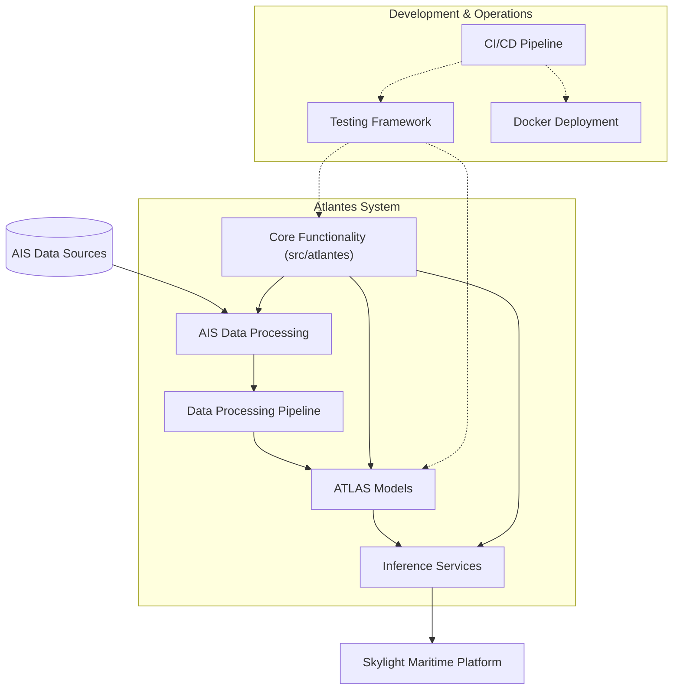
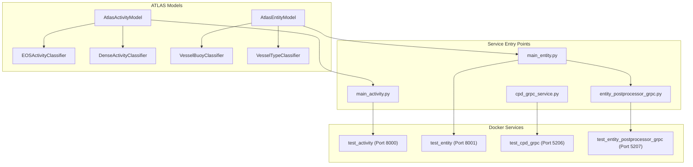
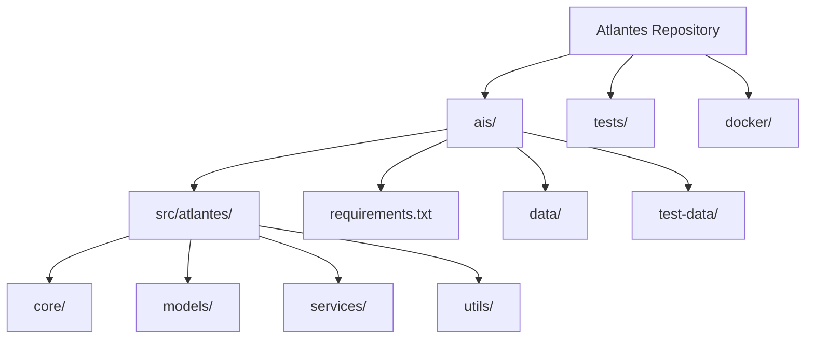
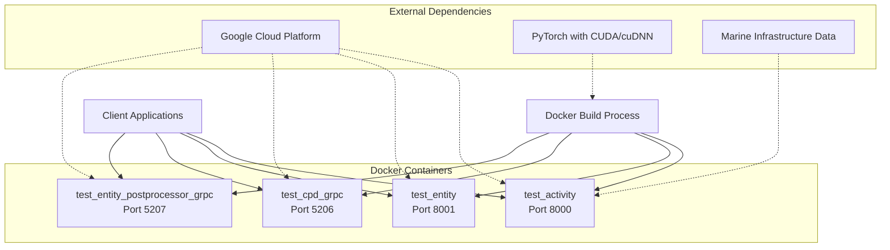

<!-- source: DeepWiki mcp.deepwiki.com · repo allenai/atlantes · page 1 Overview · fetched 2026-10-26 -->

# Overview

Relevant source files

The following files were used as context for generating this wiki page:

- [README.md](README.md)
- [ais/README.md](ais/README.md)

Atlantes is a real-time global-scale GPS trajectory modeling system developed at AI2, currently deployed in the Skylight maritime intelligence platform. The system processes AIS (Automatic Identification System) data to model vessel trajectories and classify vessel activities and entities.

## Purpose and Scope

This page provides a high-level overview of the Atlantes repository and system architecture. Atlantes is designed to analyze vessel movement patterns using AIS data and provide insights through:

- Processing and cleaning AIS data streams
- Training machine learning models on vessel trajectories
- Classifying vessel activities (fishing, anchored, transiting, etc.)
- Identifying entity types (vessel vs. buoy, vessel type classification)
- Providing real-time inference services through standardized APIs

This overview focuses on the system's core components and how they interact. For detailed implementation specifics, refer to the respective wiki pages for each component.

Sources: [README.md:3-6]()

## System Architecture

### High-Level System Components

The architecture diagram shows how data flows from AIS data sources through the Atlantes system and ultimately to the Skylight maritime platform. The system's core functionality is implemented in the `src/atlantes` directory, which contains modules for AIS data processing, ATLAS models, and inference services.

Sources: [README.md:8-21](), [ais/README.md:14-25]()

### Data Processing Flow

```mermaid
flowchart LR
    AISData[("AIS Data")] --> DataIngestion["Data Ingestion"]
    DataIngestion --> DataCleaning["Data Cleaning"]
    DataCleaning --> FeatureEngineering["Feature Engineering"]
    
    FeatureEngineering --> TrainingDataset["Training Dataset"]
    FeatureEngineering --> InferenceDataset["Inference Dataset"]
    
    TrainingDataset --> ModelTraining["Model Training"]
    ModelTraining --> TrainedModels["Trained ATLAS Models"]
    
    InferenceDataset --> InferencePipeline["Inference Pipeline"]
    TrainedModels --> InferencePipeline
    
    MarineData["Marine Infrastructure Data"] --> InferencePipeline
    
    InferencePipeline --> ActivityClassification["Activity Classification"]
    InferencePipeline --> EntityClassification["Entity Classification"]
    
    ActivityClassification --> ActivityPostprocessing["Activity Postprocessing"]
    EntityClassification --> EntityPostprocessing["Entity Postprocessing"]
    
    ActivityPostprocessing --> GRPC["gRPC Services"]
    EntityPostprocessing --> GRPC
    
    GRPC --> Clients["Client Applications"]
```

This diagram illustrates how AIS data flows through the system, from ingestion to final classification results. The system handles both training and inference pathways, with the trained ATLAS models being used to classify activities and entities.

Sources: [ais/README.md:110-122]()

## Core Components

### ATLAS Models

The core functionality of Atlantes is provided by the ATLAS (AIS Transformer Learning with Active Subpaths) models. These models are implemented using PyTorch and are designed to process AIS trajectories.

| Model Type | Classification Tasks | Description |
|------------|----------------------|-------------|
| ATLAS Activity Model | End of Sequence (EOS) Activity Classification | Classifies the activity at the end of a trajectory |
| ATLAS Activity Model | Dense Activity Classification | Classifies activities throughout a trajectory |
| ATLAS Entity Model | Vessel vs. Buoy Classification | Determines whether an AIS signal is from a vessel or buoy |
| ATLAS Entity Model | Vessel Type Classification | Identifies vessel types (fishing, cargo, tanker, etc.) |

Sources: [ais/README.md:16-25]()

### Model to Service Mapping

This diagram shows how the ATLAS models are connected to the service entry points and Docker containers. The models are implemented in the `src/atlantes/models` directory, and the service entry points are in the root directory. The Docker containers expose the services on specific ports.

Sources: [ais/README.md:91-107]()

### Inference Services

Atlantes provides several services for real-time inference:

| Service | Description | Implementation | Port |
|---------|-------------|----------------|------|
| Activity Service | Provides activity classification for vessel trajectories | `main_activity.py` | 8000 |
| Entity Service | Provides entity classification for AIS trajectories | `main_entity.py` | 8001 |
| CPD Service | Provides contextual property detection | `cpd_grpc_service.py` | 5206 |
| Entity Postprocessor | Processes the outputs of the entity service | `entity_postprocessor_grpc.py` | 5207 |

These services are exposed through gRPC interfaces, allowing them to be easily integrated into larger systems like the Skylight maritime platform.

Sources: [ais/README.md:91-107]()

## Repository Structure

The Atlantes repository is organized into several top-level directories:

| Directory | Purpose |
|-----------|---------|
| `ais` | Contains scripts and modules for loading, cleaning, and preprocessing AIS data |
| `src/atlantes` | Holds the core logic for the Atlantes system, including data processing, model training, and deployment |
| `requirements.txt` | Specifies the required Python packages for running the Atlantes system |
| `data` | Stores various AIS-related data files used throughout the project in a non-production environment |
| `tests` | Contains unit tests and integration tests for the Atlantes system |
| `test-data` | Contains test data for the Atlantes system |

Sources: [README.md:8-21]()

## Core Libraries and Technologies

Atlantes relies on several key libraries and technologies:

| Library/Technology | Purpose |
|-------------------|---------|
| PyTorch | Building and training the machine learning models |
| Dask | Parallel and distributed data processing |
| Pandas | Data manipulation, visualization, and analysis |
| Pandera | Schema-based approach to validate Dataframes |
| Weights & Biases (wandb) | Experiment tracking |
| Beaker | AI2's experimentation platform |
| Google Cloud Platform (GCP) | Storing and accessing AIS data |
| Docker | Containerizing and deploying the services |

Sources: [ais/README.md:26-34]()

## Deployment Architecture

This diagram shows the deployment architecture of the Atlantes system, with Docker containers exposing the various services on specific ports. The system depends on Google Cloud Platform for data storage and PyTorch with CUDA/cuDNN for machine learning capabilities.

Sources: [ais/README.md:103-107]()

## Where to Go Next

To learn more about specific aspects of the Atlantes system, refer to the following wiki pages:

- [Repository Structure](#1.1): Details about the organization of the repository, including main directories and their purposes.
- [System Architecture](#1.2): A more detailed overview of the system's architecture, including the relationships between components.
- [ATLAS Models](#2.1): Information about the ATLAS models used for activity and entity classification.
- [Data Processing Pipeline](#2.2): Details about how AIS data is processed, transformed, and prepared for model training and inference.
- [Inference Services](#2.3): Information about the services that provide inference capabilities.
- [Development Guide](#3): Guidance for developers working on the Atlantes system.
- [Deployment](#4): Information on how the system is deployed and operated.

---

