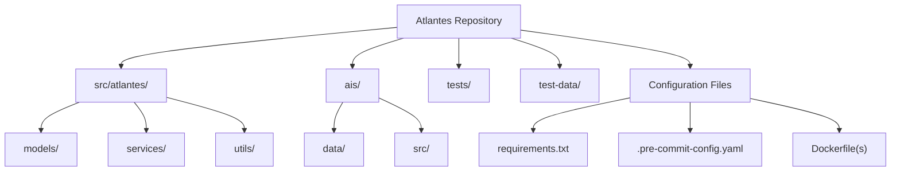
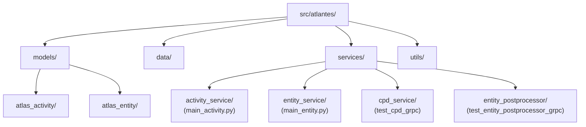
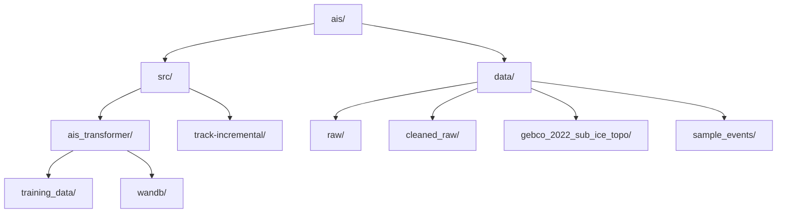
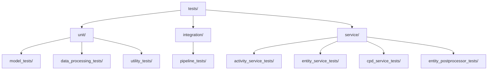

<!-- source: DeepWiki mcp.deepwiki.com · repo allenai/atlantes · page 1.1 Repository Structure · fetched 2026-10-26 -->

# Repository Structure

Relevant source files

The following files were used as context for generating this wiki page:

- [.gitignore](.gitignore)
- [README.md](README.md)

This document provides an overview of the Atlantes repository structure, explaining the organization of directories and files. It serves as a map to help developers navigate the codebase and understand where different components are located. For information about how these components interact, see [System Architecture](#1.2).

## High-Level Directory Structure

The Atlantes repository is organized into a logical hierarchy that separates core functionality, data processing, testing, and deployment resources. This structure supports the development and operation of a real-time GPS trajectory modeling system focused on maritime vessel tracking via AIS data.

### Top-Level Directory Structure

Sources: [README.md:8-18]()

## Source Code Organization

### Core Source Code in `src/atlantes/`

The `src/atlantes/` directory contains the core logic of the Atlantes system, including the ATLAS models for activity and entity classification, data processing pipelines, and inference services.

### Core Components Organization

Sources: [README.md:14]()

### AIS Data Processing in `ais/`

The `ais/` directory contains scripts and modules specific to AIS (Automatic Identification System) data processing, including data loading, cleaning, and preprocessing.

### AIS Directory Structure

Sources: [README.md:13](), [.gitignore:1-16]()

## Data Directories

### `ais/data/`

This directory stores various AIS-related data files used throughout the project in a non-production environment:

| Subdirectory | Purpose |
|--------------|---------|
| `raw/` | Raw AIS data from various sources |
| `cleaned_raw/` | Cleaned AIS data ready for processing |
| `gebco_2022_sub_ice_topo/` | Geographic data files (.nc NetCDF format) |
| `sample_events/` | Sample event data (includes sentinel2/iceberg_detection_dataset.csv) |

Sources: [README.md:16](), [.gitignore:5-6](), [.gitignore:13-15]()

### `test-data/`

Contains test data used for unit tests, integration tests, and service tests. This data is typically smaller and more controlled than the data in `ais/data/`.

Sources: [README.md:18]()

## Testing Structure

### `tests/`

Contains unit tests, integration tests, and service tests for the Atlantes system. The tests are organized to mirror the structure of the source code.

### Testing Directory Organization

Sources: [README.md:17]()

## Configuration Files

The repository contains several configuration files at the root level:

| File | Purpose |
|------|---------|
| `requirements.txt` | Specifies the required Python packages for running the Atlantes system and development tools |
| `.pre-commit-config.yaml` | Configuration for pre-commit hooks that enforce code quality standards |
| `Dockerfile(s)` | Docker configurations for containerizing the services |

Sources: [README.md:15](), [README.md:23-32]()

## Development Tools and Standards

The Atlantes repository enforces strict code quality standards through pre-commit hooks:

- 100% static type annotations (enforced via `mypy`)
- At least 90% documentation coverage for modules and functions (enforced via `interrogate`)
- Code formatting with `black`
- Linting with `ruff`

These standards ensure code quality, readability, and maintainability across the entire codebase.

Sources: [README.md:23-32](), [README.md:40-50]()

## Deployment Resources

The repository includes resources for deploying the Atlantes system as Docker containers, with separate containers for each service:

| Service | Container | Port |
|---------|-----------|------|
| Activity Service | `test_activity` | 8000 |
| Entity Service | `test_entity` | 8001 |
| CPD Service | `test_cpd_grpc` | 5206 |
| Entity Postprocessor | `test_entity_postprocessor_grpc` | 5207 |

This containerized approach allows for flexible deployment and scaling of the different components of the system.

Sources: Based on the system architecture diagrams provided, particularly the "Deployment Architecture" diagram.

---

