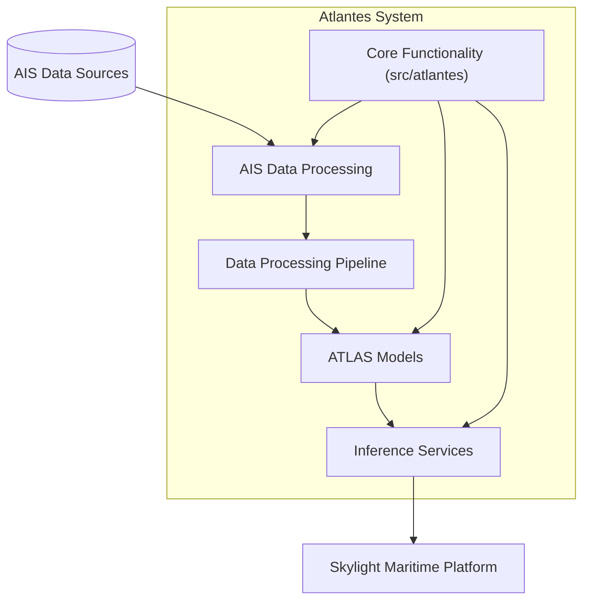
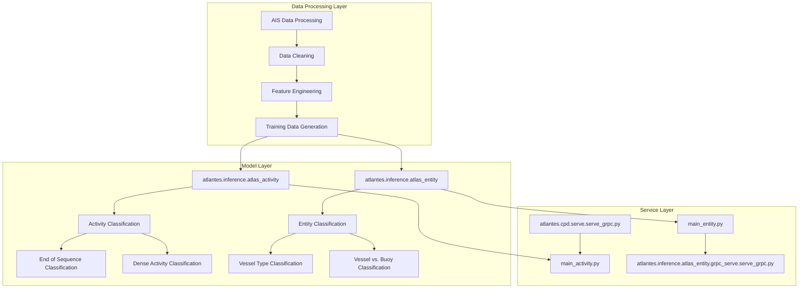
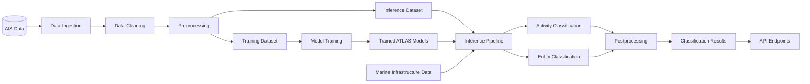
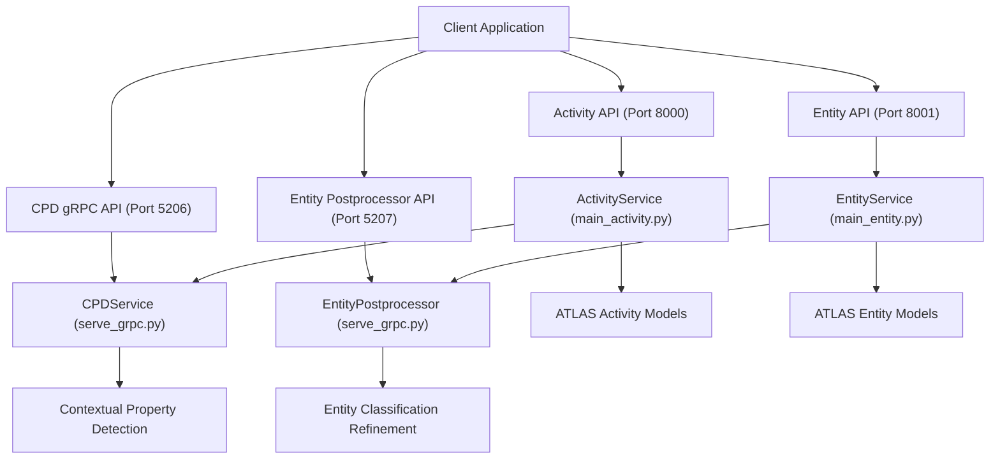
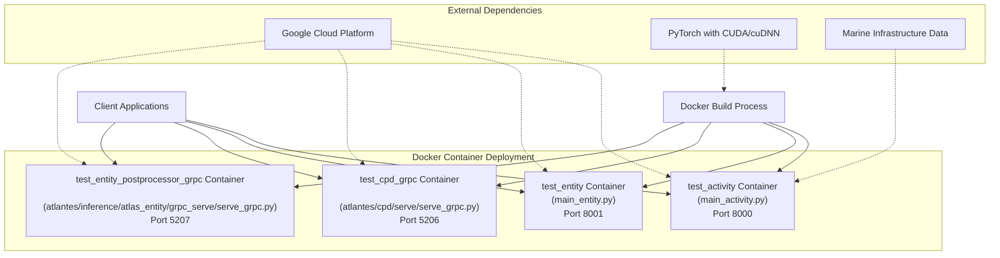
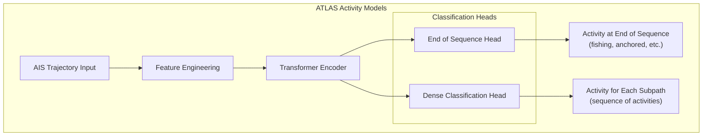
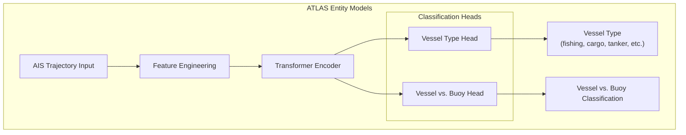
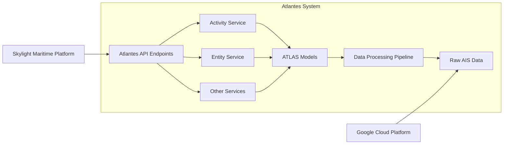

<!-- source: DeepWiki mcp.deepwiki.com · repo allenai/atlantes · page 1.2 System Architecture · fetched 2026-10-26 -->

# System Architecture

Relevant source files

The following files were used as context for generating this wiki page:

- [README.md](README.md)
- [ais/README.md](ais/README.md)
- [ais/docker-compose.yml](ais/docker-compose.yml)

This page provides a comprehensive overview of the Atlantes system architecture, explaining how the various components interact to process AIS data and generate vessel activity and entity classifications. For specific details about the repository structure, see [Repository Structure](#1.1), and for more information about individual components, see [Core Components](#2).

## Overview

Atlantes is a real-time global-scale GPS trajectory modeling system that processes Automatic Identification System (AIS) data to model vessel trajectories and classify vessel activities and entities. The system is deployed in the Skylight maritime intelligence platform and provides various analytical capabilities through specialized services.

Sources: [README.md:3-6](), [ais/README.md:1-8]()

## Core Components and Relationships

The Atlantes system consists of several key components that work together to process AIS data and provide analytical insights:

1. **Core Functionality** - Located in `src/atlantes`, this contains the fundamental logic and utilities used throughout the system.
2. **AIS Data Processing** - Handles the loading, cleaning, and preprocessing of AIS data.
3. **ATLAS Models** - The machine learning models that perform activity and entity classification.
4. **Data Processing Pipeline** - Transforms raw AIS data into features for model training and inference.
5. **Inference Services** - Provides API endpoints for model inference and result delivery.

Sources: [ais/README.md:14-24](), [ais/docker-compose.yml:9-100]()

## Data Flow Architecture

The following diagram illustrates how data flows through the Atlantes system, from ingestion to final results:

Sources: [ais/README.md:14-26]()

## Service Architecture

Atlantes provides multiple services that offer different analytical capabilities. Each service runs as a separate process with its own API endpoints:

### Main Services

| Service | File Path | Description | Port |
|---------|-----------|-------------|------|
| Activity Service | `src/main_activity.py` | Provides activity classification capabilities | 8000 |
| Entity Service | `src/main_entity.py` | Provides entity classification capabilities | 8001 |
| CPD gRPC Service | `src/atlantes/cpd/serve/serve_grpc.py` | Provides contextual property detection | 5206 |
| Entity Postprocessor | `src/atlantes/inference/atlas_entity/grpc_serve/serve_grpc.py` | Performs postprocessing on entity classification results | 5207 |

Each service has specific responsibilities:

1. **Activity Service**: Classifies vessel activities such as fishing, anchoring, and transiting
2. **Entity Service**: Classifies entity types (vessel vs. buoy, vessel types)
3. **CPD Service**: Detects contextual properties to enhance activity classification
4. **Entity Postprocessor**: Performs additional processing on entity classification results

Sources: [ais/docker-compose.yml:9-100]()

## Deployment Architecture

Atlantes is deployed using Docker containers, with each service running in its own container. The following diagram illustrates the deployment architecture:

Sources: [ais/docker-compose.yml:1-100]()

## ATLAS Model Architecture

The ATLAS (AIS Transformer Learning with Active Subpaths) models are the core machine learning components of the system:

### Activity Classification Models

### Entity Classification Models

Sources: [ais/README.md:14-26]()

## System Integration

The Atlantes system is integrated with the Skylight maritime intelligence platform, providing real-time analytics for maritime vessel tracking and monitoring. The system communicates with external services and data sources through its API endpoints, making it a modular and extensible architecture.

Sources: [README.md:3-6](), [ais/README.md:1-8]()

---

