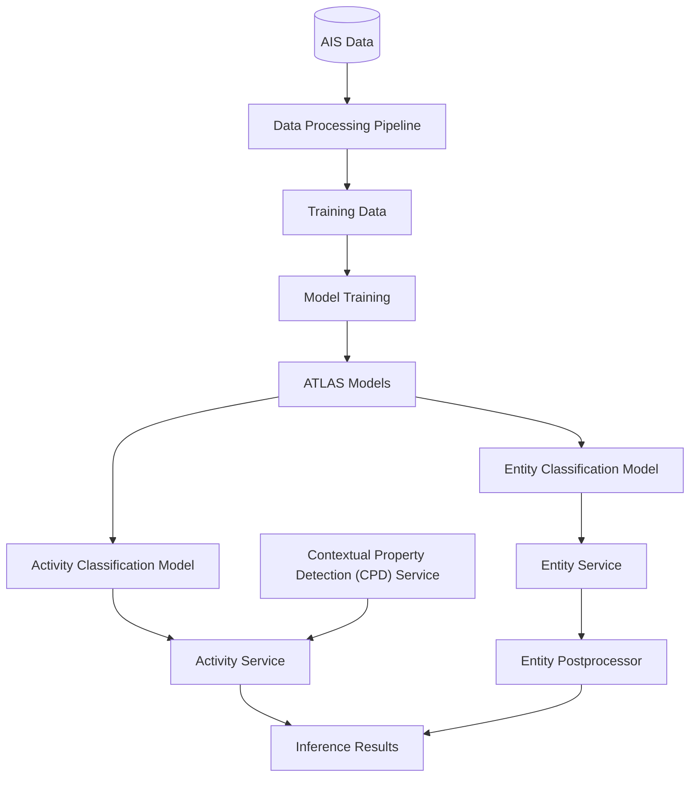
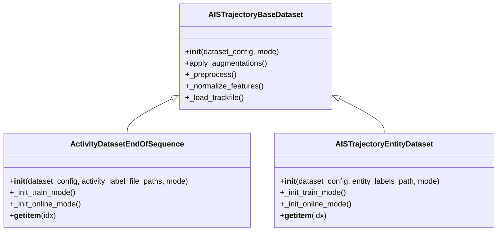
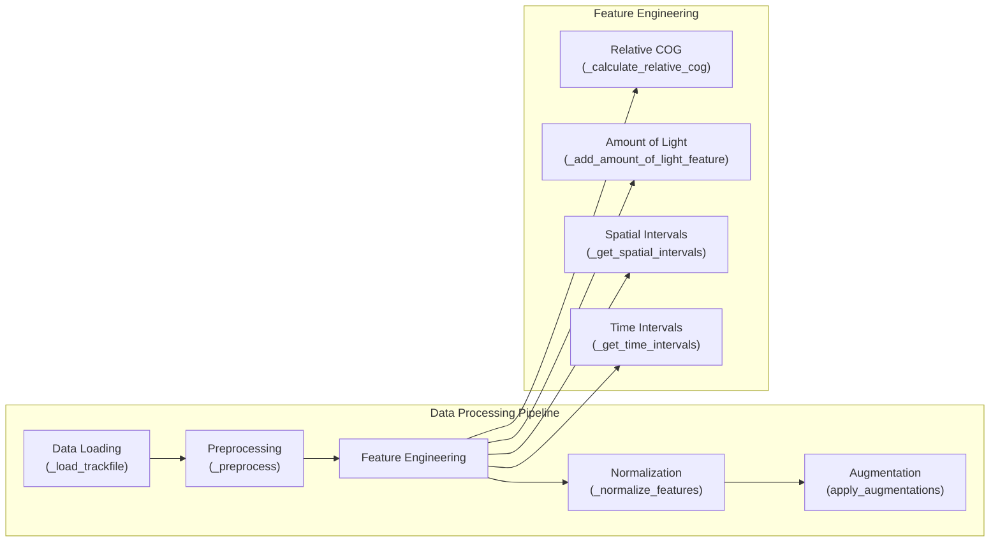
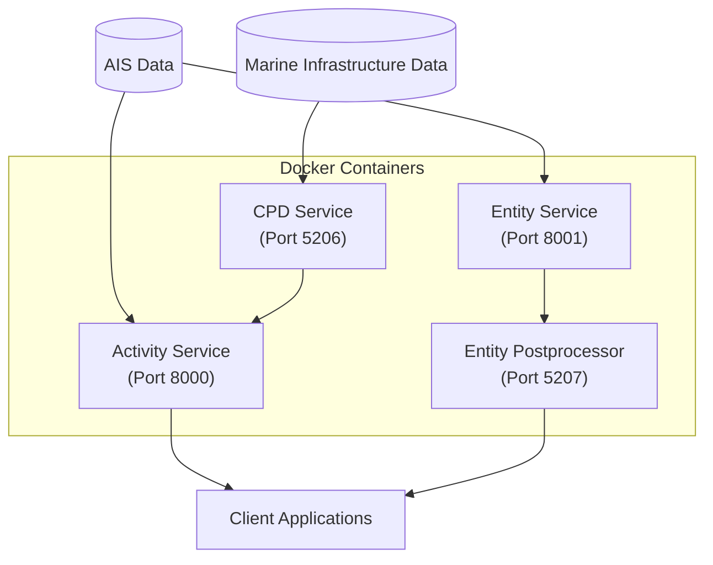
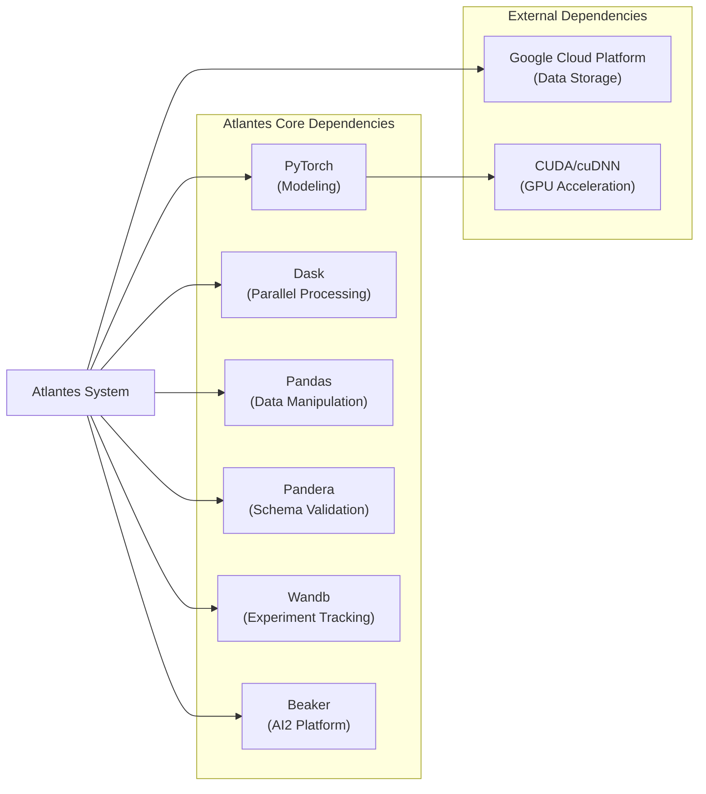
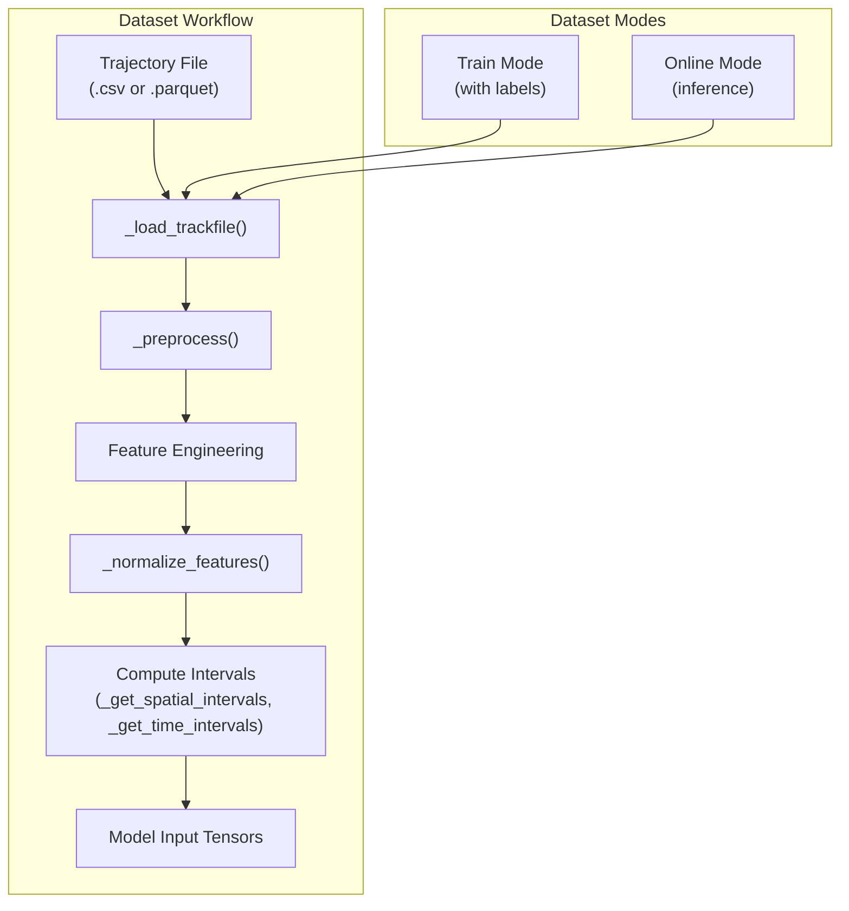
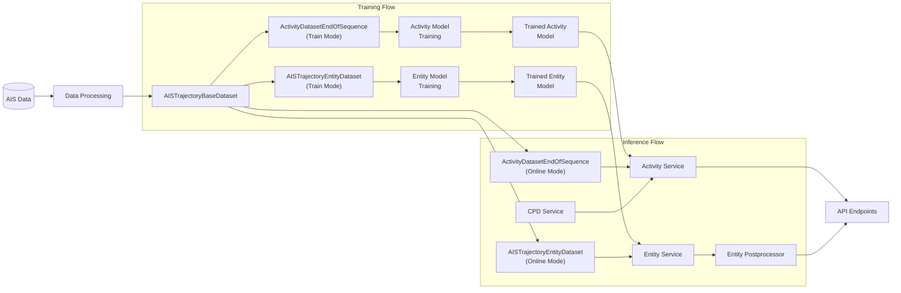

<!-- source: DeepWiki mcp.deepwiki.com · repo allenai/atlantes · page 2 Core Components · fetched 2026-10-26 -->

# Core Components

Relevant source files

The following files were used as context for generating this wiki page:

- [ais/README.md](ais/README.md)
- [ais/src/atlantes/atlas/ais_dataset.py](ais/src/atlantes/atlas/ais_dataset.py)

This page provides an overview of the primary functional components that make up the Atlantes system. Atlantes is a real-time GPS trajectory modeling system for processing maritime AIS (Automatic Identification System) data to classify vessel activities and entities. This page summarizes the main components and how they interact to form the complete system.

For detailed information about system architecture, see [System Architecture](#1.2). For more specifics on individual components, refer to the subpages on [ATLAS Models](#2.1), [Data Processing Pipeline](#2.2), and [Inference Services](#2.3).

## Core Components Overview

Atlantes consists of several interconnected components that work together to process AIS data and provide vessel activity and entity classifications:

Sources: [ais/README.md:16-25](). This diagram reflects the Atlantes AIS modeling tasks described in lines 16-25 of the README, showing the two main classification tasks.

## ATLAS Models

At the core of Atlantes are two main machine learning model systems collectively referred to as ATLAS (AIS Transformer Learning with Active Subpaths):

### Activity Classification Models

The Activity Classification models focus on determining what vessels are doing based on their movement patterns:

1. **End of Sequence Activity Classification**: Classifies the activity of a vessel at the end of a trajectory (e.g., fishing, anchored, transiting).
2. **Dense Activity Classification**: Classifies the activity for each subpath within a trajectory, providing a more granular view of vessel behavior over time.

### Entity Classification Models

The Entity Classification models focus on identifying what type of entity is transmitting AIS data:

1. **Vessel vs. Buoy Classification**: Distinguishes whether an AIS signal is coming from a vessel or a stationary buoy.
2. **Vessel Type Classification**: Identifies the specific type of vessel (e.g., fishing vessel, cargo ship, tanker).

Sources: [ais/src/atlantes/atlas/ais_dataset.py:60-1119]()

## Data Processing Pipeline

The Data Processing Pipeline handles the ingestion, cleaning, and transformation of AIS data for both model training and inference.

### Key Components of the Data Processing Pipeline:

1. **Data Loading**: Reading and parsing AIS data from various sources (CSV, Parquet).
2. **Preprocessing**: Cleaning and standardizing the raw AIS data.
3. **Feature Engineering**: Computing derived features such as:
   - Relative course over ground (rel_cog)
   - Amount of light (based on solar position)
   - Spatial intervals (using haversine distance)
   - Temporal intervals (time between AIS messages)
4. **Normalization**: Applying various transformations to features (sqrt, log, z-scaling).
5. **Augmentation**: Data augmentation for training robustness.

Sources: [ais/src/atlantes/atlas/ais_dataset.py:299-401]()

## Inference Services

Atlantes provides several services that expose the ATLAS models for real-time inference:

### Key Inference Services

1. **Activity Service**: Classifies vessel activities using the ATLAS Activity Model.
2. **Entity Service**: Classifies vessels and buoys using the ATLAS Entity Model.
3. **Entity Postprocessor**: Post-processes entity classification results.
4. **Contextual Property Detection (CPD) Service**: Provides contextual information to the Activity Service.

These services are exposed through gRPC interfaces and are typically deployed as Docker containers.

Sources: [ais/README.md:119-122](), referring to the deployment documentation mentioned in the README.

## Core Libraries and Dependencies

Atlantes relies on several key libraries and frameworks for its functionality:

| Library | Purpose |
|---------|---------|
| PyTorch | Deep learning framework for model implementation |
| Dask | Parallel and distributed data processing |
| Pandas | Data manipulation and analysis |
| Pandera | Schema-based validation for DataFrames |
| Wandb | Experiment tracking |
| Beaker | AI2 experimentation platform |

The system also requires authentication to Google Cloud Platform (GCP) for accessing AIS data and weights and biases for experiment tracking.

Sources: [ais/README.md:26-33]()

## Dataset Classes

The dataset components are critical for both training and inference. Atlantes implements specialized dataset classes for handling AIS trajectory data:

### Base Dataset Class

The `AISTrajectoryBaseDataset` serves as the foundation for all trajectory datasets, providing common functionality for:
- Loading and preprocessing trajectory data
- Computing spatiotemporal intervals for the Continuous Point Embedding (CPE)
- Normalizing features
- Applying data augmentations

### Specialized Dataset Classes

1. **ActivityDatasetEndOfSequence**: Handles data for activity classification
   - Loads trajectory and corresponding activity labels
   - Prepares input features and labels for the activity model
   - Supports both training and online (inference) modes

2. **AISTrajectoryEntityDataset**: Handles data for entity classification
   - Loads trajectory and corresponding entity labels
   - Prepares input features and labels for the entity model
   - Supports both training and online (inference) modes

Sources: [ais/src/atlantes/atlas/ais_dataset.py:60-119](), [ais/src/atlantes/atlas/ais_dataset.py:537-923](), [ais/src/atlantes/atlas/ais_dataset.py:928-1119]()

## Data Flow Through Components

To understand how the components work together, here's a data flow diagram showing how AIS data is processed through the system:

Sources: [ais/src/atlantes/atlas/ais_dataset.py:145-148](), [ais/src/atlantes/atlas/ais_dataset.py:585-616](), [ais/src/atlantes/atlas/ais_dataset.py:985-987](), [ais/README.md:90-95]()

This data flow diagram shows how AIS data moves through the system from initial processing to final API endpoints, including both the training and inference paths.

---

