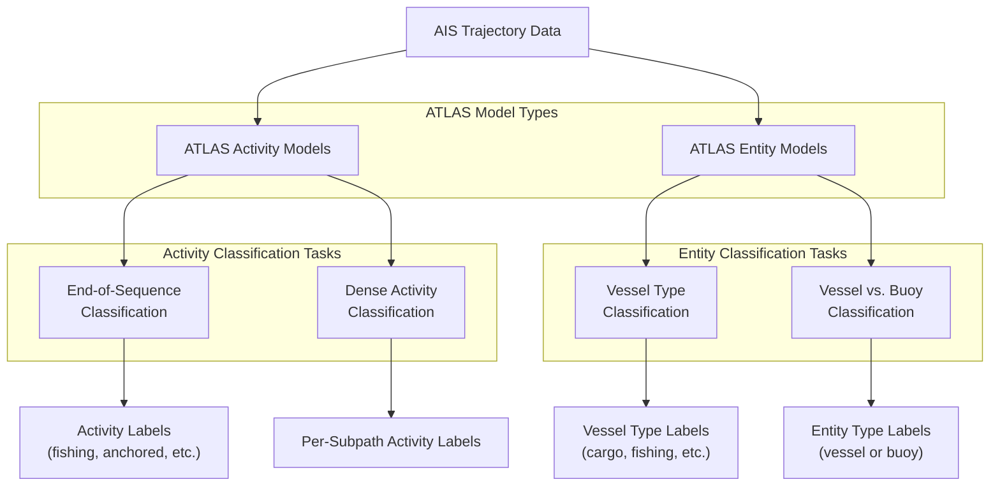
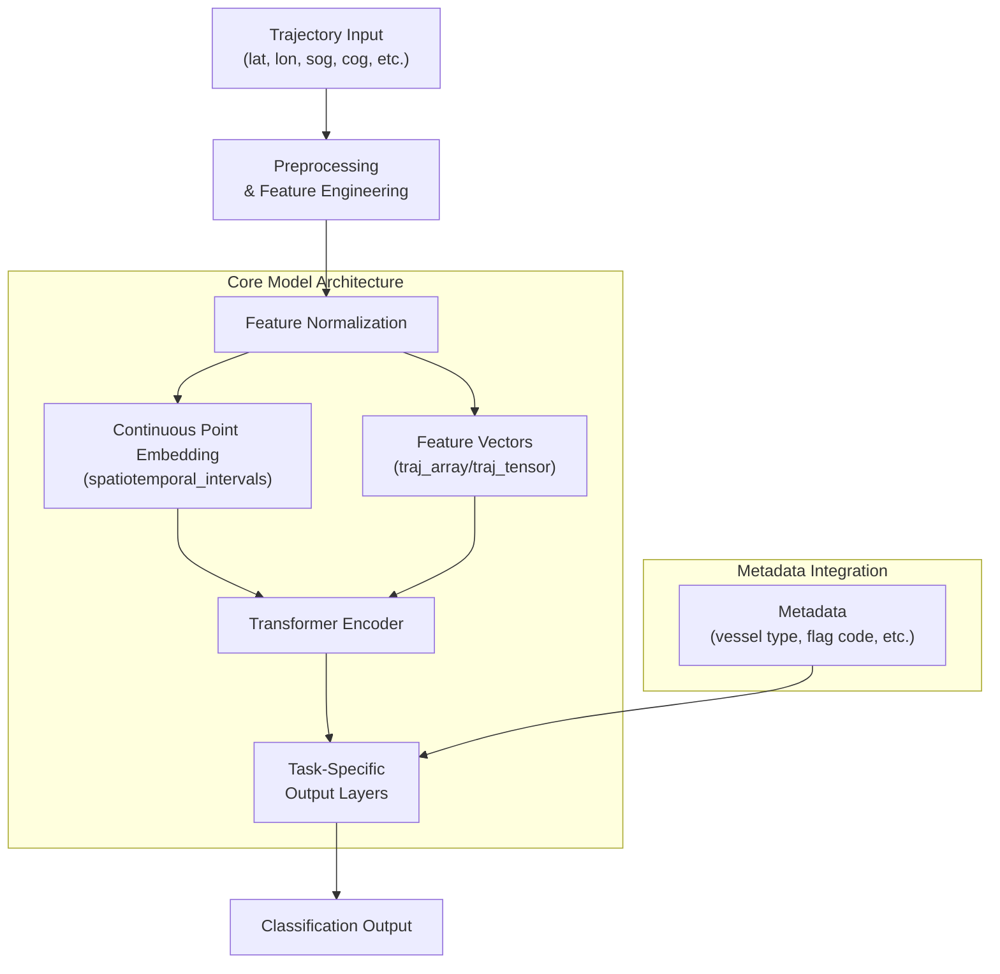
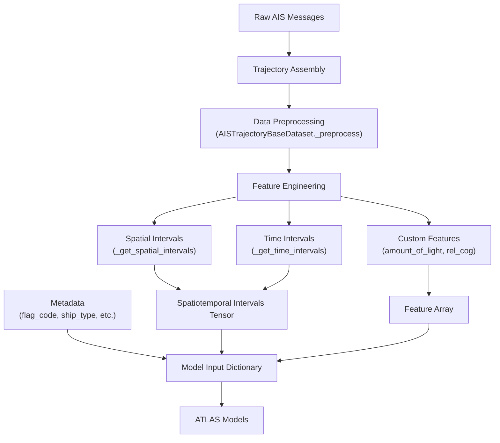
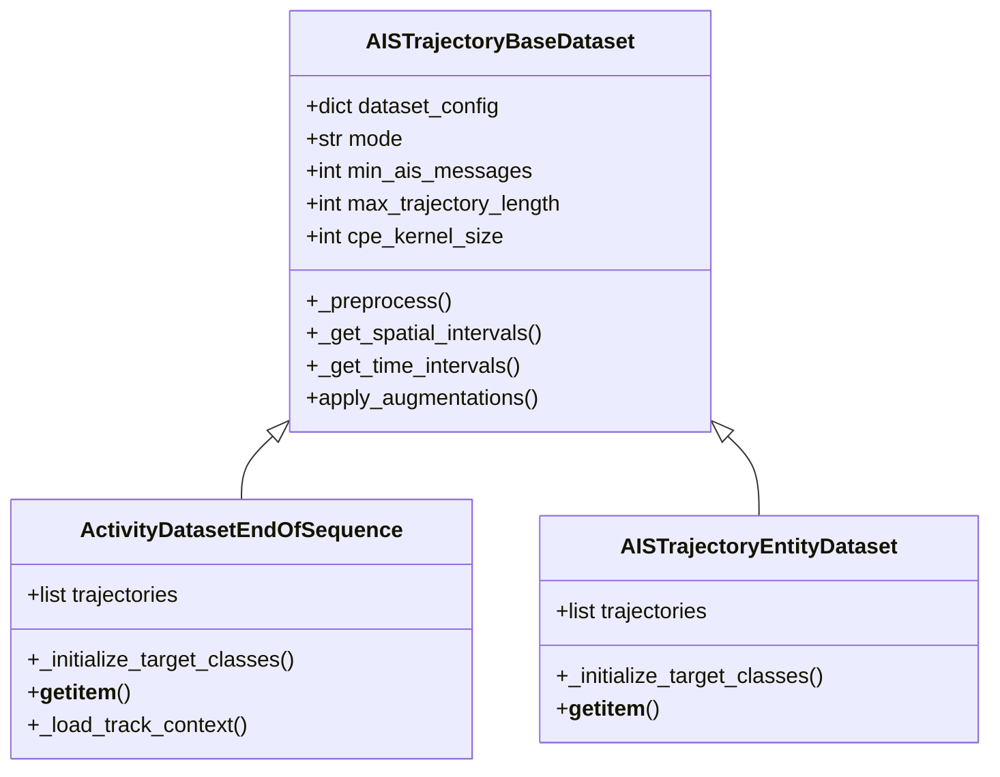

<!-- source: DeepWiki mcp.deepwiki.com · repo allenai/atlantes · page 2.1 ATLAS Models · fetched 2026-10-26 -->

# ATLAS Models

<details>
<summary>Relevant source files</summary>

The following files were used as context for generating this wiki page:

- [ais/README.md](ais/README.md)
- [ais/examples/atlas_activity_request.py](ais/examples/atlas_activity_request.py)
- [ais/examples/atlas_entity_buoy_vessel_request.py](ais/examples/atlas_entity_buoy_vessel_request.py)
- [ais/src/atlantes/atlas/ais_dataset.py](ais/src/atlantes/atlas/ais_dataset.py)

</details>


This document details the ATLAS (AIS Transformer Learning with Active Subpaths) models used in the Atlantes system. These models are the core machine learning components that process AIS (Automatic Identification System) trajectory data to classify maritime vessel activities and entity types. For information about how these models are deployed as services, see [Inference Services](#2.3).

## Overview of ATLAS Models

ATLAS models are specialized neural network architectures designed to analyze time-series GPS trajectory data from vessels. They form the analytical backbone of the Atlantes system, enabling real-time classification of vessel behaviors and characteristics.



Sources: [ais/README.md:15-24]()

## ATLAS Model Architecture

The ATLAS models use a transformer-based architecture optimized for spatial-temporal data processing. They incorporate continuous point embeddings to capture the nuances of vessel movement patterns across varying time and space intervals.



Sources: [ais/src/atlantes/atlas/ais_dataset.py:61-91](), [ais/src/atlantes/atlas/ais_dataset.py:250-332]()

## ATLAS Activity Models

ATLAS Activity models analyze vessel trajectories to classify the activities being performed by vessels. These models come in two variants:

### End of Sequence Activity Classification

This model classifies the activity of a vessel based on the entire trajectory, particularly focused on the end of the sequence. It determines what a vessel was doing at the end of its observed track (e.g., fishing, anchored, transiting).

Key features:
- Works with trajectories of at least `MIN_AIS_MESSAGES` messages (configurable parameter)
- Produces a single activity label for the trajectory
- Used for real-time activity monitoring and historical analysis

### Dense Activity Classification 

This model provides activity classification for each subpath within a trajectory, enabling detailed analysis of how a vessel's activities change over time.

Key features:
- Analyzes activity changes throughout a journey
- Outputs multiple labels across the trajectory
- Useful for detailed behavior analysis and pattern detection

Sources: [ais/README.md:16-19](), [ais/src/atlantes/atlas/ais_dataset.py:537-922]()

## ATLAS Entity Models

ATLAS Entity models classify the type of entity sending AIS signals. These models address two main classification tasks:

### Vessel vs. Buoy Classification

This model distinguishes whether an AIS transmitter is aboard a vessel or attached to a stationary buoy.

Key features:
- Analyzes movement patterns to differentiate mobile vessels from stationary markers
- Helps filter out non-vessel signals from analysis
- Important for improving data quality in maritime monitoring

### Vessel Type Classification

This model identifies the type of vessel (e.g., fishing vessel, cargo ship, tanker) based on its movement patterns.

Key features:
- Classifies vessels into different categories based on trajectory characteristics
- Supports identification even when vessel type metadata is missing or inaccurate
- Critical for maritime domain awareness and regulatory compliance monitoring

Sources: [ais/README.md:22-24](), [ais/src/atlantes/atlas/ais_dataset.py:928-1119]()

## Data Processing and Input Format

The ATLAS models ingest AIS trajectory data that has been preprocessed into a structured format. The system handles various input formats and performs necessary transformations.



### Key Input Components

1. **Trajectory Data**: Series of AIS messages with positional and navigational data
   - Latitude and longitude
   - Speed over ground (sog)
   - Course over ground (cog)
   - Timestamp (send)
   - Navigation status (nav)
   - Distance to coast (dist2coast)

2. **Spatiotemporal Intervals**: Calculated from the trajectory data
   - Time intervals between points
   - Spatial distances between points
   - Used by the Continuous Point Embedding (CPE) component

3. **Metadata**: Additional information about the vessel
   - MMSI (Maritime Mobile Service Identity)
   - Vessel name
   - Flag code
   - Vessel category/type

Sources: [ais/src/atlantes/atlas/ais_dataset.py:356-465](), [ais/examples/atlas_activity_request.py:23-45](), [ais/examples/atlas_entity_buoy_vessel_request.py:21-28]()

## Model Usage and Inference

The ATLAS models are exposed through HTTP endpoints that accept JSON-formatted requests containing trajectory data.

### Activity Classification Inference

Activity classification requests include a batch of trajectories for classification.

Example request structure:
```
{
    "tracks": [
        {
            "track_id": "test-0",
            "track_data": [
                {"lat": 40.7128, "lon": -74.0060, "sog": 10.5, "cog": 180.0, ...},
                ...
            ]
        }
    ]
}
```

Response contains activity classifications:
```
{
    "predictions": [
        {
            "track_id": "test-0",
            "classification": "fishing",
            "confidence": 0.92
        }
    ]
}
```

### Entity Classification Inference

Entity classification follows a similar request/response pattern but provides entity type classifications.

Example response for entity classification:
```
{
    "predictions": [
        {
            "track_id": "test-0",
            "classification": "cargo_vessel",
            "confidence": 0.87
        }
    ]
}
```

Sources: [ais/examples/atlas_activity_request.py:52-94](), [ais/examples/atlas_entity_buoy_vessel_request.py:35-80]()

## Model Dataset Classes

The ATLAS models use specialized dataset classes to handle training and inference data:



### Key Dataset Features

1. **Mode-based Operations**: Datasets can operate in different modes:
   - `train`: For model training with labeled data
   - `eval`: For model evaluation with labeled data
   - `online`: For inference with unlabeled data

2. **Data Augmentation**: During training, trajectories can be augmented to improve model robustness
   - Configurable augmentation pipeline
   - Supports both composition and random choice of augmentations

3. **Feature Normalization**: Input features are normalized according to configurable strategies
   - z-scaling
   - log transformation
   - square root transformation

4. **Dynamic Context Handling**: Activity models can work with varying context lengths
   - Minimum context requirements for reliable classification
   - Maximum context limits for computational efficiency

Sources: [ais/src/atlantes/atlas/ais_dataset.py:60-136](), [ais/src/atlantes/atlas/ais_dataset.py:537-584](), [ais/src/atlantes/atlas/ais_dataset.py:928-969]()

## Conclusion

The ATLAS models form the core machine learning engine of the Atlantes system, enabling accurate classification of vessel activities and entity types from AIS trajectory data. These models are designed to work with real-time streaming data and can be deployed as services within the larger Atlantes architecture. The modular design allows for different classification tasks to be handled by specialized models, all built on a common foundation of trajectory data processing.

Sources: [ais/README.md:1-10]()

---

