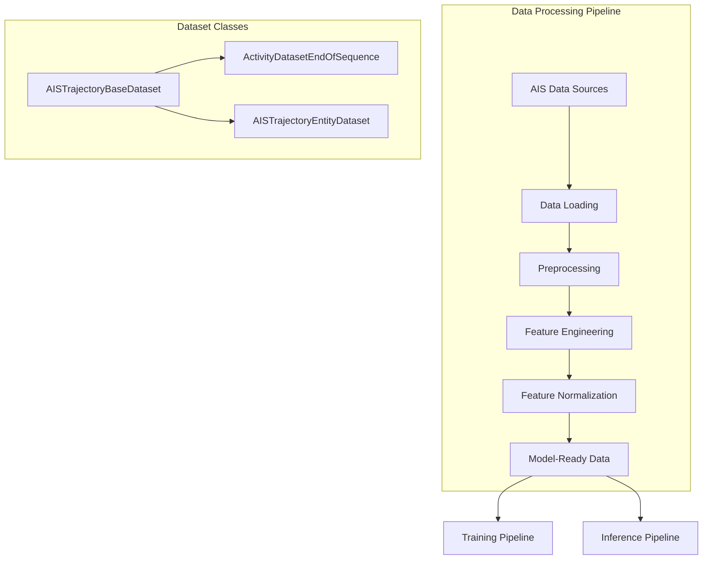
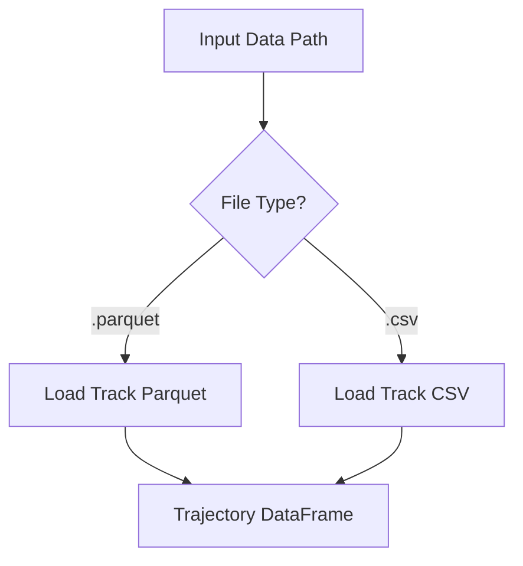
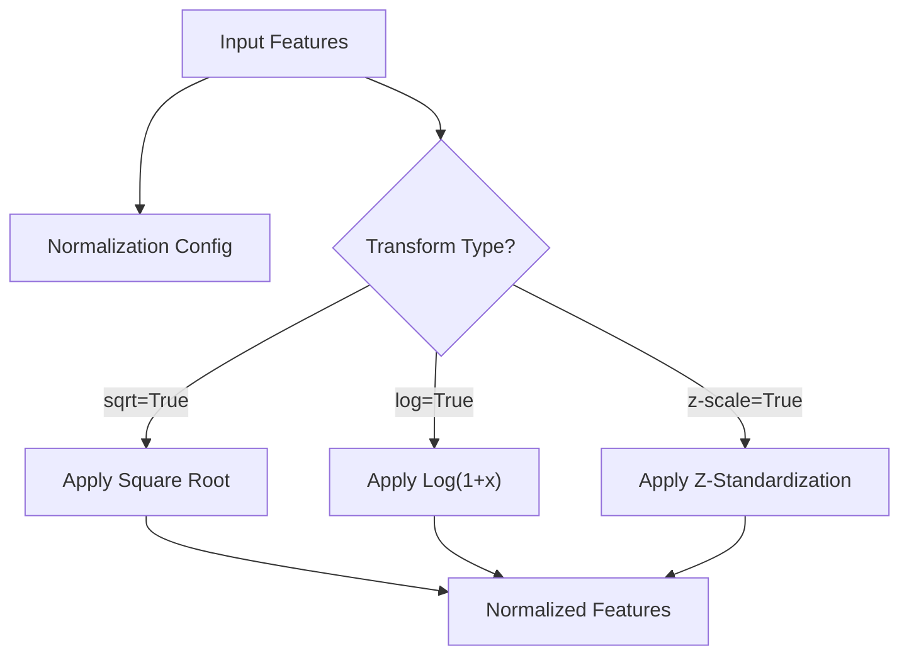
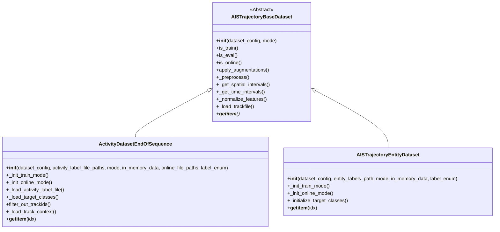

<!-- source: DeepWiki mcp.deepwiki.com · repo allenai/atlantes · page 2.2 Data Processing Pipeline · fetched 2026-10-26 -->

# Data Processing Pipeline

Relevant source files

The following files were used as context for generating this wiki page:

- [ais/src/atlantes/atlas/ais_dataset.py](ais/src/atlantes/atlas/ais_dataset.py)
- [ais/src/atlantes/feedback/run_pipeline_on_local_files.py](ais/src/atlantes/feedback/run_pipeline_on_local_files.py)

## Purpose and Scope

This document describes the data processing pipeline used in Atlantes to transform raw AIS (Automatic Identification System) data into structured formats suitable for model training and inference. The pipeline handles data cleaning, feature engineering, normalization, and preparation for both the ATLAS Activity and Entity models. For information about the ATLAS models themselves, see [ATLAS Models](#2.1).

## Overview of the Pipeline

The data processing pipeline is a critical component connecting raw AIS data to model training and inference. It transforms messy, real-world vessel trajectory data into clean, normalized, feature-rich data ready for machine learning.

Sources: [ais/src/atlantes/atlas/ais_dataset.py:60-535]()

## Data Sources and Format

The pipeline processes AIS data which comes in two primary formats:

1. CSV files with standard AIS fields
2. Parquet files with optimized storage and retrieval

Both formats contain trajectory data for vessels, including geographic coordinates, timestamps, speed, course, vessel identifiers, and metadata.

### Key Data Fields

| Field | Description | Usage |
|-------|-------------|-------|
| `lat` | Latitude | Spatial positioning |
| `lon` | Longitude | Spatial positioning |
| `send` | Timestamp | Temporal information |
| `cog` | Course over ground | Direction of movement |
| `sog` | Speed over ground | Velocity |
| `category` | Vessel type category | Entity classification |
| `trackId` | Unique trajectory identifier | Record linking |
| `mmsi` | Maritime Mobile Service Identity | Vessel identification |
| `flag_code` | Vessel's flag country | Entity attribution |

Sources: [ais/src/atlantes/atlas/ais_dataset.py:467-529]()

## Pipeline Components

### 1. Data Loading

The first step involves loading data from CSV or Parquet files. The system provides specialized methods for both formats and automatically detects the file type.

Sources: [ais/src/atlantes/atlas/ais_dataset.py:467-529]()

### 2. Preprocessing

Raw AIS data requires several preprocessing steps to ensure quality and consistency:

The `_preprocess` method ensures that:
- Data adheres to the expected schema (TrackfileDataModelTrain)
- Records are sorted chronologically
- Data types are correctly coerced
- Any required basic calculations are performed

Sources: [ais/src/atlantes/atlas/ais_dataset.py:334-354]()

### 3. Feature Engineering

The pipeline enriches the data with derived features to improve model performance:

#### Spatiotemporal Features

One key feature engineering aspect is the creation of spatiotemporal intervals, which capture both distance and time relationships between sequential AIS messages:

1. **Spatial Intervals**: Calculates distances in meters between points using the Haversine formula
   - Implementation: `_get_spatial_intervals` method
   
2. **Temporal Intervals**: Calculates time differences in seconds between sequential messages
   - Implementation: `_get_time_intervals` method

3. **Combined Spatiotemporal Intervals**: Stacks both intervals to create a unified representation

Sources: [ais/src/atlantes/atlas/ais_dataset.py:259-332]()

#### Additional Derived Features

The pipeline also calculates:

1. **Relative Course Over Ground (rel_cog)**: Measures the angular difference in the vessel's course between successive points
   - Implementation: `_calculate_relative_cog` method

2. **Amount of Light**: Calculates solar altitude to determine daylight conditions
   - Implementation: `_add_amount_of_light_feature` method

Sources: [ais/src/atlantes/atlas/ais_dataset.py:356-393]()

### 4. Feature Normalization

Raw features have different scales and distributions. The normalization process transforms them into consistent ranges suitable for neural networks:

The pipeline applies different normalization strategies per feature:
- Square root transformation for features with right-skewed distributions
- Log transformation for highly skewed or exponential data
- Z-scale normalization to standardize features to zero mean and unit variance

Sources: [ais/src/atlantes/atlas/ais_dataset.py:403-465]()

## Dataset Classes for Model Training

The pipeline includes specialized dataset classes that inherit from a common base class and prepare data specifically for each model type:

Sources: [ais/src/atlantes/atlas/ais_dataset.py:60-535](), [ais/src/atlantes/atlas/ais_dataset.py:537-922](), [ais/src/atlantes/atlas/ais_dataset.py:928-1119]()

### Base Dataset Class

The `AISTrajectoryBaseDataset` provides common functionality:
- Loading and preprocessing track files
- Calculating spatiotemporal intervals
- Normalizing features
- Applying augmentations when in training mode

Sources: [ais/src/atlantes/atlas/ais_dataset.py:60-535]()

### Activity Classification Dataset

The `ActivityDatasetEndOfSequence` class prepares data for activity classification:
- Loads and processes labeled activity data
- Creates context windows of specified lengths
- Ensures minimum message counts for reliable prediction
- Returns prepared features and labels for training

Sources: [ais/src/atlantes/atlas/ais_dataset.py:537-922]()

### Entity Classification Dataset

The `AISTrajectoryEntityDataset` class prepares data for entity classification:
- Processes vessel type and buoy/vessel classification data
- Filters trajectories based on minimum requirements
- Returns prepared features and labels for entity classification

Sources: [ais/src/atlantes/atlas/ais_dataset.py:928-1119]()

## Data Augmentation

The pipeline supports data augmentation to improve model robustness. Augmentations can be applied in two modes:

1. **Compose mode**: Apply all selected augmentations sequentially
2. **Random choice mode**: Randomly select and apply one augmentation

Augmentations are configured in the dataset configuration and are only applied during training.

Sources: [ais/src/atlantes/atlas/ais_dataset.py:151-225]()

## Pipeline Integration for Inference

The data processing pipeline integrates with the inference system through a streamlined process:

The `AtlasActivityClassifier` encapsulates the entire pipeline for inference:
1. The preprocessor converts raw AIS data into model-ready features
2. The model makes predictions
3. The postprocessor converts model outputs into human-readable results

Sources: [ais/src/atlantes/feedback/run_pipeline_on_local_files.py:16-21](), [ais/src/atlantes/feedback/run_pipeline_on_local_files.py:24-28]()

## Configuration System

The data processing pipeline is highly configurable through a dataset configuration dictionary that specifies:

| Configuration Parameter | Description |
|-------------------------|-------------|
| `MIN_AIS_MESSAGES` | Minimum number of AIS messages required for processing |
| `MAX_TRAJECTORY_LENGTH` | Maximum number of messages to use from a trajectory |
| `CPE_KERNEL_SIZE` | Kernel size for continuous point embedding |
| `FEATURE_NORMALIZATION_CONFIG_ACTIVITY` | Feature-specific normalization settings for activity classification |
| `FEATURE_NORMALIZATION_CONFIG_ENTITY` | Feature-specific normalization settings for entity classification |
| `MODEL_INPUT_COLUMNS_ACTIVITY` | Features to use for activity classification |
| `MODEL_INPUT_COLUMNS_ENTITY` | Features to use for entity classification |
| `AUGMENTATION` | Data augmentation configuration |
| `RANDOM_STATE` | Seed for reproducibility |

Sources: [ais/src/atlantes/atlas/ais_dataset.py:63-97]()

## Conclusion

The data processing pipeline is a critical component of the Atlantes system, transforming raw AIS data into clean, feature-rich data suitable for training and inference. It supports both activity and entity classification tasks with specialized dataset classes and processing methods. The pipeline is designed to be configurable, extensible, and robust to handle the complexities of maritime trajectory data.

---

