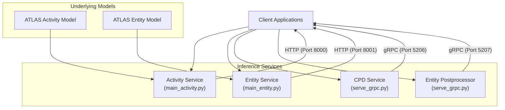
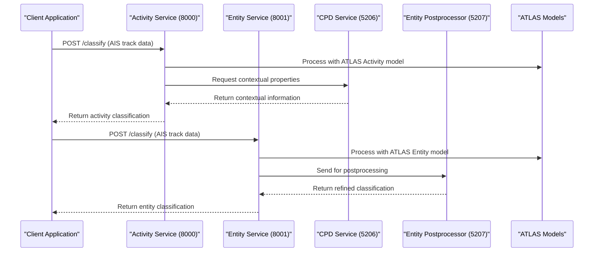

<!-- source: DeepWiki mcp.deepwiki.com · repo allenai/atlantes · page 2.3 Inference Services · fetched 2026-10-26 -->

# Inference Services

<details>
<summary>Relevant source files</summary>

The following files were used as context for generating this wiki page:

- [ais/docker-compose.yml](ais/docker-compose.yml)
- [ais/examples/atlas_activity_request.py](ais/examples/atlas_activity_request.py)
- [ais/examples/atlas_entity_buoy_vessel_request.py](ais/examples/atlas_entity_buoy_vessel_request.py)
- [ais/examples/sample_response.json](ais/examples/sample_response.json)
- [ais/examples/sample_response_entity.json](ais/examples/sample_response_entity.json)

</details>


This page documents the inference services in the Atlantes system, which provide real-time classification capabilities for AIS trajectory data. These services expose the ATLAS models' functionality through standardized interfaces for integration with client applications such as the Skylight maritime platform.

For information about the underlying models, see [ATLAS Models](#2.1). For details on data processing prior to inference, see [Data Processing Pipeline](#2.2).

## Service Architecture

The Atlantes system provides four primary inference services, each handling different aspects of maritime trajectory classification:



Sources: [ais/docker-compose.yml:1-100]()

## Service Details

### Activity Service

The Activity Service provides vessel activity classification (fishing, transiting, etc.) based on AIS trajectory data. It leverages the ATLAS Activity model to classify vessel behavior.

**Endpoint**: `/classify` (HTTP POST)
**Port**: 8000

**Request Format**:
```json
{
  "tracks": [
    {
      "track_id": "example-1",
      "track_data": [
        {"lat": 0.0, "lon": 0.0, "sog": 10.0, "cog": 90.0, ...},
        ...
      ]
    }
  ]
}
```

**Response Format**:
```json
{
  "predictions": [
    [
      "transiting",
      {
        "confidence": 0.919,
        "model": "ATLAS-Activity-Real-Time_...",
        "model_version": "...",
        "original_classification": "transiting",
        "outputs": [0.073, 0.006, 0.001, 0.919],
        "postprocessed_classification": "unknown",
        "rule_applied": "is_near_shore_threshold_applied"
      }
    ]
  ]
}
```

Sources: [ais/examples/atlas_activity_request.py:1-99](), [ais/examples/sample_response.json:1-38](), [ais/docker-compose.yml:9-32]()

### Entity Service

The Entity Service provides classification of vessel types and distinguishes between vessels and buoys based on AIS trajectory data. It's powered by the ATLAS Entity model.

**Endpoint**: `/classify` (HTTP POST)
**Port**: 8001

**Request Format**:
```json
{
  "tracks": [
    {
      "track_id": "example-1",
      "track_data": [
        {"lat": 0.0, "lon": 0.0, "sog": 10.0, "cog": 90.0, ...},
        ...
      ]
    }
  ]
}
```

**Response Format**:
```json
{
  "predictions": [
    [
      "unknown",
      {
        "confidence": 0.997,
        "confidence_threshold": 0.5,
        "model": "ATLAS-Buoy_...",
        "outputs": [0.997, 0.002],
        "postprocess_rule_applied": true,
        "postprocessed_classification": "unknown",
        "predicted_classification": "vessel"
      }
    ]
  ]
}
```

Sources: [ais/examples/atlas_entity_buoy_vessel_request.py:1-81](), [ais/examples/sample_response_entity.json:1-20](), [ais/docker-compose.yml:33-56]()

### CPD Service (Contextual Property Detection)

The CPD Service provides contextual property analysis of maritime vessels through a gRPC interface. This service helps enrich trajectory data with contextual information.

**Interface**: gRPC
**Port**: 5206

The service is implemented in [src/atlantes/cpd/serve/serve_grpc.py]() and exposes methods for contextual property detection.

Sources: [ais/docker-compose.yml:57-78]()

### Entity Postprocessor Service

The Entity Postprocessor Service applies post-processing rules to entity classification results through a gRPC interface. This improves classification accuracy by applying domain-specific knowledge and rules.

**Interface**: gRPC
**Port**: 5207

The service is implemented in [src/atlantes/inference/atlas_entity/grpc_serve/serve_grpc.py]() and handles refinement of entity classifications.

Sources: [ais/docker-compose.yml:79-100]()

## Service Flow

The following diagram illustrates how data flows through the inference services:



Sources: [ais/docker-compose.yml:1-100](), [ais/examples/atlas_activity_request.py:1-99](), [ais/examples/atlas_entity_buoy_vessel_request.py:1-81]()

## Deployment Configuration

All inference services are deployed as Docker containers with specific configuration parameters. The table below summarizes the deployment details for each service:

| Service | Container Name | Port | Command | Health Check |
|---------|---------------|------|---------|-------------|
| Activity Service | test_activity | 8000 | `python3 src/main_activity.py` | nc -zv 127.0.0.1 8000 |
| Entity Service | test_entity | 8001 | `python3 src/main_entity.py` | nc -zv 127.0.0.1 8001 |
| CPD Service | test_cpd_grpc | 5206 | `python3 /ais/src/atlantes/cpd/serve/serve_grpc.py` | nc -zv 127.0.0.1 5206 |
| Entity Postprocessor | test_entity_postprocessor_grpc | 5207 | `python3 /ais/src/atlantes/inference/atlas_entity/grpc_serve/serve_grpc.py` | nc -zv 127.0.0.1 5207 |

All services are configured with a shared memory size of 4.77GB to accommodate model loading and inference operations.

Sources: [ais/docker-compose.yml:1-100]()

## Client Usage

To interact with the inference services, clients can use standard HTTP requests for the Activity and Entity services, and gRPC calls for the CPD and Entity Postprocessor services.

Example code for sending a request to the Activity Service:

```python
import requests
import json

# Prepare AIS track data
track_data = [...] # List of AIS points with lat, lon, sog, cog, etc.

# Construct request
request_body = {
    "tracks": [
        {"track_id": "example-1", "track_data": track_data}
    ]
}

# Send request to Activity Service
response = requests.post(
    "http://localhost:8000/classify",
    json=request_body,
    timeout=600
)

# Process response
if response.ok:
    predictions = response.json()["predictions"]
    for prediction in predictions:
        classification = prediction[0]
        details = prediction[1]
        print(f"Classification: {classification}, Confidence: {details['confidence']}")
```

Similar patterns can be used for the Entity Service, with appropriate modifications to the endpoint URL.

Sources: [ais/examples/atlas_activity_request.py:52-95](), [ais/examples/atlas_entity_buoy_vessel_request.py:35-77]()

---

