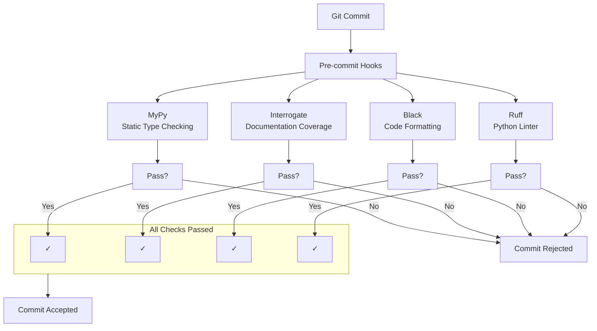
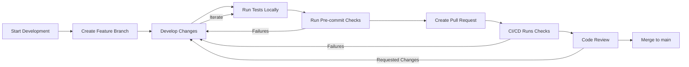
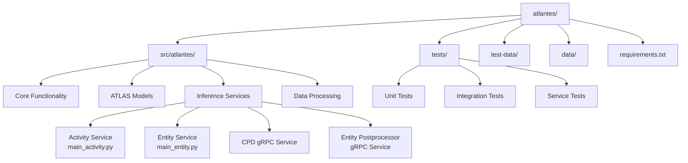
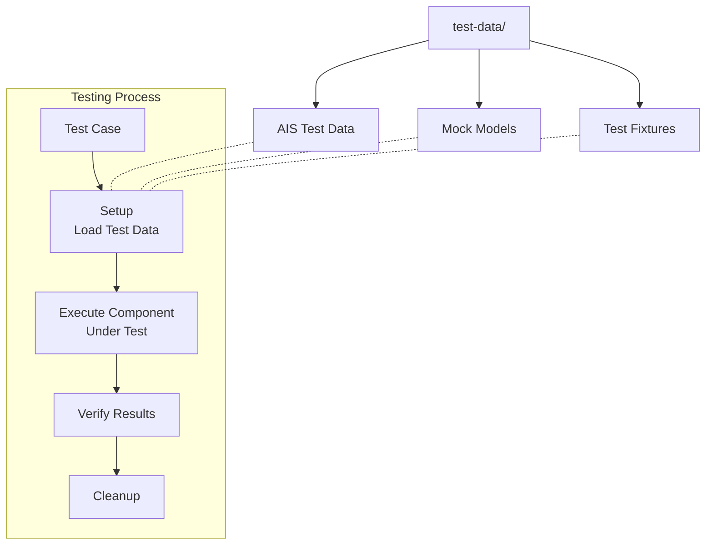

<!-- source: DeepWiki mcp.deepwiki.com · repo allenai/atlantes · page 3 Development Guide · fetched 2026-10-26 -->

# Development Guide

<details>
<summary>Relevant source files</summary>

The following files were used as context for generating this wiki page:

- [.github/workflows/lint.yml](.github/workflows/lint.yml)
- [README.md](README.md)

</details>


This guide provides essential information for developers working on the Atlantes system. It covers the development environment setup, testing framework, and code quality standards. For information about deployment, see [Deployment](#4), and for core components, see [Core Components](#2).

## Development Environment Setup

Setting up your development environment is the first step to contributing to the Atlantes project. Follow these steps to get started.

### Prerequisites

Before beginning development on Atlantes, ensure you have:

- Python 3.12 or later
- Git with LFS support
- Docker (for running containerized services)
- CUDA-compatible GPU (optional, but recommended for model training and inference)

### Repository Setup

Clone the repository and install dependencies:

```bash
git clone https://github.com/allenai/atlantes
cd atlantes
pip install -r requirements.txt
```

### Pre-commit Hooks Setup

Atlantes uses pre-commit hooks to enforce coding standards:

```bash
pip install pre-commit
pre-commit install
```

The pre-commit configuration enforces:
- Static type checking with mypy (100% coverage)
- Documentation coverage with interrogate (minimum 90% coverage)
- Code formatting with black and ruff
- Security and best practice checks



Sources: [.github/workflows/lint.yml:1-33](), [README.md:23-33]()

### IDE Setup

The project recommends using Visual Studio Code with specific extensions for development:

| Required Extensions | Recommended Extensions |
|---------------------|------------------------|
| Black | GitHub Copilot |
|       | Augment |
|       | Gitless |
|       | Parquet Viewer |
|       | GitHub Actions |

Configure VS Code for optimal development experience with the recommended settings in the repository.

Sources: [README.md:35-50]()

## Development Workflow

The development workflow for Atlantes follows a standard Git-based approach with specific requirements for code quality.



Sources: [README.md:51-61]()

## Project Structure

The Atlantes repository is organized into the following key directories:



Sources: [README.md:8-18]()

## Testing Framework

Atlantes has a comprehensive testing framework to ensure system reliability and correctness.

### Test Types

The project uses three main types of tests:

1. **Unit Tests**: Test individual components and functions in isolation
2. **Integration Tests**: Test interactions between components
3. **Service Tests**: Test complete services as they would run in production

### Running Tests

To run the test suite:

```bash
# Run all tests
pytest

# Run specific test categories
pytest tests/unit/
pytest tests/integration/
pytest tests/service/

# Run with coverage report
pytest --cov=src/atlantes
```

### Test Data

The repository includes test data in the `test-data/` directory. This data is designed to exercise various parts of the system without requiring access to production data.



## Code Quality Standards

Atlantes maintains high code quality standards enforced through automated tools and code reviews.

### Static Type Checking

The project requires 100% type annotation coverage, enforced by MyPy. This ensures type safety and helps catch errors at development time.

Example type annotations:

```python
def process_trajectory(
    points: List[Dict[str, float]], 
    sample_rate: int = 60
) -> np.ndarray:
    """Process trajectory data into a standard format."""
    # Implementation
```

### Documentation Standards

Atlantes requires at least 90% documentation coverage for all modules and functions. Documentation should follow Google-style docstrings:

```python
def function_name(param1: type, param2: type) -> return_type:
    """Short description of function.
    
    Longer description explaining details.
    
    Args:
        param1: Description of param1
        param2: Description of param2
        
    Returns:
        Description of return value
        
    Raises:
        ExceptionType: When and why exception is raised
    """
```

### Code Style

The codebase follows:
- Black for code formatting
- Ruff for linting
- PEP 8 style guide with project-specific adaptations

### Bypassing Quality Checks

In rare cases, you may need to bypass quality checks for specific files or directories. This can be done by adding them to the excluded list in the `.pre-commit-config.yaml` file. However, this should be used sparingly and with good justification.

## Contribution Guidelines

When contributing to Atlantes:

1. Create a new branch for your feature or bugfix
2. Ensure all tests pass locally
3. Run pre-commit hooks to verify code quality
4. Write appropriate tests for your changes
5. Update documentation as needed
6. Submit a pull request against the main branch
7. Address review feedback

Sources: [README.md:51-61]()

## Troubleshooting Common Issues

### Pre-commit Hook Failures

If pre-commit hooks fail:

1. Check the error message for specific issues
2. Run `pre-commit run --all-files` to test all files
3. For type checking errors, add appropriate type annotations
4. For documentation coverage errors, add missing docstrings

### Testing Environment Issues

If you encounter environment-related test failures:

1. Ensure you have the latest dependencies installed
2. Check that your Python version matches the required version (3.12+)
3. For GPU-related issues, verify CUDA and PyTorch compatibility

## Development Best Practices

When developing for Atlantes:

1. **Follow the Code Structure**: Maintain the existing architectural patterns
2. **Incremental Development**: Make small, focused changes rather than large refactors
3. **Test-Driven Development**: Write tests before implementing features
4. **Documentation First**: Document your design decisions before implementation
5. **Performance Considerations**: Be mindful of the real-time nature of the system

Sources: [README.md:1-72]()

---

