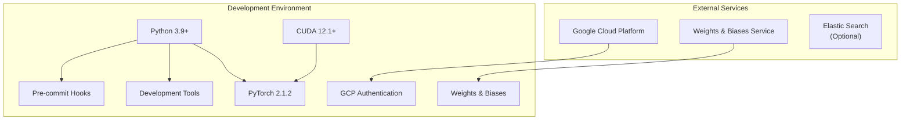
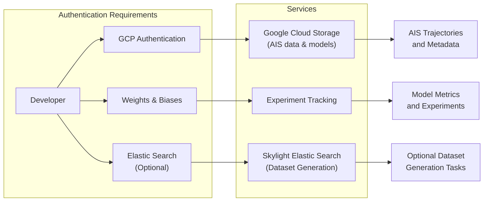
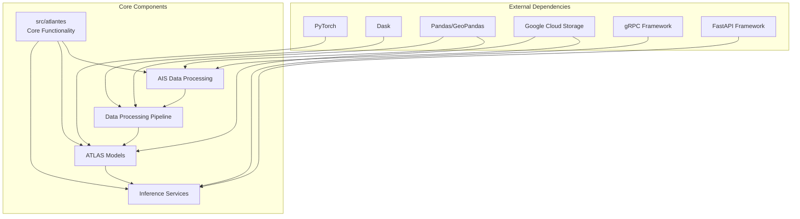

<!-- source: DeepWiki mcp.deepwiki.com · repo allenai/atlantes · page 3.1 Setup and Dependencies · fetched 2026-10-26 -->

# Setup and Dependencies

<details>
<summary>Relevant source files</summary>

The following files were used as context for generating this wiki page:

- [README.md](README.md)
- [ais/README.md](ais/README.md)
- [ais/requirements/requirements.txt](ais/requirements/requirements.txt)

</details>


This page provides a comprehensive guide to setting up a development environment for the Atlantes system, including required dependencies, external services, and development tools. For information about the testing framework, see [Testing Framework](#3.2), and for deployment information, see [Deployment](#4).

## Environment Overview

The Atlantes system requires several components to be set up for both development and deployment. This section provides a high-level view of the system dependencies and requirements.



Sources: [README.md:12-16](). [ais/README.md:26-33](), [ais/README.md:38-67]()

## Python Environment Setup

The Atlantes system requires Python 3.9+ and several Python packages. Follow these steps to set up your Python environment:

1. Create a virtual environment:
   ```bash
   python3 -m venv .venv-atlantes
   source .venv-atlantes/bin/activate
   ```

2. Install the package with CUDA support:
   ```bash
   pip install --extra-index-url https://download.pytorch.org/whl/cu121 -e .
   ```

3. Install development dependencies:
   ```bash
   pip install -r requirements/dev.txt
   ```

### Key Dependencies

The table below lists the core dependencies required by the Atlantes system:

| Library | Purpose | Version |
|---------|---------|---------|
| PyTorch | Deep learning framework | 2.1.2 |
| Dask | Parallel and distributed data processing | 2023.4+ |
| Pandas | Data manipulation and analysis | 2.2+ |
| Pandera | DataFrame validation | 0.19+ |
| GRPC | Service communication | 1.65.1+ |
| FastAPI | API framework | 0.115.11 |
| GeoPandas | Geospatial data handling | 0.14+ |
| Wandb | Experiment tracking | 0.16+ |
| Protobuf | Protocol buffers | 4.25+ |

Sources: [ais/requirements/requirements.txt:1-138](), [ais/README.md:26-33]()

## External Services and Authentication

The Atlantes system relies on several external services that require authentication:



### GCP Authentication

Google Cloud Platform (GCP) authentication is required for accessing AIS trajectories and metadata:

1. Authenticate using the gcloud CLI:
   ```bash
   gcloud auth application-default login
   ```

2. For CI/CD environments, authentication occurs via stored secrets in GitHub Actions workflows.

### Weights & Biases Authentication

Weights & Biases (wandb) is used for logging experimental runs and tracking model performance:

1. Authenticate using the wandb CLI:
   ```bash
   wandb login
   ```

### Elastic Search (Ai2-specific, Optional)

For Ai2 developers who need access to Skylight's Elastic Search (only needed for specific dataset generation tasks):

1. Set environment variables:
   ```bash
   export SEARCH_USERNAME=<username>
   export SEARCH_PASSWORD=<password>
   ```

Sources: [ais/README.md:38-67]()

## Development Tools Configuration

### Pre-commit Hooks

Pre-commit hooks enforce code quality standards before allowing commits:

1. Install pre-commit:
   ```bash
   pip install pre-commit
   pre-commit install
   ```

2. Key pre-commit hooks include:
   - Static type checking (mypy)
   - Documentation coverage (interrogate)
   - Code formatting (black, ruff)

Note that the Atlantes codebase requires:
- 100% static type annotations
- At least 90% documentation coverage
- PEP 8 compliance

These checks can be bypassed for specific files by adding them to the excluded list in `.pre-commit-config.yaml`.

### IDE Setup

For VSCode users:

1. Required Extensions:
   - Black (Python formatter)

2. Recommended Extensions:
   - Copilot
   - Augment
   - Gitless
   - Parquet Viewer
   - GitHub Actions

3. VSCode settings are available in the repository.

Sources: [README.md:23-34](), [README.md:35-49]()

## Local Testing

### Running Tests

Run the test suite:

```bash
pytest tests --ignore=tests/test_main.py -vv
```

For parallel testing:

```bash
pytest tests --ignore=tests/test_main.py -xvs -n auto
```

### Local Service Testing with Docker

To test the services locally with Docker:

1. Save your GCP credentials path:
   ```bash
   export GOOGLE_APPLICATION_CREDENTIALS=<path-to-credentials>
   ```

2. Navigate to the `ais` directory and start the services:
   ```bash
   docker-compose up
   ```

3. Test the service:
   ```bash
   python examples/atlas_activity_request.py
   ```

## System Component Dependencies

The following diagram shows how the different components of the Atlantes system depend on each other and their associated external dependencies:



Sources: [ais/README.md:14-16](), [ais/README.md:26-33](), [ais/requirements/requirements.txt:1-138]()

## Development Workflow

When developing for the Atlantes system, follow this general workflow:

1. Set up your environment as described above
2. Make your changes with proper typing and documentation
3. Run pre-commit hooks before committing (`pre-commit run --all-files`)
4. Run tests to ensure your changes don't break existing functionality
5. For model training, ensure you have proper authentication to GCP and wandb
6. For service testing, use the Docker setup to test locally

For more details on code quality requirements and standards, see [Code Quality and Standards](#3.3).

Sources: [README.md:51-62](), [ais/README.md:70-102]()

---

