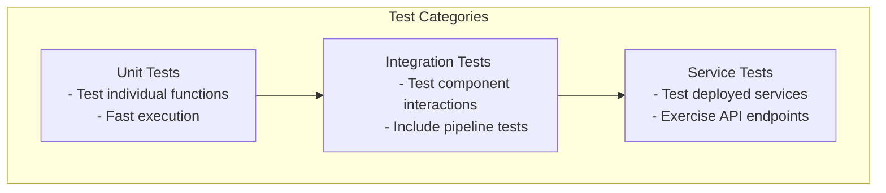
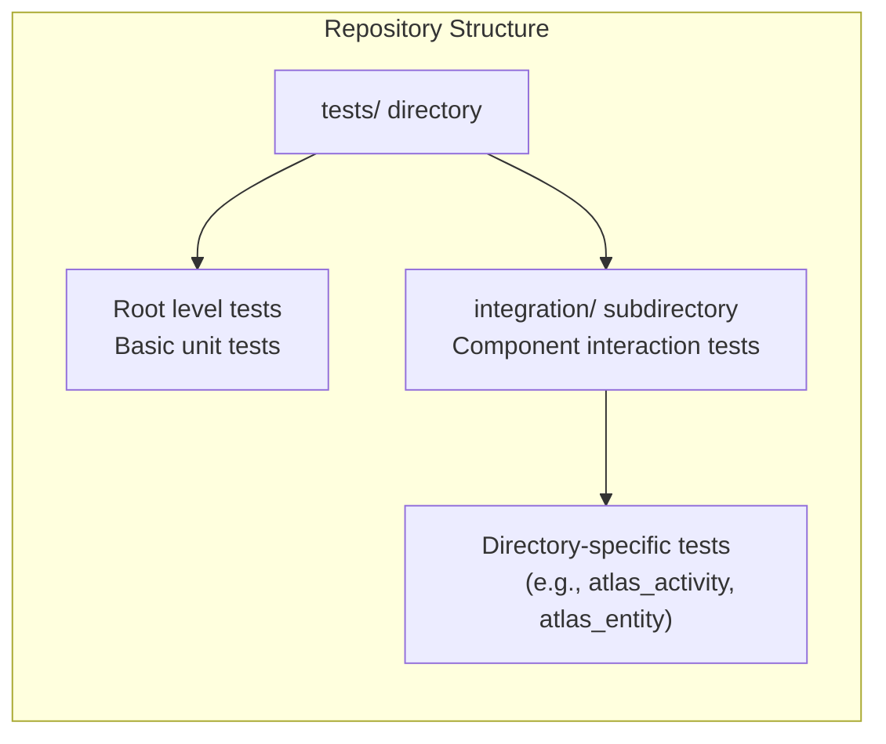
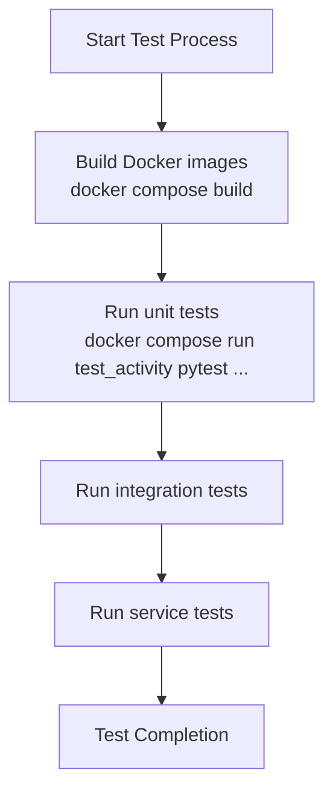
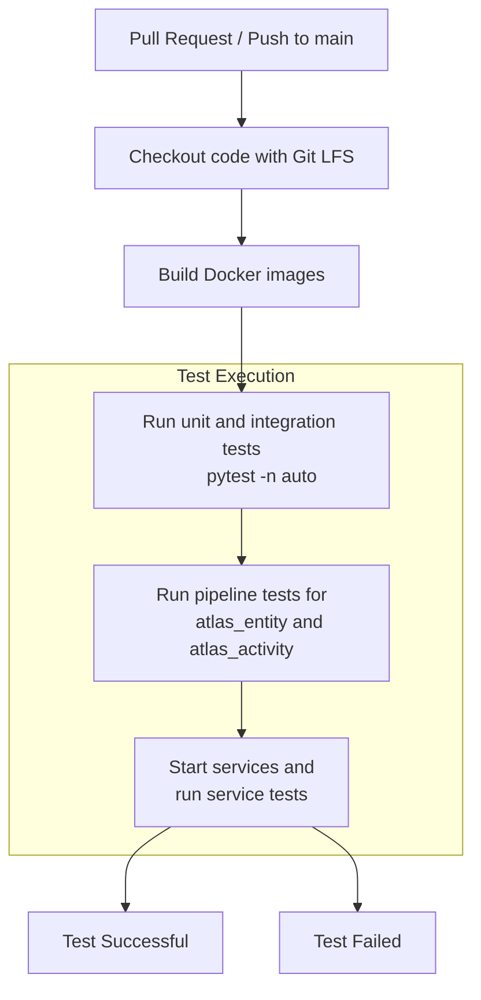
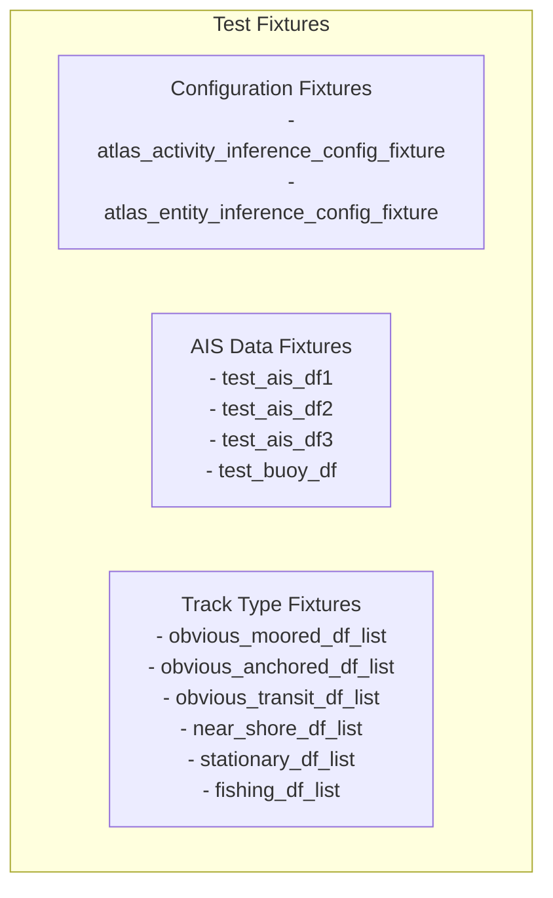
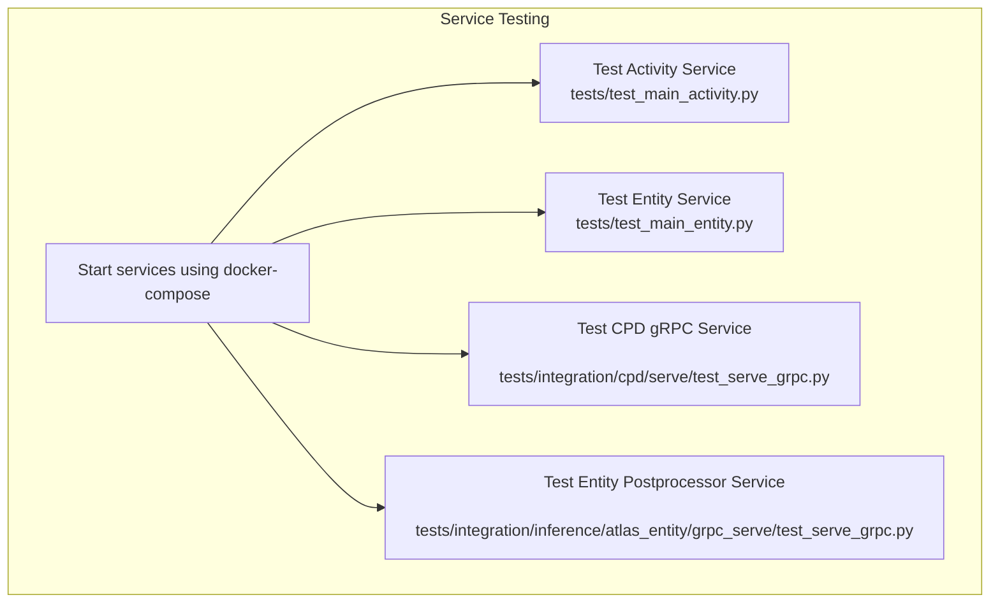
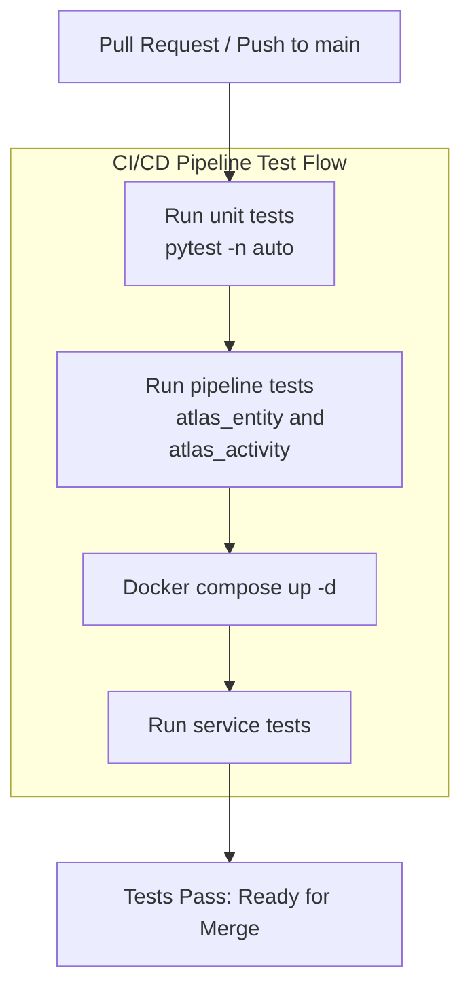

<!-- source: DeepWiki mcp.deepwiki.com · repo allenai/atlantes · page 3.2 Testing Framework · fetched 2026-10-26 -->

# Testing Framework

<details>
<summary>Relevant source files</summary>

The following files were used as context for generating this wiki page:

- [.github/workflows/tests.yaml](.github/workflows/tests.yaml)
- [ais/tests/conftest.py](ais/tests/conftest.py)

</details>


## Purpose and Scope

This document details the testing infrastructure for Atlantes, explaining how to write and run tests for the system. The testing framework enables validation of all components in the Atlantes real-time GPS trajectory modeling system, including core functionality, models, and services. For information about code quality standards, see [Code Quality and Standards](#3.3), and for information about the CI/CD pipeline, see [CI/CD Pipeline](#4.3).

## Testing Architecture

The Atlantes testing framework uses pytest as the primary testing tool and is organized into multiple test categories to ensure comprehensive coverage of the codebase.

### Test Categories



Sources: [.github/workflows/tests.yaml:51-92]()

### Test Organization



Sources: [.github/workflows/tests.yaml:53-89]()

## Test Execution

Atlantes provides multiple methods to execute tests, including local execution and automated CI/CD pipeline execution.

### Local Test Execution

Tests can be run locally using Docker Compose to ensure a consistent testing environment.



Sources: [.github/workflows/tests.yaml:49-92]()

### CI/CD Pipeline Testing

Automated testing occurs on each pull request and push to the main branch, using a GPU-enabled runner for hardware acceleration.



Sources: [.github/workflows/tests.yaml:16-92]()

## Test Fixtures and Data

The testing framework provides fixtures to access standardized test data and configurations, simplifying test development.

### Available Test Fixtures



Sources: [ais/tests/conftest.py:60-1005]()

### Test Data Organization

The testing framework uses test data stored in Google Cloud Platform (GCP) to ensure test consistency. Test data paths are configured through environment variables.

| Test Data Category | Purpose |
|---|---|
| Test AIS tracks | Basic AIS data for testing |
| Vessel activity test data | Data representing various vessel activities (moored, anchored, transiting) |
| Vessel type test data | Data for different vessel types (fishing, non-fishing) |
| Geographic test data | Data representing different geographic contexts (near-shore, high-traffic ports) |

Sources: [ais/tests/conftest.py:20-40]()

## Writing Tests for Atlantes

### Test Structure

Tests in Atlantes follow pytest conventions, with test files prefixed with `test_` and test functions prefixed with `test_`.

### Unit Test Example Structure

```python
# Example structure (not actual code)
def test_function_name():
    # Arrange: Set up test data and expected results
    # Act: Call the function being tested
    # Assert: Verify the results are as expected
```

### Using Test Fixtures

The test fixtures defined in `conftest.py` can be injected into test functions to access test data:

```python
# Example fixture usage (not actual code)
def test_with_fixture(test_ais_df1, atlas_activity_inference_config_fixture):
    # Use the fixtures in the test
```

## Testing Services

The service tests verify that deployed services function correctly through their API endpoints.



Sources: [.github/workflows/tests.yaml:72-92]()

## Best Practices

1. **Test Isolation**: Ensure each test is independent and does not rely on the state from other tests.
2. **Use Fixtures**: Leverage the provided fixtures for standardized test data and configurations.
3. **Simulate Real-World Data**: Use the various vessel track fixtures to test against realistic scenarios.
4. **Test All Components**: Write tests for all levels: unit, integration, and service.
5. **Include Edge Cases**: Test boundary conditions and error handling to ensure robustness.

## Automated Testing in the CI/CD Pipeline

The CI/CD pipeline automatically runs all tests on each pull request and push to the main branch, ensuring continuous validation of the codebase.



Sources: [.github/workflows/tests.yaml:3-9, 51-92]()

## Testing Environment

Tests are executed in Docker containers to ensure consistency across development and CI environments. The test environment includes:

1. GPU acceleration for model testing
2. Access to test data in GCP
3. Containerized services for service testing

Sources: [.github/workflows/tests.yaml:17-19]()

---

