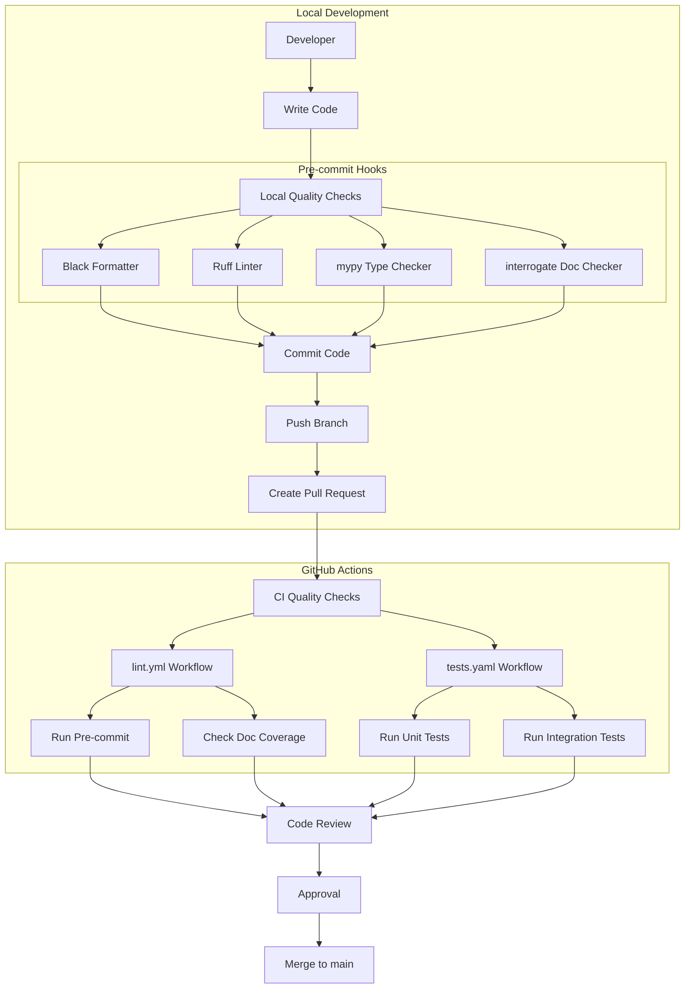
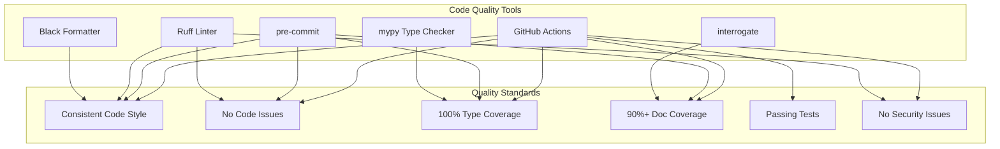

<!-- source: DeepWiki mcp.deepwiki.com · repo allenai/atlantes · page 3.3 Code Quality and Standards · fetched 2026-10-26 -->

# Code Quality and Standards

<details>
<summary>Relevant source files</summary>

The following files were used as context for generating this wiki page:

- [.github/workflows/lint.yml](.github/workflows/lint.yml)
- [README.md](README.md)

</details>


## Introduction

This document outlines the code quality requirements and standards enforced in the Atlantes codebase. These standards ensure code reliability, maintainability, and consistency across the project, which is critical for the system's role in real-time GPS trajectory modeling.

For information on setting up your development environment, see [Setup and Dependencies](#3.1). For details about the testing procedures, see [Testing Framework](#3.2).

Sources: [README.md:20-30]()

## Pre-commit Hooks

The Atlantes project uses pre-commit hooks to enforce code quality standards before changes are committed to the repository.

### Setup Process

To set up the pre-commit hooks:

```bash
pip install pre-commit
pre-commit install
```

This configuration ensures that code quality checks run automatically before each commit.

Sources: [README.md:23-28]()

### Quality Checks

The pre-commit hooks in Atlantes enforce:

- Code formatting with Black
- Linting with Ruff
- Static type checking with mypy (100% coverage requirement)
- Documentation coverage with interrogate (90% minimum coverage)
- Security checks

Sources: [README.md:30-31](), [.github/workflows/lint.yml:29-32]()

### Exclusion Process

Quality checks can be bypassed for specific files or directories by adding them to the excluded list in `.pre-commit-config.yaml`. Note that these checks are opt-out rather than opt-in, meaning all files are checked by default unless explicitly excluded.

Sources: [README.md:30-31]()

## Code Style and Formatting

### Formatting Tools

Atlantes uses the following tools to maintain consistent code style:

- **Black**: Automatically formats Python code with consistent style
- **Ruff**: Fast Python linter that enforces style and detects code issues

### Style Requirements

- All Python code must be formatted with Black
- Python indentation: 4 spaces (enforced by Black)
- Maximum line length: 88 characters (Black default)
- Imports must be organized according to PEP 8 guidelines

Sources: [README.md:41-42]()

## Type Annotations

Atlantes requires 100% static type coverage, enforced by mypy.

### Requirements

- All function parameters and return values must have explicit type annotations
- Use appropriate types from the `typing` module
- Type annotations must be valid and pass mypy checking

### Example

```python
from typing import Dict, List, Optional, Tuple

def process_vessel_data(
    vessel_id: str,
    coordinates: List[Tuple[float, float]],
    metadata: Optional[Dict[str, str]] = None
) -> Dict[str, List[float]]:
    """Process vessel tracking data.
    
    Args:
        vessel_id: Unique identifier for the vessel
        coordinates: List of (longitude, latitude) coordinates
        metadata: Optional vessel metadata
        
    Returns:
        Processed tracking data organized by feature
    """
    # Implementation
```

Sources: [README.md:30]()

## Documentation Standards

The project requires at least 90% documentation coverage for both modules and functions, enforced by the interrogate tool.

### Requirements

- All modules must have module-level docstrings explaining their purpose
- All public functions, methods, and classes must have docstrings
- Complex logic should include explanatory inline comments
- Google-style docstring format is used throughout the codebase

### Documentation Format Example

```python
def calculate_vessel_distance(
    point1: Tuple[float, float], 
    point2: Tuple[float, float]
) -> float:
    """Calculate the Euclidean distance between two vessel positions.
    
    Args:
        point1: First point as (longitude, latitude) coordinates
        point2: Second point as (longitude, latitude) coordinates
        
    Returns:
        The Euclidean distance between the points in nautical miles
    """
```

Sources: [README.md:30]()

## Continuous Integration

Atlantes uses GitHub Actions for continuous integration to ensure that all code changes meet the project's quality standards.

### CI Workflows

1. **Linting Workflow** [.github/workflows/lint.yml:1-33]():
   - Runs on both pushes and pull requests to the main branch
   - Executes pre-commit hooks on all files
   - Performs type checking with mypy
   - Checks documentation coverage with interrogate
   - Runs Ruff for code quality and security checks

2. **Testing Workflow**:
   - Executes unit tests and integration tests
   - Ensures all tests pass before merging

Sources: [.github/workflows/lint.yml:1-33]()

### Quality Gates

All pull requests must pass these quality gates before they can be merged:
- All pre-commit hooks pass
- All unit and integration tests pass
- Code review approval from project maintainers

## IDE Configuration

Atlantes recommends using Visual Studio Code with specific extensions to facilitate adherence to code quality standards.

### VSCode Setup

Required extensions:
- Black formatter extension

Recommended extensions:
- GitHub Copilot
- Augment
- Gitless
- Parquet Viewer
- GitHub Actions

Sources: [README.md:40-49]()

## Contribution Workflow

To contribute to the Atlantes project while meeting code quality standards:

1. Clone the repository
2. Set up pre-commit hooks
3. Create a new branch for your feature or bug fix
4. Make your changes following the code quality standards
5. Commit changes (pre-commit hooks will run automatically)
6. Push your branch to the remote repository
7. Create a pull request against the main branch
8. Ensure CI checks pass
9. Address any code review feedback
10. Once approved, your code will be merged

Sources: [README.md:51-61]()

## Diagrams

### Atlantes Code Quality Workflow



Sources: [.github/workflows/lint.yml:1-33](), [README.md:23-31](), [README.md:51-61]()

### Atlantes Quality Tools and Standards Mapping



Sources: [README.md:30-31](), [.github/workflows/lint.yml:1-33]()

## Summary

The Atlantes project maintains high code quality standards through:

1. **Automated Enforcement**: Pre-commit hooks and CI workflows automatically check code quality
2. **Comprehensive Type Coverage**: 100% static type coverage requirement
3. **Documentation Requirements**: Minimum 90% documentation coverage
4. **Consistent Formatting**: Standardized code style through Black and Ruff
5. **Testing**: Comprehensive test suite that must pass before merging

These standards ensure that the Atlantes codebase remains maintainable, reliable, and consistent as it continues to develop.

---

