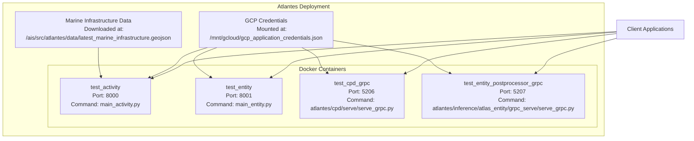
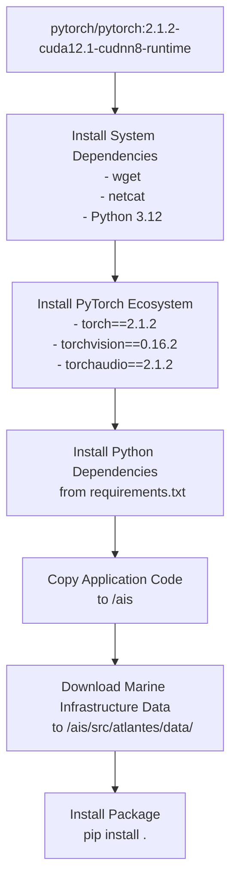
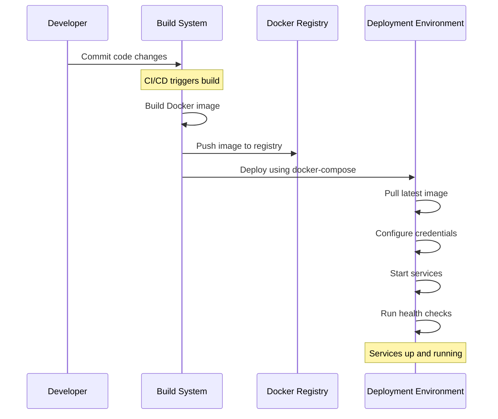
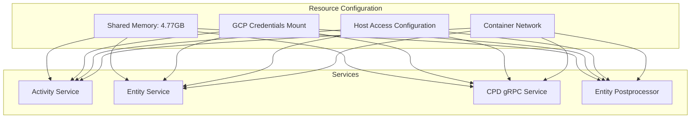
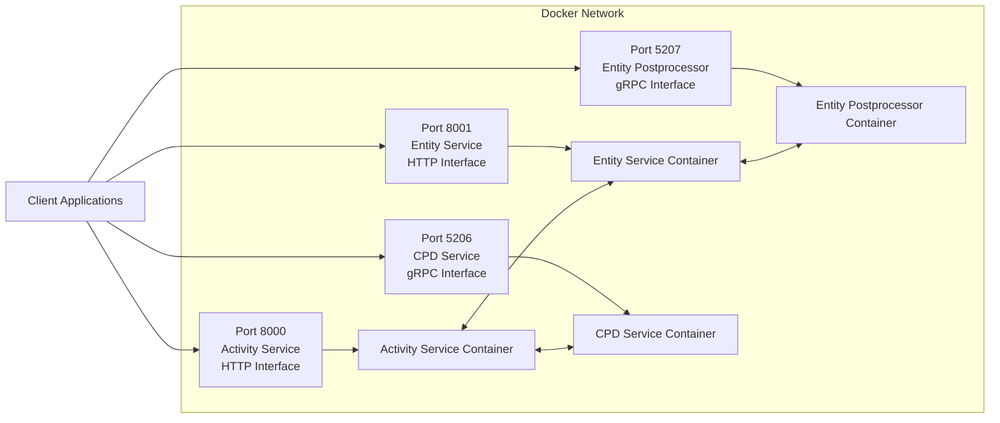

<!-- source: DeepWiki mcp.deepwiki.com · repo allenai/atlantes · page 4 Deployment · fetched 2026-10-26 -->

# Deployment

Relevant source files

The following files were used as context for generating this wiki page:

- [ais/Dockerfile](ais/Dockerfile)
- [ais/docker-compose.yml](ais/docker-compose.yml)

This document provides a technical overview of how the Atlantes system is deployed and operated in production environments. It covers the Docker-based containerization strategy, service configuration, and deployment architecture. For details on CI/CD pipelines, see [CI/CD Pipeline](#4.3), and for specific Docker configuration details, see [Docker Configuration](#4.1).

## Deployment Architecture

Atlantes follows a containerized microservice architecture where each functional component runs as a separate Docker container. The system deploys four primary services that collectively provide the full functionality of the ATLAS modeling system.

Sources: [ais/docker-compose.yml:8-100](), [ais/Dockerfile:52-57]()

## Container Image Configuration

All services use the same base Docker image defined in the Dockerfile, built on PyTorch with CUDA support for GPU acceleration. The container image is configured with:

- PyTorch 2.1.2 with CUDA 12.1 and cuDNN 8 support
- Python 3.12 environment
- GCP credentials configuration
- Required Python dependencies
- Downloaded marine infrastructure data

Sources: [ais/Dockerfile:1-60]()

## Service Configuration

Each service in the Atlantes deployment is configured with specific environment variables, ports, and health checks to ensure reliable operation.

| Service | Port | Environment Variables | Health Check | Command |
|---------|------|----------------------|--------------|---------|
| Activity Service | 8000 | `PORT=8000` | TCP check on port 8000 | `python3 src/main_activity.py` |
| Entity Service | 8001 | `PORT=8001` | TCP check on port 8001 | `python3 src/main_entity.py` |
| CPD gRPC Service | 5206 | `CPD_ADDRESS=0.0.0.0` `CPD_PORT=5206` | TCP check on port 5206 | `python3 /ais/src/atlantes/cpd/serve/serve_grpc.py` |
| Entity Postprocessor gRPC | 5207 | `ENTITY_POSTPROCESSOR_GRPC_ADDRESS=0.0.0.0` `ENTITY_POSTPROCESSOR_GRPC_PORT=5207` | TCP check on port 5207 | `python3 /ais/src/atlantes/inference/atlas_entity/grpc_serve/serve_grpc.py` |

Sources: [ais/docker-compose.yml:9-100]()

## Deployment Workflow

The deployment process for Atlantes follows these main steps:

Sources: [ais/docker-compose.yml:24-97]()

## Shared Resource Configuration

All containers utilize shared resources and configurations:

- **Shared Memory**: Each container is allocated 4.77GB of shared memory (`shm_size: '4.77gb'`)
- **Host Access**: Containers are configured with `host.docker.internal` mapping for communicating with the host machine
- **GCP Credentials**: Google Cloud Platform credentials are mounted from the host into each container
- **Container Network**: All containers are connected on the same Docker network for inter-service communication

Sources: [ais/docker-compose.yml:12-97]()

## Health Monitoring

Each service has configured health checks to ensure they are running correctly:

- **HTTP Services** (Activity and Entity): 
  - Check interval: 1 second
  - Timeout: 1 second
  - Retries: 30
  - Method: TCP port check using netcat

- **gRPC Services** (CPD and Entity Postprocessor):
  - Check interval: 2 seconds
  - Timeout: 2 seconds
  - Retries: 120
  - Method: TCP port check using netcat

These health checks ensure that services are properly started and remain operational during deployment.

Sources: [ais/docker-compose.yml:24-100]()

## Environmental Requirements

The Atlantes deployment has the following environmental prerequisites:

1. Docker runtime environment with Docker Compose support
2. CUDA-capable GPU for optimal performance
3. Google Cloud Platform credentials for accessing GCP services
4. Sufficient system resources:
   - CPU: Multiple cores recommended
   - RAM: Minimum 8GB (16GB+ recommended)
   - Storage: At least 10GB for container images and data
   - GPU: NVIDIA GPU with CUDA 12.1 support (for optimal performance)

## Connectivity Architecture

The Atlantes services are designed to be accessed by client applications through their respective ports:

Sources: [ais/docker-compose.yml:18-91]()

---

