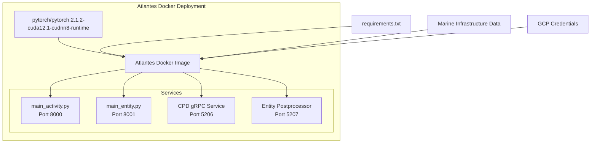
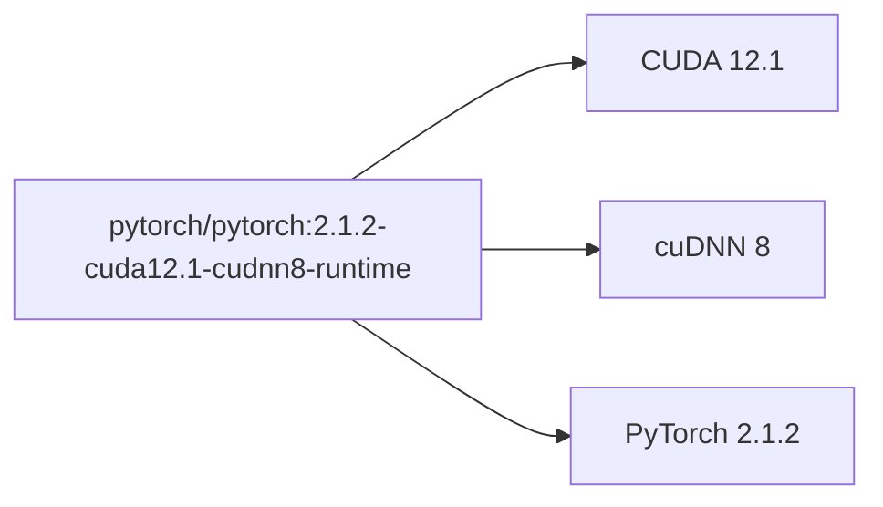
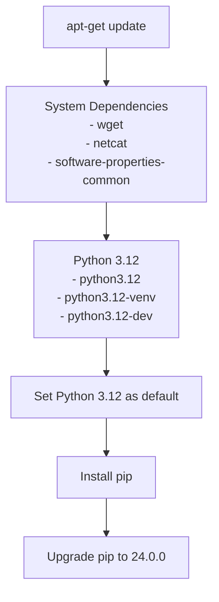
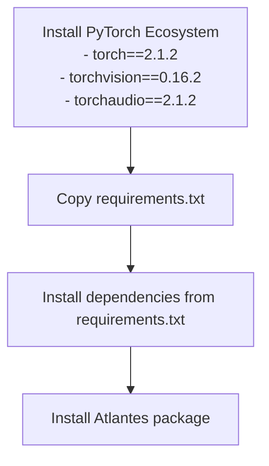
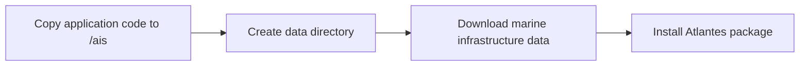
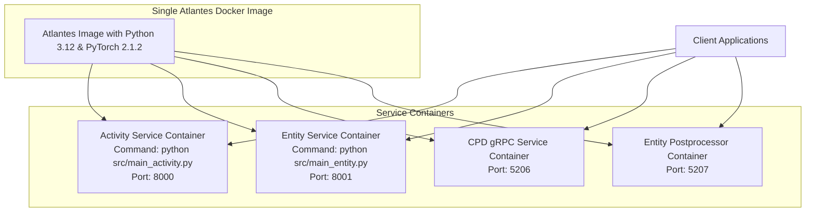
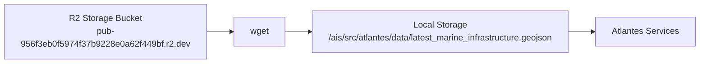
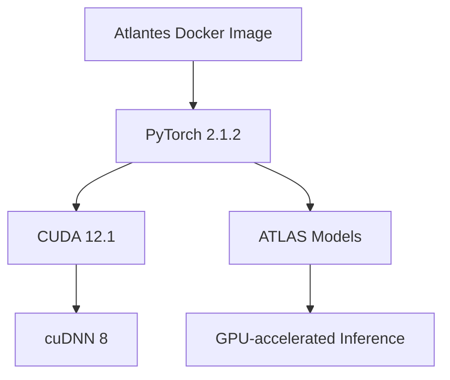

<!-- source: DeepWiki mcp.deepwiki.com · repo allenai/atlantes · page 4.1 Docker Configuration · fetched 2026-10-26 -->

# Docker Configuration

<details>
<summary>Relevant source files</summary>

The following files were used as context for generating this wiki page:

- [ais/Dockerfile](ais/Dockerfile)
- [ais/requirements/requirements.txt](ais/requirements/requirements.txt)

</details>


This document describes the Docker configuration used in the Atlantes system, explaining how the application is containerized, the structure of the Docker images, and the deployment architecture of the various services. For information about specific service configuration details, see [Service Configuration](#4.2), and for CI/CD pipeline integration, see [CI/CD Pipeline](#4.3).

## Overview

Atlantes uses Docker containers to package and deploy its various services including the Activity Service, Entity Service, CPD Service, and Entity Postprocessor. The containerization approach ensures consistent environments, simplifies dependency management, and facilitates deployment across different infrastructure.



Sources: [ais/Dockerfile:1-60]()

## Dockerfile Structure

The main Dockerfile is located at `ais/Dockerfile` and builds an image that serves as the foundation for all Atlantes services. The different services can be run from the same image by changing the entry command.

### Base Image

Atlantes uses PyTorch with CUDA support as its base image to enable GPU acceleration for model inference:



Sources: [ais/Dockerfile:1]()

### Environment Setup

The Dockerfile configures several environment variables and build arguments:

| Variable/Argument | Purpose |
|-------------------|---------|
| MOUNTED_CREDENTIALS_PATH | Path to GCP credentials file mounted into the container |
| GIT_COMMIT_HASH | Git commit hash for version tracking |
| GOOGLE_APPLICATION_CREDENTIALS | Environment variable for GCP authentication |
| DEBIAN_FRONTEND | Set to noninteractive to prevent prompts during build |

Sources: [ais/Dockerfile:6-13]()

### System Dependencies

The Dockerfile installs necessary system packages and Python 3.12:



Sources: [ais/Dockerfile:15-40]()

### Python Dependencies

The Dockerfile installs Python dependencies from `requirements/requirements.txt`:

1. First, it includes PyTorch ecosystem packages with specific versions
2. Then it installs all other dependencies from the requirements file
3. Finally, it installs the Atlantes package itself



Sources: [ais/Dockerfile:41-57](), [ais/requirements/requirements.txt:1-139]()

### Data and Application Setup

The Dockerfile copies application code and downloads external marine infrastructure data:



Sources: [ais/Dockerfile:49-57]()

### Default Service

By default, the Docker image is configured to run the Activity Service:

```
CMD ["python", "src/main_activity.py"]
```

Sources: [ais/Dockerfile:60]()

## Docker Deployment Architecture

The Docker image serves multiple services, each running on different ports:



Sources: [ais/Dockerfile:1-60]()

## Building and Running Docker Images

### Building the Docker Image

To build the Docker image, you need to provide the build arguments for GCP credentials and optionally the Git commit hash:

```bash
docker build -t atlantes \
  --build-arg MOUNTED_CREDENTIALS_PATH=/path/to/credentials.json \
  --build-arg GIT_COMMIT_HASH=$(git rev-parse HEAD) \
  -f ais/Dockerfile .
```

Sources: [ais/Dockerfile:6-13]()

### Running Different Services

Different services can be run from the same Docker image by overriding the CMD instruction:

| Service | Command |
|---------|---------|
| Activity Service | `docker run -p 8000:8000 -v /path/to/credentials.json:/path/to/credentials.json atlantes` |
| Entity Service | `docker run -p 8001:8001 -v /path/to/credentials.json:/path/to/credentials.json atlantes python src/main_entity.py` |
| CPD Service | `docker run -p 5206:5206 -v /path/to/credentials.json:/path/to/credentials.json atlantes python src/main_cpd_grpc.py` |
| Entity Postprocessor | `docker run -p 5207:5207 -v /path/to/credentials.json:/path/to/credentials.json atlantes python src/main_entity_postprocessor_grpc.py` |

Sources: [ais/Dockerfile:60]()

## Dependencies Management

The Atlantes Docker image includes a comprehensive set of dependencies specified in `requirements.txt`:

1. **Machine Learning Libraries**: PyTorch, scikit-learn, fvcore, peft
2. **Data Processing**: pandas, numpy, xarray, geopandas
3. **Geospatial Tools**: cartopy, contextily, shapely, geopy, pyproj
4. **Cloud Integration**: google-auth, google-cloud-storage, gcsfs
5. **Web Services**: fastapi, uvicorn, grpcio
6. **Monitoring**: prometheus_client, sentry-sdk
7. **Visualization**: matplotlib, seaborn, holoviews, datashader

The Docker image ensures all dependencies are consistently installed across all service deployments.

Sources: [ais/requirements/requirements.txt:1-139]()

## Integration with Marine Infrastructure Data

As part of the build process, the Docker image downloads the latest marine infrastructure data from an external source:



This data is essential for the proper functioning of the Atlantes system, particularly for the Activity Service which uses marine infrastructure information for trajectory analysis.

Sources: [ais/Dockerfile:52-57]()

## CUDA and GPU Support

The Atlantes Docker image is built with CUDA support to leverage GPU acceleration for model inference:



When running the Docker containers in a production environment, it's recommended to use hosts with compatible NVIDIA GPUs and proper CUDA driver installations to maximize inference performance.

Sources: [ais/Dockerfile:1-2](), [ais/requirements/requirements.txt:121]()

---

