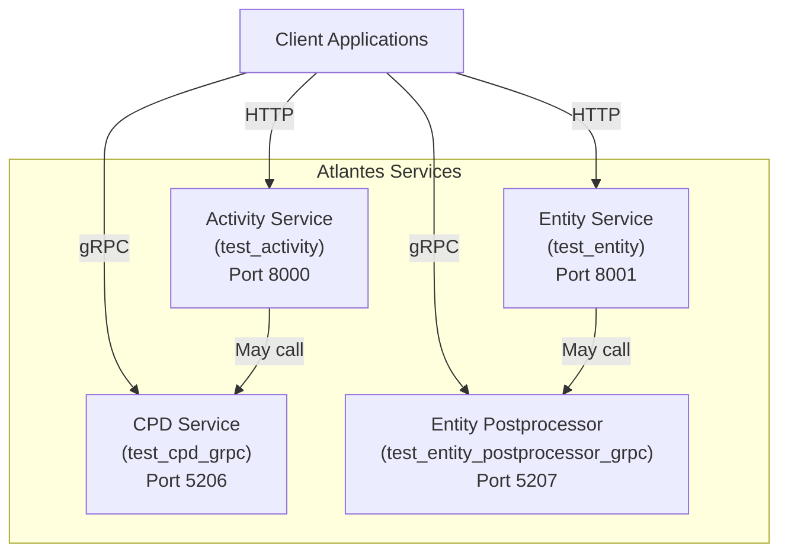
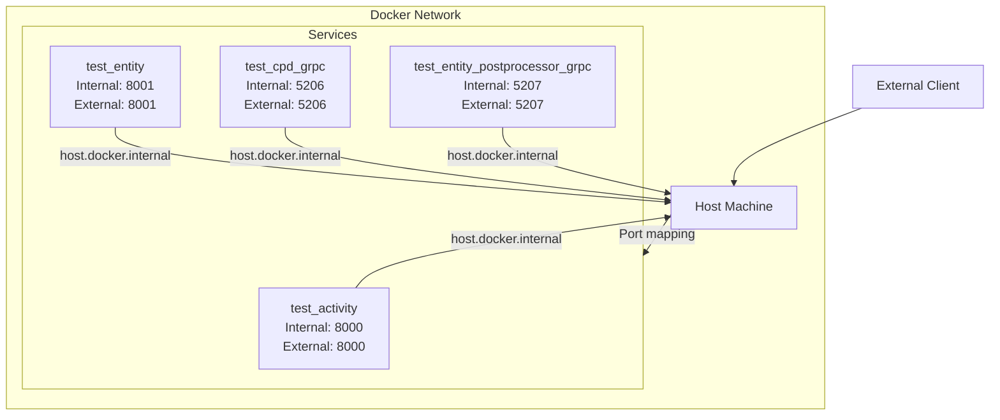
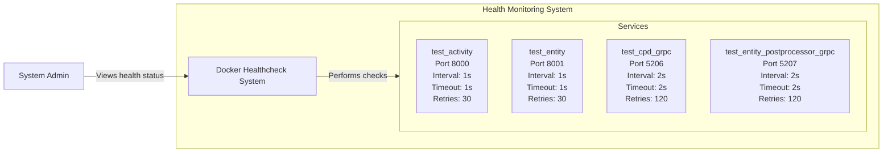

<!-- source: DeepWiki mcp.deepwiki.com · repo allenai/atlantes · page 4.2 Service Configuration · fetched 2026-10-26 -->

# Service Configuration

<details>
<summary>Relevant source files</summary>

The following files were used as context for generating this wiki page:

- [ais/docker-compose.yml](ais/docker-compose.yml)
- [ais/examples/atlas_activity_request.py](ais/examples/atlas_activity_request.py)
- [ais/examples/atlas_entity_buoy_vessel_request.py](ais/examples/atlas_entity_buoy_vessel_request.py)

</details>


This page documents the configuration and interaction of various services within the Atlantes system. It covers service endpoints, networking configuration, environment variables, and how services communicate with each other. For information about Docker container setup, see [Docker Configuration](#4.1).

## Service Architecture Overview

Atlantes comprises four primary services that work together to process and analyze AIS data for trajectory modeling and classification:



Sources: [ais/docker-compose.yml:8-100]()

## Service Configuration Details

### Activity Service

The Activity Service classifies vessel activities based on trajectory data.

| Configuration Parameter | Value | Notes |
|-------------------------|-------|-------|
| Service Name | test_activity | |
| Port | 8000 | Configurable via environment variable |
| Entry Point | src/main_activity.py | Main Python script |
| API Endpoint | /classify | For trajectory activity classification |
| Additional Debug Port | 6666 | |
| Health Check | Port connectivity test | Interval: 1s, Timeout: 1s, Retries: 30 |

Sources: [ais/docker-compose.yml:9-32](), [ais/examples/atlas_activity_request.py:17-19](), [ais/examples/atlas_activity_request.py:68-72]()

### Entity Service

The Entity Service classifies vessel types and distinguishes between vessels and buoys.

| Configuration Parameter | Value | Notes |
|-------------------------|-------|-------|
| Service Name | test_entity | |
| Port | 8001 | Configurable via environment variable |
| Entry Point | src/main_entity.py | Main Python script |
| API Endpoint | /classify | For entity classification |
| Additional Debug Port | 6667 | |
| Health Check | Port connectivity test | Interval: 1s, Timeout: 1s, Retries: 30 |

Sources: [ais/docker-compose.yml:33-56](), [ais/examples/atlas_entity_buoy_vessel_request.py:16-18](), [ais/examples/atlas_entity_buoy_vessel_request.py:54-56]()

### CPD (Contextual Property Detection) gRPC Service

This service provides contextual property detection for enhanced activity classification.

| Configuration Parameter | Value | Notes |
|-------------------------|-------|-------|
| Service Name | test_cpd_grpc | |
| Address | 0.0.0.0 | Configurable via CPD_ADDRESS env var |
| Port | 5206 | Configurable via CPD_PORT env var |
| Entry Point | /ais/src/atlantes/cpd/serve/serve_grpc.py | gRPC server script |
| Protocol | gRPC | |
| Health Check | Port connectivity test | Interval: 2s, Timeout: 2s, Retries: 120 |

Sources: [ais/docker-compose.yml:57-78]()

### Entity Postprocessor gRPC Service

This service handles post-processing of entity classification results.

| Configuration Parameter | Value | Notes |
|-------------------------|-------|-------|
| Service Name | test_entity_postprocessor_grpc | |
| Address | 0.0.0.0 | Configurable via ENTITY_POSTPROCESSOR_GRPC_ADDRESS env var |
| Port | 5207 | Configurable via ENTITY_POSTPROCESSOR_GRPC_PORT env var |
| Entry Point | /ais/src/atlantes/inference/atlas_entity/grpc_serve/serve_grpc.py | gRPC server script |
| Protocol | gRPC | |
| Health Check | Port connectivity test | Interval: 2s, Timeout: 2s, Retries: 120 |

Sources: [ais/docker-compose.yml:79-100]()

## Network Configuration

All services are configured to run within Docker containers with specific networking settings to enable inter-service communication and external access.



Key network configuration elements:

1. **Port Mapping**: Each service exposes its internal port to the same external port on the host machine
2. **Host Access**: All services include the `host.docker.internal:host-gateway` setting to access host services
3. **Shared Memory**: All services are allocated 4.77GB of shared memory (`shm_size: '4.77gb'`)

Sources: [ais/docker-compose.yml:8-100]()

## Service Communication

### HTTP Endpoints

The Activity and Entity services expose HTTP endpoints for client requests.

#### Activity Service Request Format

```
POST http://0.0.0.0:8000/classify
{
    "tracks": [
        {
            "track_id": "track-1",
            "track_data": [
                {"lat": 37.5, "lon": -122.5, "sog": 10.0, "cog": 45.0, ...},
                ...
            ]
        },
        ...
    ]
}
```

#### Entity Service Request Format

```
POST http://0.0.0.0:8001/classify
{
    "tracks": [
        {
            "track_id": "track-1",
            "track_data": [
                {"lat": 37.5, "lon": -122.5, "sog": 10.0, "cog": 45.0, ...},
                ...
            ]
        },
        ...
    ]
}
```

Sources: [ais/examples/atlas_activity_request.py:62-66](), [ais/examples/atlas_entity_buoy_vessel_request.py:46-50]()

### gRPC Interfaces

The CPD and Entity Postprocessor services expose gRPC interfaces for service-to-service communication. These services use Protocol Buffers for message serialization and are configured to listen on their respective ports.

## Environment Variable Configuration

Each service has specific environment variables that can be configured:

| Service | Environment Variables |
|---------|------------------------|
| Activity Service | `PORT` - HTTP server port (default: 8000) |
| Entity Service | `PORT` - HTTP server port (default: 8001) |
| CPD Service | `CPD_ADDRESS` - gRPC server address (default: 0.0.0.0)<br>`CPD_PORT` - gRPC server port (default: 5206) |
| Entity Postprocessor | `ENTITY_POSTPROCESSOR_GRPC_ADDRESS` - gRPC server address (default: 0.0.0.0)<br>`ENTITY_POSTPROCESSOR_GRPC_PORT` - gRPC server port (default: 5207) |

Additionally, all services require Google Cloud Platform credentials, which are mounted as volumes:

```
volumes:
  - ${GOOGLE_APPLICATION_CREDENTIALS}:/mnt/gcloud/gcp_application_credentials.json
```

This configuration allows the services to access GCP resources such as Cloud Storage or BigQuery for retrieving model artifacts or storing results.

Sources: [ais/docker-compose.yml:13-14](), [ais/docker-compose.yml:37-38](), [ais/docker-compose.yml:62-63](), [ais/docker-compose.yml:83-85](), [ais/docker-compose.yml:21-22](), [ais/docker-compose.yml:45-46]()

## Health Monitoring

Each service includes health check configurations to verify proper operation:



Health checks use a TCP connection test to verify that each service is listening on its configured port. The Activity and Entity services have more aggressive health check settings (1-second intervals) than the gRPC services (2-second intervals). The gRPC services also have higher retry counts, indicating they may take longer to initialize.

Sources: [ais/docker-compose.yml:24-32](), [ais/docker-compose.yml:48-56](), [ais/docker-compose.yml:70-78](), [ais/docker-compose.yml:92-100]()

## Example Requests

Sample Python code to interact with the services is available in the examples directory:

- `atlas_activity_request.py` - Demonstrates sending trajectory data to the Activity Service
- `atlas_entity_buoy_vessel_request.py` - Demonstrates sending trajectory data to the Entity Service

Both examples follow similar patterns:
1. Load sample trajectory data from a CSV file
2. Format the data as JSON payloads
3. Send HTTP POST requests to the appropriate service endpoint
4. Process and display the classification results

These examples provide practical guidance for integrating with the Atlantes services and can be used as templates for client applications.

Sources: [ais/examples/atlas_activity_request.py:1-98](), [ais/examples/atlas_entity_buoy_vessel_request.py:1-80]()

---

