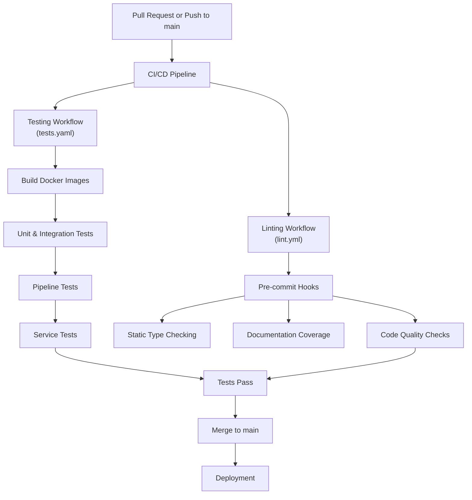
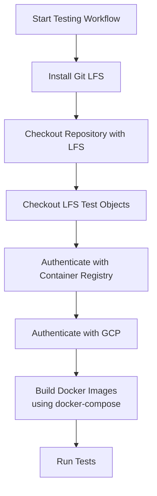
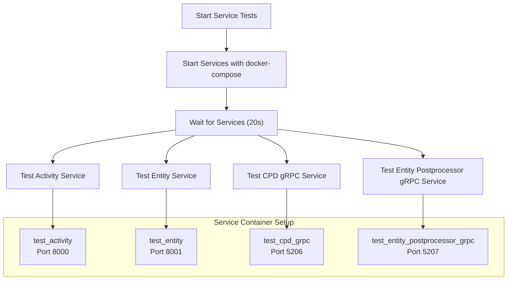
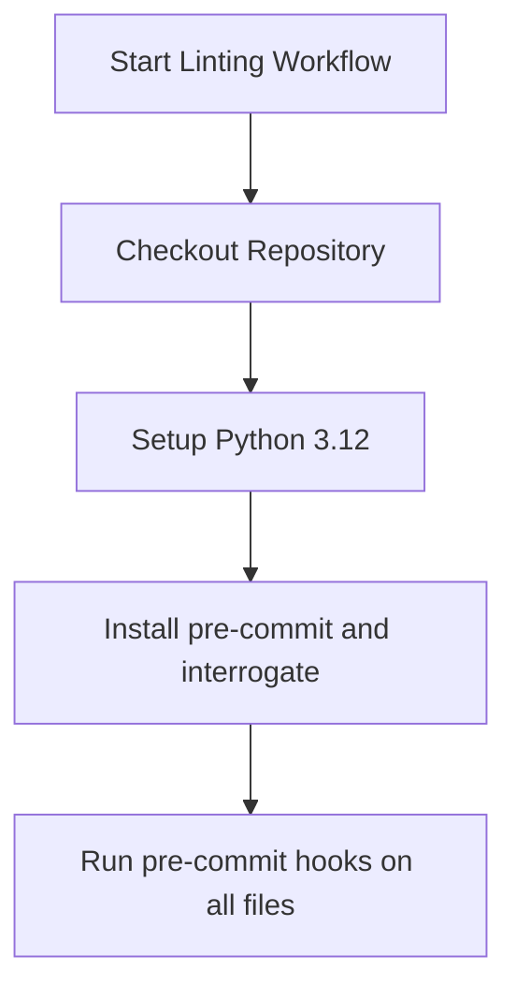
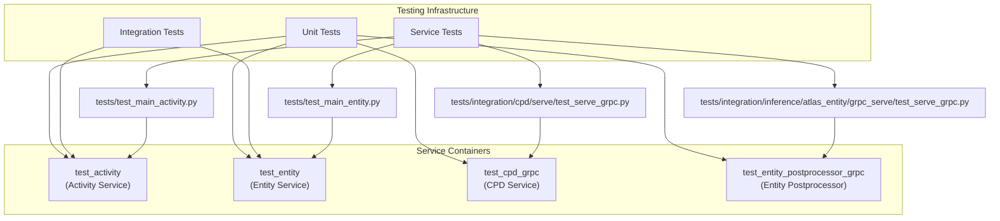
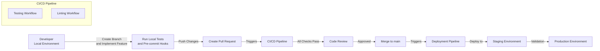

<!-- source: DeepWiki mcp.deepwiki.com · repo allenai/atlantes · page 4.3 CI/CD Pipeline · fetched 2026-10-26 -->

# CI/CD Pipeline

<details>
<summary>Relevant source files</summary>

The following files were used as context for generating this wiki page:

- [.github/workflows/lint.yml](.github/workflows/lint.yml)
- [.github/workflows/tests.yaml](.github/workflows/tests.yaml)

</details>


This document outlines the Continuous Integration and Continuous Deployment (CI/CD) pipeline for the Atlantes system. The pipeline ensures code quality, reliability, and proper functionality through automated testing and verification processes. For information about Docker configuration, see [Docker Configuration](#4.1). For service configuration details, see [Service Configuration](#4.2).

## Overview

The Atlantes CI/CD pipeline is implemented using GitHub Actions workflows that automatically trigger when code is pushed to the main branch or when pull requests targeting the main branch are created. The pipeline consists of two primary workflows:

1. Testing workflow (`tests.yaml`)
2. Linting workflow (`lint.yml`)

These automated workflows help maintain code quality and ensure reliable operation of the Atlantes system components.



Sources: [.github/workflows/tests.yaml](), [.github/workflows/lint.yml]()

## Testing Workflow

The testing workflow runs on a GPU-enabled runner to accommodate the computational requirements of the Atlantes models. It executes a comprehensive suite of tests to verify the functionality of all system components.

### Test Environment Setup

The testing workflow sets up the necessary environment by:

1. Installing Git LFS to handle large model files
2. Checking out the repository with LFS support
3. Authenticating with Google Cloud Platform and container registries
4. Building Docker images using docker-compose



Sources: [.github/workflows/tests.yaml:22-50]()

### Test Execution

The testing workflow executes tests in three distinct phases:

#### 1. Unit and Integration Tests

These tests verify the core functionality of individual components and their integration points, excluding service-level tests.

```bash
docker compose -f ais/docker-compose.yml run test_activity pytest -n auto [...]
```

Sources: [.github/workflows/tests.yaml:51-61]()

#### 2. Pipeline Tests

These tests focus specifically on the inference pipelines for both entity and activity components:

```bash
docker compose -f ais/docker-compose.yml run test_entity pytest tests/integration/inference/atlas_entity/ [...]
docker compose -f ais/docker-compose.yml run test_activity pytest tests/integration/inference/atlas_activity/ [...]
```

Sources: [.github/workflows/tests.yaml:62-71]()

#### 3. Service Tests

These tests verify that the services function correctly when running as actual services. The workflow:

1. Starts all services using docker-compose
2. Waits for the services to be ready
3. Executes service-specific tests for each component



Sources: [.github/workflows/tests.yaml:72-92]()

## Linting Workflow

The linting workflow runs on a standard Ubuntu runner and ensures code quality through static analysis, type checking, and enforcing coding standards.

### Environment Setup

The linting workflow:

1. Checks out the repository (without LFS, as it's not needed for linting)
2. Sets up Python 3.12
3. Installs pre-commit and interrogate tools



Sources: [.github/workflows/lint.yml:16-32]()

### Pre-commit Hooks

The pre-commit configuration enforces various code quality checks, including:

1. Static type checking with mypy
2. Documentation coverage verification with interrogate
3. Code style enforcement with Ruff (Python linter)
4. Security vulnerability scanning
5. Format checking and automatic fixing

Pre-commit hooks run locally during development and are also executed during the CI pipeline to ensure consistent code quality.

Sources: [.github/workflows/lint.yml:29-32]()

## Testing and Service Architecture

The testing infrastructure mirrors the service architecture of the Atlantes system, with tests specifically designed for each component:



Sources: [.github/workflows/tests.yaml:51-92]()

## CI/CD Pipeline Integration with Development Workflow

The CI/CD pipeline is integrated into the development workflow, ensuring that code changes are properly tested and validated before being deployed:



Sources: [.github/workflows/tests.yaml:3-9](), [.github/workflows/lint.yml:3-9]()

## Test Case Organization

Test cases in the Atlantes repository are organized to match the structure of the system components:

| Test Category | Path Pattern | Purpose |
|---------------|--------------|---------|
| Unit Tests | `tests/unit/...` | Test individual functions and classes |
| Integration Tests | `tests/integration/...` | Test component interactions |
| Activity Tests | `tests/integration/inference/atlas_activity/...` | Test activity inference pipeline |
| Entity Tests | `tests/integration/inference/atlas_entity/...` | Test entity inference pipeline |
| Service Tests | `tests/test_main_activity.py`, `tests/test_main_entity.py` | Test service endpoints |
| CPD Service Tests | `tests/integration/cpd/serve/test_serve_grpc.py` | Test CPD gRPC service |
| Entity Postprocessor Tests | `tests/integration/inference/atlas_entity/grpc_serve/test_serve_grpc.py` | Test Entity Postprocessor gRPC service |

Sources: [.github/workflows/tests.yaml:55-61](), [.github/workflows/tests.yaml:66-71](), [.github/workflows/tests.yaml:82-92]()

## Continuous Deployment

After successful completion of the CI pipeline (passing all tests and linting checks), the code changes can be merged into the main branch. This triggers the deployment pipeline, which:

1. Builds production-ready Docker images
2. Pushes these images to container registries
3. Updates the deployed services in the target environments

The deployment process leverages the Docker configuration detailed in [Docker Configuration](#4.1) and follows the service configuration specified in [Service Configuration](#4.2).

## Conclusion

The CI/CD pipeline for Atlantes provides automated testing, linting, and deployment to ensure high code quality and reliable operation of the system. By integrating these checks into the development workflow, the pipeline helps maintain the integrity of the codebase and facilitates smooth deployment of new features and improvements.

Sources: [.github/workflows/tests.yaml](), [.github/workflows/lint.yml]()