# Page: Overview

# Overview

<details>
<summary>Relevant source files</summary>

The following files were used as context for generating this wiki page:

- [README.md](README.md)
- [ais/README.md](ais/README.md)

</details>


Atlantes is a real-time global-scale GPS trajectory modeling system developed at AI2, currently deployed in the Skylight maritime intelligence platform. The system processes AIS (Automatic Identification System) data to model vessel trajectories and classify vessel activities and entities.

## Purpose and Scope

This page provides a high-level overview of the Atlantes repository and system architecture. Atlantes is designed to analyze vessel movement patterns using AIS data and provide insights through:

- Processing and cleaning AIS data streams
- Training machine learning models on vessel trajectories
- Classifying vessel activities (fishing, anchored, transiting, etc.)
- Identifying entity types (vessel vs. buoy, vessel type classification)
- Providing real-time inference services through standardized APIs

This overview focuses on the system's core components and how they interact. For detailed implementation specifics, refer to the respective wiki pages for each component.

Sources: [README.md:3-6]()

## System Architecture

### High-Level System Components

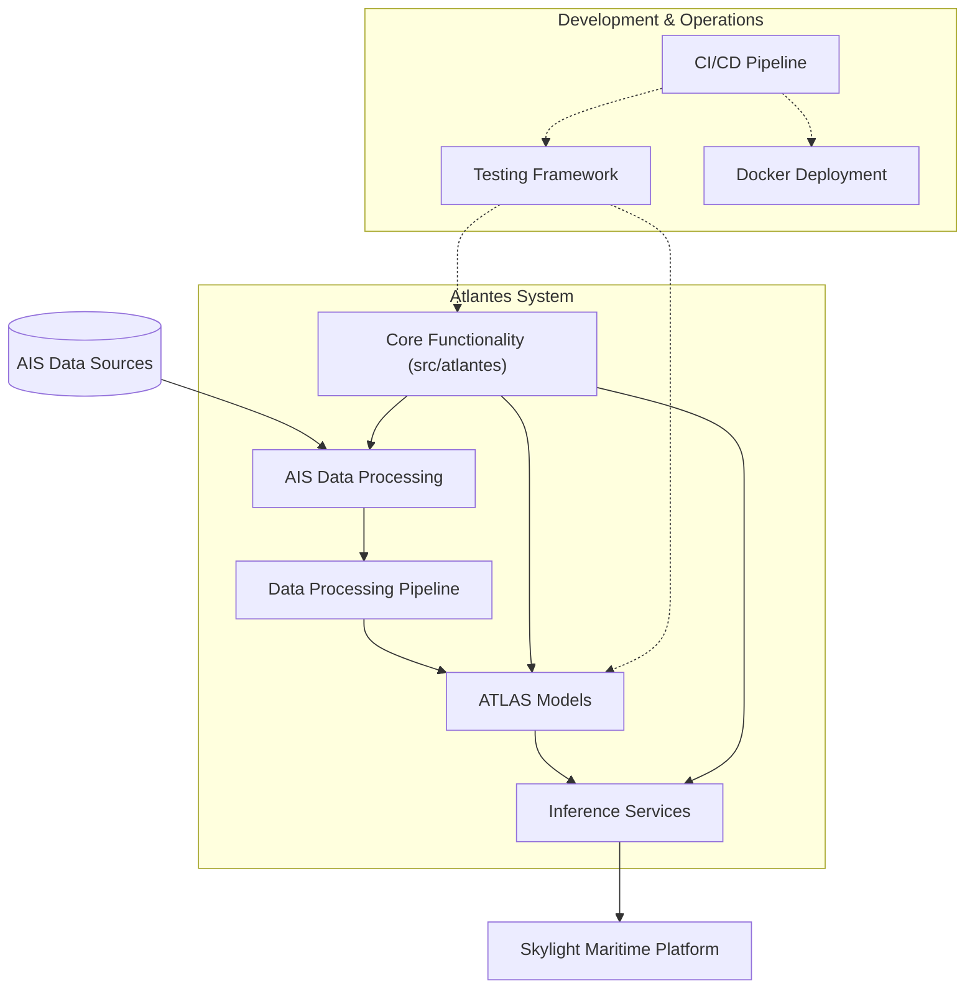

The architecture diagram shows how data flows from AIS data sources through the Atlantes system and ultimately to the Skylight maritime platform. The system's core functionality is implemented in the `src/atlantes` directory, which contains modules for AIS data processing, ATLAS models, and inference services.

Sources: [README.md:8-21](), [ais/README.md:14-25]()

### Data Processing Flow

```mermaid
flowchart LR
    AISData[("AIS Data")] --> DataIngestion["Data Ingestion"]
    DataIngestion --> DataCleaning["Data Cleaning"]
    DataCleaning --> FeatureEngineering["Feature Engineering"]
    
    FeatureEngineering --> TrainingDataset["Training Dataset"]
    FeatureEngineering --> InferenceDataset["Inference Dataset"]
    
    TrainingDataset --> ModelTraining["Model Training"]
    ModelTraining --> TrainedModels["Trained ATLAS Models"]
    
    InferenceDataset --> InferencePipeline["Inference Pipeline"]
    TrainedModels --> InferencePipeline
    
    MarineData["Marine Infrastructure Data"] --> InferencePipeline
    
    InferencePipeline --> ActivityClassification["Activity Classification"]
    InferencePipeline --> EntityClassification["Entity Classification"]
    
    ActivityClassification --> ActivityPostprocessing["Activity Postprocessing"]
    EntityClassification --> EntityPostprocessing["Entity Postprocessing"]
    
    ActivityPostprocessing --> GRPC["gRPC Services"]
    EntityPostprocessing --> GRPC
    
    GRPC --> Clients["Client Applications"]
```

This diagram illustrates how AIS data flows through the system, from ingestion to final classification results. The system handles both training and inference pathways, with the trained ATLAS models being used to classify activities and entities.

Sources: [ais/README.md:110-122]()

## Core Components

### ATLAS Models

The core functionality of Atlantes is provided by the ATLAS (AIS Transformer Learning with Active Subpaths) models. These models are implemented using PyTorch and are designed to process AIS trajectories.

| Model Type | Classification Tasks | Description |
|------------|----------------------|-------------|
| ATLAS Activity Model | End of Sequence (EOS) Activity Classification | Classifies the activity at the end of a trajectory |
| ATLAS Activity Model | Dense Activity Classification | Classifies activities throughout a trajectory |
| ATLAS Entity Model | Vessel vs. Buoy Classification | Determines whether an AIS signal is from a vessel or buoy |
| ATLAS Entity Model | Vessel Type Classification | Identifies vessel types (fishing, cargo, tanker, etc.) |

Sources: [ais/README.md:16-25]()

### Model to Service Mapping

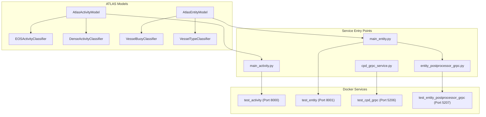

This diagram shows how the ATLAS models are connected to the service entry points and Docker containers. The models are implemented in the `src/atlantes/models` directory, and the service entry points are in the root directory. The Docker containers expose the services on specific ports.

Sources: [ais/README.md:91-107]()

### Inference Services

Atlantes provides several services for real-time inference:

| Service | Description | Implementation | Port |
|---------|-------------|----------------|------|
| Activity Service | Provides activity classification for vessel trajectories | `main_activity.py` | 8000 |
| Entity Service | Provides entity classification for AIS trajectories | `main_entity.py` | 8001 |
| CPD Service | Provides contextual property detection | `cpd_grpc_service.py` | 5206 |
| Entity Postprocessor | Processes the outputs of the entity service | `entity_postprocessor_grpc.py` | 5207 |

These services are exposed through gRPC interfaces, allowing them to be easily integrated into larger systems like the Skylight maritime platform.

Sources: [ais/README.md:91-107]()

## Repository Structure

The Atlantes repository is organized into several top-level directories:

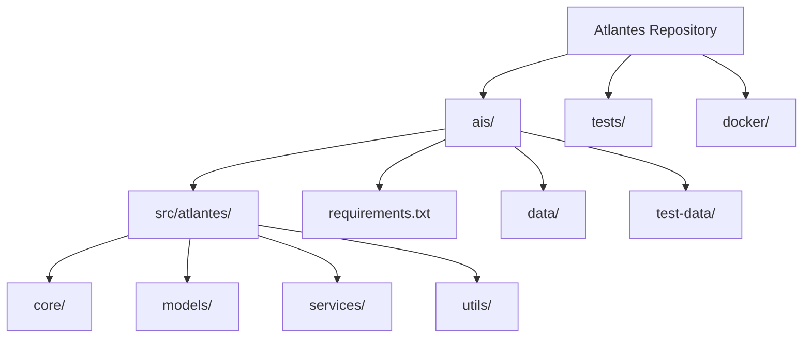

| Directory | Purpose |
|-----------|---------|
| `ais` | Contains scripts and modules for loading, cleaning, and preprocessing AIS data |
| `src/atlantes` | Holds the core logic for the Atlantes system, including data processing, model training, and deployment |
| `requirements.txt` | Specifies the required Python packages for running the Atlantes system |
| `data` | Stores various AIS-related data files used throughout the project in a non-production environment |
| `tests` | Contains unit tests and integration tests for the Atlantes system |
| `test-data` | Contains test data for the Atlantes system |

Sources: [README.md:8-21]()

## Core Libraries and Technologies

Atlantes relies on several key libraries and technologies:

| Library/Technology | Purpose |
|-------------------|---------|
| PyTorch | Building and training the machine learning models |
| Dask | Parallel and distributed data processing |
| Pandas | Data manipulation, visualization, and analysis |
| Pandera | Schema-based approach to validate Dataframes |
| Weights & Biases (wandb) | Experiment tracking |
| Beaker | AI2's experimentation platform |
| Google Cloud Platform (GCP) | Storing and accessing AIS data |
| Docker | Containerizing and deploying the services |

Sources: [ais/README.md:26-34]()

## Deployment Architecture

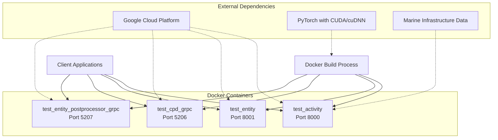

This diagram shows the deployment architecture of the Atlantes system, with Docker containers exposing the various services on specific ports. The system depends on Google Cloud Platform for data storage and PyTorch with CUDA/cuDNN for machine learning capabilities.

Sources: [ais/README.md:103-107]()

## Where to Go Next

To learn more about specific aspects of the Atlantes system, refer to the following wiki pages:

- [Repository Structure](#1.1): Details about the organization of the repository, including main directories and their purposes.
- [System Architecture](#1.2): A more detailed overview of the system's architecture, including the relationships between components.
- [ATLAS Models](#2.1): Information about the ATLAS models used for activity and entity classification.
- [Data Processing Pipeline](#2.2): Details about how AIS data is processed, transformed, and prepared for model training and inference.
- [Inference Services](#2.3): Information about the services that provide inference capabilities.
- [Development Guide](#3): Guidance for developers working on the Atlantes system.
- [Deployment](#4): Information on how the system is deployed and operated.

---

# Page: Repository Structure

# Repository Structure

<details>
<summary>Relevant source files</summary>

The following files were used as context for generating this wiki page:

- [.gitignore](.gitignore)
- [README.md](README.md)

</details>


This document provides an overview of the Atlantes repository structure, explaining the organization of directories and files. It serves as a map to help developers navigate the codebase and understand where different components are located. For information about how these components interact, see [System Architecture](#1.2).

## High-Level Directory Structure

The Atlantes repository is organized into a logical hierarchy that separates core functionality, data processing, testing, and deployment resources. This structure supports the development and operation of a real-time GPS trajectory modeling system focused on maritime vessel tracking via AIS data.

### Top-Level Directory Structure

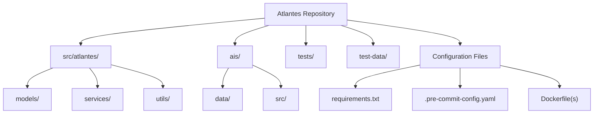

Sources: [README.md:8-18]()

## Source Code Organization

### Core Source Code in `src/atlantes/`

The `src/atlantes/` directory contains the core logic of the Atlantes system, including the ATLAS models for activity and entity classification, data processing pipelines, and inference services.

### Core Components Organization

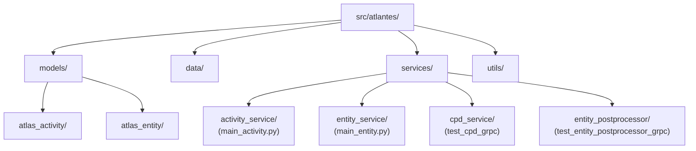

Sources: [README.md:14]()

### AIS Data Processing in `ais/`

The `ais/` directory contains scripts and modules specific to AIS (Automatic Identification System) data processing, including data loading, cleaning, and preprocessing.

### AIS Directory Structure

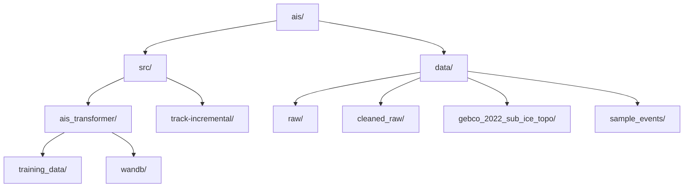

Sources: [README.md:13](), [.gitignore:1-16]()

## Data Directories

### `ais/data/`

This directory stores various AIS-related data files used throughout the project in a non-production environment:

| Subdirectory | Purpose |
|--------------|---------|
| `raw/` | Raw AIS data from various sources |
| `cleaned_raw/` | Cleaned AIS data ready for processing |
| `gebco_2022_sub_ice_topo/` | Geographic data files (.nc NetCDF format) |
| `sample_events/` | Sample event data (includes sentinel2/iceberg_detection_dataset.csv) |

Sources: [README.md:16](), [.gitignore:5-6](), [.gitignore:13-15]()

### `test-data/`

Contains test data used for unit tests, integration tests, and service tests. This data is typically smaller and more controlled than the data in `ais/data/`.

Sources: [README.md:18]()

## Testing Structure

### `tests/`

Contains unit tests, integration tests, and service tests for the Atlantes system. The tests are organized to mirror the structure of the source code.

### Testing Directory Organization

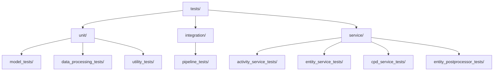

Sources: [README.md:17]()

## Configuration Files

The repository contains several configuration files at the root level:

| File | Purpose |
|------|---------|
| `requirements.txt` | Specifies the required Python packages for running the Atlantes system and development tools |
| `.pre-commit-config.yaml` | Configuration for pre-commit hooks that enforce code quality standards |
| `Dockerfile(s)` | Docker configurations for containerizing the services |

Sources: [README.md:15](), [README.md:23-32]()

## Development Tools and Standards

The Atlantes repository enforces strict code quality standards through pre-commit hooks:

- 100% static type annotations (enforced via `mypy`)
- At least 90% documentation coverage for modules and functions (enforced via `interrogate`)
- Code formatting with `black`
- Linting with `ruff`

These standards ensure code quality, readability, and maintainability across the entire codebase.

Sources: [README.md:23-32](), [README.md:40-50]()

## Deployment Resources

The repository includes resources for deploying the Atlantes system as Docker containers, with separate containers for each service:

| Service | Container | Port |
|---------|-----------|------|
| Activity Service | `test_activity` | 8000 |
| Entity Service | `test_entity` | 8001 |
| CPD Service | `test_cpd_grpc` | 5206 |
| Entity Postprocessor | `test_entity_postprocessor_grpc` | 5207 |

This containerized approach allows for flexible deployment and scaling of the different components of the system.

Sources: Based on the system architecture diagrams provided, particularly the "Deployment Architecture" diagram.

---

# Page: System Architecture

# System Architecture

<details>
<summary>Relevant source files</summary>

The following files were used as context for generating this wiki page:

- [README.md](README.md)
- [ais/README.md](ais/README.md)
- [ais/docker-compose.yml](ais/docker-compose.yml)

</details>


This page provides a comprehensive overview of the Atlantes system architecture, explaining how the various components interact to process AIS data and generate vessel activity and entity classifications. For specific details about the repository structure, see [Repository Structure](#1.1), and for more information about individual components, see [Core Components](#2).

## Overview

Atlantes is a real-time global-scale GPS trajectory modeling system that processes Automatic Identification System (AIS) data to model vessel trajectories and classify vessel activities and entities. The system is deployed in the Skylight maritime intelligence platform and provides various analytical capabilities through specialized services.

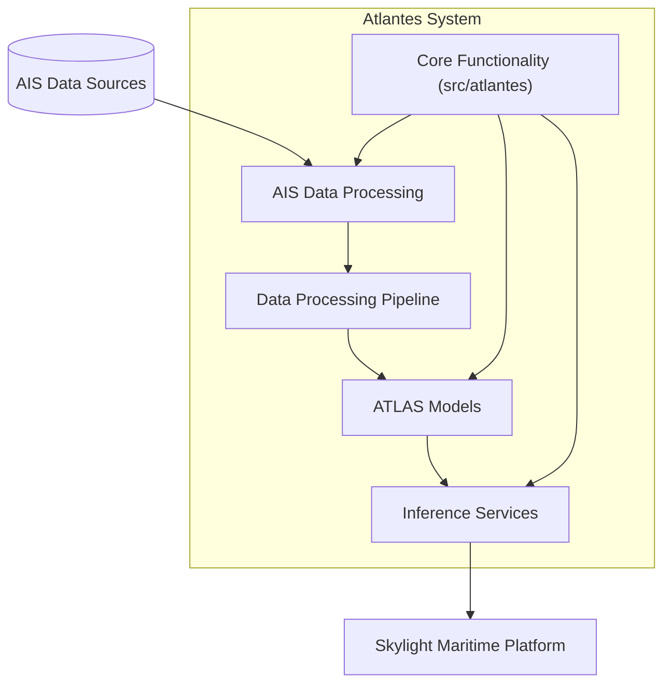

Sources: [README.md:3-6](), [ais/README.md:1-8]()

## Core Components and Relationships

The Atlantes system consists of several key components that work together to process AIS data and provide analytical insights:

1. **Core Functionality** - Located in `src/atlantes`, this contains the fundamental logic and utilities used throughout the system.
2. **AIS Data Processing** - Handles the loading, cleaning, and preprocessing of AIS data.
3. **ATLAS Models** - The machine learning models that perform activity and entity classification.
4. **Data Processing Pipeline** - Transforms raw AIS data into features for model training and inference.
5. **Inference Services** - Provides API endpoints for model inference and result delivery.

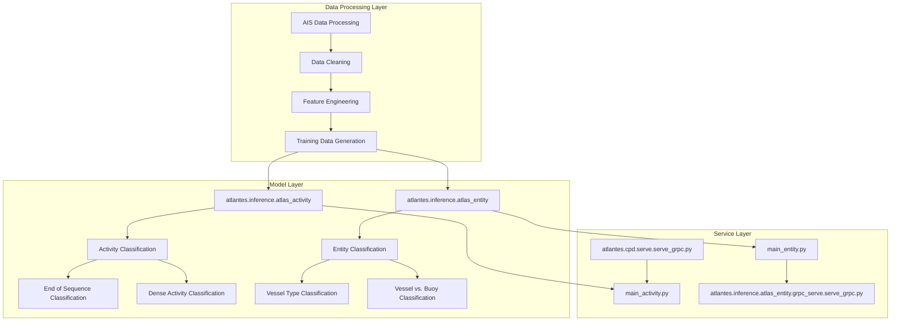

Sources: [ais/README.md:14-24](), [ais/docker-compose.yml:9-100]()

## Data Flow Architecture

The following diagram illustrates how data flows through the Atlantes system, from ingestion to final results:

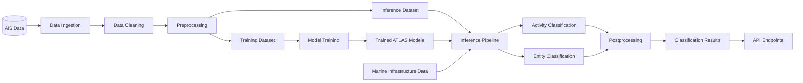

Sources: [ais/README.md:14-26]()

## Service Architecture

Atlantes provides multiple services that offer different analytical capabilities. Each service runs as a separate process with its own API endpoints:

### Main Services

| Service | File Path | Description | Port |
|---------|-----------|-------------|------|
| Activity Service | `src/main_activity.py` | Provides activity classification capabilities | 8000 |
| Entity Service | `src/main_entity.py` | Provides entity classification capabilities | 8001 |
| CPD gRPC Service | `src/atlantes/cpd/serve/serve_grpc.py` | Provides contextual property detection | 5206 |
| Entity Postprocessor | `src/atlantes/inference/atlas_entity/grpc_serve/serve_grpc.py` | Performs postprocessing on entity classification results | 5207 |

Each service has specific responsibilities:

1. **Activity Service**: Classifies vessel activities such as fishing, anchoring, and transiting
2. **Entity Service**: Classifies entity types (vessel vs. buoy, vessel types)
3. **CPD Service**: Detects contextual properties to enhance activity classification
4. **Entity Postprocessor**: Performs additional processing on entity classification results

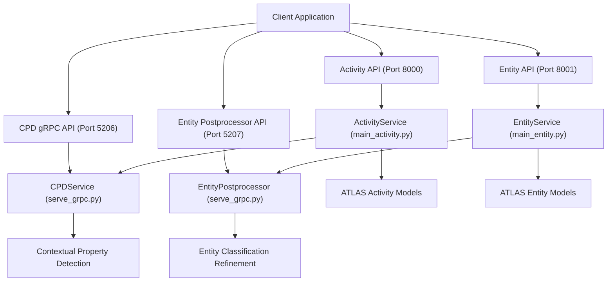

Sources: [ais/docker-compose.yml:9-100]()

## Deployment Architecture

Atlantes is deployed using Docker containers, with each service running in its own container. The following diagram illustrates the deployment architecture:

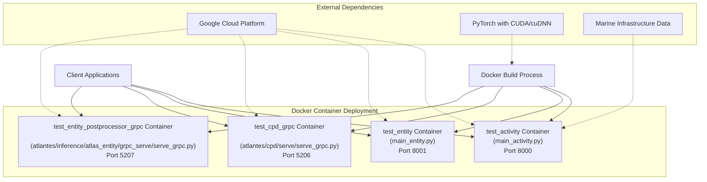

Sources: [ais/docker-compose.yml:1-100]()

## ATLAS Model Architecture

The ATLAS (AIS Transformer Learning with Active Subpaths) models are the core machine learning components of the system:

### Activity Classification Models

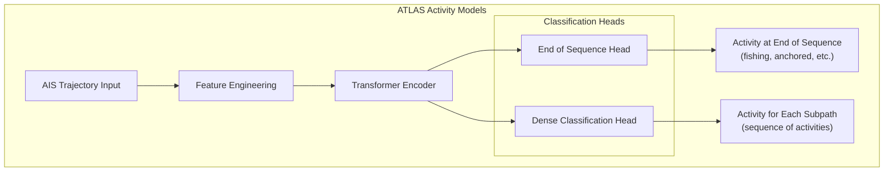

### Entity Classification Models

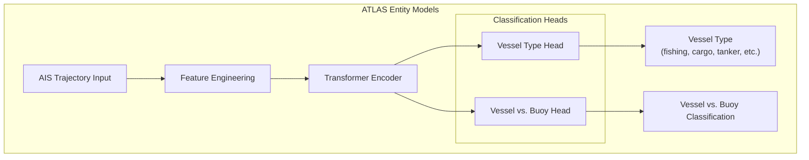

Sources: [ais/README.md:14-26]()

## System Integration

The Atlantes system is integrated with the Skylight maritime intelligence platform, providing real-time analytics for maritime vessel tracking and monitoring. The system communicates with external services and data sources through its API endpoints, making it a modular and extensible architecture.

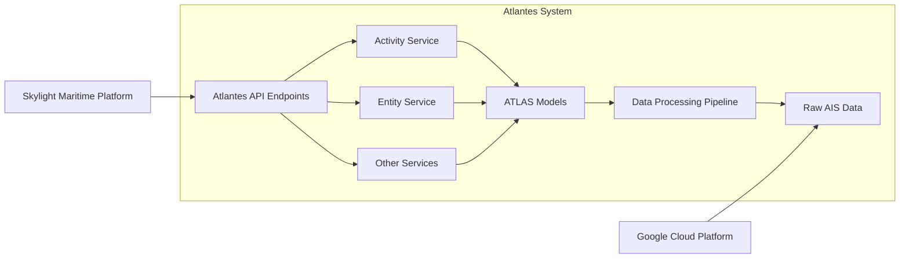

Sources: [README.md:3-6](), [ais/README.md:1-8]()

---

# Page: Core Components

# Core Components

<details>
<summary>Relevant source files</summary>

The following files were used as context for generating this wiki page:

- [ais/README.md](ais/README.md)
- [ais/src/atlantes/atlas/ais_dataset.py](ais/src/atlantes/atlas/ais_dataset.py)

</details>


This page provides an overview of the primary functional components that make up the Atlantes system. Atlantes is a real-time GPS trajectory modeling system for processing maritime AIS (Automatic Identification System) data to classify vessel activities and entities. This page summarizes the main components and how they interact to form the complete system.

For detailed information about system architecture, see [System Architecture](#1.2). For more specifics on individual components, refer to the subpages on [ATLAS Models](#2.1), [Data Processing Pipeline](#2.2), and [Inference Services](#2.3).

## Core Components Overview

Atlantes consists of several interconnected components that work together to process AIS data and provide vessel activity and entity classifications:

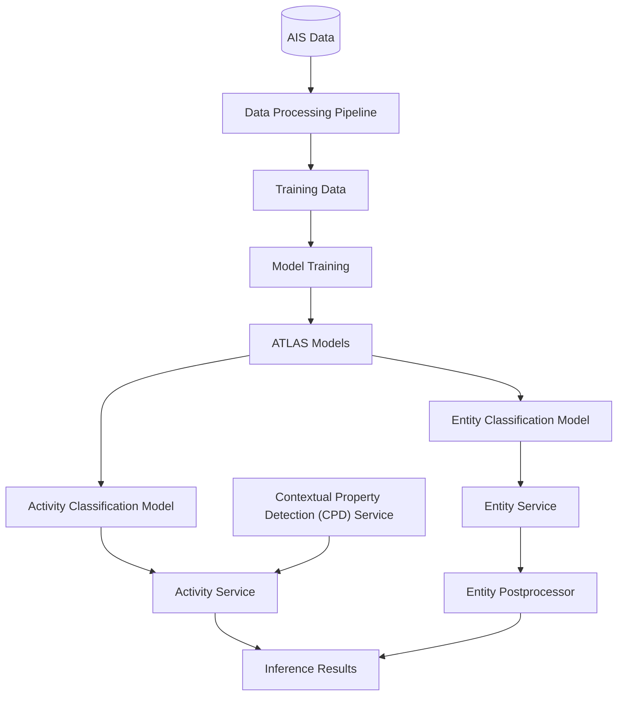

Sources: [ais/README.md:16-25](). This diagram reflects the Atlantes AIS modeling tasks described in lines 16-25 of the README, showing the two main classification tasks.

## ATLAS Models

At the core of Atlantes are two main machine learning model systems collectively referred to as ATLAS (AIS Transformer Learning with Active Subpaths):

### Activity Classification Models

The Activity Classification models focus on determining what vessels are doing based on their movement patterns:

1. **End of Sequence Activity Classification**: Classifies the activity of a vessel at the end of a trajectory (e.g., fishing, anchored, transiting).
2. **Dense Activity Classification**: Classifies the activity for each subpath within a trajectory, providing a more granular view of vessel behavior over time.

### Entity Classification Models

The Entity Classification models focus on identifying what type of entity is transmitting AIS data:

1. **Vessel vs. Buoy Classification**: Distinguishes whether an AIS signal is coming from a vessel or a stationary buoy.
2. **Vessel Type Classification**: Identifies the specific type of vessel (e.g., fishing vessel, cargo ship, tanker).

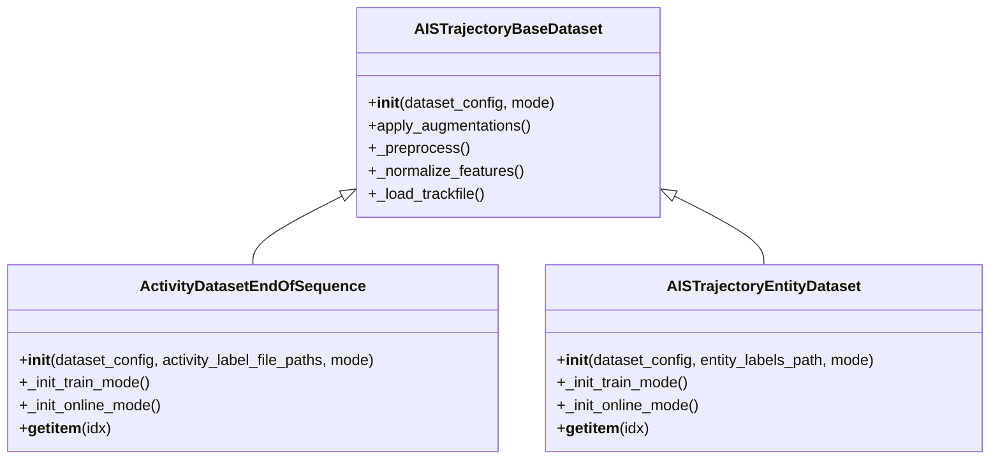

Sources: [ais/src/atlantes/atlas/ais_dataset.py:60-1119]()

## Data Processing Pipeline

The Data Processing Pipeline handles the ingestion, cleaning, and transformation of AIS data for both model training and inference.

### Key Components of the Data Processing Pipeline:

1. **Data Loading**: Reading and parsing AIS data from various sources (CSV, Parquet).
2. **Preprocessing**: Cleaning and standardizing the raw AIS data.
3. **Feature Engineering**: Computing derived features such as:
   - Relative course over ground (rel_cog)
   - Amount of light (based on solar position)
   - Spatial intervals (using haversine distance)
   - Temporal intervals (time between AIS messages)
4. **Normalization**: Applying various transformations to features (sqrt, log, z-scaling).
5. **Augmentation**: Data augmentation for training robustness.

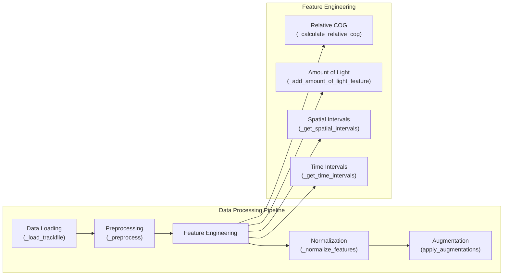

Sources: [ais/src/atlantes/atlas/ais_dataset.py:299-401]()

## Inference Services

Atlantes provides several services that expose the ATLAS models for real-time inference:

### Key Inference Services

1. **Activity Service**: Classifies vessel activities using the ATLAS Activity Model.
2. **Entity Service**: Classifies vessels and buoys using the ATLAS Entity Model.
3. **Entity Postprocessor**: Post-processes entity classification results.
4. **Contextual Property Detection (CPD) Service**: Provides contextual information to the Activity Service.

These services are exposed through gRPC interfaces and are typically deployed as Docker containers.

```mermaid
flowchart TD
    subgraph "Docker Containers"
        ActivityService["Activity Service\n(Port 8000)"]
        EntityService["Entity Service\n(Port 8001)"]
        CPDService["CPD Service\n(Port 5206)"]
        EntityPostprocessor["Entity Postprocessor\n(Port 5207)"]
    end
    
    AISData[("AIS Data")] --> ActivityService
    AISData --> EntityService
    
    MarineData[("Marine Infrastructure Data")] --> CPDService
    
    CPDService --> ActivityService
    EntityService --> EntityPostprocessor
    
    ActivityService --> Client["Client Applications"]
    EntityPostprocessor --> Client
```

Sources: [ais/README.md:119-122](), referring to the deployment documentation mentioned in the README.

## Core Libraries and Dependencies

Atlantes relies on several key libraries and frameworks for its functionality:

| Library | Purpose |
|---------|---------|
| PyTorch | Deep learning framework for model implementation |
| Dask | Parallel and distributed data processing |
| Pandas | Data manipulation and analysis |
| Pandera | Schema-based validation for DataFrames |
| Wandb | Experiment tracking |
| Beaker | AI2 experimentation platform |

The system also requires authentication to Google Cloud Platform (GCP) for accessing AIS data and weights and biases for experiment tracking.

```mermaid
flowchart LR
    subgraph "Atlantes Core Dependencies"
        PyTorch["PyTorch\n(Modeling)"]
        Dask["Dask\n(Parallel Processing)"]
        Pandas["Pandas\n(Data Manipulation)"]
        Pandera["Pandera\n(Schema Validation)"]
        Wandb["Wandb\n(Experiment Tracking)"]
        Beaker["Beaker\n(AI2 Platform)"]
    end
    
    subgraph "External Dependencies"
        GCP["Google Cloud Platform\n(Data Storage)"]
        GPU["CUDA/cuDNN\n(GPU Acceleration)"]
    end
    
    Atlantes["Atlantes System"] --> PyTorch
    Atlantes --> Dask
    Atlantes --> Pandas
    Atlantes --> Pandera
    Atlantes --> Wandb
    Atlantes --> Beaker
    
    Atlantes --> GCP
    PyTorch --> GPU
```

Sources: [ais/README.md:26-33]()

## Dataset Classes

The dataset components are critical for both training and inference. Atlantes implements specialized dataset classes for handling AIS trajectory data:

### Base Dataset Class

The `AISTrajectoryBaseDataset` serves as the foundation for all trajectory datasets, providing common functionality for:
- Loading and preprocessing trajectory data
- Computing spatiotemporal intervals for the Continuous Point Embedding (CPE)
- Normalizing features
- Applying data augmentations

### Specialized Dataset Classes

1. **ActivityDatasetEndOfSequence**: Handles data for activity classification
   - Loads trajectory and corresponding activity labels
   - Prepares input features and labels for the activity model
   - Supports both training and online (inference) modes

2. **AISTrajectoryEntityDataset**: Handles data for entity classification
   - Loads trajectory and corresponding entity labels
   - Prepares input features and labels for the entity model
   - Supports both training and online (inference) modes

```mermaid
flowchart TD
    subgraph "Dataset Workflow"
        TrackFile["Trajectory File\n(.csv or .parquet)"] --> LoadTrack["_load_trackfile()"]
        LoadTrack --> Preprocess["_preprocess()"]
        Preprocess --> FeatureEng["Feature Engineering"]
        FeatureEng --> Normalize["_normalize_features()"]
        Normalize --> Intervals["Compute Intervals\n(_get_spatial_intervals, _get_time_intervals)"]
        Intervals --> ModelInput["Model Input Tensors"]
    end
    
    subgraph "Dataset Modes"
        Train["Train Mode\n(with labels)"]
        Online["Online Mode\n(inference)"]
    end
    
    Train --> LoadTrack
    Online --> LoadTrack
```

Sources: [ais/src/atlantes/atlas/ais_dataset.py:60-119](), [ais/src/atlantes/atlas/ais_dataset.py:537-923](), [ais/src/atlantes/atlas/ais_dataset.py:928-1119]()

## Data Flow Through Components

To understand how the components work together, here's a data flow diagram showing how AIS data is processed through the system:

```mermaid
flowchart LR
    AIS[("AIS Data")] --> DataProc["Data Processing"]
    DataProc --> TrajDS["AISTrajectoryBaseDataset"]
    
    subgraph "Training Flow"
        TrajDS --> ActDS["ActivityDatasetEndOfSequence\n(Train Mode)"]
        TrajDS --> EntDS["AISTrajectoryEntityDataset\n(Train Mode)"]
        ActDS --> ActTrain["Activity Model\nTraining"]
        EntDS --> EntTrain["Entity Model\nTraining"]
        ActTrain --> ActModel["Trained Activity\nModel"]
        EntTrain --> EntModel["Trained Entity\nModel"]
    end
    
    subgraph "Inference Flow"
        TrajDS --> ActDSOnline["ActivityDatasetEndOfSequence\n(Online Mode)"]
        TrajDS --> EntDSOnline["AISTrajectoryEntityDataset\n(Online Mode)"]
        ActModel --> ActServ["Activity Service"]
        EntModel --> EntServ["Entity Service"]
        ActDSOnline --> ActServ
        EntDSOnline --> EntServ
        CPD["CPD Service"] --> ActServ
        EntServ --> EntPost["Entity Postprocessor"]
    end
    
    ActServ --> API["API Endpoints"]
    EntPost --> API
```

Sources: [ais/src/atlantes/atlas/ais_dataset.py:145-148](), [ais/src/atlantes/atlas/ais_dataset.py:585-616](), [ais/src/atlantes/atlas/ais_dataset.py:985-987](), [ais/README.md:90-95]()

This data flow diagram shows how AIS data moves through the system from initial processing to final API endpoints, including both the training and inference paths.

---

# Page: ATLAS Models

# ATLAS Models

<details>
<summary>Relevant source files</summary>

The following files were used as context for generating this wiki page:

- [ais/README.md](ais/README.md)
- [ais/examples/atlas_activity_request.py](ais/examples/atlas_activity_request.py)
- [ais/examples/atlas_entity_buoy_vessel_request.py](ais/examples/atlas_entity_buoy_vessel_request.py)
- [ais/src/atlantes/atlas/ais_dataset.py](ais/src/atlantes/atlas/ais_dataset.py)

</details>


This document details the ATLAS (AIS Transformer Learning with Active Subpaths) models used in the Atlantes system. These models are the core machine learning components that process AIS (Automatic Identification System) trajectory data to classify maritime vessel activities and entity types. For information about how these models are deployed as services, see [Inference Services](#2.3).

## Overview of ATLAS Models

ATLAS models are specialized neural network architectures designed to analyze time-series GPS trajectory data from vessels. They form the analytical backbone of the Atlantes system, enabling real-time classification of vessel behaviors and characteristics.

```mermaid
flowchart TD
    subgraph "ATLAS Model Types"
        AtlasActivity["ATLAS Activity Models"]
        AtlasEntity["ATLAS Entity Models"]
    end
    
    subgraph "Activity Classification Tasks"
        EOS["End-of-Sequence\nClassification"]
        Dense["Dense Activity\nClassification"]
    end
    
    subgraph "Entity Classification Tasks"
        VesselType["Vessel Type\nClassification"]
        BuoyVessel["Vessel vs. Buoy\nClassification"]
    end
    
    AtlasActivity --> EOS
    AtlasActivity --> Dense
    AtlasEntity --> VesselType
    AtlasEntity --> BuoyVessel
    
    AISData["AIS Trajectory Data"] --> AtlasActivity
    AISData --> AtlasEntity
    
    EOS --> ActivityOutput["Activity Labels\n(fishing, anchored, etc.)"]
    Dense --> DenseOutput["Per-Subpath Activity Labels"]
    VesselType --> TypeOutput["Vessel Type Labels\n(cargo, fishing, etc.)"]
    BuoyVessel --> BuoyOutput["Entity Type Labels\n(vessel or buoy)"]
```

Sources: [ais/README.md:15-24]()

## ATLAS Model Architecture

The ATLAS models use a transformer-based architecture optimized for spatial-temporal data processing. They incorporate continuous point embeddings to capture the nuances of vessel movement patterns across varying time and space intervals.

```mermaid
flowchart TD
    Input["Trajectory Input\n(lat, lon, sog, cog, etc.)"] --> Preprocess["Preprocessing\n& Feature Engineering"]
    Preprocess --> FeatureNorm["Feature Normalization"]
    
    subgraph "Core Model Architecture"
        FeatureNorm --> CPE["Continuous Point Embedding\n(spatiotemporal_intervals)"]
        FeatureNorm --> Features["Feature Vectors\n(traj_array/traj_tensor)"]
        
        CPE --> Transformer["Transformer Encoder"]
        Features --> Transformer
        
        Transformer --> TaskSpecific["Task-Specific\nOutput Layers"]
    end
    
    TaskSpecific --> Classification["Classification Output"]
    
    subgraph "Metadata Integration"
        Meta["Metadata\n(vessel type, flag code, etc.)"] --> TaskSpecific
    end
```

Sources: [ais/src/atlantes/atlas/ais_dataset.py:61-91](), [ais/src/atlantes/atlas/ais_dataset.py:250-332]()

## ATLAS Activity Models

ATLAS Activity models analyze vessel trajectories to classify the activities being performed by vessels. These models come in two variants:

### End of Sequence Activity Classification

This model classifies the activity of a vessel based on the entire trajectory, particularly focused on the end of the sequence. It determines what a vessel was doing at the end of its observed track (e.g., fishing, anchored, transiting).

Key features:
- Works with trajectories of at least `MIN_AIS_MESSAGES` messages (configurable parameter)
- Produces a single activity label for the trajectory
- Used for real-time activity monitoring and historical analysis

### Dense Activity Classification 

This model provides activity classification for each subpath within a trajectory, enabling detailed analysis of how a vessel's activities change over time.

Key features:
- Analyzes activity changes throughout a journey
- Outputs multiple labels across the trajectory
- Useful for detailed behavior analysis and pattern detection

Sources: [ais/README.md:16-19](), [ais/src/atlantes/atlas/ais_dataset.py:537-922]()

## ATLAS Entity Models

ATLAS Entity models classify the type of entity sending AIS signals. These models address two main classification tasks:

### Vessel vs. Buoy Classification

This model distinguishes whether an AIS transmitter is aboard a vessel or attached to a stationary buoy.

Key features:
- Analyzes movement patterns to differentiate mobile vessels from stationary markers
- Helps filter out non-vessel signals from analysis
- Important for improving data quality in maritime monitoring

### Vessel Type Classification

This model identifies the type of vessel (e.g., fishing vessel, cargo ship, tanker) based on its movement patterns.

Key features:
- Classifies vessels into different categories based on trajectory characteristics
- Supports identification even when vessel type metadata is missing or inaccurate
- Critical for maritime domain awareness and regulatory compliance monitoring

Sources: [ais/README.md:22-24](), [ais/src/atlantes/atlas/ais_dataset.py:928-1119]()

## Data Processing and Input Format

The ATLAS models ingest AIS trajectory data that has been preprocessed into a structured format. The system handles various input formats and performs necessary transformations.

```mermaid
flowchart TD
    RawAIS["Raw AIS Messages"] --> TrackGeneration["Trajectory Assembly"]
    TrackGeneration --> Preprocessing["Data Preprocessing\n(AISTrajectoryBaseDataset._preprocess)"]
    
    Preprocessing --> FeatureEngineering["Feature Engineering"]
    FeatureEngineering --> SpatialIntervals["Spatial Intervals\n(_get_spatial_intervals)"]
    FeatureEngineering --> TimeIntervals["Time Intervals\n(_get_time_intervals)"]
    FeatureEngineering --> CustomFeatures["Custom Features\n(amount_of_light, rel_cog)"]
    
    SpatialIntervals --> SpatioTemporal["Spatiotemporal Intervals Tensor"]
    TimeIntervals --> SpatioTemporal
    CustomFeatures --> FeatureArray["Feature Array"]
    
    Metadata["Metadata\n(flag_code, ship_type, etc.)"] --> ModelInput["Model Input Dictionary"]
    SpatioTemporal --> ModelInput
    FeatureArray --> ModelInput
    
    ModelInput --> AtlasModels["ATLAS Models"]
```

### Key Input Components

1. **Trajectory Data**: Series of AIS messages with positional and navigational data
   - Latitude and longitude
   - Speed over ground (sog)
   - Course over ground (cog)
   - Timestamp (send)
   - Navigation status (nav)
   - Distance to coast (dist2coast)

2. **Spatiotemporal Intervals**: Calculated from the trajectory data
   - Time intervals between points
   - Spatial distances between points
   - Used by the Continuous Point Embedding (CPE) component

3. **Metadata**: Additional information about the vessel
   - MMSI (Maritime Mobile Service Identity)
   - Vessel name
   - Flag code
   - Vessel category/type

Sources: [ais/src/atlantes/atlas/ais_dataset.py:356-465](), [ais/examples/atlas_activity_request.py:23-45](), [ais/examples/atlas_entity_buoy_vessel_request.py:21-28]()

## Model Usage and Inference

The ATLAS models are exposed through HTTP endpoints that accept JSON-formatted requests containing trajectory data.

### Activity Classification Inference

Activity classification requests include a batch of trajectories for classification.

Example request structure:
```
{
    "tracks": [
        {
            "track_id": "test-0",
            "track_data": [
                {"lat": 40.7128, "lon": -74.0060, "sog": 10.5, "cog": 180.0, ...},
                ...
            ]
        }
    ]
}
```

Response contains activity classifications:
```
{
    "predictions": [
        {
            "track_id": "test-0",
            "classification": "fishing",
            "confidence": 0.92
        }
    ]
}
```

### Entity Classification Inference

Entity classification follows a similar request/response pattern but provides entity type classifications.

Example response for entity classification:
```
{
    "predictions": [
        {
            "track_id": "test-0",
            "classification": "cargo_vessel",
            "confidence": 0.87
        }
    ]
}
```

Sources: [ais/examples/atlas_activity_request.py:52-94](), [ais/examples/atlas_entity_buoy_vessel_request.py:35-80]()

## Model Dataset Classes

The ATLAS models use specialized dataset classes to handle training and inference data:

```mermaid
classDiagram
    class AISTrajectoryBaseDataset {
        +dict dataset_config
        +str mode
        +int min_ais_messages
        +int max_trajectory_length
        +int cpe_kernel_size
        +_preprocess()
        +_get_spatial_intervals()
        +_get_time_intervals()
        +apply_augmentations()
    }
    
    class ActivityDatasetEndOfSequence {
        +list trajectories
        +_initialize_target_classes()
        +__getitem__()
        +_load_track_context()
    }
    
    class AISTrajectoryEntityDataset {
        +list trajectories
        +_initialize_target_classes()
        +__getitem__()
    }
    
    AISTrajectoryBaseDataset <|-- ActivityDatasetEndOfSequence
    AISTrajectoryBaseDataset <|-- AISTrajectoryEntityDataset
```

### Key Dataset Features

1. **Mode-based Operations**: Datasets can operate in different modes:
   - `train`: For model training with labeled data
   - `eval`: For model evaluation with labeled data
   - `online`: For inference with unlabeled data

2. **Data Augmentation**: During training, trajectories can be augmented to improve model robustness
   - Configurable augmentation pipeline
   - Supports both composition and random choice of augmentations

3. **Feature Normalization**: Input features are normalized according to configurable strategies
   - z-scaling
   - log transformation
   - square root transformation

4. **Dynamic Context Handling**: Activity models can work with varying context lengths
   - Minimum context requirements for reliable classification
   - Maximum context limits for computational efficiency

Sources: [ais/src/atlantes/atlas/ais_dataset.py:60-136](), [ais/src/atlantes/atlas/ais_dataset.py:537-584](), [ais/src/atlantes/atlas/ais_dataset.py:928-969]()

## Conclusion

The ATLAS models form the core machine learning engine of the Atlantes system, enabling accurate classification of vessel activities and entity types from AIS trajectory data. These models are designed to work with real-time streaming data and can be deployed as services within the larger Atlantes architecture. The modular design allows for different classification tasks to be handled by specialized models, all built on a common foundation of trajectory data processing.

Sources: [ais/README.md:1-10]()

---

# Page: Data Processing Pipeline

# Data Processing Pipeline

<details>
<summary>Relevant source files</summary>

The following files were used as context for generating this wiki page:

- [ais/src/atlantes/atlas/ais_dataset.py](ais/src/atlantes/atlas/ais_dataset.py)
- [ais/src/atlantes/feedback/run_pipeline_on_local_files.py](ais/src/atlantes/feedback/run_pipeline_on_local_files.py)

</details>


## Purpose and Scope

This document describes the data processing pipeline used in Atlantes to transform raw AIS (Automatic Identification System) data into structured formats suitable for model training and inference. The pipeline handles data cleaning, feature engineering, normalization, and preparation for both the ATLAS Activity and Entity models. For information about the ATLAS models themselves, see [ATLAS Models](#2.1).

## Overview of the Pipeline

The data processing pipeline is a critical component connecting raw AIS data to model training and inference. It transforms messy, real-world vessel trajectory data into clean, normalized, feature-rich data ready for machine learning.

```mermaid
flowchart TD
    subgraph "Data Processing Pipeline"
        direction LR
        AIS["AIS Data Sources"] --> DataLoad["Data Loading"]
        DataLoad --> Preprocess["Preprocessing"]
        Preprocess --> FeatureEng["Feature Engineering"]
        FeatureEng --> Normalize["Feature Normalization"]
        Normalize --> ModelReady["Model-Ready Data"]
    end
    
    ModelReady --> Train["Training Pipeline"]
    ModelReady --> Inference["Inference Pipeline"]
    
    subgraph "Dataset Classes"
        Base["AISTrajectoryBaseDataset"]
        Activity["ActivityDatasetEndOfSequence"]
        Entity["AISTrajectoryEntityDataset"]
        
        Base --> Activity
        Base --> Entity
    end
```

Sources: [ais/src/atlantes/atlas/ais_dataset.py:60-535]()

## Data Sources and Format

The pipeline processes AIS data which comes in two primary formats:

1. CSV files with standard AIS fields
2. Parquet files with optimized storage and retrieval

Both formats contain trajectory data for vessels, including geographic coordinates, timestamps, speed, course, vessel identifiers, and metadata.

### Key Data Fields

| Field | Description | Usage |
|-------|-------------|-------|
| `lat` | Latitude | Spatial positioning |
| `lon` | Longitude | Spatial positioning |
| `send` | Timestamp | Temporal information |
| `cog` | Course over ground | Direction of movement |
| `sog` | Speed over ground | Velocity |
| `category` | Vessel type category | Entity classification |
| `trackId` | Unique trajectory identifier | Record linking |
| `mmsi` | Maritime Mobile Service Identity | Vessel identification |
| `flag_code` | Vessel's flag country | Entity attribution |

Sources: [ais/src/atlantes/atlas/ais_dataset.py:467-529]()

## Pipeline Components

### 1. Data Loading

The first step involves loading data from CSV or Parquet files. The system provides specialized methods for both formats and automatically detects the file type.

```mermaid
flowchart TD
    Input["Input Data Path"] --> FileType{"File Type?"}
    FileType -->|".parquet"| LoadParquet["Load Track Parquet"]
    FileType -->|".csv"| LoadCSV["Load Track CSV"]
    
    LoadParquet --> TrackDF["Trajectory DataFrame"]
    LoadCSV --> TrackDF
```

Sources: [ais/src/atlantes/atlas/ais_dataset.py:467-529]()

### 2. Preprocessing

Raw AIS data requires several preprocessing steps to ensure quality and consistency:

```mermaid
flowchart LR
    Raw["Raw Trajectory"] --> Validate["Schema Validation"]
    Validate --> Sort["Sort by Timestamp"]
    Sort --> Filter["Filter Anomalies"]
    Filter --> Clean["Data Cleaning"]
    Clean --> Preproc["Preprocessed Data"]
```

The `_preprocess` method ensures that:
- Data adheres to the expected schema (TrackfileDataModelTrain)
- Records are sorted chronologically
- Data types are correctly coerced
- Any required basic calculations are performed

Sources: [ais/src/atlantes/atlas/ais_dataset.py:334-354]()

### 3. Feature Engineering

The pipeline enriches the data with derived features to improve model performance:

#### Spatiotemporal Features

One key feature engineering aspect is the creation of spatiotemporal intervals, which capture both distance and time relationships between sequential AIS messages:

1. **Spatial Intervals**: Calculates distances in meters between points using the Haversine formula
   - Implementation: `_get_spatial_intervals` method
   
2. **Temporal Intervals**: Calculates time differences in seconds between sequential messages
   - Implementation: `_get_time_intervals` method

3. **Combined Spatiotemporal Intervals**: Stacks both intervals to create a unified representation

Sources: [ais/src/atlantes/atlas/ais_dataset.py:259-332]()

#### Additional Derived Features

The pipeline also calculates:

1. **Relative Course Over Ground (rel_cog)**: Measures the angular difference in the vessel's course between successive points
   - Implementation: `_calculate_relative_cog` method

2. **Amount of Light**: Calculates solar altitude to determine daylight conditions
   - Implementation: `_add_amount_of_light_feature` method

Sources: [ais/src/atlantes/atlas/ais_dataset.py:356-393]()

### 4. Feature Normalization

Raw features have different scales and distributions. The normalization process transforms them into consistent ranges suitable for neural networks:

```mermaid
flowchart TD
    Input["Input Features"] --> Config["Normalization Config"]
    Input --> Transform{"Transform Type?"}
    
    Transform -->|"sqrt=True"| Sqrt["Apply Square Root"]
    Transform -->|"log=True"| Log["Apply Log(1+x)"]
    Transform -->|"z-scale=True"| ZScale["Apply Z-Standardization"]
    
    Sqrt --> Normalized["Normalized Features"]
    Log --> Normalized
    ZScale --> Normalized
```

The pipeline applies different normalization strategies per feature:
- Square root transformation for features with right-skewed distributions
- Log transformation for highly skewed or exponential data
- Z-scale normalization to standardize features to zero mean and unit variance

Sources: [ais/src/atlantes/atlas/ais_dataset.py:403-465]()

## Dataset Classes for Model Training

The pipeline includes specialized dataset classes that inherit from a common base class and prepare data specifically for each model type:

```mermaid
classDiagram
    class AISTrajectoryBaseDataset {
        <<Abstract>>
        +__init__(dataset_config, mode)
        +is_train()
        +is_eval()
        +is_online()
        +apply_augmentations()
        +_preprocess()
        +_get_spatial_intervals()
        +_get_time_intervals()
        +_normalize_features()
        +_load_trackfile()
        +__getitem__()* 
    }
    
    class ActivityDatasetEndOfSequence {
        +__init__(dataset_config, activity_label_file_paths, mode, in_memory_data, online_file_paths, label_enum)
        +_init_train_mode()
        +_init_online_mode()
        +_load_activity_label_file()
        +_load_target_classes()
        +filter_out_trackids()
        +_load_track_context()
        +__getitem__(idx)
    }
    
    class AISTrajectoryEntityDataset {
        +__init__(dataset_config, entity_labels_path, mode, in_memory_data, label_enum)
        +_init_train_mode()
        +_init_online_mode()
        +_initialize_target_classes()
        +__getitem__(idx)
    }
    
    AISTrajectoryBaseDataset <|-- ActivityDatasetEndOfSequence
    AISTrajectoryBaseDataset <|-- AISTrajectoryEntityDataset
```

Sources: [ais/src/atlantes/atlas/ais_dataset.py:60-535](), [ais/src/atlantes/atlas/ais_dataset.py:537-922](), [ais/src/atlantes/atlas/ais_dataset.py:928-1119]()

### Base Dataset Class

The `AISTrajectoryBaseDataset` provides common functionality:
- Loading and preprocessing track files
- Calculating spatiotemporal intervals
- Normalizing features
- Applying augmentations when in training mode

Sources: [ais/src/atlantes/atlas/ais_dataset.py:60-535]()

### Activity Classification Dataset

The `ActivityDatasetEndOfSequence` class prepares data for activity classification:
- Loads and processes labeled activity data
- Creates context windows of specified lengths
- Ensures minimum message counts for reliable prediction
- Returns prepared features and labels for training

Sources: [ais/src/atlantes/atlas/ais_dataset.py:537-922]()

### Entity Classification Dataset

The `AISTrajectoryEntityDataset` class prepares data for entity classification:
- Processes vessel type and buoy/vessel classification data
- Filters trajectories based on minimum requirements
- Returns prepared features and labels for entity classification

Sources: [ais/src/atlantes/atlas/ais_dataset.py:928-1119]()

## Data Augmentation

The pipeline supports data augmentation to improve model robustness. Augmentations can be applied in two modes:

1. **Compose mode**: Apply all selected augmentations sequentially
2. **Random choice mode**: Randomly select and apply one augmentation

Augmentations are configured in the dataset configuration and are only applied during training.

Sources: [ais/src/atlantes/atlas/ais_dataset.py:151-225]()

## Pipeline Integration for Inference

The data processing pipeline integrates with the inference system through a streamlined process:

```mermaid
flowchart LR
    Input["Input Track Data"] --> Preprocessor["AtlasActivityPreprocessor"]
    Preprocessor --> Model["AtlasActivityModel"]
    Model --> Postprocessor["AtlasActivityPostProcessor"]
    
    subgraph "AtlasActivityClassifier"
        Preprocessor
        Model
        Postprocessor
    end
    
    Postprocessor --> Output["Classification Results"]
```

The `AtlasActivityClassifier` encapsulates the entire pipeline for inference:
1. The preprocessor converts raw AIS data into model-ready features
2. The model makes predictions
3. The postprocessor converts model outputs into human-readable results

Sources: [ais/src/atlantes/feedback/run_pipeline_on_local_files.py:16-21](), [ais/src/atlantes/feedback/run_pipeline_on_local_files.py:24-28]()

## Configuration System

The data processing pipeline is highly configurable through a dataset configuration dictionary that specifies:

| Configuration Parameter | Description |
|-------------------------|-------------|
| `MIN_AIS_MESSAGES` | Minimum number of AIS messages required for processing |
| `MAX_TRAJECTORY_LENGTH` | Maximum number of messages to use from a trajectory |
| `CPE_KERNEL_SIZE` | Kernel size for continuous point embedding |
| `FEATURE_NORMALIZATION_CONFIG_ACTIVITY` | Feature-specific normalization settings for activity classification |
| `FEATURE_NORMALIZATION_CONFIG_ENTITY` | Feature-specific normalization settings for entity classification |
| `MODEL_INPUT_COLUMNS_ACTIVITY` | Features to use for activity classification |
| `MODEL_INPUT_COLUMNS_ENTITY` | Features to use for entity classification |
| `AUGMENTATION` | Data augmentation configuration |
| `RANDOM_STATE` | Seed for reproducibility |

Sources: [ais/src/atlantes/atlas/ais_dataset.py:63-97]()

## Conclusion

The data processing pipeline is a critical component of the Atlantes system, transforming raw AIS data into clean, feature-rich data suitable for training and inference. It supports both activity and entity classification tasks with specialized dataset classes and processing methods. The pipeline is designed to be configurable, extensible, and robust to handle the complexities of maritime trajectory data.

---

# Page: Inference Services

# Inference Services

<details>
<summary>Relevant source files</summary>

The following files were used as context for generating this wiki page:

- [ais/docker-compose.yml](ais/docker-compose.yml)
- [ais/examples/atlas_activity_request.py](ais/examples/atlas_activity_request.py)
- [ais/examples/atlas_entity_buoy_vessel_request.py](ais/examples/atlas_entity_buoy_vessel_request.py)
- [ais/examples/sample_response.json](ais/examples/sample_response.json)
- [ais/examples/sample_response_entity.json](ais/examples/sample_response_entity.json)

</details>


This page documents the inference services in the Atlantes system, which provide real-time classification capabilities for AIS trajectory data. These services expose the ATLAS models' functionality through standardized interfaces for integration with client applications such as the Skylight maritime platform.

For information about the underlying models, see [ATLAS Models](#2.1). For details on data processing prior to inference, see [Data Processing Pipeline](#2.2).

## Service Architecture

The Atlantes system provides four primary inference services, each handling different aspects of maritime trajectory classification:

```mermaid
flowchart TD
    Client["Client Applications"]
    
    subgraph "Inference Services"
        direction LR
        ActivityService["Activity Service\n(main_activity.py)"]
        EntityService["Entity Service\n(main_entity.py)"]
        CPDService["CPD Service\n(serve_grpc.py)"]
        EntityPostprocessor["Entity Postprocessor\n(serve_grpc.py)"]
    end
    
    subgraph "Underlying Models"
        AtlasActivity["ATLAS Activity Model"]
        AtlasEntity["ATLAS Entity Model"]
    end
    
    Client --> ActivityService
    Client --> EntityService
    Client --> CPDService
    Client --> EntityPostprocessor
    
    AtlasActivity --> ActivityService
    AtlasEntity --> EntityService
    
    ActivityService --> |"HTTP (Port 8000)"| Client
    EntityService --> |"HTTP (Port 8001)"| Client
    CPDService --> |"gRPC (Port 5206)"| Client
    EntityPostprocessor --> |"gRPC (Port 5207)"| Client
```

Sources: [ais/docker-compose.yml:1-100]()

## Service Details

### Activity Service

The Activity Service provides vessel activity classification (fishing, transiting, etc.) based on AIS trajectory data. It leverages the ATLAS Activity model to classify vessel behavior.

**Endpoint**: `/classify` (HTTP POST)
**Port**: 8000

**Request Format**:
```json
{
  "tracks": [
    {
      "track_id": "example-1",
      "track_data": [
        {"lat": 0.0, "lon": 0.0, "sog": 10.0, "cog": 90.0, ...},
        ...
      ]
    }
  ]
}
```

**Response Format**:
```json
{
  "predictions": [
    [
      "transiting",
      {
        "confidence": 0.919,
        "model": "ATLAS-Activity-Real-Time_...",
        "model_version": "...",
        "original_classification": "transiting",
        "outputs": [0.073, 0.006, 0.001, 0.919],
        "postprocessed_classification": "unknown",
        "rule_applied": "is_near_shore_threshold_applied"
      }
    ]
  ]
}
```

Sources: [ais/examples/atlas_activity_request.py:1-99](), [ais/examples/sample_response.json:1-38](), [ais/docker-compose.yml:9-32]()

### Entity Service

The Entity Service provides classification of vessel types and distinguishes between vessels and buoys based on AIS trajectory data. It's powered by the ATLAS Entity model.

**Endpoint**: `/classify` (HTTP POST)
**Port**: 8001

**Request Format**:
```json
{
  "tracks": [
    {
      "track_id": "example-1",
      "track_data": [
        {"lat": 0.0, "lon": 0.0, "sog": 10.0, "cog": 90.0, ...},
        ...
      ]
    }
  ]
}
```

**Response Format**:
```json
{
  "predictions": [
    [
      "unknown",
      {
        "confidence": 0.997,
        "confidence_threshold": 0.5,
        "model": "ATLAS-Buoy_...",
        "outputs": [0.997, 0.002],
        "postprocess_rule_applied": true,
        "postprocessed_classification": "unknown",
        "predicted_classification": "vessel"
      }
    ]
  ]
}
```

Sources: [ais/examples/atlas_entity_buoy_vessel_request.py:1-81](), [ais/examples/sample_response_entity.json:1-20](), [ais/docker-compose.yml:33-56]()

### CPD Service (Contextual Property Detection)

The CPD Service provides contextual property analysis of maritime vessels through a gRPC interface. This service helps enrich trajectory data with contextual information.

**Interface**: gRPC
**Port**: 5206

The service is implemented in [src/atlantes/cpd/serve/serve_grpc.py]() and exposes methods for contextual property detection.

Sources: [ais/docker-compose.yml:57-78]()

### Entity Postprocessor Service

The Entity Postprocessor Service applies post-processing rules to entity classification results through a gRPC interface. This improves classification accuracy by applying domain-specific knowledge and rules.

**Interface**: gRPC
**Port**: 5207

The service is implemented in [src/atlantes/inference/atlas_entity/grpc_serve/serve_grpc.py]() and handles refinement of entity classifications.

Sources: [ais/docker-compose.yml:79-100]()

## Service Flow

The following diagram illustrates how data flows through the inference services:

```mermaid
sequenceDiagram
    participant Client as "Client Application"
    participant Activity as "Activity Service (8000)"
    participant Entity as "Entity Service (8001)"
    participant CPD as "CPD Service (5206)"
    participant PostProc as "Entity Postprocessor (5207)"
    participant Models as "ATLAS Models"
    
    Client->>Activity: POST /classify (AIS track data)
    Activity->>Models: Process with ATLAS Activity model
    Activity->>CPD: Request contextual properties
    CPD-->>Activity: Return contextual information
    Activity-->>Client: Return activity classification
    
    Client->>Entity: POST /classify (AIS track data)
    Entity->>Models: Process with ATLAS Entity model
    Entity->>PostProc: Send for postprocessing
    PostProc-->>Entity: Return refined classification
    Entity-->>Client: Return entity classification
```

Sources: [ais/docker-compose.yml:1-100](), [ais/examples/atlas_activity_request.py:1-99](), [ais/examples/atlas_entity_buoy_vessel_request.py:1-81]()

## Deployment Configuration

All inference services are deployed as Docker containers with specific configuration parameters. The table below summarizes the deployment details for each service:

| Service | Container Name | Port | Command | Health Check |
|---------|---------------|------|---------|-------------|
| Activity Service | test_activity | 8000 | `python3 src/main_activity.py` | nc -zv 127.0.0.1 8000 |
| Entity Service | test_entity | 8001 | `python3 src/main_entity.py` | nc -zv 127.0.0.1 8001 |
| CPD Service | test_cpd_grpc | 5206 | `python3 /ais/src/atlantes/cpd/serve/serve_grpc.py` | nc -zv 127.0.0.1 5206 |
| Entity Postprocessor | test_entity_postprocessor_grpc | 5207 | `python3 /ais/src/atlantes/inference/atlas_entity/grpc_serve/serve_grpc.py` | nc -zv 127.0.0.1 5207 |

All services are configured with a shared memory size of 4.77GB to accommodate model loading and inference operations.

Sources: [ais/docker-compose.yml:1-100]()

## Client Usage

To interact with the inference services, clients can use standard HTTP requests for the Activity and Entity services, and gRPC calls for the CPD and Entity Postprocessor services.

Example code for sending a request to the Activity Service:

```python
import requests
import json

# Prepare AIS track data
track_data = [...] # List of AIS points with lat, lon, sog, cog, etc.

# Construct request
request_body = {
    "tracks": [
        {"track_id": "example-1", "track_data": track_data}
    ]
}

# Send request to Activity Service
response = requests.post(
    "http://localhost:8000/classify",
    json=request_body,
    timeout=600
)

# Process response
if response.ok:
    predictions = response.json()["predictions"]
    for prediction in predictions:
        classification = prediction[0]
        details = prediction[1]
        print(f"Classification: {classification}, Confidence: {details['confidence']}")
```

Similar patterns can be used for the Entity Service, with appropriate modifications to the endpoint URL.

Sources: [ais/examples/atlas_activity_request.py:52-95](), [ais/examples/atlas_entity_buoy_vessel_request.py:35-77]()

---

# Page: Development Guide

# Development Guide

<details>
<summary>Relevant source files</summary>

The following files were used as context for generating this wiki page:

- [.github/workflows/lint.yml](.github/workflows/lint.yml)
- [README.md](README.md)

</details>


This guide provides essential information for developers working on the Atlantes system. It covers the development environment setup, testing framework, and code quality standards. For information about deployment, see [Deployment](#4), and for core components, see [Core Components](#2).

## Development Environment Setup

Setting up your development environment is the first step to contributing to the Atlantes project. Follow these steps to get started.

### Prerequisites

Before beginning development on Atlantes, ensure you have:

- Python 3.12 or later
- Git with LFS support
- Docker (for running containerized services)
- CUDA-compatible GPU (optional, but recommended for model training and inference)

### Repository Setup

Clone the repository and install dependencies:

```bash
git clone https://github.com/allenai/atlantes
cd atlantes
pip install -r requirements.txt
```

### Pre-commit Hooks Setup

Atlantes uses pre-commit hooks to enforce coding standards:

```bash
pip install pre-commit
pre-commit install
```

The pre-commit configuration enforces:
- Static type checking with mypy (100% coverage)
- Documentation coverage with interrogate (minimum 90% coverage)
- Code formatting with black and ruff
- Security and best practice checks

```mermaid
flowchart TD
    commit["Git Commit"] --> precommit["Pre-commit Hooks"]
    precommit --> mypy["MyPy\nStatic Type Checking"]
    precommit --> interrogate["Interrogate\nDocumentation Coverage"]
    precommit --> black["Black\nCode Formatting"]
    precommit --> ruff["Ruff\nPython Linter"]
    
    mypy --> check1["Pass?"]
    interrogate --> check2["Pass?"]
    black --> check3["Pass?"]
    ruff --> check4["Pass?"]
    
    check1 -->|No| reject["Commit Rejected"]
    check2 -->|No| reject
    check3 -->|No| reject
    check4 -->|No| reject
    
    check1 -->|Yes| continue1
    check2 -->|Yes| continue2
    check3 -->|Yes| continue3
    check4 -->|Yes| continue4
    
    subgraph continue ["All Checks Passed"]
        continue1["✓"]
        continue2["✓"]
        continue3["✓"]
        continue4["✓"]
    end
    
    continue --> accept["Commit Accepted"]
```

Sources: [.github/workflows/lint.yml:1-33](), [README.md:23-33]()

### IDE Setup

The project recommends using Visual Studio Code with specific extensions for development:

| Required Extensions | Recommended Extensions |
|---------------------|------------------------|
| Black | GitHub Copilot |
|       | Augment |
|       | Gitless |
|       | Parquet Viewer |
|       | GitHub Actions |

Configure VS Code for optimal development experience with the recommended settings in the repository.

Sources: [README.md:35-50]()

## Development Workflow

The development workflow for Atlantes follows a standard Git-based approach with specific requirements for code quality.

```mermaid
flowchart LR
    start["Start Development"] --> branch["Create Feature Branch"]
    branch --> develop["Develop Changes"]
    develop --> test["Run Tests Locally"]
    test --> lint["Run Pre-commit Checks"]
    lint --> PR["Create Pull Request"]
    PR --> CI["CI/CD Runs Checks"]
    CI --> review["Code Review"]
    review --> merge["Merge to main"]
    
    develop -->|Iterate| test
    lint -->|Failures| develop
    CI -->|Failures| develop
    review -->|Requested Changes| develop
```

Sources: [README.md:51-61]()

## Project Structure

The Atlantes repository is organized into the following key directories:

```mermaid
graph TD
    root["atlantes/"] --> src["src/atlantes/"]
    root --> tests["tests/"]
    root --> testdata["test-data/"]
    root --> data["data/"]
    root --> requirements["requirements.txt"]
    
    src --> core["Core Functionality"]
    src --> models["ATLAS Models"]
    src --> services["Inference Services"]
    src --> dataproc["Data Processing"]
    
    services --> activity["Activity Service\nmain_activity.py"]
    services --> entity["Entity Service\nmain_entity.py"]
    services --> cpd["CPD gRPC Service"]
    services --> postproc["Entity Postprocessor\ngRPC Service"]
    
    tests --> unittest["Unit Tests"]
    tests --> integration["Integration Tests"]
    tests --> service["Service Tests"]
```

Sources: [README.md:8-18]()

## Testing Framework

Atlantes has a comprehensive testing framework to ensure system reliability and correctness.

### Test Types

The project uses three main types of tests:

1. **Unit Tests**: Test individual components and functions in isolation
2. **Integration Tests**: Test interactions between components
3. **Service Tests**: Test complete services as they would run in production

### Running Tests

To run the test suite:

```bash
# Run all tests
pytest

# Run specific test categories
pytest tests/unit/
pytest tests/integration/
pytest tests/service/

# Run with coverage report
pytest --cov=src/atlantes
```

### Test Data

The repository includes test data in the `test-data/` directory. This data is designed to exercise various parts of the system without requiring access to production data.

```mermaid
flowchart TD
    testdata["test-data/"] --> aistestdata["AIS Test Data"]
    testdata --> mockmodels["Mock Models"]
    testdata --> fixtures["Test Fixtures"]
    
    subgraph "Testing Process"
        test["Test Case"] --> setup["Setup\nLoad Test Data"]
        setup --> execute["Execute Component\nUnder Test"]
        execute --> verify["Verify Results"]
        verify --> cleanup["Cleanup"]
    end
    
    aistestdata -.- setup
    mockmodels -.- setup
    fixtures -.- setup
```

## Code Quality Standards

Atlantes maintains high code quality standards enforced through automated tools and code reviews.

### Static Type Checking

The project requires 100% type annotation coverage, enforced by MyPy. This ensures type safety and helps catch errors at development time.

Example type annotations:

```python
def process_trajectory(
    points: List[Dict[str, float]], 
    sample_rate: int = 60
) -> np.ndarray:
    """Process trajectory data into a standard format."""
    # Implementation
```

### Documentation Standards

Atlantes requires at least 90% documentation coverage for all modules and functions. Documentation should follow Google-style docstrings:

```python
def function_name(param1: type, param2: type) -> return_type:
    """Short description of function.
    
    Longer description explaining details.
    
    Args:
        param1: Description of param1
        param2: Description of param2
        
    Returns:
        Description of return value
        
    Raises:
        ExceptionType: When and why exception is raised
    """
```

### Code Style

The codebase follows:
- Black for code formatting
- Ruff for linting
- PEP 8 style guide with project-specific adaptations

### Bypassing Quality Checks

In rare cases, you may need to bypass quality checks for specific files or directories. This can be done by adding them to the excluded list in the `.pre-commit-config.yaml` file. However, this should be used sparingly and with good justification.

## Contribution Guidelines

When contributing to Atlantes:

1. Create a new branch for your feature or bugfix
2. Ensure all tests pass locally
3. Run pre-commit hooks to verify code quality
4. Write appropriate tests for your changes
5. Update documentation as needed
6. Submit a pull request against the main branch
7. Address review feedback

Sources: [README.md:51-61]()

## Troubleshooting Common Issues

### Pre-commit Hook Failures

If pre-commit hooks fail:

1. Check the error message for specific issues
2. Run `pre-commit run --all-files` to test all files
3. For type checking errors, add appropriate type annotations
4. For documentation coverage errors, add missing docstrings

### Testing Environment Issues

If you encounter environment-related test failures:

1. Ensure you have the latest dependencies installed
2. Check that your Python version matches the required version (3.12+)
3. For GPU-related issues, verify CUDA and PyTorch compatibility

## Development Best Practices

When developing for Atlantes:

1. **Follow the Code Structure**: Maintain the existing architectural patterns
2. **Incremental Development**: Make small, focused changes rather than large refactors
3. **Test-Driven Development**: Write tests before implementing features
4. **Documentation First**: Document your design decisions before implementation
5. **Performance Considerations**: Be mindful of the real-time nature of the system

Sources: [README.md:1-72]()

---

# Page: Setup and Dependencies

# Setup and Dependencies

<details>
<summary>Relevant source files</summary>

The following files were used as context for generating this wiki page:

- [README.md](README.md)
- [ais/README.md](ais/README.md)
- [ais/requirements/requirements.txt](ais/requirements/requirements.txt)

</details>


This page provides a comprehensive guide to setting up a development environment for the Atlantes system, including required dependencies, external services, and development tools. For information about the testing framework, see [Testing Framework](#3.2), and for deployment information, see [Deployment](#4).

## Environment Overview

The Atlantes system requires several components to be set up for both development and deployment. This section provides a high-level view of the system dependencies and requirements.

```mermaid
flowchart TD
    subgraph "Development Environment"
        Python["Python 3.9+"]
        CUDA["CUDA 12.1+"]
        PyTorch["PyTorch 2.1.2"]
        GCPAuth["GCP Authentication"]
        WandB["Weights & Biases"]
        PreCommit["Pre-commit Hooks"]
        DevTools["Development Tools"]
    end

    subgraph "External Services"
        GCP["Google Cloud Platform"]
        WandBService["Weights & Biases Service"]
        ElasticSearch["Elastic Search\n(Optional)"]
    end

    Python --> PyTorch
    CUDA --> PyTorch
    Python --> DevTools
    Python --> PreCommit
    GCP --> GCPAuth
    WandBService --> WandB
```

Sources: [README.md:12-16](). [ais/README.md:26-33](), [ais/README.md:38-67]()

## Python Environment Setup

The Atlantes system requires Python 3.9+ and several Python packages. Follow these steps to set up your Python environment:

1. Create a virtual environment:
   ```bash
   python3 -m venv .venv-atlantes
   source .venv-atlantes/bin/activate
   ```

2. Install the package with CUDA support:
   ```bash
   pip install --extra-index-url https://download.pytorch.org/whl/cu121 -e .
   ```

3. Install development dependencies:
   ```bash
   pip install -r requirements/dev.txt
   ```

### Key Dependencies

The table below lists the core dependencies required by the Atlantes system:

| Library | Purpose | Version |
|---------|---------|---------|
| PyTorch | Deep learning framework | 2.1.2 |
| Dask | Parallel and distributed data processing | 2023.4+ |
| Pandas | Data manipulation and analysis | 2.2+ |
| Pandera | DataFrame validation | 0.19+ |
| GRPC | Service communication | 1.65.1+ |
| FastAPI | API framework | 0.115.11 |
| GeoPandas | Geospatial data handling | 0.14+ |
| Wandb | Experiment tracking | 0.16+ |
| Protobuf | Protocol buffers | 4.25+ |

Sources: [ais/requirements/requirements.txt:1-138](), [ais/README.md:26-33]()

## External Services and Authentication

The Atlantes system relies on several external services that require authentication:

```mermaid
flowchart LR
    subgraph "Authentication Requirements"
        Dev["Developer"]
        GCP["GCP Authentication"]
        WandB["Weights & Biases"]
        ES["Elastic Search\n(Optional)"]
    end

    subgraph "Services"
        GCPService["Google Cloud Storage\n(AIS data & models)"]
        WandBService["Experiment Tracking"]
        ESService["Skylight Elastic Search\n(Dataset Generation)"]
    end

    Dev --> GCP
    Dev --> WandB
    Dev --> ES
    GCP --> GCPService
    WandB --> WandBService
    ES --> ESService

    GCPService --> AISData["AIS Trajectories\nand Metadata"]
    WandBService --> ExperimentLogs["Model Metrics\nand Experiments"]
    ESService --> SpecificDatasets["Optional Dataset\nGeneration Tasks"]
```

### GCP Authentication

Google Cloud Platform (GCP) authentication is required for accessing AIS trajectories and metadata:

1. Authenticate using the gcloud CLI:
   ```bash
   gcloud auth application-default login
   ```

2. For CI/CD environments, authentication occurs via stored secrets in GitHub Actions workflows.

### Weights & Biases Authentication

Weights & Biases (wandb) is used for logging experimental runs and tracking model performance:

1. Authenticate using the wandb CLI:
   ```bash
   wandb login
   ```

### Elastic Search (Ai2-specific, Optional)

For Ai2 developers who need access to Skylight's Elastic Search (only needed for specific dataset generation tasks):

1. Set environment variables:
   ```bash
   export SEARCH_USERNAME=<username>
   export SEARCH_PASSWORD=<password>
   ```

Sources: [ais/README.md:38-67]()

## Development Tools Configuration

### Pre-commit Hooks

Pre-commit hooks enforce code quality standards before allowing commits:

1. Install pre-commit:
   ```bash
   pip install pre-commit
   pre-commit install
   ```

2. Key pre-commit hooks include:
   - Static type checking (mypy)
   - Documentation coverage (interrogate)
   - Code formatting (black, ruff)

Note that the Atlantes codebase requires:
- 100% static type annotations
- At least 90% documentation coverage
- PEP 8 compliance

These checks can be bypassed for specific files by adding them to the excluded list in `.pre-commit-config.yaml`.

### IDE Setup

For VSCode users:

1. Required Extensions:
   - Black (Python formatter)

2. Recommended Extensions:
   - Copilot
   - Augment
   - Gitless
   - Parquet Viewer
   - GitHub Actions

3. VSCode settings are available in the repository.

Sources: [README.md:23-34](), [README.md:35-49]()

## Local Testing

### Running Tests

Run the test suite:

```bash
pytest tests --ignore=tests/test_main.py -vv
```

For parallel testing:

```bash
pytest tests --ignore=tests/test_main.py -xvs -n auto
```

### Local Service Testing with Docker

To test the services locally with Docker:

1. Save your GCP credentials path:
   ```bash
   export GOOGLE_APPLICATION_CREDENTIALS=<path-to-credentials>
   ```

2. Navigate to the `ais` directory and start the services:
   ```bash
   docker-compose up
   ```

3. Test the service:
   ```bash
   python examples/atlas_activity_request.py
   ```

## System Component Dependencies

The following diagram shows how the different components of the Atlantes system depend on each other and their associated external dependencies:

```mermaid
flowchart TD
    subgraph "Core Components"
        Core["src/atlantes\nCore Functionality"]
        AIS["AIS Data Processing"]
        Models["ATLAS Models"]
        DataProcess["Data Processing Pipeline"]
        Inference["Inference Services"]
    end

    subgraph "External Dependencies"
        PyTorch["PyTorch"]
        Dask["Dask"]
        Pandas["Pandas/GeoPandas"]
        GCP["Google Cloud Storage"]
        GRPC["gRPC Framework"]
        FastAPI["FastAPI Framework"]
    end

    PyTorch --> Models
    Dask --> DataProcess
    Pandas --> AIS
    Pandas --> DataProcess
    GCP --> AIS
    GCP --> Models
    GRPC --> Inference
    FastAPI --> Inference

    Core --> AIS
    Core --> Models
    Core --> Inference
    AIS --> DataProcess
    DataProcess --> Models
    Models --> Inference
```

Sources: [ais/README.md:14-16](), [ais/README.md:26-33](), [ais/requirements/requirements.txt:1-138]()

## Development Workflow

When developing for the Atlantes system, follow this general workflow:

1. Set up your environment as described above
2. Make your changes with proper typing and documentation
3. Run pre-commit hooks before committing (`pre-commit run --all-files`)
4. Run tests to ensure your changes don't break existing functionality
5. For model training, ensure you have proper authentication to GCP and wandb
6. For service testing, use the Docker setup to test locally

For more details on code quality requirements and standards, see [Code Quality and Standards](#3.3).

Sources: [README.md:51-62](), [ais/README.md:70-102]()

---

# Page: Testing Framework

# Testing Framework

<details>
<summary>Relevant source files</summary>

The following files were used as context for generating this wiki page:

- [.github/workflows/tests.yaml](.github/workflows/tests.yaml)
- [ais/tests/conftest.py](ais/tests/conftest.py)

</details>


## Purpose and Scope

This document details the testing infrastructure for Atlantes, explaining how to write and run tests for the system. The testing framework enables validation of all components in the Atlantes real-time GPS trajectory modeling system, including core functionality, models, and services. For information about code quality standards, see [Code Quality and Standards](#3.3), and for information about the CI/CD pipeline, see [CI/CD Pipeline](#4.3).

## Testing Architecture

The Atlantes testing framework uses pytest as the primary testing tool and is organized into multiple test categories to ensure comprehensive coverage of the codebase.

### Test Categories

```mermaid
flowchart TD
    subgraph "Test Categories"
        Unit["Unit Tests
        - Test individual functions
        - Fast execution"]
        Integration["Integration Tests 
        - Test component interactions
        - Include pipeline tests"]
        Service["Service Tests
        - Test deployed services
        - Exercise API endpoints"]
    end
    
    Unit --> Integration --> Service
```

Sources: [.github/workflows/tests.yaml:51-92]()

### Test Organization

```mermaid
flowchart LR
    subgraph "Repository Structure"
        Tests["tests/ directory"]
        TestsRoot["Root level tests
        Basic unit tests"]
        Integration["integration/ subdirectory
        Component interaction tests"]
        DirectoryInteg["Directory-specific tests
        (e.g., atlas_activity, atlas_entity)"]
    end
    
    Tests --> TestsRoot
    Tests --> Integration
    Integration --> DirectoryInteg
```

Sources: [.github/workflows/tests.yaml:53-89]()

## Test Execution

Atlantes provides multiple methods to execute tests, including local execution and automated CI/CD pipeline execution.

### Local Test Execution

Tests can be run locally using Docker Compose to ensure a consistent testing environment.

```mermaid
flowchart TD
    Start["Start Test Process"] --> DockerBuild["Build Docker images
    docker compose build"]
    DockerBuild --> RunUnit["Run unit tests
    docker compose run test_activity pytest ..."]
    RunUnit --> RunIntegration["Run integration tests"]
    RunIntegration --> RunService["Run service tests"]
    RunService --> End["Test Completion"]
```

Sources: [.github/workflows/tests.yaml:49-92]()

### CI/CD Pipeline Testing

Automated testing occurs on each pull request and push to the main branch, using a GPU-enabled runner for hardware acceleration.

```mermaid
flowchart TD
    PR["Pull Request / Push to main"] --> Checkout["Checkout code with Git LFS"]
    Checkout --> BuildImages["Build Docker images"]
    
    subgraph "Test Execution"
        UnitTests["Run unit and integration tests
        pytest -n auto"]
        PipelineTests["Run pipeline tests for
        atlas_entity and atlas_activity"]
        ServiceTests["Start services and
        run service tests"]
    end
    
    BuildImages --> UnitTests
    UnitTests --> PipelineTests 
    PipelineTests --> ServiceTests
    
    ServiceTests --> Success["Test Successful"]
    ServiceTests --> Failure["Test Failed"]
```

Sources: [.github/workflows/tests.yaml:16-92]()

## Test Fixtures and Data

The testing framework provides fixtures to access standardized test data and configurations, simplifying test development.

### Available Test Fixtures

```mermaid
flowchart TD
    subgraph "Test Fixtures"
        Config["Configuration Fixtures
        - atlas_activity_inference_config_fixture
        - atlas_entity_inference_config_fixture"]
        
        AISDfs["AIS Data Fixtures
        - test_ais_df1
        - test_ais_df2
        - test_ais_df3
        - test_buoy_df"]
        
        TrackDfs["Track Type Fixtures
        - obvious_moored_df_list
        - obvious_anchored_df_list
        - obvious_transit_df_list
        - near_shore_df_list
        - stationary_df_list
        - fishing_df_list"]
    end
```

Sources: [ais/tests/conftest.py:60-1005]()

### Test Data Organization

The testing framework uses test data stored in Google Cloud Platform (GCP) to ensure test consistency. Test data paths are configured through environment variables.

| Test Data Category | Purpose |
|---|---|
| Test AIS tracks | Basic AIS data for testing |
| Vessel activity test data | Data representing various vessel activities (moored, anchored, transiting) |
| Vessel type test data | Data for different vessel types (fishing, non-fishing) |
| Geographic test data | Data representing different geographic contexts (near-shore, high-traffic ports) |

Sources: [ais/tests/conftest.py:20-40]()

## Writing Tests for Atlantes

### Test Structure

Tests in Atlantes follow pytest conventions, with test files prefixed with `test_` and test functions prefixed with `test_`.

### Unit Test Example Structure

```python
# Example structure (not actual code)
def test_function_name():
    # Arrange: Set up test data and expected results
    # Act: Call the function being tested
    # Assert: Verify the results are as expected
```

### Using Test Fixtures

The test fixtures defined in `conftest.py` can be injected into test functions to access test data:

```python
# Example fixture usage (not actual code)
def test_with_fixture(test_ais_df1, atlas_activity_inference_config_fixture):
    # Use the fixtures in the test
```

## Testing Services

The service tests verify that deployed services function correctly through their API endpoints.

```mermaid
flowchart TD
    subgraph "Service Testing"
        StartServices["Start services using docker-compose"] 
        ActivityTest["Test Activity Service
        tests/test_main_activity.py"]
        EntityTest["Test Entity Service
        tests/test_main_entity.py"]
        CPDTest["Test CPD gRPC Service
        tests/integration/cpd/serve/test_serve_grpc.py"]
        PostprocessorTest["Test Entity Postprocessor Service
        tests/integration/inference/atlas_entity/grpc_serve/test_serve_grpc.py"]
    end
    
    StartServices --> ActivityTest
    StartServices --> EntityTest
    StartServices --> CPDTest
    StartServices --> PostprocessorTest
```

Sources: [.github/workflows/tests.yaml:72-92]()

## Best Practices

1. **Test Isolation**: Ensure each test is independent and does not rely on the state from other tests.
2. **Use Fixtures**: Leverage the provided fixtures for standardized test data and configurations.
3. **Simulate Real-World Data**: Use the various vessel track fixtures to test against realistic scenarios.
4. **Test All Components**: Write tests for all levels: unit, integration, and service.
5. **Include Edge Cases**: Test boundary conditions and error handling to ensure robustness.

## Automated Testing in the CI/CD Pipeline

The CI/CD pipeline automatically runs all tests on each pull request and push to the main branch, ensuring continuous validation of the codebase.

```mermaid
flowchart TD
    subgraph "CI/CD Pipeline Test Flow"
        RunUnitTests["Run unit tests
        pytest -n auto"]
        RunPipelineTests["Run pipeline tests
        atlas_entity and atlas_activity"]
        StartServices["Docker compose up -d"]
        RunServiceTests["Run service tests"]
    end
    
    PR["Pull Request / Push to main"] --> RunUnitTests
    RunUnitTests --> RunPipelineTests
    RunPipelineTests --> StartServices
    StartServices --> RunServiceTests
    RunServiceTests --> Merge["Tests Pass: Ready for Merge"]
```

Sources: [.github/workflows/tests.yaml:3-9, 51-92]()

## Testing Environment

Tests are executed in Docker containers to ensure consistency across development and CI environments. The test environment includes:

1. GPU acceleration for model testing
2. Access to test data in GCP
3. Containerized services for service testing

Sources: [.github/workflows/tests.yaml:17-19]()

---

# Page: Code Quality and Standards

# Code Quality and Standards

<details>
<summary>Relevant source files</summary>

The following files were used as context for generating this wiki page:

- [.github/workflows/lint.yml](.github/workflows/lint.yml)
- [README.md](README.md)

</details>


## Introduction

This document outlines the code quality requirements and standards enforced in the Atlantes codebase. These standards ensure code reliability, maintainability, and consistency across the project, which is critical for the system's role in real-time GPS trajectory modeling.

For information on setting up your development environment, see [Setup and Dependencies](#3.1). For details about the testing procedures, see [Testing Framework](#3.2).

Sources: [README.md:20-30]()

## Pre-commit Hooks

The Atlantes project uses pre-commit hooks to enforce code quality standards before changes are committed to the repository.

### Setup Process

To set up the pre-commit hooks:

```bash
pip install pre-commit
pre-commit install
```

This configuration ensures that code quality checks run automatically before each commit.

Sources: [README.md:23-28]()

### Quality Checks

The pre-commit hooks in Atlantes enforce:

- Code formatting with Black
- Linting with Ruff
- Static type checking with mypy (100% coverage requirement)
- Documentation coverage with interrogate (90% minimum coverage)
- Security checks

Sources: [README.md:30-31](), [.github/workflows/lint.yml:29-32]()

### Exclusion Process

Quality checks can be bypassed for specific files or directories by adding them to the excluded list in `.pre-commit-config.yaml`. Note that these checks are opt-out rather than opt-in, meaning all files are checked by default unless explicitly excluded.

Sources: [README.md:30-31]()

## Code Style and Formatting

### Formatting Tools

Atlantes uses the following tools to maintain consistent code style:

- **Black**: Automatically formats Python code with consistent style
- **Ruff**: Fast Python linter that enforces style and detects code issues

### Style Requirements

- All Python code must be formatted with Black
- Python indentation: 4 spaces (enforced by Black)
- Maximum line length: 88 characters (Black default)
- Imports must be organized according to PEP 8 guidelines

Sources: [README.md:41-42]()

## Type Annotations

Atlantes requires 100% static type coverage, enforced by mypy.

### Requirements

- All function parameters and return values must have explicit type annotations
- Use appropriate types from the `typing` module
- Type annotations must be valid and pass mypy checking

### Example

```python
from typing import Dict, List, Optional, Tuple

def process_vessel_data(
    vessel_id: str,
    coordinates: List[Tuple[float, float]],
    metadata: Optional[Dict[str, str]] = None
) -> Dict[str, List[float]]:
    """Process vessel tracking data.
    
    Args:
        vessel_id: Unique identifier for the vessel
        coordinates: List of (longitude, latitude) coordinates
        metadata: Optional vessel metadata
        
    Returns:
        Processed tracking data organized by feature
    """
    # Implementation
```

Sources: [README.md:30]()

## Documentation Standards

The project requires at least 90% documentation coverage for both modules and functions, enforced by the interrogate tool.

### Requirements

- All modules must have module-level docstrings explaining their purpose
- All public functions, methods, and classes must have docstrings
- Complex logic should include explanatory inline comments
- Google-style docstring format is used throughout the codebase

### Documentation Format Example

```python
def calculate_vessel_distance(
    point1: Tuple[float, float], 
    point2: Tuple[float, float]
) -> float:
    """Calculate the Euclidean distance between two vessel positions.
    
    Args:
        point1: First point as (longitude, latitude) coordinates
        point2: Second point as (longitude, latitude) coordinates
        
    Returns:
        The Euclidean distance between the points in nautical miles
    """
```

Sources: [README.md:30]()

## Continuous Integration

Atlantes uses GitHub Actions for continuous integration to ensure that all code changes meet the project's quality standards.

### CI Workflows

1. **Linting Workflow** [.github/workflows/lint.yml:1-33]():
   - Runs on both pushes and pull requests to the main branch
   - Executes pre-commit hooks on all files
   - Performs type checking with mypy
   - Checks documentation coverage with interrogate
   - Runs Ruff for code quality and security checks

2. **Testing Workflow**:
   - Executes unit tests and integration tests
   - Ensures all tests pass before merging

Sources: [.github/workflows/lint.yml:1-33]()

### Quality Gates

All pull requests must pass these quality gates before they can be merged:
- All pre-commit hooks pass
- All unit and integration tests pass
- Code review approval from project maintainers

## IDE Configuration

Atlantes recommends using Visual Studio Code with specific extensions to facilitate adherence to code quality standards.

### VSCode Setup

Required extensions:
- Black formatter extension

Recommended extensions:
- GitHub Copilot
- Augment
- Gitless
- Parquet Viewer
- GitHub Actions

Sources: [README.md:40-49]()

## Contribution Workflow

To contribute to the Atlantes project while meeting code quality standards:

1. Clone the repository
2. Set up pre-commit hooks
3. Create a new branch for your feature or bug fix
4. Make your changes following the code quality standards
5. Commit changes (pre-commit hooks will run automatically)
6. Push your branch to the remote repository
7. Create a pull request against the main branch
8. Ensure CI checks pass
9. Address any code review feedback
10. Once approved, your code will be merged

Sources: [README.md:51-61]()

## Diagrams

### Atlantes Code Quality Workflow

```mermaid
flowchart TD
    subgraph "Local Development"
        Developer["Developer"] --> WriteCode["Write Code"]
        WriteCode --> LocalChecks["Local Quality Checks"]
        
        subgraph "Pre-commit Hooks"
            LocalChecks --> BlackFormatter["Black Formatter"]
            LocalChecks --> RuffLinter["Ruff Linter"]
            LocalChecks --> MyPyChecker["mypy Type Checker"]
            LocalChecks --> InterrogateChecker["interrogate Doc Checker"]
        end
        
        BlackFormatter --> CommitCode["Commit Code"]
        RuffLinter --> CommitCode
        MyPyChecker --> CommitCode
        InterrogateChecker --> CommitCode
        
        CommitCode --> PushBranch["Push Branch"]
        PushBranch --> CreatePR["Create Pull Request"]
    end
    
    CreatePR --> CIChecks["CI Quality Checks"]
    
    subgraph "GitHub Actions"
        CIChecks --> LintWorkflow["lint.yml Workflow"]
        CIChecks --> TestWorkflow["tests.yaml Workflow"]
        
        LintWorkflow --> RunPrecommit["Run Pre-commit"]
        LintWorkflow --> CheckDocCoverage["Check Doc Coverage"]
        
        TestWorkflow --> RunUnitTests["Run Unit Tests"]
        TestWorkflow --> RunIntegrationTests["Run Integration Tests"]
    end
    
    RunPrecommit --> CodeReview["Code Review"]
    CheckDocCoverage --> CodeReview
    RunUnitTests --> CodeReview
    RunIntegrationTests --> CodeReview
    
    CodeReview --> Approval["Approval"]
    Approval --> MergeMain["Merge to main"]
```

Sources: [.github/workflows/lint.yml:1-33](), [README.md:23-31](), [README.md:51-61]()

### Atlantes Quality Tools and Standards Mapping

```mermaid
graph TD
    subgraph "Code Quality Tools"
        Black["Black Formatter"]
        Ruff["Ruff Linter"]
        mypy["mypy Type Checker"]
        interrogate["interrogate"]
        precommit["pre-commit"]
        GHActions["GitHub Actions"]
    end
    
    subgraph "Quality Standards"
        Style["Consistent Code Style"]
        Issues["No Code Issues"]
        Types["100% Type Coverage"]
        Docs["90%+ Doc Coverage"]
        Tests["Passing Tests"]
        Security["No Security Issues"]
    end
    
    Black --> Style
    Ruff --> Style
    Ruff --> Issues
    Ruff --> Security
    mypy --> Types
    interrogate --> Docs
    precommit --> Style
    precommit --> Issues
    precommit --> Types
    precommit --> Docs
    GHActions --> Tests
    GHActions --> Style
    GHActions --> Issues
    GHActions --> Types
    GHActions --> Docs
    GHActions --> Security
```

Sources: [README.md:30-31](), [.github/workflows/lint.yml:1-33]()

## Summary

The Atlantes project maintains high code quality standards through:

1. **Automated Enforcement**: Pre-commit hooks and CI workflows automatically check code quality
2. **Comprehensive Type Coverage**: 100% static type coverage requirement
3. **Documentation Requirements**: Minimum 90% documentation coverage
4. **Consistent Formatting**: Standardized code style through Black and Ruff
5. **Testing**: Comprehensive test suite that must pass before merging

These standards ensure that the Atlantes codebase remains maintainable, reliable, and consistent as it continues to develop.

---

# Page: Deployment

# Deployment

<details>
<summary>Relevant source files</summary>

The following files were used as context for generating this wiki page:

- [ais/Dockerfile](ais/Dockerfile)
- [ais/docker-compose.yml](ais/docker-compose.yml)

</details>


This document provides a technical overview of how the Atlantes system is deployed and operated in production environments. It covers the Docker-based containerization strategy, service configuration, and deployment architecture. For details on CI/CD pipelines, see [CI/CD Pipeline](#4.3), and for specific Docker configuration details, see [Docker Configuration](#4.1).

## Deployment Architecture

Atlantes follows a containerized microservice architecture where each functional component runs as a separate Docker container. The system deploys four primary services that collectively provide the full functionality of the ATLAS modeling system.

```mermaid
flowchart TD
    subgraph "Atlantes Deployment"
        subgraph "Docker Containers"
            ActivityService["test_activity
            Port: 8000
            Command: main_activity.py"]
            
            EntityService["test_entity
            Port: 8001
            Command: main_entity.py"]
            
            CPDService["test_cpd_grpc
            Port: 5206
            Command: atlantes/cpd/serve/serve_grpc.py"]
            
            EntityPostprocessor["test_entity_postprocessor_grpc
            Port: 5207
            Command: atlantes/inference/atlas_entity/grpc_serve/serve_grpc.py"]
        end
        
        Credentials["GCP Credentials
        Mounted at: /mnt/gcloud/gcp_application_credentials.json"]
        
        MarineData["Marine Infrastructure Data
        Downloaded at: /ais/src/atlantes/data/latest_marine_infrastructure.geojson"]
    end
    
    Client["Client Applications"] --> ActivityService
    Client --> EntityService
    Client --> CPDService
    Client --> EntityPostprocessor
    
    Credentials --> ActivityService
    Credentials --> EntityService
    Credentials --> CPDService
    Credentials --> EntityPostprocessor
    
    MarineData --> ActivityService
```

Sources: [ais/docker-compose.yml:8-100](), [ais/Dockerfile:52-57]()

## Container Image Configuration

All services use the same base Docker image defined in the Dockerfile, built on PyTorch with CUDA support for GPU acceleration. The container image is configured with:

- PyTorch 2.1.2 with CUDA 12.1 and cuDNN 8 support
- Python 3.12 environment
- GCP credentials configuration
- Required Python dependencies
- Downloaded marine infrastructure data

```mermaid
flowchart TD
    Base["pytorch/pytorch:2.1.2-cuda12.1-cudnn8-runtime"] --> Install["Install System Dependencies
    - wget
    - netcat
    - Python 3.12"]
    
    Install --> PyTorch["Install PyTorch Ecosystem
    - torch==2.1.2
    - torchvision==0.16.2
    - torchaudio==2.1.2"]
    
    PyTorch --> RequirementsInstall["Install Python Dependencies
    from requirements.txt"]
    
    RequirementsInstall --> CodeCopy["Copy Application Code
    to /ais"]
    
    CodeCopy --> MarineData["Download Marine Infrastructure Data
    to /ais/src/atlantes/data/"]
    
    MarineData --> PackageInstall["Install Package
    pip install ."]
```

Sources: [ais/Dockerfile:1-60]()

## Service Configuration

Each service in the Atlantes deployment is configured with specific environment variables, ports, and health checks to ensure reliable operation.

| Service | Port | Environment Variables | Health Check | Command |
|---------|------|----------------------|--------------|---------|
| Activity Service | 8000 | `PORT=8000` | TCP check on port 8000 | `python3 src/main_activity.py` |
| Entity Service | 8001 | `PORT=8001` | TCP check on port 8001 | `python3 src/main_entity.py` |
| CPD gRPC Service | 5206 | `CPD_ADDRESS=0.0.0.0`<br>`CPD_PORT=5206` | TCP check on port 5206 | `python3 /ais/src/atlantes/cpd/serve/serve_grpc.py` |
| Entity Postprocessor gRPC | 5207 | `ENTITY_POSTPROCESSOR_GRPC_ADDRESS=0.0.0.0`<br>`ENTITY_POSTPROCESSOR_GRPC_PORT=5207` | TCP check on port 5207 | `python3 /ais/src/atlantes/inference/atlas_entity/grpc_serve/serve_grpc.py` |

Sources: [ais/docker-compose.yml:9-100]()

## Deployment Workflow

The deployment process for Atlantes follows these main steps:

```mermaid
sequenceDiagram
    participant Dev as Developer
    participant Build as Build System
    participant Docker as Docker Registry
    participant Env as Deployment Environment
    
    Dev->>Build: Commit code changes
    Note over Build: CI/CD triggers build
    Build->>Build: Build Docker image
    Build->>Docker: Push image to registry
    
    Build->>Env: Deploy using docker-compose
    Env->>Env: Pull latest image
    Env->>Env: Configure credentials
    Env->>Env: Start services
    Env->>Env: Run health checks
    Note over Env: Services up and running
```

Sources: [ais/docker-compose.yml:24-97]()

## Shared Resource Configuration

All containers utilize shared resources and configurations:

- **Shared Memory**: Each container is allocated 4.77GB of shared memory (`shm_size: '4.77gb'`)
- **Host Access**: Containers are configured with `host.docker.internal` mapping for communicating with the host machine
- **GCP Credentials**: Google Cloud Platform credentials are mounted from the host into each container
- **Container Network**: All containers are connected on the same Docker network for inter-service communication

```mermaid
flowchart TD
    subgraph "Resource Configuration"
        SharedMem["Shared Memory: 4.77GB"]
        GCPCreds["GCP Credentials Mount"]
        HostAccess["Host Access Configuration"]
        Network["Container Network"]
    end
    
    subgraph "Services"
        Activity["Activity Service"]
        Entity["Entity Service"]
        CPD["CPD gRPC Service"]
        EntityPost["Entity Postprocessor"]
    end
    
    SharedMem --> Activity
    SharedMem --> Entity
    SharedMem --> CPD
    SharedMem --> EntityPost
    
    GCPCreds --> Activity
    GCPCreds --> Entity
    GCPCreds --> CPD
    GCPCreds --> EntityPost
    
    HostAccess --> Activity
    HostAccess --> Entity
    HostAccess --> CPD
    HostAccess --> EntityPost
    
    Network --> Activity
    Network --> Entity
    Network --> CPD
    Network --> EntityPost
```

Sources: [ais/docker-compose.yml:12-97]()

## Health Monitoring

Each service has configured health checks to ensure they are running correctly:

- **HTTP Services** (Activity and Entity): 
  - Check interval: 1 second
  - Timeout: 1 second
  - Retries: 30
  - Method: TCP port check using netcat

- **gRPC Services** (CPD and Entity Postprocessor):
  - Check interval: 2 seconds
  - Timeout: 2 seconds
  - Retries: 120
  - Method: TCP port check using netcat

These health checks ensure that services are properly started and remain operational during deployment.

Sources: [ais/docker-compose.yml:24-100]()

## Environmental Requirements

The Atlantes deployment has the following environmental prerequisites:

1. Docker runtime environment with Docker Compose support
2. CUDA-capable GPU for optimal performance
3. Google Cloud Platform credentials for accessing GCP services
4. Sufficient system resources:
   - CPU: Multiple cores recommended
   - RAM: Minimum 8GB (16GB+ recommended)
   - Storage: At least 10GB for container images and data
   - GPU: NVIDIA GPU with CUDA 12.1 support (for optimal performance)

## Connectivity Architecture

The Atlantes services are designed to be accessed by client applications through their respective ports:

```mermaid
flowchart LR
    Client["Client Applications"] --> Port8000["Port 8000
    Activity Service
    HTTP Interface"]
    
    Client --> Port8001["Port 8001
    Entity Service
    HTTP Interface"]
    
    Client --> Port5206["Port 5206
    CPD Service
    gRPC Interface"]
    
    Client --> Port5207["Port 5207
    Entity Postprocessor
    gRPC Interface"]
    
    subgraph "Docker Network"
        Port8000 --> Activity["Activity Service Container"]
        Port8001 --> Entity["Entity Service Container"]
        Port5206 --> CPD["CPD Service Container"]
        Port5207 --> EntityPostProcessor["Entity Postprocessor Container"]
        
        Activity <--> Entity
        Activity <--> CPD
        Entity <--> EntityPostProcessor
    end
```

Sources: [ais/docker-compose.yml:18-91]()

---

# Page: Docker Configuration

# Docker Configuration

<details>
<summary>Relevant source files</summary>

The following files were used as context for generating this wiki page:

- [ais/Dockerfile](ais/Dockerfile)
- [ais/requirements/requirements.txt](ais/requirements/requirements.txt)

</details>


This document describes the Docker configuration used in the Atlantes system, explaining how the application is containerized, the structure of the Docker images, and the deployment architecture of the various services. For information about specific service configuration details, see [Service Configuration](#4.2), and for CI/CD pipeline integration, see [CI/CD Pipeline](#4.3).

## Overview

Atlantes uses Docker containers to package and deploy its various services including the Activity Service, Entity Service, CPD Service, and Entity Postprocessor. The containerization approach ensures consistent environments, simplifies dependency management, and facilitates deployment across different infrastructure.

```mermaid
flowchart TD
    subgraph "Atlantes Docker Deployment"
        Base["pytorch/pytorch:2.1.2-cuda12.1-cudnn8-runtime"]
        DockerImage["Atlantes Docker Image"]
        
        subgraph "Services"
            ActivityService["main_activity.py\nPort 8000"]
            EntityService["main_entity.py\nPort 8001"]
            CPDService["CPD gRPC Service\nPort 5206"]
            EntityPostprocessor["Entity Postprocessor\nPort 5207"]
        end
        
        Base --> DockerImage
        DockerImage --> ActivityService
        DockerImage --> EntityService
        DockerImage --> CPDService
        DockerImage --> EntityPostprocessor
    end
    
    Requirements["requirements.txt"] --> DockerImage
    MarineInfrastructure["Marine Infrastructure Data"] --> DockerImage
    GCPCredentials["GCP Credentials"] --> DockerImage
```

Sources: [ais/Dockerfile:1-60]()

## Dockerfile Structure

The main Dockerfile is located at `ais/Dockerfile` and builds an image that serves as the foundation for all Atlantes services. The different services can be run from the same image by changing the entry command.

### Base Image

Atlantes uses PyTorch with CUDA support as its base image to enable GPU acceleration for model inference:

```mermaid
flowchart LR
    PyTorch["pytorch/pytorch:2.1.2-cuda12.1-cudnn8-runtime"] --> CUDA["CUDA 12.1"]
    PyTorch --> cuDNN["cuDNN 8"]
    PyTorch --> PyTorchRuntime["PyTorch 2.1.2"]
```

Sources: [ais/Dockerfile:1]()

### Environment Setup

The Dockerfile configures several environment variables and build arguments:

| Variable/Argument | Purpose |
|-------------------|---------|
| MOUNTED_CREDENTIALS_PATH | Path to GCP credentials file mounted into the container |
| GIT_COMMIT_HASH | Git commit hash for version tracking |
| GOOGLE_APPLICATION_CREDENTIALS | Environment variable for GCP authentication |
| DEBIAN_FRONTEND | Set to noninteractive to prevent prompts during build |

Sources: [ais/Dockerfile:6-13]()

### System Dependencies

The Dockerfile installs necessary system packages and Python 3.12:

```mermaid
flowchart TD
    AptUpdate["apt-get update"] --> SystemDeps["System Dependencies\n- wget\n- netcat\n- software-properties-common"]
    SystemDeps --> Python["Python 3.12\n- python3.12\n- python3.12-venv\n- python3.12-dev"]
    Python --> DefaultPython["Set Python 3.12 as default"]
    DefaultPython --> PipInstall["Install pip"]
    PipInstall --> PipUpgrade["Upgrade pip to 24.0.0"]
```

Sources: [ais/Dockerfile:15-40]()

### Python Dependencies

The Dockerfile installs Python dependencies from `requirements/requirements.txt`:

1. First, it includes PyTorch ecosystem packages with specific versions
2. Then it installs all other dependencies from the requirements file
3. Finally, it installs the Atlantes package itself

```mermaid
flowchart TD
    PyTorch["Install PyTorch Ecosystem\n- torch==2.1.2\n- torchvision==0.16.2\n- torchaudio==2.1.2"] --> CopyReqs["Copy requirements.txt"]
    CopyReqs --> InstallReqs["Install dependencies from requirements.txt"]
    InstallReqs --> InstallPackage["Install Atlantes package"]
```

Sources: [ais/Dockerfile:41-57](), [ais/requirements/requirements.txt:1-139]()

### Data and Application Setup

The Dockerfile copies application code and downloads external marine infrastructure data:

```mermaid
flowchart LR
    CopyCode["Copy application code to /ais"] --> CreateDir["Create data directory"]
    CreateDir --> DownloadData["Download marine infrastructure data"]
    DownloadData --> Install["Install Atlantes package"]
```

Sources: [ais/Dockerfile:49-57]()

### Default Service

By default, the Docker image is configured to run the Activity Service:

```
CMD ["python", "src/main_activity.py"]
```

Sources: [ais/Dockerfile:60]()

## Docker Deployment Architecture

The Docker image serves multiple services, each running on different ports:

```mermaid
flowchart TD
    subgraph "Single Atlantes Docker Image"
        AtlantesImage["Atlantes Image with Python 3.12 & PyTorch 2.1.2"]
    end
    
    subgraph "Service Containers"
        ActivityContainer["Activity Service Container\nCommand: python src/main_activity.py\nPort: 8000"]
        EntityContainer["Entity Service Container\nCommand: python src/main_entity.py\nPort: 8001"]
        CPDContainer["CPD gRPC Service Container\nPort: 5206"]
        EntityPostprocessorContainer["Entity Postprocessor Container\nPort: 5207"]
    end
    
    AtlantesImage --> ActivityContainer
    AtlantesImage --> EntityContainer
    AtlantesImage --> CPDContainer
    AtlantesImage --> EntityPostprocessorContainer
    
    Client["Client Applications"] --> ActivityContainer
    Client --> EntityContainer
    Client --> CPDContainer
    Client --> EntityPostprocessorContainer
```

Sources: [ais/Dockerfile:1-60]()

## Building and Running Docker Images

### Building the Docker Image

To build the Docker image, you need to provide the build arguments for GCP credentials and optionally the Git commit hash:

```bash
docker build -t atlantes \
  --build-arg MOUNTED_CREDENTIALS_PATH=/path/to/credentials.json \
  --build-arg GIT_COMMIT_HASH=$(git rev-parse HEAD) \
  -f ais/Dockerfile .
```

Sources: [ais/Dockerfile:6-13]()

### Running Different Services

Different services can be run from the same Docker image by overriding the CMD instruction:

| Service | Command |
|---------|---------|
| Activity Service | `docker run -p 8000:8000 -v /path/to/credentials.json:/path/to/credentials.json atlantes` |
| Entity Service | `docker run -p 8001:8001 -v /path/to/credentials.json:/path/to/credentials.json atlantes python src/main_entity.py` |
| CPD Service | `docker run -p 5206:5206 -v /path/to/credentials.json:/path/to/credentials.json atlantes python src/main_cpd_grpc.py` |
| Entity Postprocessor | `docker run -p 5207:5207 -v /path/to/credentials.json:/path/to/credentials.json atlantes python src/main_entity_postprocessor_grpc.py` |

Sources: [ais/Dockerfile:60]()

## Dependencies Management

The Atlantes Docker image includes a comprehensive set of dependencies specified in `requirements.txt`:

1. **Machine Learning Libraries**: PyTorch, scikit-learn, fvcore, peft
2. **Data Processing**: pandas, numpy, xarray, geopandas
3. **Geospatial Tools**: cartopy, contextily, shapely, geopy, pyproj
4. **Cloud Integration**: google-auth, google-cloud-storage, gcsfs
5. **Web Services**: fastapi, uvicorn, grpcio
6. **Monitoring**: prometheus_client, sentry-sdk
7. **Visualization**: matplotlib, seaborn, holoviews, datashader

The Docker image ensures all dependencies are consistently installed across all service deployments.

Sources: [ais/requirements/requirements.txt:1-139]()

## Integration with Marine Infrastructure Data

As part of the build process, the Docker image downloads the latest marine infrastructure data from an external source:

```mermaid
flowchart LR
    ExternalSource["R2 Storage Bucket\npub-956f3eb0f5974f37b9228e0a62f449bf.r2.dev"] --> Download["wget"]
    Download --> LocalStorage["Local Storage\n/ais/src/atlantes/data/latest_marine_infrastructure.geojson"]
    LocalStorage --> Services["Atlantes Services"]
```

This data is essential for the proper functioning of the Atlantes system, particularly for the Activity Service which uses marine infrastructure information for trajectory analysis.

Sources: [ais/Dockerfile:52-57]()

## CUDA and GPU Support

The Atlantes Docker image is built with CUDA support to leverage GPU acceleration for model inference:

```mermaid
flowchart TD
    DockerImage["Atlantes Docker Image"] --> PyTorch["PyTorch 2.1.2"]
    PyTorch --> CUDA["CUDA 12.1"]
    CUDA --> cuDNN["cuDNN 8"]
    PyTorch --> Models["ATLAS Models"]
    Models --> GPUInference["GPU-accelerated Inference"]
```

When running the Docker containers in a production environment, it's recommended to use hosts with compatible NVIDIA GPUs and proper CUDA driver installations to maximize inference performance.

Sources: [ais/Dockerfile:1-2](), [ais/requirements/requirements.txt:121]()

---

# Page: Service Configuration

# Service Configuration

<details>
<summary>Relevant source files</summary>

The following files were used as context for generating this wiki page:

- [ais/docker-compose.yml](ais/docker-compose.yml)
- [ais/examples/atlas_activity_request.py](ais/examples/atlas_activity_request.py)
- [ais/examples/atlas_entity_buoy_vessel_request.py](ais/examples/atlas_entity_buoy_vessel_request.py)

</details>


This page documents the configuration and interaction of various services within the Atlantes system. It covers service endpoints, networking configuration, environment variables, and how services communicate with each other. For information about Docker container setup, see [Docker Configuration](#4.1).

## Service Architecture Overview

Atlantes comprises four primary services that work together to process and analyze AIS data for trajectory modeling and classification:

```mermaid
graph TB
    subgraph "Atlantes Services"
        ActivityService["Activity Service\n(test_activity)\nPort 8000"]
        EntityService["Entity Service\n(test_entity)\nPort 8001"]
        CPDService["CPD Service\n(test_cpd_grpc)\nPort 5206"]
        EntityPostprocessor["Entity Postprocessor\n(test_entity_postprocessor_grpc)\nPort 5207"]
    end
    
    Client["Client Applications"] -- "HTTP" --> ActivityService
    Client -- "HTTP" --> EntityService
    Client -- "gRPC" --> CPDService
    Client -- "gRPC" --> EntityPostprocessor
    
    ActivityService -- "May call" --> CPDService
    EntityService -- "May call" --> EntityPostprocessor
```

Sources: [ais/docker-compose.yml:8-100]()

## Service Configuration Details

### Activity Service

The Activity Service classifies vessel activities based on trajectory data.

| Configuration Parameter | Value | Notes |
|-------------------------|-------|-------|
| Service Name | test_activity | |
| Port | 8000 | Configurable via environment variable |
| Entry Point | src/main_activity.py | Main Python script |
| API Endpoint | /classify | For trajectory activity classification |
| Additional Debug Port | 6666 | |
| Health Check | Port connectivity test | Interval: 1s, Timeout: 1s, Retries: 30 |

Sources: [ais/docker-compose.yml:9-32](), [ais/examples/atlas_activity_request.py:17-19](), [ais/examples/atlas_activity_request.py:68-72]()

### Entity Service

The Entity Service classifies vessel types and distinguishes between vessels and buoys.

| Configuration Parameter | Value | Notes |
|-------------------------|-------|-------|
| Service Name | test_entity | |
| Port | 8001 | Configurable via environment variable |
| Entry Point | src/main_entity.py | Main Python script |
| API Endpoint | /classify | For entity classification |
| Additional Debug Port | 6667 | |
| Health Check | Port connectivity test | Interval: 1s, Timeout: 1s, Retries: 30 |

Sources: [ais/docker-compose.yml:33-56](), [ais/examples/atlas_entity_buoy_vessel_request.py:16-18](), [ais/examples/atlas_entity_buoy_vessel_request.py:54-56]()

### CPD (Contextual Property Detection) gRPC Service

This service provides contextual property detection for enhanced activity classification.

| Configuration Parameter | Value | Notes |
|-------------------------|-------|-------|
| Service Name | test_cpd_grpc | |
| Address | 0.0.0.0 | Configurable via CPD_ADDRESS env var |
| Port | 5206 | Configurable via CPD_PORT env var |
| Entry Point | /ais/src/atlantes/cpd/serve/serve_grpc.py | gRPC server script |
| Protocol | gRPC | |
| Health Check | Port connectivity test | Interval: 2s, Timeout: 2s, Retries: 120 |

Sources: [ais/docker-compose.yml:57-78]()

### Entity Postprocessor gRPC Service

This service handles post-processing of entity classification results.

| Configuration Parameter | Value | Notes |
|-------------------------|-------|-------|
| Service Name | test_entity_postprocessor_grpc | |
| Address | 0.0.0.0 | Configurable via ENTITY_POSTPROCESSOR_GRPC_ADDRESS env var |
| Port | 5207 | Configurable via ENTITY_POSTPROCESSOR_GRPC_PORT env var |
| Entry Point | /ais/src/atlantes/inference/atlas_entity/grpc_serve/serve_grpc.py | gRPC server script |
| Protocol | gRPC | |
| Health Check | Port connectivity test | Interval: 2s, Timeout: 2s, Retries: 120 |

Sources: [ais/docker-compose.yml:79-100]()

## Network Configuration

All services are configured to run within Docker containers with specific networking settings to enable inter-service communication and external access.

```mermaid
graph TB
    subgraph "Docker Network"
        Host["Host Machine"] -- "Port mapping" --> Services
        
        subgraph "Services"
            Activity["test_activity\nInternal: 8000\nExternal: 8000"]
            Entity["test_entity\nInternal: 8001\nExternal: 8001"]
            CPD["test_cpd_grpc\nInternal: 5206\nExternal: 5206"]
            EntityPost["test_entity_postprocessor_grpc\nInternal: 5207\nExternal: 5207"]
        end
        
        Activity -- "host.docker.internal" --> Host
        Entity -- "host.docker.internal" --> Host
        CPD -- "host.docker.internal" --> Host
        EntityPost -- "host.docker.internal" --> Host
    end
    
    Client["External Client"] --> Host
```

Key network configuration elements:

1. **Port Mapping**: Each service exposes its internal port to the same external port on the host machine
2. **Host Access**: All services include the `host.docker.internal:host-gateway` setting to access host services
3. **Shared Memory**: All services are allocated 4.77GB of shared memory (`shm_size: '4.77gb'`)

Sources: [ais/docker-compose.yml:8-100]()

## Service Communication

### HTTP Endpoints

The Activity and Entity services expose HTTP endpoints for client requests.

#### Activity Service Request Format

```
POST http://0.0.0.0:8000/classify
{
    "tracks": [
        {
            "track_id": "track-1",
            "track_data": [
                {"lat": 37.5, "lon": -122.5, "sog": 10.0, "cog": 45.0, ...},
                ...
            ]
        },
        ...
    ]
}
```

#### Entity Service Request Format

```
POST http://0.0.0.0:8001/classify
{
    "tracks": [
        {
            "track_id": "track-1",
            "track_data": [
                {"lat": 37.5, "lon": -122.5, "sog": 10.0, "cog": 45.0, ...},
                ...
            ]
        },
        ...
    ]
}
```

Sources: [ais/examples/atlas_activity_request.py:62-66](), [ais/examples/atlas_entity_buoy_vessel_request.py:46-50]()

### gRPC Interfaces

The CPD and Entity Postprocessor services expose gRPC interfaces for service-to-service communication. These services use Protocol Buffers for message serialization and are configured to listen on their respective ports.

## Environment Variable Configuration

Each service has specific environment variables that can be configured:

| Service | Environment Variables |
|---------|------------------------|
| Activity Service | `PORT` - HTTP server port (default: 8000) |
| Entity Service | `PORT` - HTTP server port (default: 8001) |
| CPD Service | `CPD_ADDRESS` - gRPC server address (default: 0.0.0.0)<br>`CPD_PORT` - gRPC server port (default: 5206) |
| Entity Postprocessor | `ENTITY_POSTPROCESSOR_GRPC_ADDRESS` - gRPC server address (default: 0.0.0.0)<br>`ENTITY_POSTPROCESSOR_GRPC_PORT` - gRPC server port (default: 5207) |

Additionally, all services require Google Cloud Platform credentials, which are mounted as volumes:

```
volumes:
  - ${GOOGLE_APPLICATION_CREDENTIALS}:/mnt/gcloud/gcp_application_credentials.json
```

This configuration allows the services to access GCP resources such as Cloud Storage or BigQuery for retrieving model artifacts or storing results.

Sources: [ais/docker-compose.yml:13-14](), [ais/docker-compose.yml:37-38](), [ais/docker-compose.yml:62-63](), [ais/docker-compose.yml:83-85](), [ais/docker-compose.yml:21-22](), [ais/docker-compose.yml:45-46]()

## Health Monitoring

Each service includes health check configurations to verify proper operation:

```mermaid
graph LR
    subgraph "Health Monitoring System"
        Docker["Docker Healthcheck System"] -- "Performs checks" --> Services
        
        subgraph "Services"
            Act["test_activity\nPort 8000\nInterval: 1s\nTimeout: 1s\nRetries: 30"]
            Ent["test_entity\nPort 8001\nInterval: 1s\nTimeout: 1s\nRetries: 30"]
            CPD["test_cpd_grpc\nPort 5206\nInterval: 2s\nTimeout: 2s\nRetries: 120"]
            EP["test_entity_postprocessor_grpc\nPort 5207\nInterval: 2s\nTimeout: 2s\nRetries: 120"]
        end
    end
    
    User["System Admin"] -- "Views health status" --> Docker
```

Health checks use a TCP connection test to verify that each service is listening on its configured port. The Activity and Entity services have more aggressive health check settings (1-second intervals) than the gRPC services (2-second intervals). The gRPC services also have higher retry counts, indicating they may take longer to initialize.

Sources: [ais/docker-compose.yml:24-32](), [ais/docker-compose.yml:48-56](), [ais/docker-compose.yml:70-78](), [ais/docker-compose.yml:92-100]()

## Example Requests

Sample Python code to interact with the services is available in the examples directory:

- `atlas_activity_request.py` - Demonstrates sending trajectory data to the Activity Service
- `atlas_entity_buoy_vessel_request.py` - Demonstrates sending trajectory data to the Entity Service

Both examples follow similar patterns:
1. Load sample trajectory data from a CSV file
2. Format the data as JSON payloads
3. Send HTTP POST requests to the appropriate service endpoint
4. Process and display the classification results

These examples provide practical guidance for integrating with the Atlantes services and can be used as templates for client applications.

Sources: [ais/examples/atlas_activity_request.py:1-98](), [ais/examples/atlas_entity_buoy_vessel_request.py:1-80]()

---

# Page: CI/CD Pipeline

# CI/CD Pipeline

<details>
<summary>Relevant source files</summary>

The following files were used as context for generating this wiki page:

- [.github/workflows/lint.yml](.github/workflows/lint.yml)
- [.github/workflows/tests.yaml](.github/workflows/tests.yaml)

</details>


This document outlines the Continuous Integration and Continuous Deployment (CI/CD) pipeline for the Atlantes system. The pipeline ensures code quality, reliability, and proper functionality through automated testing and verification processes. For information about Docker configuration, see [Docker Configuration](#4.1). For service configuration details, see [Service Configuration](#4.2).

## Overview

The Atlantes CI/CD pipeline is implemented using GitHub Actions workflows that automatically trigger when code is pushed to the main branch or when pull requests targeting the main branch are created. The pipeline consists of two primary workflows:

1. Testing workflow (`tests.yaml`)
2. Linting workflow (`lint.yml`)

These automated workflows help maintain code quality and ensure reliable operation of the Atlantes system components.

```mermaid
flowchart TD
    PR["Pull Request or Push to main"] --> Pipeline["CI/CD Pipeline"]
    
    Pipeline --> Testing["Testing Workflow\n(tests.yaml)"]
    Pipeline --> Linting["Linting Workflow\n(lint.yml)"]
    
    Testing --> BuildImages["Build Docker Images"]
    BuildImages --> UnitTests["Unit & Integration Tests"]
    UnitTests --> PipelineTests["Pipeline Tests"]
    PipelineTests --> ServiceTests["Service Tests"]
    
    Linting --> PreCommit["Pre-commit Hooks"]
    PreCommit --> TypeChecking["Static Type Checking"]
    PreCommit --> DocCoverage["Documentation Coverage"]
    PreCommit --> CodeQuality["Code Quality Checks"]
    
    ServiceTests --> Success["Tests Pass"]
    CodeQuality --> Success
    
    Success --> Merge["Merge to main"]
    Merge --> Deploy["Deployment"]
```

Sources: [.github/workflows/tests.yaml](), [.github/workflows/lint.yml]()

## Testing Workflow

The testing workflow runs on a GPU-enabled runner to accommodate the computational requirements of the Atlantes models. It executes a comprehensive suite of tests to verify the functionality of all system components.

### Test Environment Setup

The testing workflow sets up the necessary environment by:

1. Installing Git LFS to handle large model files
2. Checking out the repository with LFS support
3. Authenticating with Google Cloud Platform and container registries
4. Building Docker images using docker-compose

```mermaid
flowchart TD
    Start["Start Testing Workflow"] --> GitLFS["Install Git LFS"]
    GitLFS --> Checkout["Checkout Repository with LFS"]
    Checkout --> LFSObjects["Checkout LFS Test Objects"]
    LFSObjects --> ContainerAuth["Authenticate with Container Registry"]
    ContainerAuth --> GCPAuth["Authenticate with GCP"]
    GCPAuth --> DockerBuild["Build Docker Images\nusing docker-compose"]
    DockerBuild --> Tests["Run Tests"]
```

Sources: [.github/workflows/tests.yaml:22-50]()

### Test Execution

The testing workflow executes tests in three distinct phases:

#### 1. Unit and Integration Tests

These tests verify the core functionality of individual components and their integration points, excluding service-level tests.

```bash
docker compose -f ais/docker-compose.yml run test_activity pytest -n auto [...]
```

Sources: [.github/workflows/tests.yaml:51-61]()

#### 2. Pipeline Tests

These tests focus specifically on the inference pipelines for both entity and activity components:

```bash
docker compose -f ais/docker-compose.yml run test_entity pytest tests/integration/inference/atlas_entity/ [...]
docker compose -f ais/docker-compose.yml run test_activity pytest tests/integration/inference/atlas_activity/ [...]
```

Sources: [.github/workflows/tests.yaml:62-71]()

#### 3. Service Tests

These tests verify that the services function correctly when running as actual services. The workflow:

1. Starts all services using docker-compose
2. Waits for the services to be ready
3. Executes service-specific tests for each component

```mermaid
flowchart TD
    ServiceTestsStart["Start Service Tests"] --> ComposeUp["Start Services with docker-compose"]
    ComposeUp --> Wait["Wait for Services (20s)"]
    Wait --> ActivityTest["Test Activity Service"]
    Wait --> EntityTest["Test Entity Service"]
    Wait --> CPDTest["Test CPD gRPC Service"]
    Wait --> PostprocessorTest["Test Entity Postprocessor gRPC Service"]
    
    subgraph "Service Container Setup"
        ActivityService["test_activity\nPort 8000"]
        EntityService["test_entity\nPort 8001"]
        CPDService["test_cpd_grpc\nPort 5206"]
        EntityPostprocessor["test_entity_postprocessor_grpc\nPort 5207"]
    end
    
    ActivityTest --> ActivityService
    EntityTest --> EntityService
    CPDTest --> CPDService
    PostprocessorTest --> EntityPostprocessor
```

Sources: [.github/workflows/tests.yaml:72-92]()

## Linting Workflow

The linting workflow runs on a standard Ubuntu runner and ensures code quality through static analysis, type checking, and enforcing coding standards.

### Environment Setup

The linting workflow:

1. Checks out the repository (without LFS, as it's not needed for linting)
2. Sets up Python 3.12
3. Installs pre-commit and interrogate tools

```mermaid
flowchart TD
    LintStart["Start Linting Workflow"] --> CheckoutRepo["Checkout Repository"]
    CheckoutRepo --> SetupPython["Setup Python 3.12"]
    SetupPython --> InstallTools["Install pre-commit and interrogate"]
    InstallTools --> RunPreCommit["Run pre-commit hooks on all files"]
```

Sources: [.github/workflows/lint.yml:16-32]()

### Pre-commit Hooks

The pre-commit configuration enforces various code quality checks, including:

1. Static type checking with mypy
2. Documentation coverage verification with interrogate
3. Code style enforcement with Ruff (Python linter)
4. Security vulnerability scanning
5. Format checking and automatic fixing

Pre-commit hooks run locally during development and are also executed during the CI pipeline to ensure consistent code quality.

Sources: [.github/workflows/lint.yml:29-32]()

## Testing and Service Architecture

The testing infrastructure mirrors the service architecture of the Atlantes system, with tests specifically designed for each component:

```mermaid
flowchart TB
    subgraph "Testing Infrastructure"
        UnitTests["Unit Tests"]
        IntegrationTests["Integration Tests"]
        ServiceTests["Service Tests"]
    end
    
    subgraph "Service Containers"
        ActivityContainer["test_activity\n(Activity Service)"]
        EntityContainer["test_entity\n(Entity Service)"]
        CPDContainer["test_cpd_grpc\n(CPD Service)"]
        PostprocessorContainer["test_entity_postprocessor_grpc\n(Entity Postprocessor)"]
    end
    
    UnitTests --> ActivityContainer
    UnitTests --> EntityContainer
    UnitTests --> CPDContainer
    UnitTests --> PostprocessorContainer
    
    IntegrationTests --> ActivityContainer
    IntegrationTests --> EntityContainer
    
    ServiceTests --> ServiceActivityTests["tests/test_main_activity.py"]
    ServiceTests --> ServiceEntityTests["tests/test_main_entity.py"]
    ServiceTests --> ServiceCPDTests["tests/integration/cpd/serve/test_serve_grpc.py"]
    ServiceTests --> ServicePostprocessorTests["tests/integration/inference/atlas_entity/grpc_serve/test_serve_grpc.py"]
    
    ServiceActivityTests --> ActivityContainer
    ServiceEntityTests --> EntityContainer
    ServiceCPDTests --> CPDContainer
    ServicePostprocessorTests --> PostprocessorContainer
```

Sources: [.github/workflows/tests.yaml:51-92]()

## CI/CD Pipeline Integration with Development Workflow

The CI/CD pipeline is integrated into the development workflow, ensuring that code changes are properly tested and validated before being deployed:

```mermaid
flowchart LR
    Dev["Developer\nLocal Environment"] -- "Create Branch\nand Implement Feature" --> LocalTests["Run Local Tests\nand Pre-commit Hooks"]
    LocalTests -- "Push Changes" --> PR["Create Pull Request"]
    PR -- "Triggers" --> CI["CI/CD Pipeline"]
    
    subgraph "CI/CD Pipeline"
        Tests["Testing Workflow"]
        Lint["Linting Workflow"]
    end
    
    CI -- "All Checks Pass" --> Review["Code Review"]
    Review -- "Approved" --> Merge["Merge to main"]
    Merge -- "Triggers" --> Deploy["Deployment Pipeline"]
    
    Deploy -- "Deploy to" --> Staging["Staging Environment"]
    Staging -- "Validation" --> Production["Production Environment"]
```

Sources: [.github/workflows/tests.yaml:3-9](), [.github/workflows/lint.yml:3-9]()

## Test Case Organization

Test cases in the Atlantes repository are organized to match the structure of the system components:

| Test Category | Path Pattern | Purpose |
|---------------|--------------|---------|
| Unit Tests | `tests/unit/...` | Test individual functions and classes |
| Integration Tests | `tests/integration/...` | Test component interactions |
| Activity Tests | `tests/integration/inference/atlas_activity/...` | Test activity inference pipeline |
| Entity Tests | `tests/integration/inference/atlas_entity/...` | Test entity inference pipeline |
| Service Tests | `tests/test_main_activity.py`, `tests/test_main_entity.py` | Test service endpoints |
| CPD Service Tests | `tests/integration/cpd/serve/test_serve_grpc.py` | Test CPD gRPC service |
| Entity Postprocessor Tests | `tests/integration/inference/atlas_entity/grpc_serve/test_serve_grpc.py` | Test Entity Postprocessor gRPC service |

Sources: [.github/workflows/tests.yaml:55-61](), [.github/workflows/tests.yaml:66-71](), [.github/workflows/tests.yaml:82-92]()

## Continuous Deployment

After successful completion of the CI pipeline (passing all tests and linting checks), the code changes can be merged into the main branch. This triggers the deployment pipeline, which:

1. Builds production-ready Docker images
2. Pushes these images to container registries
3. Updates the deployed services in the target environments

The deployment process leverages the Docker configuration detailed in [Docker Configuration](#4.1) and follows the service configuration specified in [Service Configuration](#4.2).

## Conclusion

The CI/CD pipeline for Atlantes provides automated testing, linting, and deployment to ensure high code quality and reliable operation of the system. By integrating these checks into the development workflow, the pipeline helps maintain the integrity of the codebase and facilitates smooth deployment of new features and improvements.

Sources: [.github/workflows/tests.yaml](), [.github/workflows/lint.yml]()