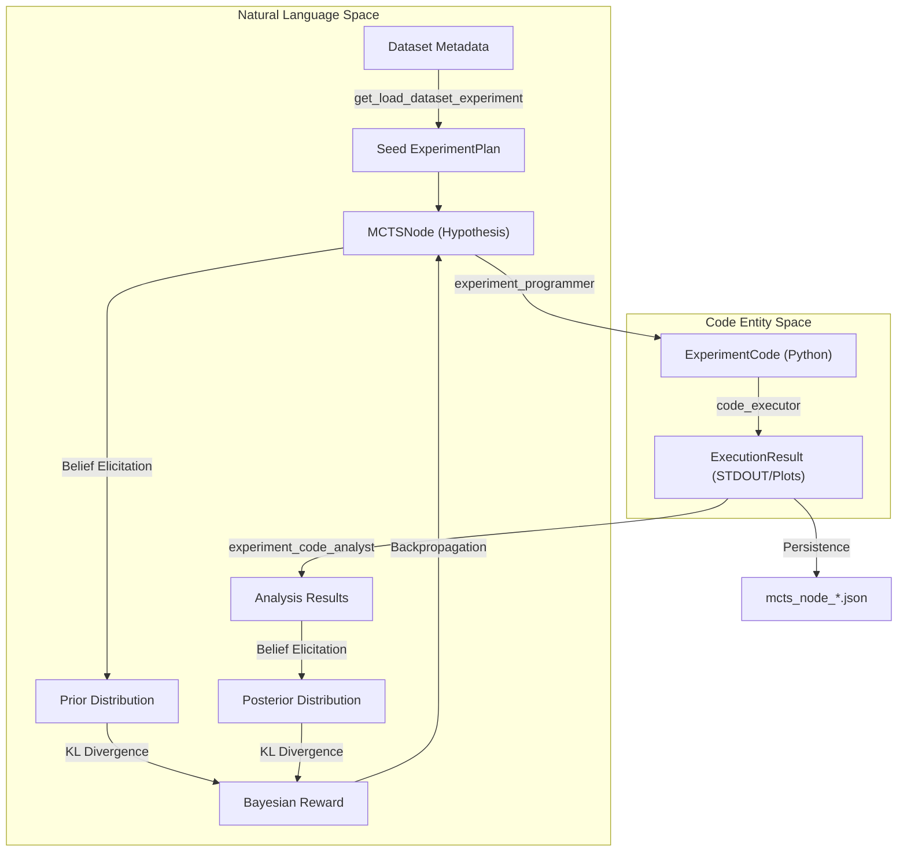
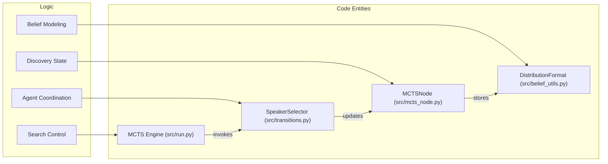

<!-- source: DeepWiki mcp.deepwiki.com · repo allenai/autodiscovery-neurips · page 1 Overview · fetched 2026-10-26 -->

# Overview

Relevant source files

The following files were used as context for generating this wiki page:

- [README.md](README.md)
- [artifacts/autodiscovery_logo.png](artifacts/autodiscovery_logo.png)
- [pyproject.toml](pyproject.toml)

**AutoDiscovery** is a framework for open-ended scientific discovery that uses **Bayesian Surprise** to guide an automated research process. Presented at NeurIPS 2025, the system automates the cycle of hypothesis generation, experimental design, code execution, and result analysis. By quantifying how much an experimental result changes an agent's prior beliefs, AutoDiscovery prioritizes the exploration of "surprising" scientific insights.

The system is designed to interface with diverse scientific datasets, utilizing a Multi-Agent system orchestrated by a Monte Carlo Tree Search (MCTS) engine to navigate the vast space of possible hypotheses.

### Research Goals
- **Open-ended Discovery**: Moving beyond fixed benchmarks to discover novel relationships in data without predefined targets.
- **Quantifiable Surprise**: Using Bayesian inference to measure the information gain of an experiment.
- **Systematic Exploration**: Employing MCTS to balance the exploration of new areas of a dataset with the exploitation of promising hypothesis branches.

---

## High-Level System Flow

The AutoDiscovery pipeline bridges the gap between high-level natural language scientific reasoning and concrete code execution. The following diagram illustrates how the system translates a dataset description into a tree of validated scientific discoveries.

### Discovery Pipeline: From Natural Language to Code
The system operates by transitioning between "Natural Language Space" (hypotheses, beliefs) and "Code Entity Space" (data processing, statistical tests).

**Sources:** [README.md:2-6](), [src/run.py:31-31](), [pyproject.toml:5-15]()

---

## Key Subsystems

### 1. MCTS Discovery Loop
The core of AutoDiscovery is a Monte Carlo Tree Search. Each node in the tree represents a state of discovery containing a specific hypothesis and the experiment designed to test it. The search engine uses strategies like **UCB1** and **Progressive Widening** to decide which hypothesis to refine next.

For details on the tree structure and search algorithms, see **[MCTS Discovery Loop](#2.1)**.

### 2. Multi-Agent Orchestration
AutoDiscovery utilizes an `autogen`-based multi-agent system where specialized agents collaborate to perform research tasks. These agents include:
*   `experiment_generator`: Proposes new hypotheses.
*   `experiment_programmer`: Writes the Python code to test hypotheses.
*   `code_executor`: Runs the code in a sandbox and captures results.
*   `experiment_code_analyst`: Interprets the statistical outputs and visualizations.

For details on agent prompts and the state machine governing their interactions, see **[Multi-Agent Orchestration](#2.2)**.

### 3. Bayesian Reward System
The "value" of a discovery is not just its statistical significance, but its **Surprisal**. The system elicits a **Prior** belief distribution from an LLM before running an experiment, and a **Posterior** distribution after seeing the results. The reward is calculated based on the **KL Divergence** between these distributions.

For details on belief formats (Gaussian, Categorical, Beta) and reward formulas, see **[Belief System and Bayesian Reward](#2.3)**.

---

## Technical Mapping: Logic to Implementation

The following diagram maps the logical discovery steps to the specific classes and files responsible for executing them.

### Mapping Research Logic to Code Entities

**Sources:** [src/run.py:31-31](), [pyproject.toml:31-31]()

---

## Documentation Roadmap

To get started with AutoDiscovery, follow the documentation in this order:

1.  **[Getting Started](#1.1)**: Install the environment (Python 3.10+, `pyautogen`) and run your first discovery experiment using the `autodiscovery` CLI.
2.  **[Key Concepts and Terminology](#1.2)**: Understand the domain-specific language of the project, such as "Belief Elicitation" and "DiscoveryBench".
3.  **[Core Architecture](#2)**: Dive into the implementation details of the MCTS loop and the agent transition logic.
4.  **[Dataset Integration](#3)**: Learn how to format your own scientific data for discovery using the supported metadata schemas.
5.  **[Output, Persistence, and Utilities](#5)**: Use the D3.js visualizer to explore the generated discovery trees and export results to CSV.

**Sources:** [README.md:8-41](), [README.md:85-102](), [pyproject.toml:10-28]()

---

