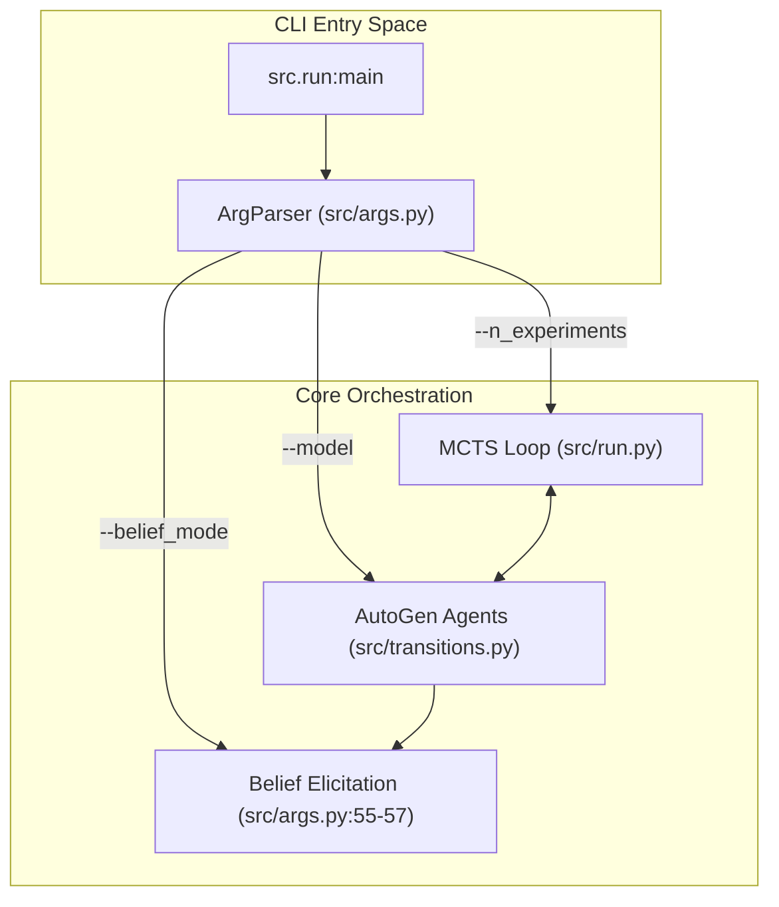
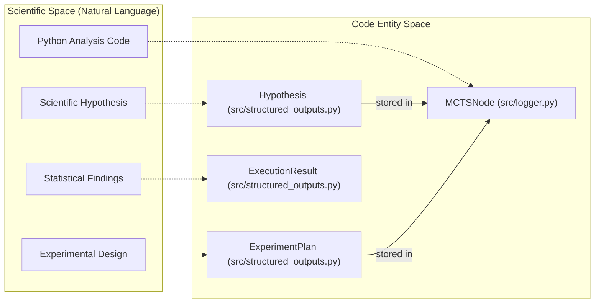

<!-- source: DeepWiki mcp.deepwiki.com · repo allenai/autodiscovery-neurips · page 1.1 Getting Started · fetched 2026-10-26 -->

# Getting Started

<details>
<summary>Relevant source files</summary>

The following files were used as context for generating this wiki page:

- [README.md](README.md)
- [environment.yml](environment.yml)
- [pyproject.toml](pyproject.toml)
- [src/args.py](src/args.py)

</details>


The AutoDiscovery system is designed for open-ended scientific discovery by optimizing for **Bayesian Surprise**. It utilizes Monte Carlo Tree Search (MCTS) to navigate a space of hypotheses and experimental plans, leveraging LLM-based agents to generate code, execute experiments, and elicit belief distributions.

### Purpose and Scope
This guide provides the technical requirements and procedures to set up the AutoDiscovery environment, install dependencies, and execute discovery runs using the provided Command Line Interface (CLI). It also details the expected data formats for dataset metadata.

---

## Environment Setup

AutoDiscovery requires **Python 3.10 or newer** due to the use of modern type hinting (e.g., `float | None`) and dependency requirements like `matplotlib 3.10` [README.md:10-12]().

### Conda Installation (Recommended)
The project provides an `environment.yml` file that specifies Python 3.11 and key scientific libraries.

```sh
conda env create -f environment.yml
conda activate autodiscovery
```
*Sources: [environment.yml:1-16](), [README.md:42-49]()*

### Pip Installation
To use the `autodiscovery` CLI command globally within your environment, install the package in editable mode from the repository root:

```sh
python -m pip install -e .
```
**Note:** Ensure your `python` and `pip` versions match. Using a Python 3.9 interpreter will result in installation failures [README.md:14-20]().

### Dependencies
The system relies on several core packages for agent orchestration and data analysis:
*   `pyautogen[openai]==0.8`: For multi-agent conversation management [pyproject.toml:22]().
*   `scikit-learn`, `scipy`, `statsmodels`: For statistical analysis and experiment execution [pyproject.toml:23-25]().
*   `streamlit`: For visualization components [pyproject.toml:16]().

*Sources: [pyproject.toml:15-28](), [README.md:8-21]()*

---

## Configuration and CLI Usage

The primary entry point is `src/run.py`, which is mapped to the `autodiscovery` command via `project.scripts` [pyproject.toml:30-31]().

### Running an Experiment
A standard run requires specifying the dataset metadata, output directories, and the number of MCTS iterations (`n_experiments`).

```sh
autodiscovery \
    --work_dir="work" \
    --out_dir="outputs" \
    --dataset_metadata="path/to/metadata.json" \
    --n_experiments=16 \
    --model="gpt-4o" \
    --belief_model="gpt-4o"
```
*Sources: [README.md:24-32](), [src/args.py:8-13](), [src/args.py:26-26]()*

### Key CLI Arguments
The `ArgParser` class in `src/args.py` defines the configuration surface:

| Argument | Type | Default | Description |
| :--- | :--- | :--- | :--- |
| `--dataset_metadata` | `str` | Required | Path to the JSON metadata file describing the dataset. |
| `--n_experiments` | `int` | Required | Total number of MCTS iterations to perform. |
| `--model` | `str` | `o4-mini` | The LLM used for discovery agents (Generator, Programmer, etc.). |
| `--belief_model` | `str` | `gpt-4o` | The LLM used specifically for belief elicitation. |
| `--mcts_selection` | `str` | `ucb1_recursive` | Strategy for tree traversal (`ucb1`, `beam_search`, `pw`, etc.). |
| `--belief_mode` | `str` | `boolean_cat` | The format of belief elicitation (e.g., `gaussian`, `categorical`). |
| `--continue_from_dir`| `str` | `None` | Path to resume a previous session using existing logs. |

*Sources: [src/args.py:8-81]()*

---

## System Architecture Overview

The following diagrams illustrate how the CLI configuration initiates the internal discovery components.

### Diagram 1: Initialization Flow
This diagram maps the CLI entry point to the core orchestration logic.


*Sources: [src.run:main](), [src/args.py:4-81](), [README.md:87-97]()*

### Diagram 2: Data Entity Mapping
Mapping natural language scientific concepts to code entities.


*Sources: [src/structured_outputs.py:1-60](), [src/logger.py:1-20]()*

---

## Dataset Metadata Formats

AutoDiscovery supports three primary metadata schemas to ingest scientific data. The format is selected via the `--dataset_metadata_type` flag [src/args.py:36-37]().

### 1. DiscoveryBench (`dbench`)
The default format. It requires a JSON file describing paths to CSV files and column-level descriptions.
*   **Structure:** Contains a list of dataset files and a `column_description` map.
*   **Usage:** Point `--dataset_metadata` to the `metadata_0.json` file in a DiscoveryBench task folder [README.md:28]().

### 2. BLADE (`blade`)
Used for behavioral data experiments. Requires the `BLADE` repository datasets to be cloned locally [README.md:74-80]().

### 3. Custom Datasets (BYO-Datasets)
To use custom data, provide a JSON metadata file following the DiscoveryBench structure:
*   Paths to datasets must be relative to the metadata file [README.md:83]().
*   Provide natural language descriptions for every relevant column to allow the LLM to formulate hypotheses.

*Sources: [README.md:64-84](), [src/args.py:36-37]()*

---

## Resuming Exploration
The system maintains state persistence by saving nodes to JSON files (`mcts_nodes.json`). To resume an interrupted run:
1.  Identify the output directory of the previous run.
2.  Use the `--continue_from_dir` flag [src/args.py:22-23]().
3.  The system will reload the MCTS tree and continue from the last completed iteration [README.md:99-101]().

*Sources: [src/args.py:22-25](), [README.md:99-101]()*

---

