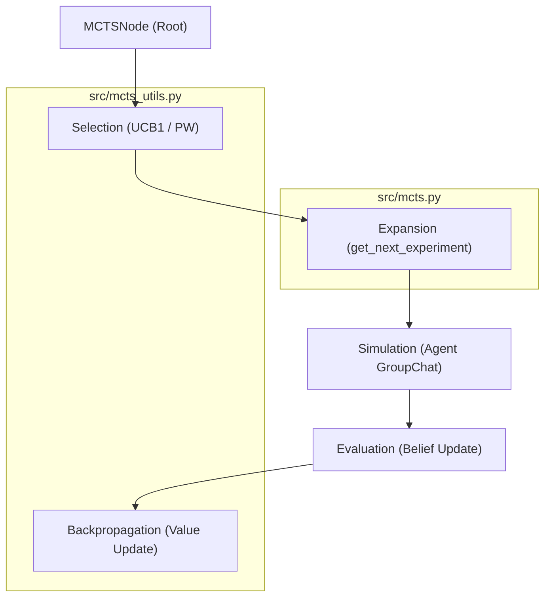
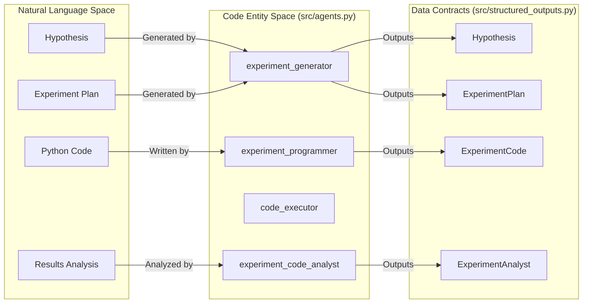

<!-- source: DeepWiki mcp.deepwiki.com · repo allenai/autodiscovery-neurips · page 1.2 Key Concepts and Terminology · fetched 2026-10-26 -->

# Key Concepts and Terminology

Relevant source files

The following files were used as context for generating this wiki page:

- [README.md](README.md)
- [src/agents.py](src/agents.py)
- [src/beliefs.py](src/beliefs.py)
- [src/mcts.py](src/mcts.py)

This page defines the core domain concepts and technical implementation details of the AutoDiscovery system. It bridges the gap between scientific discovery theory (Bayesian Surprise, MCTS) and the specific code entities that implement them.

## 1. Bayesian Surprise and Belief Distributions

AutoDiscovery quantifies the value of a scientific discovery using **Bayesian Surprise**, defined as the change in an agent's belief distribution after observing experimental evidence. This is primarily implemented through KL Divergence between a **Prior** and a **Posterior** distribution.

### Implementation of Belief Modes
The system supports multiple statistical distributions to model different types of scientific hypotheses. These are managed by the `BELIEF_MODE_TO_CLS` mapping in [src/beliefs.py:108-114]().

| Concept | Code Entity | Distribution | Use Case |
| :--- | :--- | :--- | :--- |
| **Boolean Belief** | `BeliefTrueFalse` | Beta | Binary hypotheses (e.g., "Feature A affects B"). [src/beliefs.py:13-14]() |
| **Categorical** | `BeliefCategorical` | Dirichlet | Multi-bucket qualitative support (e.g., "Definitely True" to "Definitely False"). [src/beliefs.py:161-162]() |
| **Gaussian** | `BeliefGauss` | Normal | Numeric estimates (e.g., "The correlation coefficient is 0.5"). [src/beliefs.py:465-466]() |

### Reward Calculation
The reward (or "value") of a node in the search tree is derived from these beliefs.
- **KL Divergence**: Calculated between `prior` and `posterior` objects using `kl_divergence` methods [src/beliefs.py:142-158]().
- **Self Value**: The `get_self_value` function (in `src/mcts_utils.py`) computes the node's reward based on the `--reward_mode` (e.g., `kl`, `belief`, or `belief_and_kl`) [src/mcts.py:56]().

Sources: [src/beliefs.py:13-162](), [src/beliefs.py:465-466](), [src/mcts.py:58-64]()

---

## 2. Monte Carlo Tree Search (MCTS)

AutoDiscovery treats the scientific process as a search problem. The `MCTSNode` class represents a single step in this process: a hypothesis followed by an experiment.

### MCTSNode Structure
Each node in the tree stores the full state of a scientific iteration:
- **Scientific State**: `hypothesis`, `experiment_plan`, `code`, and `analysis` [src/mcts.py:46-51]().
- **Search State**: `visits`, `value` (cumulative), and `self_value` (intrinsic surprise) [src/mcts.py:54-56]().
- **Belief State**: `prior` and `posterior` distribution objects [src/mcts.py:60-61]().

### Search Process Flow

Sources: [src/mcts.py:14-64](), [src/mcts.py:118-123](), [src/mcts_utils.py:10-11]()

---

## 3. Agent Roles and Orchestration

The discovery process is executed by a multi-agent system built on `autogen`. Each agent has a specific role defined by a system prompt and a Pydantic structured output schema.

### Mapping Concepts to Code Entities
The following diagram maps the logical steps of an experiment to the specific Python classes and agents responsible for them.

### Key Agent Definitions
- **`experiment_generator`**: Uses `ExperimentList` schema to propose falsifiable statements [src/agents.py:146-150]().
- **`experiment_programmer`**: Transforms plans into executable Python code using `ExperimentCode` schema [src/agents.py:220-225]().
- **`code_executor`**: A `UserProxyAgent` that runs code in a `LocalCommandLineCodeExecutor` [src/agents.py:246-255]().
- **`experiment_code_analyst`**: Interprets raw logs and plots (via `IMAGE_ANALYSIS_PATCH`) into scientific insights [src/agents.py:270-280]().

Sources: [src/agents.py:14-87](), [src/agents.py:143-280](), [src/structured_outputs.py:2-3]()

---

## 4. Dataset Formats

The system is designed to be dataset-agnostic, supporting several standard formats for scientific metadata.

| Format | Description | Loader/Utility |
| :--- | :--- | :--- |
| **DiscoveryBench** | Real-world scientific datasets with detailed column descriptions. | Referred to as `dbench` in CLI. [README.md:66-72]() |
| **BLADE** | Benchmarks for Language Model-Driven Exploration. | Referred to as `blade` in CLI. [README.md:74-80]() |
| **Custom JSON** | User-provided metadata mapping paths to natural language descriptions. | Passed via `--dataset_metadata`. [README.md:83-84]() |

### Data Flow to Agents
The dataset description is injected into the `experiment_generator` system prompt to ensure the LLM only uses available columns and does not simulate synthetic data [src/agents.py:157-160]().

Sources: [README.md:66-84](), [src/agents.py:157-160]()

---

## 5. System State and Persistence

To ensure reliability during long-running discovery sessions, AutoDiscovery maintains a rigorous serialization format.

### MCTS State Persistence
The entire search tree is saved as a collection of JSON files:
- **`mcts_nodes.json`**: The core tree structure including node links [src/mcts.py:65-66]().
- **`mcts_node_{id}.json`**: Detailed logs for individual nodes, including full agent conversation history (`messages`) [src/mcts.py:40](), [src/mcts.py:88]().

### The `IMAGE_ANALYSIS_PATCH`
A critical concept for "vision-capable" discovery is the `IMAGE_ANALYSIS_PATCH`. It intercepts `matplotlib.pyplot.show()` calls and redirects the plot to an LLM (typically `gpt-4o`) to generate a textual description of the results, which is then fed back to the `experiment_code_analyst` [src/agents.py:14-87]().

Sources: [src/mcts.py:65-117](), [src/agents.py:14-87]()

---

