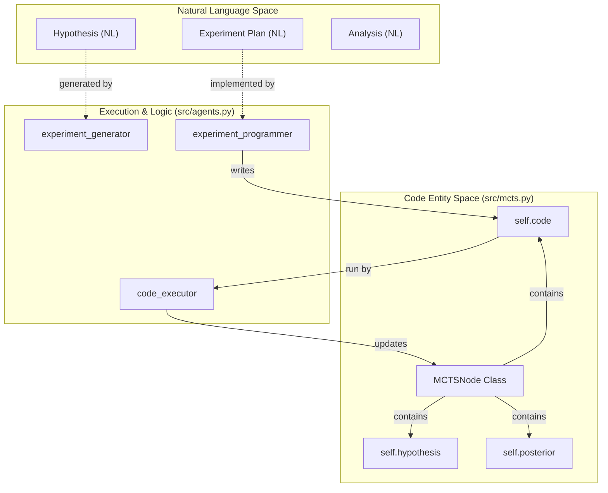
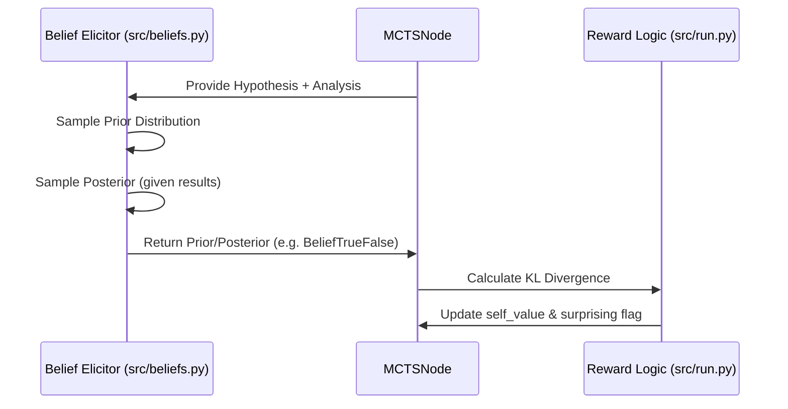

<!-- source: DeepWiki mcp.deepwiki.com · repo allenai/autodiscovery-neurips · page 2 Core Architecture · fetched 2026-10-26 -->

# Core Architecture

Relevant source files

The following files were used as context for generating this wiki page:

- [src/agents.py](src/agents.py)
- [src/beliefs.py](src/beliefs.py)
- [src/mcts.py](src/mcts.py)
- [src/run.py](src/run.py)

The AutoDiscovery pipeline is designed as an iterative discovery engine that combines tree-based search with multi-agent orchestration to explore scientific datasets. It operates by generating hypotheses, implementing them as code, executing that code against real data, and then updating a Bayesian belief model based on the results.

## Pipeline Overview

The system architecture follows a hierarchical structure where a search algorithm manages a tree of scientific explorations. Each node in this tree represents a single experiment cycle (Hypothesis -> Code -> Result -> Analysis).

### Data Flow
1.  **Initialization**: The system loads dataset metadata and initializes a "root" experiment plan [src/dataset.py:165-175]().
2.  **MCTS Selection**: The discovery loop selects a promising node to expand based on past performance or exploration criteria [src/run.py:21-40]().
3.  **Agent Group Chat**: A specialized multi-agent team (using AutoGen) takes the selected hypothesis and carries out the implementation and analysis [src/mcts_utils.py:193-215]().
4.  **Belief Update**: An LLM-based "belief elicitation" process compares the agent's findings against a prior distribution to calculate "Surprise" (KL Divergence) [src/run.py:105-118]().
5.  **Backpropagation**: The surprise value is used as a reward to update the MCTS tree, influencing future selections [src/run.py:159-165]().

### Component Relationship
The following diagram illustrates how the natural language goals are translated into executable code entities and evaluated.

**System Entity Mapping**

**Sources:** [src/mcts.py:14-64](), [src/agents.py:143-220](), [src/run.py:105-165]()

---

## MCTS Discovery Loop
The discovery process is framed as a search problem using **Monte Carlo Tree Search (MCTS)**. The `MCTSNode` class acts as the primary data structure, storing the state of an experiment including its code, results, and current belief metrics.

*   **Tree Structure**: Each node tracks its `level`, `node_idx`, and `parent_id` to maintain the hierarchy [src/mcts.py:24-35]().
*   **Selection Strategies**: The system supports various strategies like UCB1, Progressive Widening, and Beam Search to decide which hypothesis to pursue next [src/run.py:7-9]().
*   **State Persistence**: Nodes are serialized to JSON, allowing the system to resume interrupted runs or replay discoveries [src/mcts.py:65-116]().

For details, see [MCTS Discovery Loop](#2.1).

**Sources:** [src/mcts.py:14-64](), [src/run.py:21-40]()

---

## Multi-Agent Orchestration
AutoDiscovery uses a group of specialized LLM agents, orchestrated via `autogen`, to handle the complexity of scientific reasoning and coding.

| Agent Name | Role |
| :--- | :--- |
| `experiment_generator` | Proposes new hypotheses and experiment plans [src/agents.py:146](). |
| `experiment_programmer` | Translates plans into Python code using `pandas` and `matplotlib` [src/agents.py:175](). |
| `code_executor` | A `UserProxyAgent` that runs code in a local environment [src/agents.py:215](). |
| `experiment_code_analyst` | Interprets the raw output and visualizations from the code [src/agents.py:230](). |

The conversation flow is managed by a `SpeakerSelector` state machine that enforces strict transitions (e.g., the Programmer must follow the Generator) [src/mcts_utils.py:193-215]().

For details, see [Multi-Agent Orchestration](#2.2).

**Sources:** [src/agents.py:133-250](), [src/mcts_utils.py:193-215]()

---

## Belief System and Bayesian Reward
The "value" of a discovery is determined by its **Bayesian Surprise**. Instead of simple success/failure, the system measures how much an experiment changes the LLM's belief in a hypothesis.

**Belief Flow Diagram**

*   **Distribution Formats**: Supports Beta (True/False), Dirichlet (Categorical), and Gaussian distributions [src/beliefs.py:13-200]().
*   **KL Divergence**: Quantifies the "distance" between the prior (what we thought before the data) and the posterior (what we think after) [src/beliefs.py:142-158]().
*   **Reward Modes**: The MCTS reward can be tuned to favor high belief change, high KL divergence, or a combination [src/run.py:159-162]().

For details, see [Belief System and Bayesian Reward](#2.3).

**Sources:** [src/beliefs.py:1-160](), [src/run.py:43-118](), [src/mcts_utils.py:112-125]()

---

