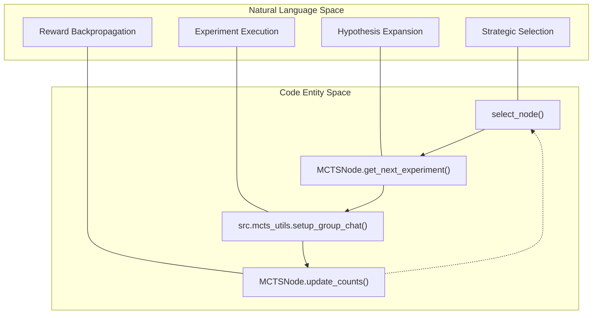
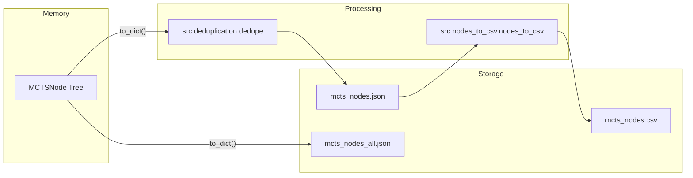

<!-- source: DeepWiki mcp.deepwiki.com · repo allenai/autodiscovery-neurips · page 2.1 MCTS Discovery Loop · fetched 2026-10-26 -->

# MCTS Discovery Loop

Relevant source files

The following files were used as context for generating this wiki page:

- [src/mcts.py](src/mcts.py)
- [src/mcts_utils.py](src/mcts_utils.py)
- [src/run.py](src/run.py)

The **Monte Carlo Tree Search (MCTS) Discovery Loop** is the central engine driving the AutoDiscovery pipeline. It manages the iterative process of hypothesis generation, experiment execution, and belief updating. By representing the scientific discovery process as a tree search, the system can strategically balance the exploration of novel scientific territories with the exploitation of promising research directions.

## MCTS Overview and Traversal

The discovery process is structured as a tree where each node represents a specific experiment and its resulting scientific insights. The loop follows the standard MCTS phases:

1.  **Selection**: The system traverses the existing tree from the root to a leaf node using a selection strategy (e.g., UCB1).
2.  **Expansion**: At the selected node, a new experiment is proposed. If the node has "untried experiments," one is selected; otherwise, the `experiment_generator` agent may be invoked to propose new ones [src/mcts.py:118-146]().
3.  **Simulation (Experimentation)**: The system executes the experiment via the multi-agent orchestration pipeline, resulting in code output, analysis, and a review.
4.  **Backpropagation**: The "value" of the experiment—determined by the **Bayesian Surprise** (belief change or KL divergence)—is propagated back up the tree to inform future selections [src/mcts.py:171-183]().

### Natural Language to Code Entity Mapping: Search Process

The following diagram maps the conceptual MCTS phases to the specific functions and classes in the codebase.

**Sources:** [src/run.py:21-41](), [src/mcts.py:118-183](), [src/mcts_utils.py:186-213]()

---

## MCTSNode Data Model

The `MCTSNode` class is the primary data structure for the search tree. It stores not only the tree topology (parent/children links) but also the full scientific context of an experiment, including the hypothesis, the executable code, and the elicited prior/posterior belief distributions.

For details on fields like `visits`, `value`, and serialization methods, see [MCTSNode Data Model](#2.1.1).

**Sources:** [src/mcts.py:14-64]()

---

## Selection Strategies

AutoDiscovery supports multiple interchangeable selection algorithms to navigate the hypothesis space. These are configured via CLI flags and determine how the system chooses which "branch" of science to investigate next.

*   **UCB1**: Balances exploration and exploitation using the standard Upper Confidence Bound formula.
*   **Progressive Widening**: Limits the number of children at a node based on the number of visits, preventing the search from becoming too shallow in high-dimensional hypothesis spaces.
*   **Beam Search**: A deterministic search strategy that maintains a fixed number of best-performing nodes at each level.

For implementation details and configuration, see [Selection Strategies](#2.1.2).

**Sources:** [src/run.py:7-8](), [src/run.py:21-41]()

---

## State Persistence and Resumption

The MCTS loop is designed for long-running experiments. The state of the tree is frequently serialized to disk to prevent data loss and allow for post-hoc analysis.

*   **Serialization**: Nodes are converted to dictionaries via `to_dict()` and saved as `mcts_nodes.json` (deduplicated) and `mcts_nodes_all.json` (full history) [src/mcts_utils.py:130-162]().
*   **Resumption**: The `load_mcts_from_json` function can reconstruct a full `MCTSNode` tree from these files, allowing the search to continue from a previous state [src/mcts_utils.py:15-90]().
*   **Replay**: During loading, the system can "replay" the `creation_idx` to correctly reconstruct `visits` and `value` counts across the tree [src/mcts_utils.py:79-89]().

### Data Flow: Persistence and Analysis

This diagram illustrates how the in-memory tree structure is transformed into persistent storage formats.

**Sources:** [src/mcts_utils.py:93-129](), [src/mcts_utils.py:130-162]()

---

## Reward and Surprisal Calculation

The "reward" that guides the MCTS is derived from **Bayesian Surprise**. After an experiment is executed and analyzed, the system elicits a `posterior` belief from an LLM. The difference between the `prior` (what the model expected) and the `posterior` (what the model learned from the data) defines the reward.

*   **Reward Modes**: Configurable via `reward_mode` (e.g., "belief", "kl", or "belief_and_kl") [src/run.py:46-47]().
*   **Surprisal**: If the belief change exceeds a certain threshold (`surprisal_width`), the node is marked as `surprising` [src/run.py:159-162]().
*   **Online Beliefs**: The system can optionally use "online" updates, where the prior for a new node is conditioned on the results of all previously discovered surprising nodes [src/run.py:51-74]().

**Sources:** [src/run.py:43-162](), [src/mcts_utils.py:228-243]()

---

