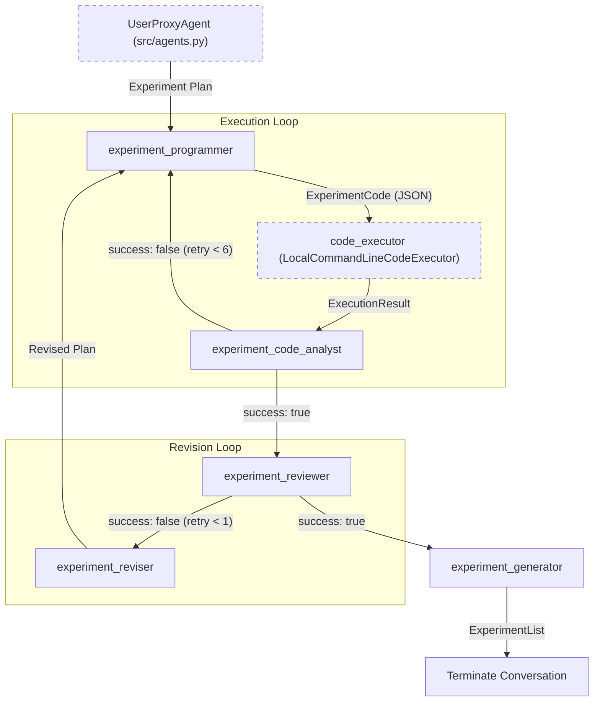
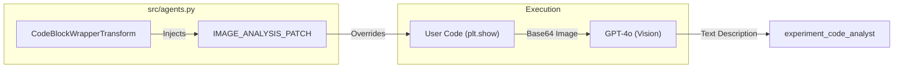

<!-- source: DeepWiki mcp.deepwiki.com · repo allenai/autodiscovery-neurips · page 2.2 Multi-Agent Orchestration · fetched 2026-10-26 -->

# Multi-Agent Orchestration

Relevant source files

The following files were used as context for generating this wiki page:

- [src/agents.py](src/agents.py)
- [src/mcts_utils.py](src/mcts_utils.py)
- [src/transitions.py](src/transitions.py)

This page describes how AutoDiscovery leverages the **AutoGen** framework to coordinate a specialized team of LLM-based agents. The system transforms high-level research hypotheses into executable code, analyzes experimental results, and refines ideas through a structured multi-turn conversation.

The orchestration logic is designed to ensure that experiments are not only generated but also rigorously implemented, executed in a sandboxed environment, and reviewed for scientific validity.

## Orchestration Architecture

The orchestration is built around a `GroupChat` and a `GroupChatManager` [src/mcts_utils.py:8-12](). Unlike a standard round-robin or LLM-selected conversation, AutoDiscovery uses a deterministic state machine to manage the experiment lifecycle.

### Conversation Pipeline
The pipeline follows a linear path with specific retry loops for code failures and scientific revisions:

1.  **Programming**: Translating the experiment plan into Python code.
2.  **Execution**: Running the code in a local shell and capturing output/plots.
3.  **Analysis**: Interpreting logs and visual data to determine if the hypothesis was supported.
4.  **Review**: Critiquing the methodology and results for errors or biases.
5.  **Generation**: Proposing the next set of hypotheses based on findings.

### Multi-Agent Interaction Diagram
The following diagram maps the logical flow of the orchestration to the specific classes and files that implement them.

**Diagram: Multi-Agent State Machine**

**Sources:** [src/transitions.py:23-66](), [src/agents.py:146-240]()

---

## Agent Roles and Responsibilities

Each agent is initialized as a `ConversableAgent` with a specific `system_message` and `response_format` [src/agents.py:146-240]().

| Agent Name | Primary Responsibility | Key Code Entity |
| :--- | :--- | :--- |
| `experiment_generator` | Proposes new hypotheses/plans based on history. | `ExperimentList` [src/agents.py:146]() |
| `experiment_programmer` | Writes Python code to test a specific plan. | `ExperimentCode` [src/agents.py:180]() |
| `code_executor` | Executes code and captures STDOUT/Plots. | `LocalCommandLineCodeExecutor` [src/agents.py:6]() |
| `experiment_code_analyst` | Interprets results and plot descriptions. | `ExperimentAnalyst` [src/agents.py:202]() |
| `experiment_reviewer` | Validates the scientific integrity of the result. | `ExperimentReviewer` [src/agents.py:221]() |
| `experiment_reviser` | Fixes plans if the reviewer finds flaws. | `Experiment` [src/agents.py:238]() |

For a deep dive into the specific prompts and schemas for each agent, see **[Agent Roles and Prompts (#2.2.1)]**.

**Sources:** [src/agents.py:133-240](), [src/structured_outputs.py:2-3]()

---

## State Machine and Control Flow

The orchestration is governed by the `SpeakerSelector` class in `src/transitions.py`. It implements the `select_next_speaker` logic, which acts as the "brain" of the `GroupChat` [src/transitions.py:11-66]().

### Deterministic Routing
The selector uses the `last_speaker.name` and the content of the last message to decide the next step. It handles:
*   **JSON Parsing**: It attempts to parse agent responses to find `success` flags [src/transitions.py:36-40]().
*   **Failure Budgets**: It maintains internal counters for `code_failure_count` (limit 6) and `experiment_revision_count` (limit 1) [src/transitions.py:8-9]().

### Image Analysis Integration
A unique feature of the orchestration is the `IMAGE_ANALYSIS_PATCH` [src/agents.py:14-87](). When the `experiment_programmer` writes code, the system wraps it in a transform that patches `matplotlib.pyplot.show` to automatically trigger an LLM-based image description service. This allows the `experiment_code_analyst` to "see" the plots through text descriptions.

**Diagram: Code Execution and Visual Feedback**

**Sources:** [src/agents.py:90-104](), [src/agents.py:39-75]()

For detailed documentation on the transition rules and retry logic, see **[Conversation Flow and Transitions (#2.2.2)]**.

---

## MCTS Integration

The multi-agent orchestration is the "Execution" phase of the larger MCTS loop.
1.  The MCTS selects a node (hypothesis).
2.  The `GroupChat` is initialized with that hypothesis as the `user_query` [src/agents.py:133-144]().
3.  The agents run through the pipeline described above.
4.  The final output of the `experiment_generator` provides the "children" (new hypotheses) for the MCTS tree [src/mcts_utils.py:65-77]().

**Sources:** [src/mcts_utils.py:15-90](), [src/agents.py:133-144]()

---

