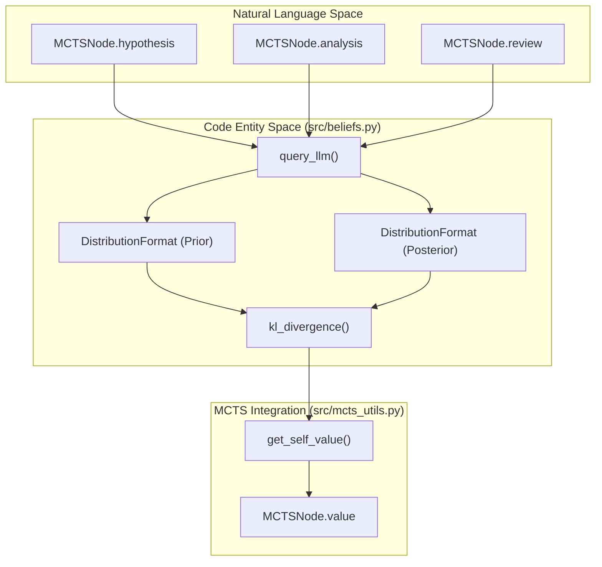
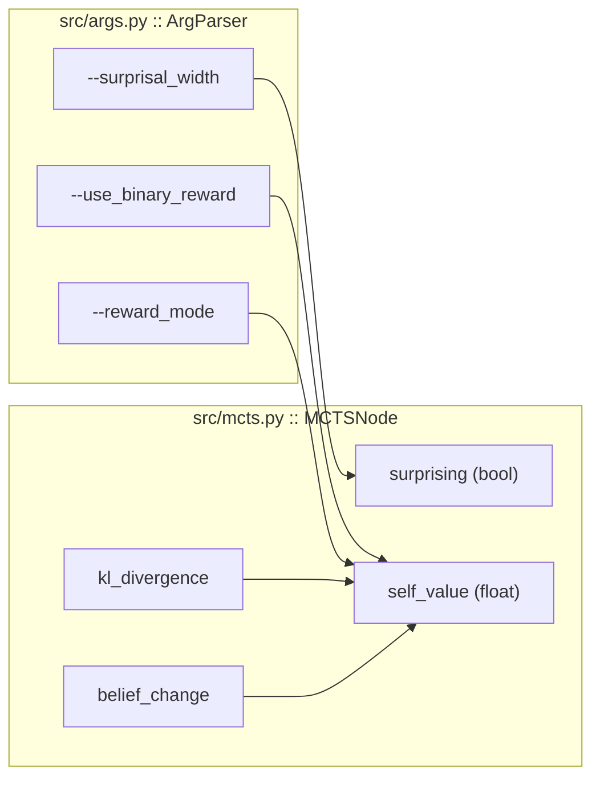

<!-- source: DeepWiki mcp.deepwiki.com · repo allenai/autodiscovery-neurips · page 2.3 Belief System and Bayesian Reward · fetched 2026-10-26 -->

# Belief System and Bayesian Reward

Relevant source files

The following files were used as context for generating this wiki page:

- [src/beliefs.py](src/beliefs.py)
- [src/mcts_utils.py](src/mcts_utils.py)
- [src/run.py](src/run.py)

The Belief System is the quantitative core of AutoDiscovery, responsible for measuring the "surprisal" of experimental results. It translates natural language hypotheses and code-generated evidence into mathematical distributions. By comparing an agent's **prior** belief (before seeing results) with its **posterior** belief (after seeing results), the system calculates a reward that guides the Monte Carlo Tree Search (MCTS) toward scientifically interesting discoveries.

### Bayesian Workflow Overview

The system follows a structured Bayesian update cycle for every node in the MCTS tree:
1.  **Prior Elicitation**: The LLM is prompted to estimate the likelihood of a hypothesis based on current scientific knowledge or previous experiment nodes [src/run.py:64-74]().
2.  **Evidence Integration**: The LLM reviews the `code_output` and `analysis` from the current experiment [src/run.py:93-102]().
3.  **Posterior Elicitation**: The LLM provides an updated belief distribution given the new evidence [src/run.py:106-118]().
4.  **Reward Calculation**: The system computes the **KL Divergence** or **Belief Change** between the prior and posterior to determine the node's `self_value` [src/run.py:159-162]().

#### Data Flow: From Results to Reward
The following diagram illustrates how experimental evidence is transformed into a Bayesian reward within the `compute_and_store_reward` pipeline.

**Belief Update and Reward Pipeline**

**Sources:** [src/run.py:43-162](), [src/beliefs.py:142-158](), [src/mcts_utils.py:18-18]()

---

### Belief Distribution Formats

The system supports multiple mathematical representations of belief, defined in `src/beliefs.py`. Each format includes a `DistributionFormat` for internal math and a `ResponseFormat` (Pydantic model) to enforce structured LLM outputs.

*   **BeliefTrueFalse (Beta Distribution)**: Models binary hypotheses using `n_true` and `n_false` counts [src/beliefs.py:13-32]().
*   **BeliefCategorical (Dirichlet Distribution)**: Models belief across five buckets from "definitely false" to "definitely true" [src/beliefs.py:161-180]().
*   **BeliefGauss (Gaussian Distribution)**: Models numeric hypotheses (e.g., "The effect size is X") using mean and variance [src/beliefs.py:535-555]().

For a detailed reference on formulas and mean calculations for each type, see **[Belief Distribution Formats](#2.3.1)**.

---

### Reward Calculation and Surprisal

The reward (or `self_value`) is the signal used by MCTS to prioritize branches of the search tree. It is primarily derived from the **Bayesian Surprise**, which quantifies how much the experimental evidence changed the system's internal model.

#### Key Reward Metrics
| Metric | Code Reference | Description |
| :--- | :--- | :--- |
| **KL Divergence** | `kl_divergence()` | Measures the information gain between prior and posterior distributions. |
| **Belief Change** | `node.belief_change` | The absolute difference between the mean of the prior and the mean of the posterior. |
| **Surprising** | `node.surprising` | A boolean flag triggered if the surprise exceeds the `surprisal_width` threshold. |

The function `get_self_value` in `src/mcts_utils.py` maps these metrics into a scalar reward based on the configured `reward_mode` (e.g., `belief`, `kl`, or `belief_and_kl`) [src/run.py:159-162]().

**Entity Mapping: Belief Metrics to Code Properties**

**Sources:** [src/run.py:156-162](), [src/mcts_utils.py:18-18](), [src/args.py:16-16]()

For details on the reward scaling and online belief updates, see **[Reward Calculation and Surprisal](#2.3.2)**.

---

### Online Belief Updates
When `use_online_beliefs` is enabled, the system constructs an `evidence_msg` containing the history of all previous "surprising" discoveries in the current path [src/run.py:51-62](). This ensures that the LLM's **prior** for a new experiment is conditioned on the cumulative knowledge discovered so far, preventing the system from being "surprised" by the same fact twice.

**Sources:** [src/run.py:51-74](), [src/mcts_utils.py:55-61]()

---

