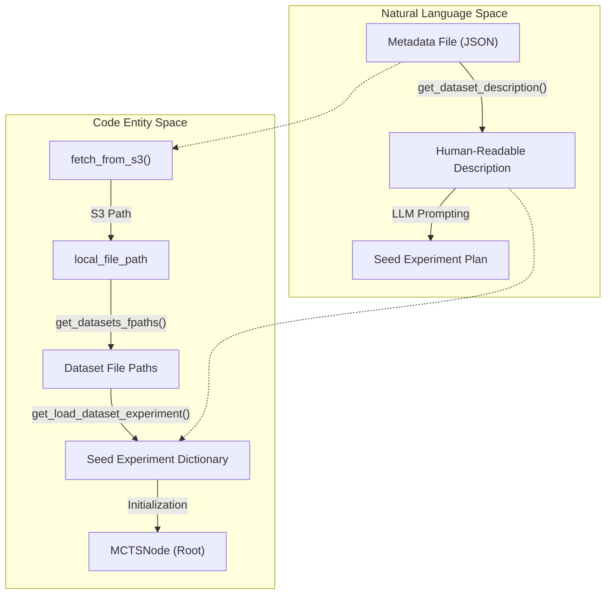
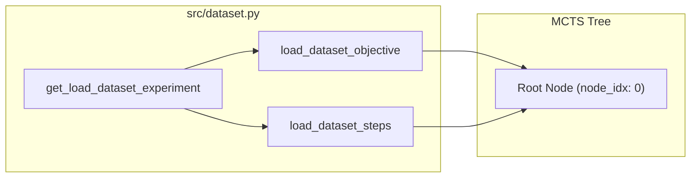

<!-- source: DeepWiki mcp.deepwiki.com · repo allenai/autodiscovery-neurips · page 3 Dataset Integration · fetched 2026-10-26 -->

# Dataset Integration

Relevant source files

The following files were used as context for generating this wiki page:

- [src/dataset.py](src/dataset.py)
- [src/utils.py](src/utils.py)

The AutoDiscovery system is designed to ingest scientific datasets through a structured pipeline that converts raw metadata into a machine-readable format for the Monte Carlo Tree Search (MCTS) discovery loop. The integration process handles both local and remote (S3) storage, parses various metadata schemas to extract semantic information about data columns, and initializes the research process with a "seed" experiment.

### High-Level Data Flow

The following diagram illustrates how the system transitions from raw metadata files to a structured experiment plan that the agents can execute.

**Dataset Ingestion and Initialization Pipeline**

Sources: [src/dataset.py:107-133](), [src/dataset.py:136-160](), [src/dataset.py:162-182](), [src/utils.py:104-125]()

---

### Metadata Formats

AutoDiscovery supports three primary metadata schemas to describe the structure and semantics of scientific datasets. These formats allow the system to understand what each column represents without needing to inspect every row of the raw data initially.

*   **DiscoveryBench (dbench):** The default format, utilizing a `datasets` list where each entry contains a `columns` object with `raw` field descriptions [src/dataset.py:125-131]().
*   **BLADE:** A format that separates data paths from descriptive metadata, often used in specific benchmarking contexts [src/dataset.py:17-55]().
*   **AI2-style:** A specialized format supporting multiple datasets within a single metadata file, including detailed column-level descriptions [src/dataset.py:63-96]().

For a detailed reference on the JSON structures and specific loader functions for these formats, see **[Metadata Formats (#3.1)]**.

Sources: [src/dataset.py:7-15](), [src/dataset.py:58-60](), [src/dataset.py:99-104]()

---

### Dataset Loading and Retrieval

The system provides utilities to resolve dataset locations, whether they are stored on a local filesystem or in Amazon S3 buckets.

| Function | Responsibility | Code Reference |
| :--- | :--- | :--- |
| `fetch_from_s3` | Downloads binary data from S3 URLs to a local `_s3` directory. | [src/utils.py:104-125]() |
| `get_datasets_fpaths` | Resolves metadata paths and downloads associated CSV files if stored on S3. | [src/dataset.py:136-160]() |
| `load_dataset_metadata` | Standard JSON loader for parsing metadata into Python dictionaries. | [src/dataset.py:99-104]() |

The retrieval logic ensures that even if metadata is provided as an S3 link, the system can synchronize all necessary files to the local execution environment before the agents begin their work.

For details on the resolution logic and S3 synchronization, see **[Dataset Loading and Experiment Initialization (#3.2)]**.

Sources: [src/dataset.py:136-160](), [src/utils.py:104-125]()

---

### Experiment Initialization

The discovery process begins with a "Seed Experiment." Instead of starting with a random hypothesis, the system uses `get_load_dataset_experiment` to create a root node in the MCTS tree [src/dataset.py:162-182]().

**Seed Experiment Components**
*   **Objective:** Instructs the agent to load the dataset and generate summary statistics [src/dataset.py:164]().
*   **Steps:** A sequence of actions including loading files and performing initial analysis [src/dataset.py:165-166]().
*   **EDA (Optional):** If the `--run_eda` flag is enabled, the system adds Exploratory Data Analysis tasks to the seed plan, helping the agents understand the data distribution before proposing hypotheses [src/dataset.py:167-169]().

**Initialization Logic**

Sources: [src/dataset.py:162-182]()

For details on how this seed experiment bootstraps the discovery loop, see **[Dataset Loading and Experiment Initialization (#3.2)]**.

---

