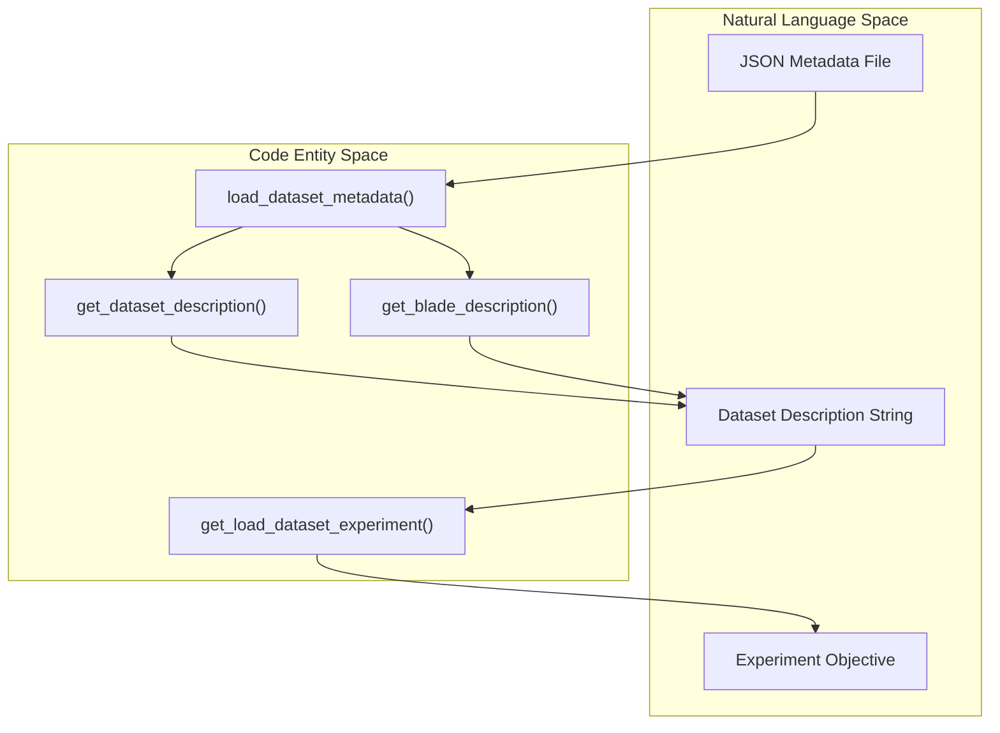
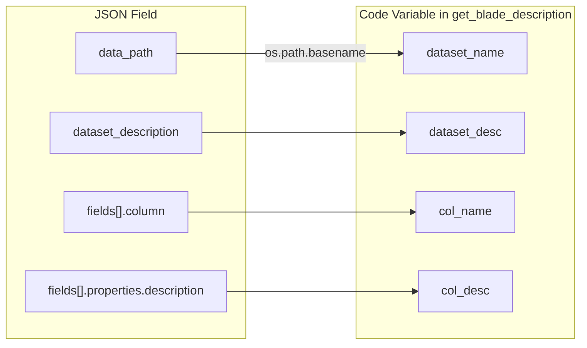

<!-- source: DeepWiki mcp.deepwiki.com · repo allenai/autodiscovery-neurips · page 3.1 Metadata Formats · fetched 2026-10-26 -->

# Metadata Formats

<details>
<summary>Relevant source files</summary>

The following files were used as context for generating this wiki page:

- [README.md](README.md)
- [src/dataset.py](src/dataset.py)

</details>


AutoDiscovery supports three distinct metadata schemas to describe scientific datasets. These formats provide the system with the necessary semantic context (natural language descriptions of columns and dataset goals) to initialize the MCTS discovery loop. The system uses these formats to bridge the gap between raw CSV files and the high-level hypotheses generated by the agents.

## Supported Formats Overview

The system categorizes metadata into three primary types:
1.  **DiscoveryBench (dbench)**: The default format used for the DiscoveryBench benchmark.
2.  **BLADE**: A format compatible with the Behavioral Laboratory for Automated Discovery and Exploitation.
3.  **AI2-style**: A legacy or internal variant of the DiscoveryBench format.

The metadata type is typically determined by CLI arguments or inferred during the dataset loading process in `src/dataset.py`.

### Metadata Loading Data Flow

The following diagram illustrates how the `src/dataset.py` module processes metadata files to generate the initial experiment plan.

**Metadata Processing Flow**

Sources: [src/dataset.py:107-133](), [src/dataset.py:162-182]()

---

## 1. DiscoveryBench (dbench)

DiscoveryBench is the primary format used by the AutoDiscovery system. It treats a "dataset" as a collection of one or more files, each with structured column descriptions.

### JSON Structure
The schema expects a top-level `datasets` key containing a list of dataset objects.

| Field | Type | Description |
| :--- | :--- | :--- |
| `name` | `string` | The filename of the CSV (relative to the metadata file). |
| `description` | `string` | High-level summary of what the dataset contains. |
| `columns` | `object` | Contains a `raw` key with a list of column definitions. |
| `columns.raw[].name` | `string` | The header name in the CSV. |
| `columns.raw[].description` | `string` | Natural language explanation of the column's meaning. |

### Implementation Details
*   **Loader**: `load_dataset_metadata` [src/dataset.py:99-104]()
*   **Description Generator**: `get_dataset_description` [src/dataset.py:107-133]()
*   **File Path Resolver**: `get_datasets_fpaths` extracts the `name` field to locate local or S3 files [src/dataset.py:148-149]().

Sources: [src/dataset.py:125-131](), [src/dataset.py:148-149]()

---

## 2. BLADE Format

The BLADE format is structured differently, often focusing on a single data path with a nested `data_desc` object.

### JSON Structure
| Field | Type | Description |
| :--- | :--- | :--- |
| `data_path` | `string` | Path to the data file. |
| `data_desc` | `object` | Contains `dataset_description` and `fields`. |
| `data_desc.fields[]` | `list` | List of objects defining columns. |
| `field.column` | `string` | The column name. |
| `field.properties.description` | `string` | The column description. |

### Implementation Details
*   **Loader**: `load_blade_metadata` [src/dataset.py:7-9]()
*   **Description Generator**: `get_blade_description` [src/dataset.py:17-55]()
*   **File Path Resolver**: In BLADE mode, `get_datasets_fpaths` defaults the filename to `data.csv` [src/dataset.py:152]().

**BLADE Metadata Mapping**

Sources: [src/dataset.py:39-44](), [src/dataset.py:48-53]()

---

## 3. AI2-style Format

The AI2-style format is a variation of the DiscoveryBench schema, processed by specific utility functions to handle minor structural differences in how columns are nested.

### Implementation Details
*   **Loader**: `load_ai2_metadata` [src/dataset.py:58-60]()
*   **Description Generator**: `get_ai2_description` [src/dataset.py:63-96]()

This format specifically looks for `metadata.get("datasets", [])` and iterates through `dataset.get("columns", {}).get("raw", [])` [src/dataset.py:82-90]().

Sources: [src/dataset.py:82-94]()

---

## Metadata to Experiment Initialization

Regardless of the input format, the final goal of the metadata is to populate the `load_dataset_experiment` object. This object serves as the root of the MCTS tree.

### Key Function: `get_load_dataset_experiment`
This function constructs the initial prompt for the `experiment_generator` agent.

1.  **Objective Construction**: Combines a static string ("Load the dataset...") with the human-readable string generated by `get_dataset_description` or `get_blade_description` [src/dataset.py:164-173]().
2.  **Step Generation**: Automatically lists the files to be loaded based on the resolved `dataset_paths` [src/dataset.py:165]().
3.  **EDA Integration**: If `run_eda=True`, it appends steps for Exploratory Data Analysis to the initial plan [src/dataset.py:167-169]().

### Experiment Schema
The resulting dictionary follows this structure:
```python
{
    "hypothesis": None,
    "experiment_plan": {
        "objective": str,
        "steps": str,
        "deliverables": str
    }
}
```
Sources: [src/dataset.py:174-182]()

---

