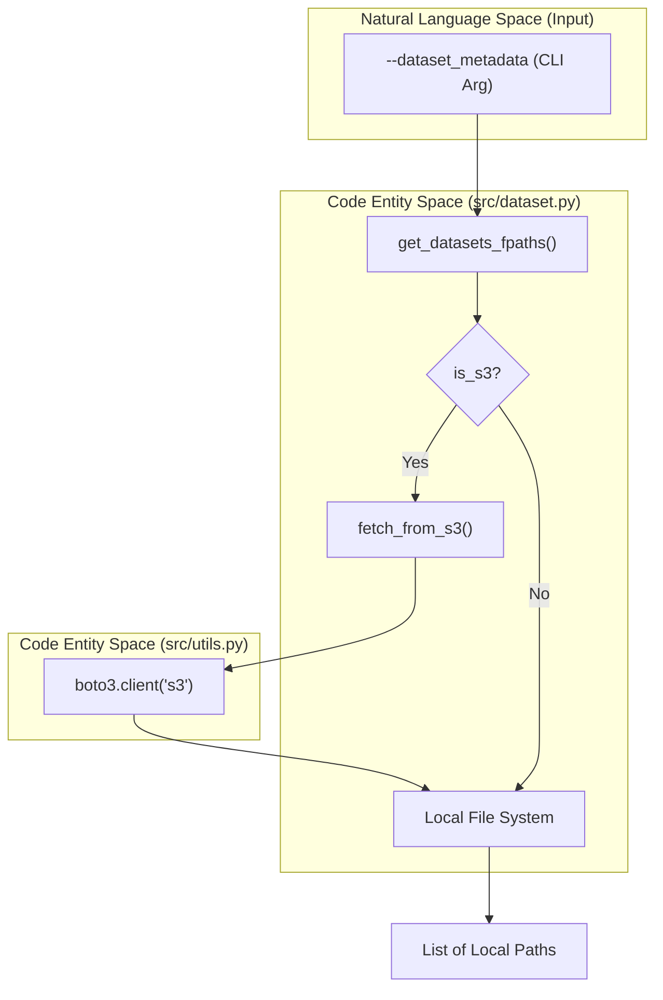
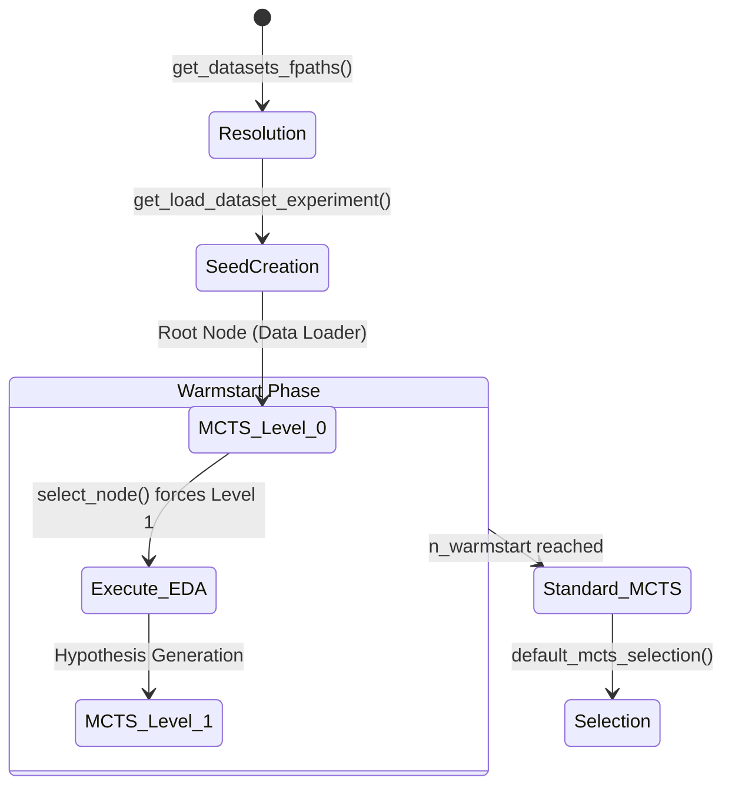

<!-- source: DeepWiki mcp.deepwiki.com · repo allenai/autodiscovery-neurips · page 3.2 Dataset Loading and Experiment Initialization · fetched 2026-10-26 -->

# Dataset Loading and Experiment Initialization

Relevant source files

The following files were used as context for generating this wiki page:

- [src/dataset.py](src/dataset.py)
- [src/run.py](src/run.py)
- [src/utils.py](src/utils.py)

This page details the mechanisms used to ingest scientific datasets and initialize the Monte Carlo Tree Search (MCTS) discovery process. The system supports both local and remote (S3) data sources and uses metadata to bootstrap an initial "Seed Experiment" that provides the necessary context for subsequent hypothesis generation.

## Dataset Resolution and S3 Integration

The function `get_datasets_fpaths` in `src/dataset.py` is responsible for resolving dataset locations. It handles the transition from URI strings to local file system paths, supporting both standard local paths and `s3://` protocols.

### Implementation Details
- **S3 Resolution**: If a path starts with `s3`, the system uses `fetch_from_s3` [src/utils.py:104-125]() to download the metadata and the associated data files into a local `_s3` directory [src/dataset.py:137-141]().
- **Metadata Parsing**: The system reads the JSON metadata to identify specific data files. For standard datasets, it looks for the `datasets` key and extracts the `name` of each file [src/dataset.py:143-149](). For BLADE-style datasets, it defaults to `data.csv` [src/dataset.py:150-152]().
- **Path Construction**: It returns a list of absolute local paths to the data files and the path to the resolved metadata file [src/dataset.py:159]().

### Data Flow: URI to Local Path
The following diagram illustrates how the system resolves data locations during initialization.

**Dataset Path Resolution Flow**

**Sources:** [src/dataset.py:136-159](), [src/utils.py:104-125]()

---

## Seed Experiment Generation

Once the dataset paths are resolved, the system creates a "Seed Experiment." This is a specialized `MCTSNode` at level 0 that does not test a hypothesis but instead performs the foundational work of loading data and generating summary statistics.

### `get_load_dataset_experiment`
This function [src/dataset.py:162-182]() constructs the initial `experiment_plan` dictionary. 

1.  **Objective**: Combines a standard loading prompt with a human-readable description of the dataset generated from metadata [src/dataset.py:164-173]().
2.  **Steps**: Defines the programmatic steps for the agent, such as "Load the dataset" and "Generate summary statistics" [src/dataset.py:165]().
3.  **Deliverables**: Specifies the expected output to ensure the `experiment_code_analyst` can verify success [src/dataset.py:166]().

### Metadata Descriptions
The system formats metadata into prompts using specific loaders:
- **DiscoveryBench**: Uses `get_dataset_description` [src/dataset.py:107-133]().
- **BLADE**: Uses `get_blade_description` [src/dataset.py:17-55]().

| Feature | DiscoveryBench Loader | BLADE Loader |
| :--- | :--- | :--- |
| **Function** | `load_dataset_metadata` | `load_blade_metadata` |
| **Fields** | `datasets`, `columns`, `raw` | `data_desc`, `fields`, `properties` |
| **Logic** | Iterates through all dataset objects. | Extracts dataset name from folder structure. |

**Sources:** [src/dataset.py:162-182](), [src/dataset.py:17-55](), [src/dataset.py:107-133]()

---

## Exploratory Data Analysis (EDA) and Warmstarting

The system provides an optional `run_eda` flag that modifies the seed experiment to perform initial exploration before the MCTS loop begins hypothesis generation.

### The EDA Step
If `run_eda` is True, the `get_load_dataset_experiment` function appends additional instructions to the experiment plan:
- **Steps**: "Perform some exploratory data analysis (EDA)... to get a better understanding of the data" [src/dataset.py:168]().
- **Deliverables**: "Exploratory data analysis (EDA) performed" [src/dataset.py:169]().

### Warmstart Logic
In `src/run.py`, the `select_node` function manages the transition from the seed experiment to the discovery tree [src/run.py:21-40]().

- **Selection Override**: If `n_warmstart` is configured and the number of child nodes at the data loader level (Level 2) is less than the warmstart threshold, the system forces the selection of the data loader node [src/run.py:34-38]().
- **Bootstrapping**: This ensures that the agent explores the data and populates the context with observations before the MCTS selection logic (e.g., UCB1) takes over.

**Initialization State Machine**

**Sources:** [src/run.py:21-40](), [src/dataset.py:167-169]()

---

## Summary of Key Functions

| Function Name | File | Purpose |
| :--- | :--- | :--- |
| `get_datasets_fpaths` | `src/dataset.py` | Resolves S3 or local paths for datasets and metadata [src/dataset.py:136](). |
| `fetch_from_s3` | `src/utils.py` | Downloads files from S3 buckets using `boto3` [src/utils.py:104](). |
| `get_load_dataset_experiment` | `src/dataset.py` | Constructs the dictionary for the level 0 experiment plan [src/dataset.py:162](). |
| `get_dataset_description` | `src/dataset.py` | Formats DiscoveryBench metadata into a string for LLM prompts [src/dataset.py:107](). |
| `select_node` | `src/run.py` | Orchestrates whether to continue warmstarting or use MCTS selection [src/run.py:21](). |

**Sources:** [src/dataset.py:1-182](), [src/run.py:21-40](), [src/utils.py:104-125]()

---

