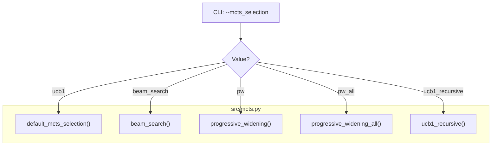
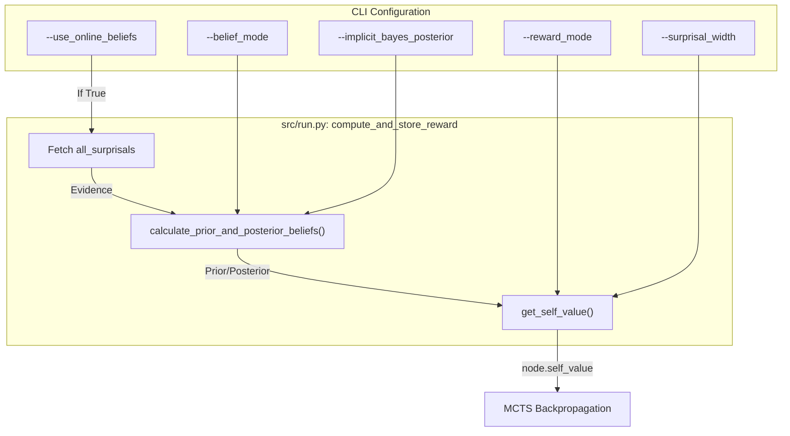

<!-- source: DeepWiki mcp.deepwiki.com · repo allenai/autodiscovery-neurips · page 4 Configuration Reference · fetched 2026-10-26 -->

# Configuration Reference

Relevant source files

The following files were used as context for generating this wiki page:

- [src/args.py](src/args.py)
- [src/run.py](src/run.py)

The AutoDiscovery system is configured via a comprehensive set of command-line arguments defined in the `ArgParser` class. These parameters control everything from the dataset ingestion and LLM selection to the specific mathematical formulations of the Bayesian reward system and MCTS search heuristics.

The primary entry point for configuration is [src/args.py:4-82]().

## Dataset and Output Configuration

These arguments define the input data sources, the metadata schema used to interpret those sources, and where the system should persist its state and logs.

| Argument | Type | Default | Description |
| :--- | :--- | :--- | :--- |
| `--dataset_metadata` | `str` | **Required** | Path to the dataset metadata file (local or S3). [src/args.py:8-8]() |
| `--dataset_metadata_type` | `str` | `dbench` | Format of the metadata: `dbench`, `blade`, or `ai2`. [src/args.py:36-37]() |
| `--out_dir` | `str` | **Required** | Root directory for experiment logs and serialized MCTS nodes. [src/args.py:9-9]() |
| `--timestamp_dir` | `bool` | `True` | Whether to create a unique timestamped subfolder within `out_dir`. [src/args.py:32-33]() |
| `--work_dir` | `str` | **Required** | Directory where agents write and execute python code. [src/args.py:38-38]() |
| `--delete_work_dir` | `bool` | `True` | If true, cleans up the `work_dir` after the run completes. [src/args.py:39-40]() |

**Sources:** [src/args.py:8-40]()

---

## Model Selection and Inference

AutoDiscovery utilizes a multi-agent architecture where different agents can be backed by different LLMs. Configuration allows for fine-tuning reasoning effort and temperature, particularly for OpenAI's o-series models.

| Argument | Type | Default | Description |
| :--- | :--- | :--- | :--- |
| `--model` | `str` | `o4-mini` | Primary LLM for agents (Generator, Programmer, Analyst). [src/args.py:10-11]() |
| `--belief_model` | `str` | `gpt-4o` | Specific LLM used for belief elicitation and distribution sampling. [src/args.py:12-13]() |
| `--temperature` | `float` | `1.0` | Sampling temperature for primary agents. [src/args.py:16-17]() |
| `--belief_temperature` | `float` | `1.0` | Sampling temperature for the belief elicitation agent. [src/args.py:18-19]() |
| `--reasoning_effort` | `str` | `medium` | Effort level for o-series models (`low`, `medium`, `high`). [src/args.py:20-21]() |

**Sources:** [src/args.py:10-21]()

---

## Search Strategy (MCTS)

The core discovery engine is governed by Monte Carlo Tree Search. These parameters define the branching factor, the selection logic, and how the tree explores vs. exploits.

### Logic Flow: Selection Method Mapping
The `--mcts_selection` flag determines which function from `src/mcts.py` is invoked during the discovery loop.

*Sources: [src/args.py:44-46](), [src/run.py:7-8](), [src/run.py:40-40]()*

### Search Parameters

| Argument | Type | Default | Description |
| :--- | :--- | :--- | :--- |
| `--n_experiments` | `int` | **Required** | Total number of MCTS iterations to perform. [src/args.py:26-26]() |
| `--k_experiments` | `int` | `8` | Maximum branching factor (children per node). [src/args.py:27-27]() |
| `--exploration_weight` | `float` | `2.0` | The $C$ constant in the UCB1 formula. [src/args.py:34-35]() |
| `--pw_k` | `float` | `1.0` | Multiplier for Progressive Widening. [src/args.py:47-47]() |
| `--pw_alpha` | `float` | `0.5` | Exponent for Progressive Widening. [src/args.py:48-48]() |
| `--beam_width` | `int` | `8` | Number of nodes to track if using `beam_search`. [src/args.py:41-41]() |
| `--n_warmstart` | `int` | `8` | Initial experiments to run before MCTS selection kicks in. [src/args.py:70-71]() |

**Sources:** [src/args.py:26-71]()

---

## Belief Elicitation and Bayesian Reward

These settings control how "surprise" is calculated. The system compares a **Prior** (what the LLM expects before seeing data) to a **Posterior** (what the LLM believes after seeing code execution results).

### Belief Data Flow: From CLI to Reward
The following diagram illustrates how configuration flags influence the reward calculation in `compute_and_store_reward`.

*Sources: [src/run.py:43-162](), [src/args.py:51-79]()*

### Belief Parameters

| Argument | Type | Default | Description |
| :--- | :--- | :--- | :--- |
| `--belief_mode` | `str` | `boolean_cat` | The distribution format (e.g., `gaussian`, `categorical`). [src/args.py:55-57]() |
| `--n_belief_samples`| `int` | `30` | Number of LLM samples to build the distribution. [src/args.py:30-31]() |
| `--reward_mode` | `str` | `kl` | Metric for reward: `belief` (change in mean), `kl` (divergence), or `belief_and_kl`. [src/args.py:78-79]() |
| `--surprisal_width` | `float` | `0.2` | Threshold for marking a node as "surprising". [src/args.py:53-54]() |
| `--use_online_beliefs`| `bool` | `False` | If true, priors are conditioned on all previous surprising findings. [src/args.py:72-73]() |
| `--implicit_bayes_posterior` | `bool` | `False` | If true, samples the posterior directly; if false, performs a formal Bayesian update. [src/args.py:51-52]() |
| `--kl_scale` | `float` | `5.0` | Normalization factor for KL divergence values. [src/args.py:76-77]() |

**Sources:** [src/args.py:30-79](), [src/run.py:159-162]()

---

## Execution Safety and Persistence

| Argument | Type | Default | Description |
| :--- | :--- | :--- | :--- |
| `--code_timeout` | `int` | `1800` | Max seconds for the `code_executor` to run a script. [src/args.py:66-67]() |
| `--continue_from_dir`| `str` | `None` | Path to a previous `out_dir` to resume search. [src/args.py:22-23]() |
| `--continue_from_json`| `str` | `None` | Path to a specific `mcts_nodes.json` to resume. [src/args.py:24-25]() |
| `--dedupe` | `bool` | `True` | Run embedding-based deduplication after the search. [src/args.py:60-61]() |
| `--run_eda` | `bool` | `False` | If true, the first experiment is an Exploratory Data Analysis. [src/args.py:68-69]() |

**Sources:** [src/args.py:22-69]()

---

