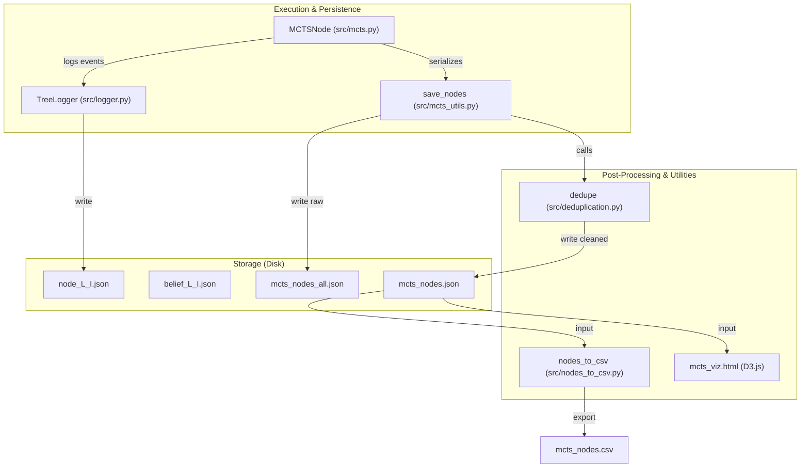

<!-- source: DeepWiki mcp.deepwiki.com · repo allenai/autodiscovery-neurips · page 5 Output, Persistence, and Utilities · fetched 2026-10-26 -->

# Output, Persistence, and Utilities

Relevant source files

The following files were used as context for generating this wiki page:

- [src/deduplication.py](src/deduplication.py)
- [src/log_utils.py](src/log_utils.py)
- [src/logger.py](src/logger.py)
- [src/mcts_utils.py](src/mcts_utils.py)
- [src/mcts_viz.html](src/mcts_viz.html)
- [src/nodes_to_csv.py](src/nodes_to_csv.py)

This section covers how AutoDiscovery manages the lifecycle of a discovery run beyond the live execution loop. It details the mechanisms for saving the Monte Carlo Tree Search (MCTS) state, resuming interrupted experiments, deduplicating redundant findings, and visualizing the resulting tree of hypotheses.

## Overview of Persistence and Post-Processing

The system is designed to be fault-tolerant and highly observable. Every state transition in the MCTS tree and every agent interaction is persisted to disk in real-time. This enables a robust post-processing pipeline where raw logs are transformed into structured CSV reports, deduplicated using semantic embeddings, and rendered in interactive visualizations.

### System Data Flow and Persistence

The following diagram illustrates how internal code entities interact with the file system to ensure persistence and facilitate post-processing.

**Persistence and Utility Data Flow**

Sources: [src/mcts_utils.py:93-128](), [src/logger.py:20-35](), [src/deduplication.py:141-162](), [src/nodes_to_csv.py:16-73]()

---

## 5.1 State Persistence and Resumption
AutoDiscovery uses a robust serialization format to ensure long-running MCTS explorations can be paused and resumed. The core state is stored in `mcts_nodes_all.json` (raw) and `mcts_nodes.json` (deduplicated).

- **Serialization**: `MCTSNode` objects are converted to dictionaries via `to_dict` and saved through the `save_nodes` pipeline. [src/mcts_utils.py:93-119]()
- **Resumption**: The `load_mcts_from_json` function reconstructs the tree by mapping `(level, node_idx)` pairs and re-linking parent/child pointers. It also features a `replay_mcts` mode to recalculate visit counts and values from the ground up. [src/mcts_utils.py:15-90]()
- **CLI Support**: Users can resume runs using the `--continue_from_dir` flag, which triggers the loading and replay mechanism.

For details, see [State Persistence and Resumption](#5.1).

---

## 5.2 Deduplication and CSV Export
To handle the "stochastic redundancy" of LLM-generated hypotheses, the system includes a deduplication pipeline and a reporting utility.

- **Deduplication**: The `dedupe` function in `src/deduplication.py` uses OpenAI's `text-embedding-3-large` to cluster similar hypotheses via Hierarchical Agglomerative Clustering (HAC). For clusters that are close but not identical, it uses an LLM-based `get_llm_merge_decision` to make final semantic equivalence calls. [src/deduplication.py:78-108](), [src/deduplication.py:111-139]()
- **CSV Export**: The `nodes_to_csv` utility extracts critical metrics—such as `belief_change`, `kl_divergence`, and `surprisal` status—into a sortable spreadsheet for researchers. [src/nodes_to_csv.py:39-62]()

For details, see [Deduplication and CSV Export](#5.2).

---

## 5.3 MCTS Tree Visualization
The system provides a D3.js-based interactive visualization tool, `src/mcts_viz.html`.

- **Visual Encoding**: Nodes are rendered as split circles. The left half represents the `prior` belief and the right half represents the `posterior` belief. [src/mcts_viz.html:48-58]()
- **Belief Direction**: Color coding indicates whether the belief shifted positively (green) or negatively (red) following experimentation. [src/mcts_viz.html:60-74]()
- **Interaction**: The tool allows users to upload a `mcts_nodes.json` file, pan/zoom through the tree, and click nodes to view full experiment plans, code, and analysis in a details panel. [src/mcts_viz.html:178-240]()

For details, see [MCTS Tree Visualization](#5.3).

---

## 5.4 Logging Infrastructure
Granular logging is handled by `TreeLogger` and a suite of utilities in `log_utils.py`.

- **Node Logging**: Every node in the MCTS tree has a corresponding `node_L_I.json` file containing the full conversation history of the agents involved in that node's creation. [src/logger.py:20-28]()
- **Belief Persistence**: `save_belief_distribution` records the raw LLM samples used to calculate priors and posteriors, ensuring the Bayesian reward is auditable. [src/log_utils.py:91-131]()
- **Hypothesis Inheritance**: `load_parent_hypotheses` allows child nodes to "inherit" the belief state of their ancestors, maintaining context across the search branch. [src/log_utils.py:133-185]()

For details, see [Logging Infrastructure](#5.4).

### Code Entity Association
The following table maps system concepts to their implementation files for quick reference.

| System Concept | Code Entity | File Path |
| :--- | :--- | :--- |
| **State Saving** | `save_nodes` | [src/mcts_utils.py]() |
| **State Loading** | `load_mcts_from_json` | [src/mcts_utils.py]() |
| **Clustering** | `dedupe` | [src/deduplication.py]() |
| **Report Generation** | `nodes_to_csv` | [src/nodes_to_csv.py]() |
| **Per-Node Logging** | `TreeLogger` | [src/logger.py]() |
| **Belief Storage** | `save_belief_distribution` | [src/log_utils.py]() |

Sources: [src/mcts_utils.py:15-128](), [src/deduplication.py:141-162](), [src/nodes_to_csv.py:16-73](), [src/logger.py:5-28](), [src/log_utils.py:91-131]()

---

