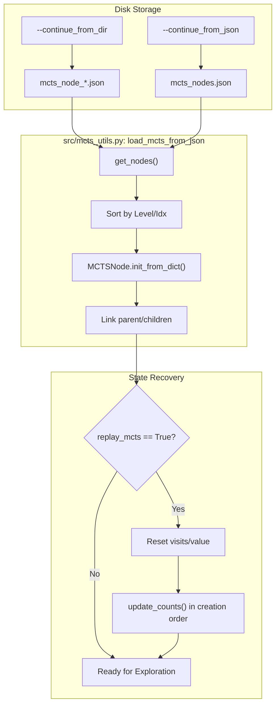
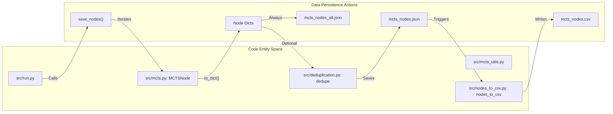

<!-- source: DeepWiki mcp.deepwiki.com · repo allenai/autodiscovery-neurips · page 5.1 State Persistence and Resumption · fetched 2026-10-26 -->

# State Persistence and Resumption

Relevant source files

The following files were used as context for generating this wiki page:

- [src/args.py](src/args.py)
- [src/mcts_utils.py](src/mcts_utils.py)
- [src/run.py](src/run.py)

AutoDiscovery provides a robust state persistence mechanism designed to ensure that the progress of a Monte Carlo Tree Search (MCTS) can be saved, analyzed, and resumed. Because discovery runs involve expensive LLM calls and long-running code executions, the system serializes the state of every `MCTSNode` to disk incrementally and provides utilities to reconstruct the entire search tree from these logs.

## Serialization Formats and Disk Layout

The system utilizes three primary JSON formats to persist the state of the discovery process within the directory specified by `--out_dir` [src/args.py:9]().

### 1. Incremental Node Logs (`mcts_node_*.json`)
Each time a node is successfully expanded or updated, its state is serialized into an individual file named `mcts_node_{level}_{node_idx}.json`. This ensures that even if a run is interrupted, the majority of the tree remains recoverable. These files contain the full `MCTSNode` data, including hypotheses, experiment plans, code, and belief distributions.

### 2. Consolidated Node Registry (`mcts_nodes.json`)
At the end of a run, or during periodic saves, the system generates `mcts_nodes.json`. This file contains a list of **deduplicated** nodes. The deduplication process uses embedding-based clustering and LLM verification to merge nodes with semantically identical hypotheses [src/mcts_utils.py:143-147]().

### 3. Full Node Registry (`mcts_nodes_all.json`)
This file contains the raw, non-deduplicated list of every node generated during the MCTS process [src/mcts_utils.py:156-159](). It serves as the ground truth for the search tree before any post-processing.

**Sources:** [src/mcts_utils.py:130-162](), [src/args.py:8-10]()

---

## The Resumption Mechanism

AutoDiscovery supports resuming interrupted runs through two primary CLI flags: `--continue_from_dir` and `--continue_from_json` [src/args.py:22-25]().

### Replay Logic
When resuming, the system invokes `load_mcts_from_json` [src/mcts_utils.py:15-90](). This function performs the following steps:
1. **Node Instantiation**: Reads all JSON files and creates `MCTSNode` objects using `node.init_from_dict(data)` [src/mcts_utils.py:38]().
2. **Tree Reconstruction**: Iterates through the nodes to re-establish parent-child links based on `parent_id` and `parent_idx` [src/mcts_utils.py:43-51]().
3. **MCTS Replay**: If `replay_mcts` is enabled, the system resets all `visits` and `value` counts to zero and then iterates through the nodes in their original `creation_idx` order [src/mcts_utils.py:80-88](). It calls `update_counts` for each node to backpropagate the rewards, ensuring the UCB1 values match the state at the time of interruption.

### Data Flow for Resumption
The following diagram illustrates how the system transitions from disk storage back into the live `MCTSNode` objects in memory.

**MCTS State Reconstruction Flow**

**Sources:** [src/mcts_utils.py:15-90](), [src/args.py:22-25]()

---

## The `save_nodes` Pipeline

The `save_nodes` function in `src/mcts_utils.py` is the central coordinator for persisting the search results. It handles the transition from the `nodes_by_level` dictionary used during the run to the final structured outputs.

### Implementation Details
- **Conversion**: It converts `MCTSNode` objects into dictionaries via `to_dict()` [src/mcts_utils.py:118]().
- **Deduplication**: If `run_dedupe` is true, it calls the `dedupe` utility to merge redundant discovery paths [src/mcts_utils.py:143-147]().
- **CSV Export**: Finally, it triggers `nodes_to_csv` to create a human-readable summary of the discovery process [src/mcts_utils.py:127]().

**Entity Mapping: Persistence Logic**

**Sources:** [src/mcts_utils.py:93-129](), [src/mcts_utils.py:130-162]()

---

## Reward and Belief Persistence

During the exploration loop in `src/run.py`, the system calculates rewards based on Bayesian surprise. These metrics are stored directly on the node and persisted to ensure that resumption maintains the same search priorities.

### Key Fields Persisted:
- `prior` & `posterior`: The belief distributions (e.g., `BeliefCategorical`) elicited from the LLM [src/run.py:154-155]().
- `belief_change` & `kl_divergence`: The calculated metrics used to determine "surprisal" [src/run.py:156-157]().
- `self_value`: The intrinsic reward of the node, computed via `get_self_value` [src/run.py:159-162]().
- `surprising`: A boolean flag indicating if the node met the `surprisal_width` threshold [src/run.py:163]().

### Online Beliefs and Context
If `--use_online_beliefs` is enabled [src/args.py:72](), the system also persists `all_surprisals` [src/run.py:165](). When resuming, this allows the system to reconstruct the `evidence_msg` used for prior conditioning, ensuring that the belief elicitation context remains consistent across sessions [src/run.py:53-62]().

**Sources:** [src/run.py:43-165](), [src/args.py:53-57](), [src/args.py:72-79]()

---

