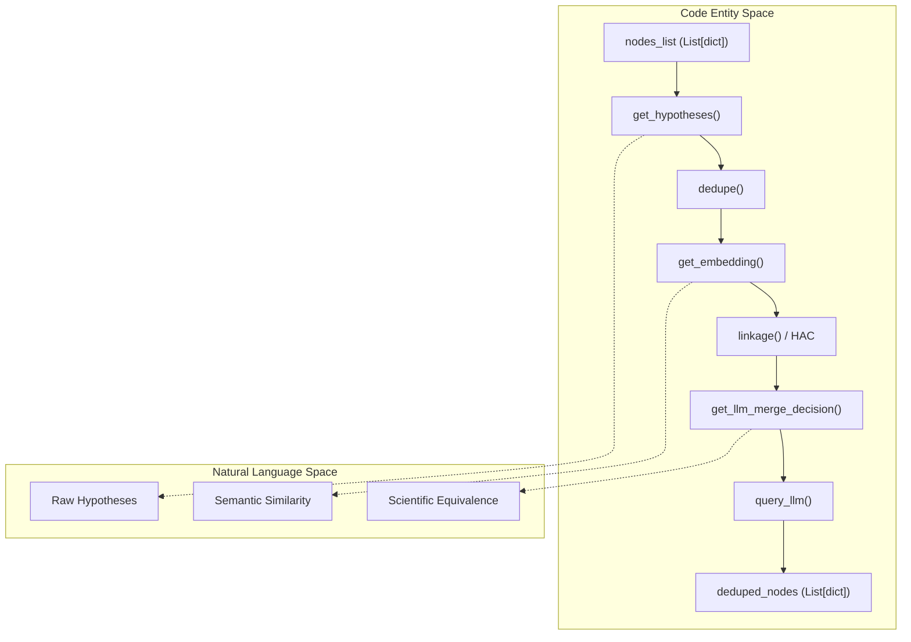
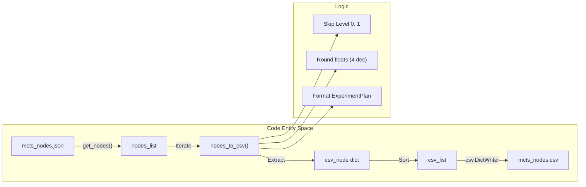

<!-- source: DeepWiki mcp.deepwiki.com · repo allenai/autodiscovery-neurips · page 5.2 Deduplication and CSV Export · fetched 2026-10-26 -->

# Deduplication and CSV Export

Relevant source files

The following files were used as context for generating this wiki page:

- [src/deduplication.py](src/deduplication.py)
- [src/mcts_utils.py](src/mcts_utils.py)
- [src/mcts_viz.html](src/mcts_viz.html)
- [src/nodes_to_csv.py](src/nodes_to_csv.py)

The **Deduplication and CSV Export** pipeline is responsible for refining the MCTS output by merging redundant hypotheses and generating human-readable reports. This subsystem ensures that the final set of discoveries is unique and that surprising findings are easily accessible for analysis.

## Overview

As the MCTS exploration progresses, different branches of the tree may converge on semantically identical hypotheses expressed in slightly different natural language. The deduplication pipeline in `src/deduplication.py` uses a hybrid approach—combining Hierarchical Agglomerative Clustering (HAC) of embeddings with LLM-based verification—to collapse these duplicates [src/deduplication.py:141-144](). Following deduplication, the `nodes_to_csv` utility transforms the complex JSON node structures into a flattened, sortable CSV format optimized for identifying high-belief-change results [src/nodes_to_csv.py:16-20]().

---

## Deduplication Pipeline

The deduplication process is triggered automatically during the `save_nodes` call in the MCTS loop [src/mcts_utils.py:121-122](). It operates in three primary stages: exact matching, embedding-based clustering, and LLM-based merge decisions.

### Implementation Flow

1.  **Exact Match Filtering**: Initial removal of identical hypothesis strings [src/deduplication.py:153-159]().
2.  **Embedding Generation**: Remaining hypotheses are embedded using OpenAI's `text-embedding-3-large` model [src/deduplication.py:78-87]().
3.  **HAC Clustering**: Hierarchical Agglomerative Clustering is performed on the embeddings to group potentially similar hypotheses [src/deduplication.py:171-174]().
4.  **LLM Verification**: For each cluster, the LLM (`gpt-4o` by default) performs pairwise comparisons to decide if hypotheses are semantically the same [src/deduplication.py:111-138]().

### LLM Merge Logic
The function `get_llm_merge_decision` uses a Pydantic `ResponseFormat` to enforce a boolean `is_same` decision [src/deduplication.py:113-114](). It employs a sampling approach (`n_samples`, default 30) and a `merge_threshold` (default 0.7) to ensure robust decisions [src/deduplication.py:111-112]().

**Data Flow: Deduplication Logic**

*Sources: [src/deduplication.py:11-138](), [src/deduplication.py:141-174]()*

---

## CSV Export Utility

The `nodes_to_csv` utility extracts specific metrics from the `MCTSNode` dictionary representation to create a report that highlights "surprising" discoveries—those with high KL divergence or significant belief shifts.

### Extracted Fields
The utility maps `MCTSNode` fields to CSV columns:
| CSV Column | MCTSNode Source | Description |
| :--- | :--- | :--- |
| `id` | `node['id']` | Unique node identifier (level_idx) [src/nodes_to_csv.py:39](). |
| `surprisal` | `node['surprising']` | Boolean flag for surprising nodes [src/nodes_to_csv.py:42](). |
| `prior` | `node['prior']['mean']` | Initial belief mean [src/nodes_to_csv.py:29](). |
| `posterior` | `node['posterior']['mean']` | Updated belief mean after experiment [src/nodes_to_csv.py:30](). |
| `belief_change` | `node['belief_change']` | Absolute difference between prior and posterior [src/nodes_to_csv.py:31](). |
| `belief_kl` | `node['kl_divergence']` | KL Divergence metric [src/nodes_to_csv.py:32](). |

### Post-Processing Logic
The script automatically filters out root and level-1 nodes (which usually contain setup or metadata) [src/nodes_to_csv.py:25-26](). It also calculates a `belief_dir` ('pos', 'neg', or 'same') based on the movement of the mean [src/nodes_to_csv.py:48-50](). Finally, the list is sorted by `belief_change` in descending order so the most impactful results appear at the top [src/nodes_to_csv.py:61-62]().

**Data Flow: JSON to CSV Transformation**

*Sources: [src/nodes_to_csv.py:16-73]()*

---

## Integration in MCTS Workflow

The `save_nodes` function in `src/mcts_utils.py` acts as the orchestrator for these post-processing steps. It is typically called at the end of an exploration run or during periodic checkpoints.

### Sequence of Operations
1.  **Serialization**: `MCTSNode` objects are converted to dictionaries using `to_dict()` [src/mcts_utils.py:118]().
2.  **Deduplication**: `save_nodes_to_json` is called with `run_dedupe=True`. This produces two files: `mcts_nodes.json` (deduplicated) and `mcts_nodes_all.json` (original) [src/mcts_utils.py:151-158]().
3.  **Export**: `nodes_to_csv` is called on the deduplicated list to generate the final report [src/mcts_utils.py:126-127]().

### CLI Usage
Users can manually trigger these utilities via the command line:
*   **Deduplication**: `python -m src.deduplication --in_fpath <path_to_json> --out_fpath <output_dir>` [src/deduplication.py:14-29]().
*   **CSV Export**: `python -m src.nodes_to_csv --in_fpath <path_to_json> --out_fpath <output_csv>` [src/nodes_to_csv.py:8-13]().

*Sources: [src/mcts_utils.py:93-129](), [src/deduplication.py:14-29](), [src/nodes_to_csv.py:8-13]()*

---

