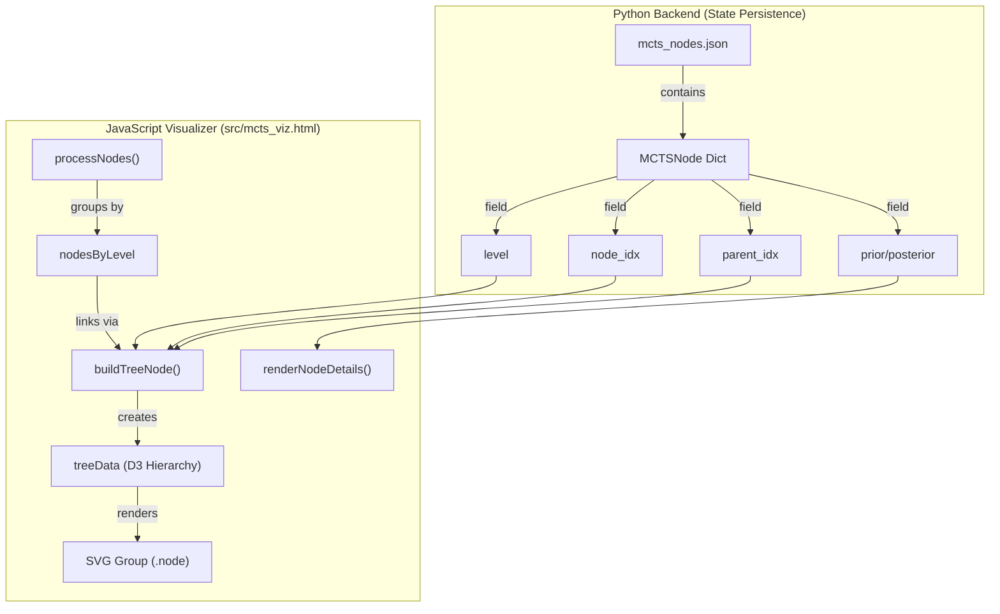

<!-- source: DeepWiki mcp.deepwiki.com · repo allenai/autodiscovery-neurips · page 5.3 MCTS Tree Visualization · fetched 2026-10-26 -->

# MCTS Tree Visualization

<details>
<summary>Relevant source files</summary>

The following files were used as context for generating this wiki page:

- [src/deduplication.py](src/deduplication.py)
- [src/mcts_viz.html](src/mcts_viz.html)

</details>


The MCTS Tree Visualization tool is a standalone, browser-based utility designed to provide a graphical representation of the discovery process. It allows researchers to inspect the branching logic of the Monte Carlo Tree Search, evaluate belief shifts (prior vs. posterior) at each node, and drill down into the specific code and results generated by the agentic pipeline.

## 1. Overview and Usage

The tool is implemented as a single HTML/JavaScript file `src/mcts_viz.html` using the **D3.js** library for hierarchical data rendering.

### 1.1 Loading Data
The visualizer consumes JSON log files generated during the MCTS execution, typically `mcts_nodes.json` or `mcts_nodes_all.json` [src/mcts_viz.html:164-168](). 
1. Open `src/mcts_viz.html` in a modern web browser.
2. Drag and drop the JSON log file into the "upload area" or use the file picker [src/mcts_viz.html:164-167]().
3. The tool parses the flat list of nodes and reconstructs the parent-child hierarchy based on `level` and `parent_idx` attributes [src/mcts_viz.html:203-212]().

### 1.2 Navigation
- **Zoom/Pan**: Users can use the mouse wheel to zoom and click-drag to pan across the tree canvas [src/mcts_viz.html:265-271]().
- **Surprise Counter**: A floating indicator in the top-right corner displays the total count of nodes flagged as `surprising` within the loaded dataset [src/mcts_viz.html:160-162]().

**Sources:** [src/mcts_viz.html:160-212](), [src/mcts_viz.html:265-271]()

---

## 2. Technical Implementation

The visualizer transforms the MCTS state from a serialized list into a dynamic SVG tree.

### 2.1 Data Flow: JSON to D3 Hierarchy
The visualization logic follows a standard transformation pipeline:

| Step | Function | Description |
| :--- | :--- | :--- |
| **Parsing** | `handleFiles` | Reads the local JSON file and triggers `processNodes` [src/mcts_viz.html:182-195](). |
| **Indexing** | `processNodes` | Groups nodes by `level` for efficient parent-child linking [src/mcts_viz.html:203-209](). |
| **Recursion** | `buildTreeNode` | Recursively builds a nested object structure compatible with `d3.hierarchy` [src/mcts_viz.html:223-240](). |
| **Layout** | `d3.tree()` | Computes the (x, y) coordinates for each node in the tree [src/mcts_viz.html:273-276](). |

### 2.2 System Mapping: Code Entities to Visuals
The following diagram illustrates how the MCTS data structures defined in the Python backend are mapped to D3 elements in the frontend.

**MCTS Data Mapping**

**Sources:** [src/mcts_viz.html:197-240](), [src/mcts_viz.html:273-280]()

---

## 3. Node Rendering and Visual Language

Nodes are not simple circles; they are complex glyphs that represent the "Belief Shift" resulting from an experiment.

### 3.1 The Split-Circle Glyph
Each node is rendered as a circle split into two halves:
- **Left Half (Prior)**: Represents the LLM's initial belief about the hypothesis before seeing the data [src/mcts_viz.html:48-52]().
- **Right Half (Posterior)**: Represents the updated belief after the experiment code has been executed and analyzed [src/mcts_viz.html:54-58]().

### 3.2 Color Coding
The visualizer uses colors to indicate the direction of the belief (e.g., Support vs. Refute):
- **Grey**: Default state or unreviewed node [src/mcts_viz.html:49-55]().
- **Green (`.positive`)**: High probability/belief in the hypothesis [src/mcts_viz.html:61-62]().
- **Red (`.negative`)**: Low probability/belief (refutation) [src/mcts_viz.html:65-66]().

### 3.3 Selection and Inspection
Clicking a node triggers the `showDetails(node)` function, which populates the **Details Panel** [src/mcts_viz.html:314-325](). This panel provides a deep dive into:
- **Hypothesis**: The natural language statement being tested.
- **Experiment Plan**: The proposed methodology.
- **Code**: The Python code generated by the `experiment_programmer` [src/mcts_viz.html:343-345]().
- **Execution Results**: Logs, errors, or data summaries from the `code_executor`.
- **Belief Visualization**: A horizontal bar chart showing the distribution of the prior vs. posterior [src/mcts_viz.html:120-143]().

**Node Interaction Logic**
```mermaid
sequenceDiagram
    participant User
    participant SVG as SVG Canvas
    participant Details as Details Panel
    participant D3 as D3 Selection

    User->>SVG: Click Node
    SVG->>D3: select(this)
    D3->>Details: updateContent(d.data)
    Details->>Details: renderBeliefBar(prior)
    Details->>Details: renderBeliefBar(posterior)
    Details->>Details: syntaxHighlight(code)
```
**Sources:** [src/mcts_viz.html:44-75](), [src/mcts_viz.html:314-350](), [src/mcts_viz.html:120-143]()

---

## 4. Key Functions Reference

| Function | File:Line | Description |
| :--- | :--- | :--- |
| `processNodes(nodes)` | [src/mcts_viz.html:197-215]() | Main entry point for data processing after file upload. |
| `buildTreeNode(node, nodesByLevel)` | [src/mcts_viz.html:223-240]() | Reconstructs the tree structure from flat JSON. |
| `renderTree()` | [src/mcts_viz.html:242-312]() | Initializes the SVG, applies zoom behaviors, and draws links/nodes. |
| `showDetails(d)` | [src/mcts_viz.html:314-360]() | Updates the sidebar with the full metadata of the selected node. |
| `createBeliefBar(belief, label)` | [src/mcts_viz.html:362-385]() | Helper to generate the visual belief distribution bars. |

**Sources:** [src/mcts_viz.html:197-385]()

---

