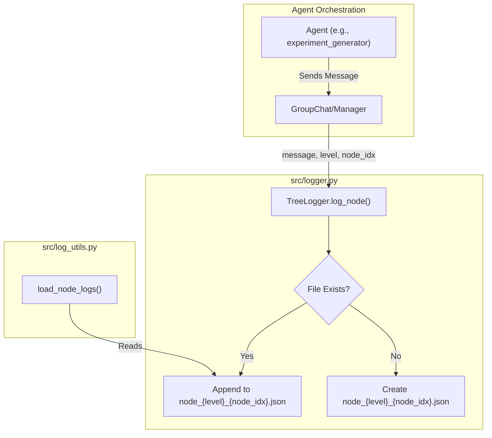
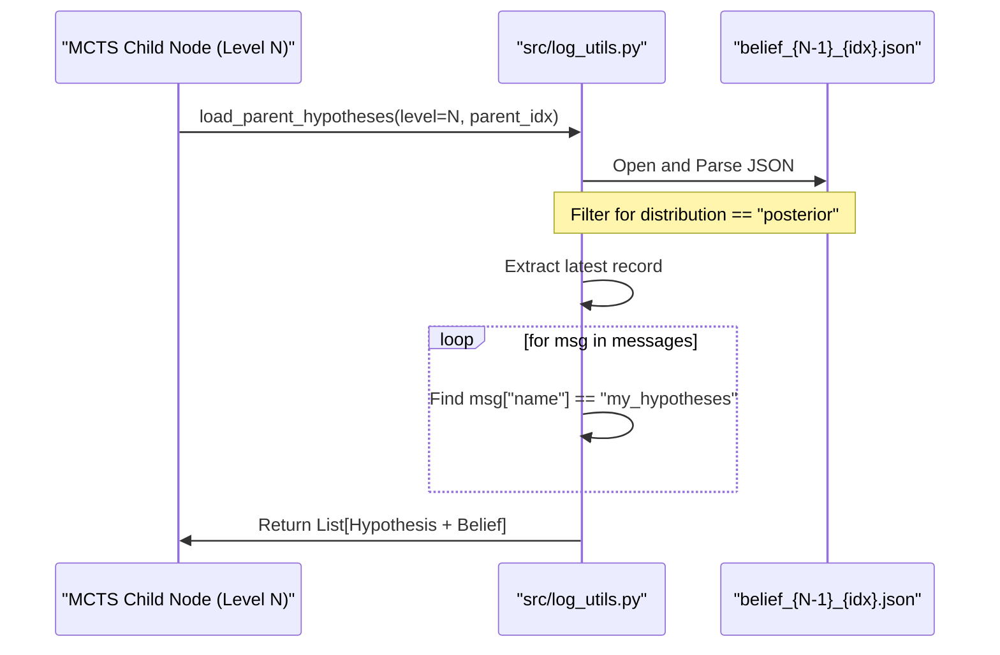

<!-- source: DeepWiki mcp.deepwiki.com · repo allenai/autodiscovery-neurips · page 5.4 Logging Infrastructure · fetched 2026-10-26 -->

# Logging Infrastructure

Relevant source files

The following files were used as context for generating this wiki page:

- [src/log_utils.py](src/log_utils.py)
- [src/logger.py](src/logger.py)

The Logging Infrastructure in AutoDiscovery is responsible for the granular persistence of the Monte Carlo Tree Search (MCTS) execution. Unlike standard application logs, this system captures the full conversational state of each node, belief distribution shifts (priors and posteriors), and the inheritance of scientific context across the search tree.

## TreeLogger Class

The `TreeLogger` class is the primary interface for persisting agent interactions at specific nodes within the discovery tree. It organizes logs hierarchically based on the tree depth and node index.

### Implementation Details
- **Storage Strategy**: Every node in the MCTS tree is associated with a dedicated JSON file named using the convention `node_{level}_{node_idx}.json` [src/logger.py:28-28]().
- **Message Handling**: The `log_node` method accepts both raw strings and dictionaries, ensuring that structured agent outputs (Pydantic models converted to dicts) are pretty-printed for readability [src/logger.py:31-34]().
- **Token-Level Logging**: The logger includes a `log_choices` method specifically for capturing LLM logprobs, which are essential for analyzing the confidence of agentic decisions [src/logger.py:62-73]().

### Logging Data Flow
The following diagram illustrates how the `TreeLogger` interacts with the agent orchestration layer to persist node state.

**Agent-to-Disk Logging Flow**

**Sources:** [src/logger.py:5-35](), [src/log_utils.py:6-24]()

## Belief Distribution Persistence

A critical component of the logging infrastructure is the persistence of belief distributions. This allows the system to track how an LLM's confidence in a hypothesis changes after seeing experimental evidence.

### `save_belief_distribution`
This function evaluates a hypothesis against a set of messages and saves the resulting distribution [src/log_utils.py:91-111]().
- **File Naming**: Beliefs are stored in files named `belief_{level}_{node_idx}.json` [src/log_utils.py:121-121]().
- **Record Structure**: Each record includes the `belief_result` (the distribution parameters), the `context` (current, branch, or all), and the specific `messages` that led to this belief [src/log_utils.py:113-119]().
- **Versioning**: The function appends to existing belief files, allowing a single node to have multiple belief updates (e.g., as more evidence is gathered) [src/log_utils.py:129-131]().

### `load_node_logs`
This utility parses the `node_*.json` files to reconstruct the conversation history for a specific node [src/log_utils.py:6-34](). It specifically uses `extract_node_messages` to isolate messages starting from the last `user_proxy` interaction, effectively filtering out previous MCTS iteration noise [src/log_utils.py:46-68]().

**Sources:** [src/log_utils.py:46-68](), [src/log_utils.py:91-131]()

## Parent Hypothesis Inheritance

To maintain scientific continuity, child nodes in the MCTS tree must "inherit" the hypotheses and beliefs established by their parents. This is handled by `load_parent_hypotheses`.

### Context Inheritance Mechanism
1. **Parent Resolution**: The system looks for the belief log of the parent node (`level-1`, `parent_node_idx`) [src/log_utils.py:148-148]().
2. **Posterior Retrieval**: It identifies the latest "posterior" distribution record for the specified context (e.g., "branch") [src/log_utils.py:159-166]().
3. **Hypothesis Extraction**: It iterates through the messages in that record to find entries named `my_hypotheses`, extracting the hypothesis text and the associated belief score [src/log_utils.py:169-177]().
4. **Belief Assignment**: The most recent belief result is assigned to the latest hypothesis in the list before returning it to the child node for further exploration [src/log_utils.py:182-183]().

**Hypothesis Inheritance Architecture**

**Sources:** [src/log_utils.py:133-185]()

## Key Functions and Interfaces

| Function | File | Purpose |
| :--- | :--- | :--- |
| `TreeLogger.log_node` | [src/logger.py:20-34]() | Writes agent messages to node-specific JSON files. |
| `save_belief_distribution` | [src/log_utils.py:91-132]() | Triggers belief evaluation and saves the distribution to disk. |
| `load_node_logs` | [src/log_utils.py:6-40]() | Reconstructs node state from disk for search resumption or analysis. |
| `load_parent_hypotheses` | [src/log_utils.py:133-185]() | Transfers hypothesis state from parent nodes to child nodes. |
| `extract_node_messages` | [src/log_utils.py:46-68]() | Filters raw logs to return only relevant conversation segments. |

**Sources:** [src/logger.py:1-90](), [src/log_utils.py:1-193]()

---

