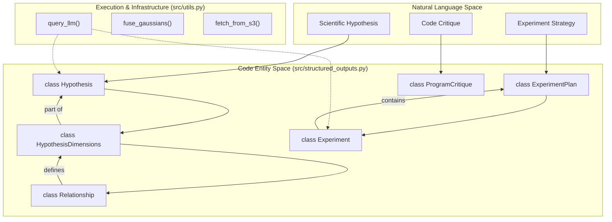
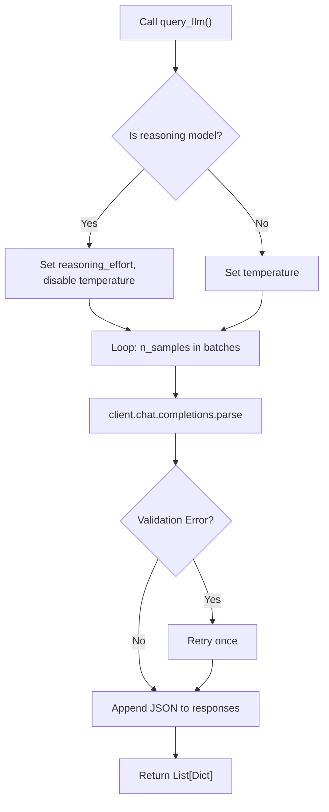

<!-- source: DeepWiki mcp.deepwiki.com · repo allenai/autodiscovery-neurips · page 6 Structured Outputs and LLM Utilities · fetched 2026-10-26 -->

# Structured Outputs and LLM Utilities

Relevant source files

The following files were used as context for generating this wiki page:

- [src/structured_outputs.py](src/structured_outputs.py)
- [src/utils.py](src/utils.py)

This section provides a reference for the foundational data structures and utility functions that enable robust communication between LLM agents and external infrastructure. The codebase relies on Pydantic for strict schema enforcement and a set of shared utilities for LLM interaction, statistical belief fusion, and data synchronization.

## Overview

The AutoDiscovery system operates by passing structured data between specialized agents (e.g., `experiment_generator`, `experiment_programmer`, `experiment_reviewer`). To ensure these agents adhere to expected data contracts, the system uses Pydantic models defined in `src/structured_outputs.py`. Complementing these schemas is `src/utils.py`, which provides the `query_llm` interface for handling batching and reasoning models, as well as mathematical utilities for Bayesian belief updates.

### System Data Flow and Code Entities

The following diagram illustrates how natural language concepts (Hypotheses, Plans) are mapped to specific Pydantic classes and handled by utility functions during the discovery process.

**Diagram: Mapping Natural Language to Code Entities**

Sources: [src/structured_outputs.py:6-120](), [src/utils.py:11-101]()

---

## 6.1 Pydantic Schemas

The system uses Pydantic models to enforce structured outputs from LLMs. This ensures that every agent response can be programmatically parsed and validated before being passed to the next stage of the MCTS tree or the code execution environment.

### Core Models
*   **`Hypothesis`**: Represents a declarative statement about the world. It includes a `HypothesisDimensions` object that breaks the statement down into specific variables and causal relationships [src/structured_outputs.py:34-43]().
*   **`ExperimentPlan`**: Defines the objective, steps, and expected deliverables for testing a hypothesis [src/structured_outputs.py:46-58]().
*   **`ExperimentCode`**: A simple wrapper for the Python code generated to execute an experiment [src/structured_outputs.py:103-111]().
*   **`ExperimentAnalyst` & `ExperimentReviewer`**: Models that capture the success status and textual feedback or analysis of an experiment run. They include validators to ensure that failures always include feedback [src/structured_outputs.py:123-160]().

For a detailed breakdown of every field and validator, see [Pydantic Schemas](#6.1).

Sources: [src/structured_outputs.py:1-190]()

---

## 6.2 LLM and Infrastructure Utilities

The `src/utils.py` module contains the engine for LLM interactions and helper functions for data management and mathematical operations.

### LLM Interaction
The `query_llm` function is the primary entry point for all model calls. It supports:
*   **Batching**: Automatically batches requests (size 8 for reasoning models) [src/utils.py:24-31]().
*   **Reasoning Models**: Specifically handles `o1` and `gpt-5` style models by adjusting `reasoning_effort` and omitting `temperature` [src/utils.py:22-36]().
*   **Structured Parsing**: Uses `client.chat.completions.parse` to map responses directly into the Pydantic schemas defined in `src/structured_outputs.py` [src/utils.py:42-50]().

### Infrastructure and Math
*   **`fuse_gaussians`**: Implements a product-of-Gaussians approach to fuse multiple independent Gaussian beliefs into a single distribution [src/utils.py:64-101]().
*   **`fetch_from_s3`**: Synchronizes datasets from S3 buckets to a local directory for processing [src/utils.py:104-125]().
*   **`try_loading_dict`**: A fault-tolerant JSON parser that attempts to fix common truncation errors in LLM outputs [src/utils.py:54-61]().

**Diagram: LLM Utility Logic Flow**

For implementation details and parameter references, see [LLM and Infrastructure Utilities](#6.2).

Sources: [src/utils.py:11-125]()

---

