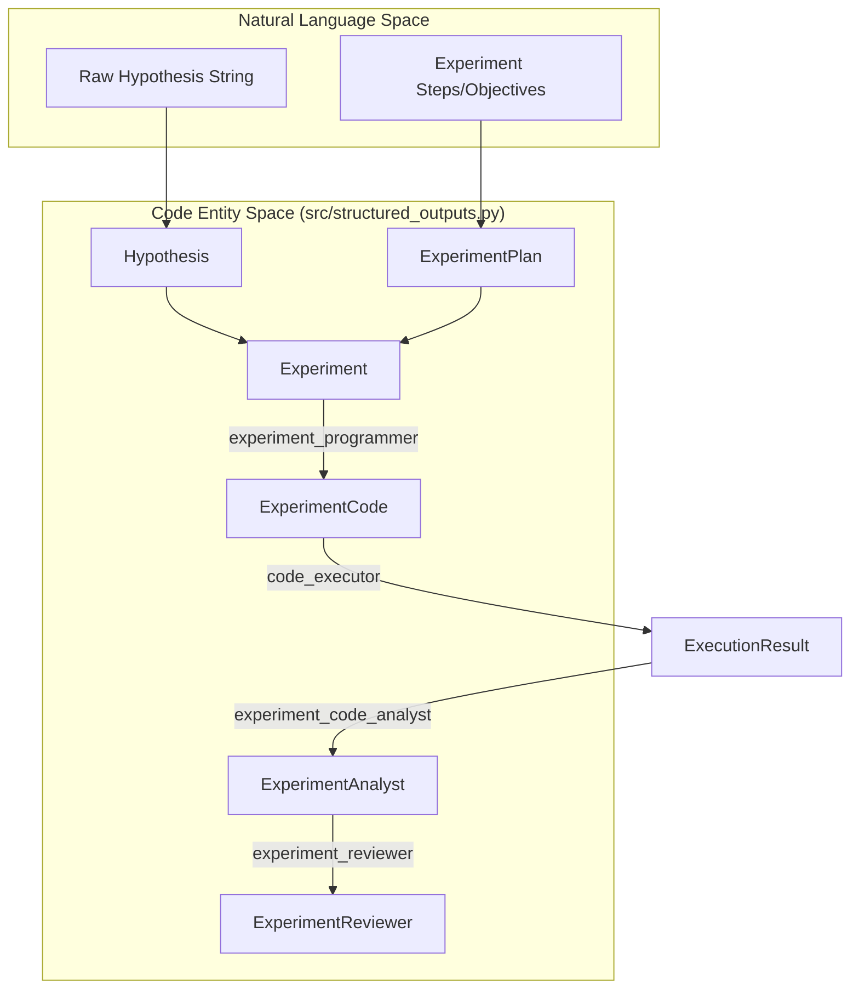
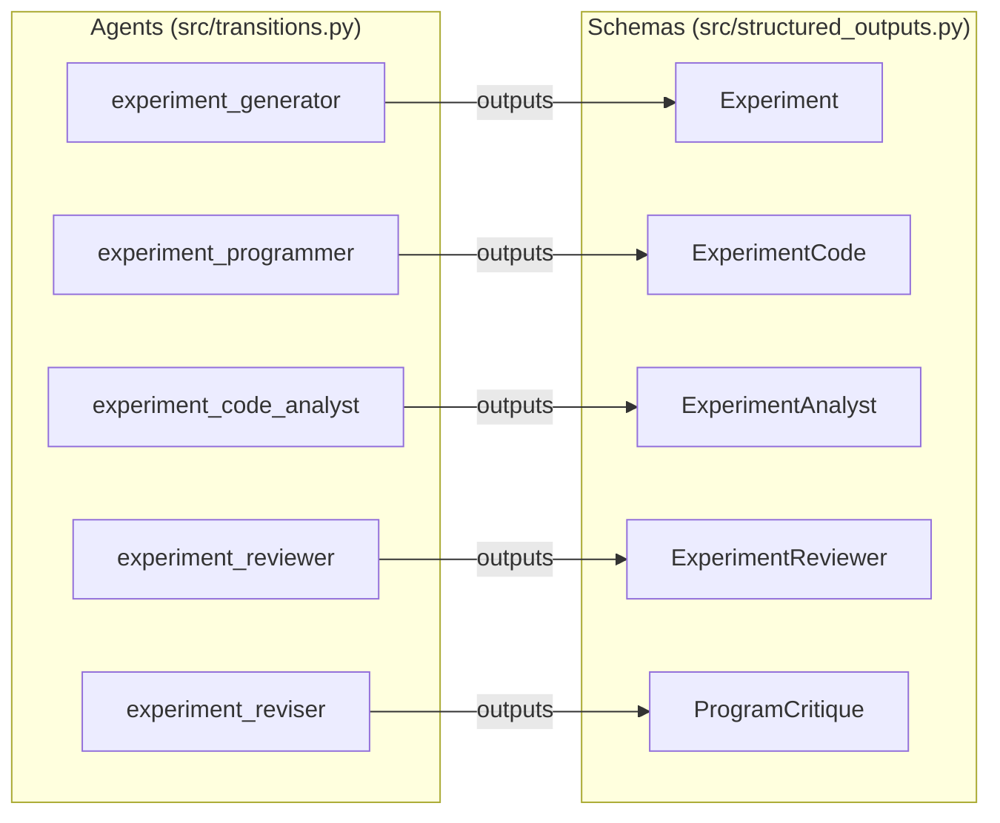

<!-- source: DeepWiki mcp.deepwiki.com · repo allenai/autodiscovery-neurips · page 6.1 Pydantic Schemas · fetched 2026-10-26 -->

# Pydantic Schemas

Relevant source files

The following files were used as context for generating this wiki page:

- [src/structured_outputs.py](src/structured_outputs.py)

This page provides a detailed technical reference for the Pydantic models used to enforce structured data contracts between LLM agents and the core discovery engine. These schemas ensure that natural language reasoning is translated into machine-readable objects that can be serialized, validated, and executed.

## Overview of Structured Output Flow

The AutoDiscovery pipeline relies on these schemas to bridge the gap between "Natural Language Space" (where agents reason) and "Code Entity Space" (where the MCTS engine operates). Every transition in the agent group chat is governed by these models to prevent parsing errors and ensure consistent state transitions.

### Data Flow: From Hypothesis to Execution

The following diagram illustrates how different Pydantic models are instantiated throughout the lifecycle of a single experiment node within the `MCTSNode` structure.

**Figure 1: Schema Lifecycle in Experiment Pipeline**

**Sources:** [src/structured_outputs.py:6-190]()

---

## Core Hypothesis Models

The hypothesis is the central unit of discovery. It is decomposed into structured dimensions to allow for precise comparison and deduplication.

### `Hypothesis`
The top-level container for a scientific assertion.
- **`hypothesis`** (`str`): The full natural-language statement.
- **`dimensions`** (`HypothesisDimensions`): Structured breakdown of the claim.

### `HypothesisDimensions`
Deconstructs a hypothesis into testable components.
- **`contexts`** (`list[str]`): Boundary conditions and assumptions (e.g., "In low-income urban areas").
- **`variables`** (`list[str]`): Key concepts or data columns involved.
- **`relationships`** (`list[Relationship]`): Causal or correlative links between variables.

### `Relationship`
Defines the interaction between two specific variables.
- **`explanatory`** (`str`): The independent variable.
- **`response`** (`str`): The dependent variable.
- **`relationship`** (`str`): Description of the effect (e.g., "positively correlates with").

**Sources:** [src/structured_outputs.py:6-44]()

---

## Experimentation and Execution Models

These models govern the planning, coding, and technical execution of an experiment.

### `ExperimentPlan`
Defines the "how" of the verification process.
- **`objective`** (`str`): The primary goal.
- **`steps`** (`str`): Sequential instructions for implementation.
- **`deliverables`** (`str`): Expected outputs (e.g., "A scatter plot of X vs Y").

### `Experiment` and `ExperimentHypothesis`
Wrapper classes that pair a hypothesis with its corresponding plan. `Experiment` is typically used during the generation phase, while `ExperimentHypothesis` is used in list contexts.
- **`hypothesis`** (`str`)
- **`experiment_plan`** (`ExperimentPlan`)

### `ExperimentCode`
The output of the `experiment_programmer` agent.
- **`code`** (`str`): The actual Python code to be executed.

### `ExecutionResult`
Captures the raw output from the `code_executor`.
- **`exit_code`** (`int`): `0` for success, non-zero for runtime errors.
- **`result`** (`str`): The standard output (stdout) or error trace (stderr) from the Python subprocess.

**Sources:** [src/structured_outputs.py:46-111](), [src/structured_outputs.py:187-190]()

---

## Analysis and Feedback Models

These models facilitate the "Self-Correction" loop within the multi-agent system.

### `ExperimentAnalyst`
The structured interpretation of the `ExecutionResult`.
- **`analysis`** (`str`): Detailed textual interpretation of the data/plots.
- **`success`** (`bool`): Indicates if the experiment successfully addressed the hypothesis.
- **Validation:** Includes a `model_validator` that mandates an `analysis` string if `success` is `True` [src/structured_outputs.py:134-138]().

### `ExperimentReviewer`
The final quality gate before a node is finalized in the MCTS tree.
- **`feedback`** (`str`): Instructions for improvement or reasons for failure.
- **`success`** (`bool`): Final determination of experiment validity.
- **Validation:** Includes a `model_validator` that mandates `feedback` if `success` is `False` [src/structured_outputs.py:155-159]().

### `ProgramCritique`
Used by the `experiment_reviser` to suggest specific code fixes.
- **`fixes`** (`list[str]`): A list of granular improvements for the next iteration of `ExperimentCode`.

**Sources:** [src/structured_outputs.py:113-160]()

---

## Visual and Multi-Modal Analysis

When experiments generate plots, the system uses the `IMAGE_ANALYSIS_PATCH` mechanism to translate pixels into structured insights.

### `ImageAnalysis`
Used by the `experiment_code_analyst` when processing visual outputs.

| Attribute | Type | Description |
| :--- | :--- | :--- |
| `plot_type` | `str` | e.g., "scatter", "histogram", "heatmap" |
| `title` | `str` | The title extracted from the plot |
| `x_axis_label` | `str` | Label for the X-axis |
| `y_axis_label` | `str` | Label for the Y-axis |
| `x_axis_range` | `list[int\|float]` | Numerical range of the X-axis |
| `data_trends` | `list[str]` | Observed patterns (e.g., "linear increase") |
| `statistical_insights`| `list[str]` | Metrics or statistical observations |

**Sources:** [src/structured_outputs.py:162-185]()

---

## System Mapping: Agent to Schema

The following diagram maps specific system agents to the Pydantic models they are responsible for producing.

**Figure 2: Agent-Schema Responsibility Map**

**Sources:** [src/structured_outputs.py:1-190](), [src/transitions.py:1-200]()

---

