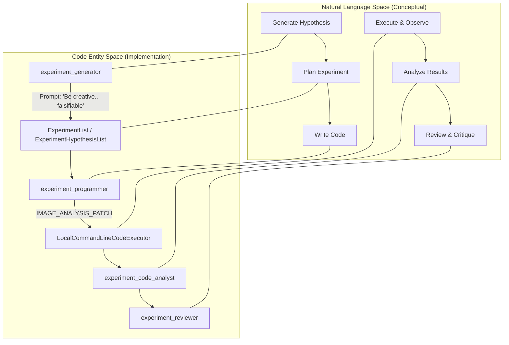
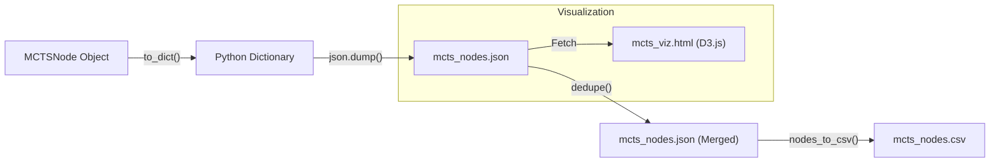

<!-- source: DeepWiki mcp.deepwiki.com · repo allenai/autodiscovery-neurips · page 7 Glossary · fetched 2026-10-26 -->

# Glossary

Relevant source files

The following files were used as context for generating this wiki page:

- [README.md](README.md)
- [src/agents.py](src/agents.py)
- [src/args.py](src/args.py)
- [src/beliefs.py](src/beliefs.py)
- [src/dataset.py](src/dataset.py)
- [src/deduplication.py](src/deduplication.py)
- [src/mcts.py](src/mcts.py)
- [src/mcts_utils.py](src/mcts_utils.py)
- [src/mcts_viz.html](src/mcts_viz.html)
- [src/run.py](src/run.py)
- [src/structured_outputs.py](src/structured_outputs.py)
- [src/transitions.py](src/transitions.py)
- [src/utils.py](src/utils.py)

This page provides a comprehensive reference for the domain-specific terminology, architectural components, and implementation details of the AutoDiscovery system.

## Core Concepts

### Bayesian Surprise
The fundamental metric used to guide discovery. It quantifies how much an experiment's results change the system's belief distribution regarding a hypothesis. In this codebase, surprise is operationalized as the **KL Divergence** between the prior belief and the posterior belief after observing experimental evidence [src/run.py:106-118]().

### MCTS (Monte Carlo Tree Search)
The search engine that navigates the space of possible scientific discoveries. Unlike traditional MCTS used in games, this implementation explores a hierarchy of experiments where nodes represent specific experimental executions and their resulting beliefs [src/mcts.py:14-64]().

### Belief Distribution
A probabilistic representation of the truth of a hypothesis. The system supports multiple distribution types (e.g., Beta for True/False, Dirichlet for Categorical) to model LLM uncertainty [src/beliefs.py:13-161]().

---

## Technical Terms & Code Entities

### 1. Discovery Loop Entities
| Term | Code Entity | Description |
| :--- | :--- | :--- |
| **Root Node** | `MCTSNode(level=0)` | The starting point, usually representing the dataset loading phase [src/mcts_utils.py:54-63](). |
| **Selection Strategy** | `mcts_selection` | Logic to pick the next node to expand (e.g., `ucb1_recursive`, `pw`) [src/args.py:44-46](). |
| **Self Value** | `node.self_value` | The immediate reward of a node based on its surprisal [src/run.py:159-162](). |
| **Backpropagation** | `node.update_counts` | Updating the aggregate value and visit counts from a leaf up to the root [src/mcts_utils.py:87-88](). |

**Sources:** [src/mcts.py:14-64](), [src/mcts_utils.py:54-90](), [src/run.py:159-165](), [src/args.py:44-46]()

### 2. Belief & Reward System
| Term | Code Entity | Description |
| :--- | :--- | :--- |
| **Prior** | `node.prior` | The belief distribution *before* the experiment is run [src/run.py:154](). |
| **Posterior** | `node.posterior` | The belief distribution *after* analyzing experimental results [src/run.py:155](). |
| **Belief Change** | `node.belief_change` | The absolute difference between prior and posterior means [src/run.py:156](). |
| **Surprisal Width** | `surprisal_width` | Threshold (default 0.2) to determine if a result is "surprising" [src/args.py:53-54](). |

**Sources:** [src/run.py:106-162](), [src/args.py:53-54](), [src/beliefs.py:54-74]()

---

## Agent Roles and Orchestration

The system uses a multi-agent group chat (via AutoGen) to execute the scientific process.

### Code-to-Concept Mapping: Agent Pipeline
The following diagram maps the conceptual scientific steps to the specific classes and prompts used in `src/agents.py` and `src/transitions.py`.

**Scientific Discovery Flow**

**Sources:** [src/agents.py:143-200](), [src/structured_outputs.py:83-101](), [src/transitions.py:1-20]()

---

## Data Model and Persistence

### MCTSNode Implementation
The `MCTSNode` class is the primary data structure for the discovery tree.

| Field | Type | Description |
| :--- | :--- | :--- |
| `hypothesis` | `str` | The natural language assertion being tested [src/mcts.py:46](). |
| `experiment_plan` | `dict` | Objective, steps, and deliverables [src/mcts.py:47](). |
| `code` | `str` | Python code generated to test the hypothesis [src/mcts.py:48](). |
| `code_output` | `str` | Stdout/stderr and plot descriptions from execution [src/mcts.py:49](). |
| `analysis` | `str` | LLM-generated interpretation of the `code_output` [src/mcts.py:50](). |
| `surprising` | `bool` | Flag indicating if KL divergence exceeded threshold [src/mcts.py:59](). |

**Sources:** [src/mcts.py:14-64](), [src/structured_outputs.py:46-58]()

### State Serialization Flow
The system persists the tree to enable resumption and visualization.

**Persistence Pipeline**

**Sources:** [src/mcts.py:65-117](), [src/mcts_utils.py:93-162](), [src/deduplication.py:141-160](), [src/mcts_viz.html:182-215]()

---

## Dataset Formats

The system supports three primary metadata schemas to describe scientific data:

1.  **DiscoveryBench (dbench):** Standard format using a `datasets` key with nested `columns` and `raw` descriptions [src/dataset.py:107-133]().
2.  **BLADE:** Uses `data_desc` with `fields` and `properties` [src/dataset.py:17-55]().
3.  **AI2:** Similar to DiscoveryBench but with a specific `raw` column nesting structure [src/dataset.py:63-96]().

**Sources:** [src/dataset.py:7-133](), [src/args.py:36-37]()

---

## Abbreviations

*   **EDA:** Exploratory Data Analysis. An optional warm-start step where the agent explores the dataset before forming targeted hypotheses [src/args.py:68-69]().
*   **KL:** Kullback–Leibler Divergence. Used as the reward signal for MCTS [src/beliefs.py:142-158]().
*   **PW:** Progressive Widening. A selection strategy to handle large or infinite branching factors in the discovery tree [src/run.py:7-8]().
*   **UCB1:** Upper Confidence Bound 1. The standard algorithm for balancing exploration and exploitation in MCTS [src/run.py:7-8]().

**Sources:** [src/args.py:44-46](), [src/run.py:7-8](), [src/beliefs.py:142-158]()