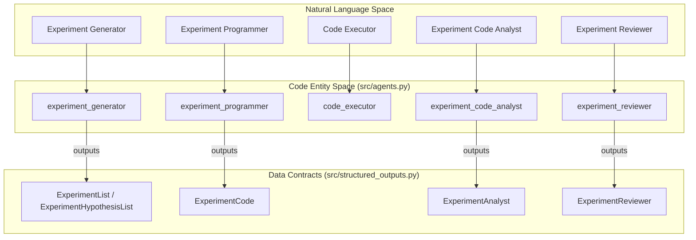
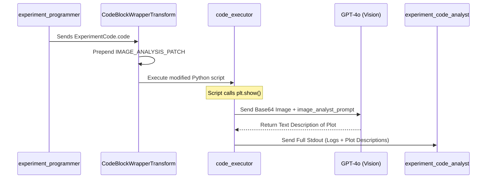

<!-- source: DeepWiki mcp.deepwiki.com · repo allenai/autodiscovery-neurips · extra page Agent Roles and Prompts · fetched 2026-10-26 -->

# Agent Roles and Prompts

Relevant source files

The following files were used as context for generating this wiki page:

- [src/agents.py](src/agents.py)
- [src/structured_outputs.py](src/structured_outputs.py)

This page provides a detailed reference for the multi-agent system used in AutoDiscovery. Each agent is a specialized `ConversableAgent` configured with specific system prompts, LLM configurations, and Pydantic-based structured output schemas to ensure robust transitions within the discovery pipeline.

## Overview of Agent Architecture

The agents are initialized via the `get_agents` function in [src/agents.py:133-134](). They operate within an AutoGen-based group chat, where their interactions are governed by a state machine. The system utilizes structured outputs to enforce data contracts between different stages of the experiment lifecycle, such as hypothesis generation, coding, and result analysis.

### Agent-Code Entity Mapping

The following diagram bridges the natural language roles to the specific code entities and Pydantic models that define their communication interface.

**Diagram: Agent Role to Code Entity Mapping**

Sources: [src/agents.py:133-315](), [src/structured_outputs.py:1-160]()

---

## Agent Roles and Specifications

### 1. Experiment Generator
The `experiment_generator` is responsible for open-ended, data-driven research. It proposes verifiable hypotheses and corresponding experiment plans.

*   **System Prompt:** Instructs the agent to be creative and think of falsifiable statements using only provided datasets [src/agents.py:150-160]().
*   **Structured Output:** Uses `ExperimentList` or `ExperimentHypothesisList` [src/agents.py:148-149]().
*   **Key Constraints:** Must not simulate dummy data and must use prior experiments as inspiration without repetition [src/agents.py:158-160]().

### 2. Experiment Programmer
The `experiment_programmer` translates natural language experiment plans into executable Python code.

*   **System Prompt:** Focuses on writing modular, well-documented code. It is instructed to perform data cleaning, analysis, and visualization [src/agents.py:197-210]().
*   **Structured Output:** `ExperimentCode` [src/agents.py:195]().
*   **Retry Budget:** Handled by the `SpeakerSelector` in `src/transitions.py`, typically allowing up to 6 code execution failures before termination.

### 3. Code Executor
The `code_executor` is a `UserProxyAgent` that runs the generated code in a local environment.

*   **Implementation:** Uses `LocalCommandLineCodeExecutor` with a specified work directory [src/agents.py:230-234]().
*   **Safety:** Execution is sandboxed to the command line, and a timeout (default 30 minutes) is applied [src/agents.py:134]().

### 4. Experiment Code Analyst
The `experiment_code_analyst` interprets the output of the code execution, including logs and plot descriptions.

*   **System Prompt:** Instructed to provide a detailed analysis of the experiment outcomes and determine if the experiment successfully tested the hypothesis [src/agents.py:253-263]().
*   **Structured Output:** `ExperimentAnalyst` [src/agents.py:251](). This model requires an `analysis` string if `success` is true [src/structured_outputs.py:134-138]().

### 5. Experiment Reviewer
The `experiment_reviewer` acts as a quality gate, reviewing the analyst's conclusions against the original hypothesis.

*   **System Prompt:** Critically evaluates whether the results support or refute the hypothesis and identifies potential flaws in the experimental design [src/agents.py:279-290]().
*   **Structured Output:** `ExperimentReviewer` [src/agents.py:277](). It requires `feedback` if the experiment is marked as a failure [src/structured_outputs.py:155-159]().

### 6. Experiment Reviser
The `experiment_reviser` is invoked when an experiment fails due to logic or implementation errors.

*   **System Prompt:** Uses feedback from the reviewer to suggest specific fixes to the code or plan [src/agents.py:304-313]().
*   **Structured Output:** `ProgramCritique` [src/agents.py:302]().

Sources: [src/agents.py:146-315](), [src/structured_outputs.py:83-160]()

---

## The IMAGE_ANALYSIS_PATCH Mechanism

Because the `code_executor` runs in a headless environment, standard `matplotlib.pyplot.show()` calls would not be visible to the LLM. AutoDiscovery solves this using the `IMAGE_ANALYSIS_PATCH` [src/agents.py:14-87]().

### Implementation Details
The patch is a string of Python code prepended to every code block generated by the `experiment_programmer` via the `CodeBlockWrapperTransform` [src/agents.py:90-104]().

1.  **Redefinition:** It overrides `plt.show` using `functools.partial` to point to a custom `image_to_text` function [src/agents.py:80-86]().
2.  **Capture:** `image_to_text` iterates through all active figures, saves them to a `BytesIO` buffer as PNGs, and encodes them to base64 [src/agents.py:39-47]().
3.  **Analysis:** It sends the base64 image to `gpt-4o` with a specialized `image_analyst_prompt` [src/agents.py:24-36]().
4.  **Injection:** The resulting text description of the plot is printed to standard output, which the `code_executor` captures and passes to the `experiment_code_analyst` [src/agents.py:73-75]().

**Diagram: Image Analysis Data Flow**

Sources: [src/agents.py:14-104]()

---

## Configuration and Retry Logic

Agents are configured with an OpenAI configuration that supports both standard GPT-4 models and the O-series reasoning models.

| Parameter | Logic | File Reference |
| :--- | :--- | :--- |
| **Temperature** | Applied to non-reasoning models; omitted for O-series. | [src/agents.py:120-129]() |
| **Reasoning Effort** | Configurable for O-series models (defaulting to "medium"). | [src/agents.py:124-126]() |
| **Max Retries** | Set to 3 at the LLM configuration level. | [src/agents.py:117]() |
| **Token Limits** | `MessageTokenLimiter` enforces a 10,000 token limit per message. | [src/agents.py:139-141]() |

Sources: [src/agents.py:110-142]()

---

