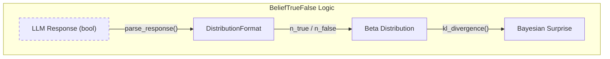
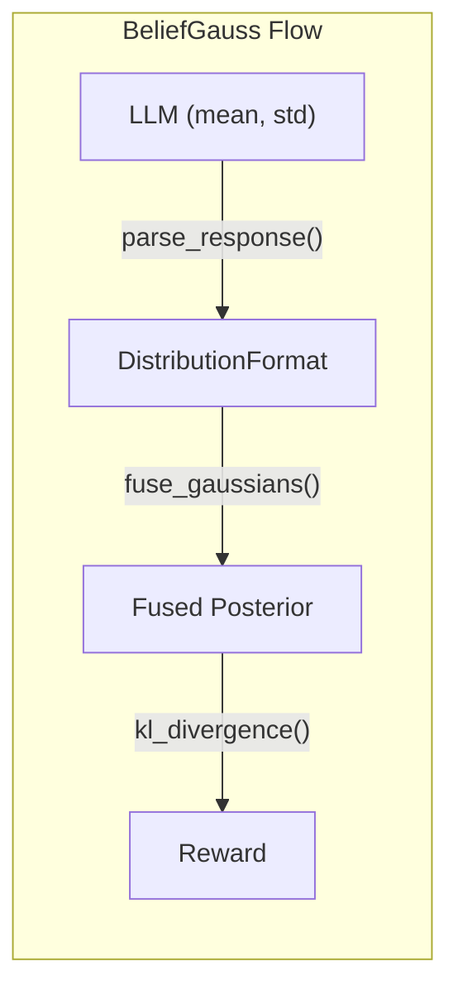

<!-- source: DeepWiki mcp.deepwiki.com · repo allenai/autodiscovery-neurips · extra page Belief Distribution Formats · fetched 2026-10-26 -->

# Belief Distribution Formats

Relevant source files

The following files were used as context for generating this wiki page:

- [src/beliefs.py](src/beliefs.py)

The AutoDiscovery system quantifies scientific belief using a Bayesian framework. It translates qualitative LLM assessments into quantitative probability distributions to calculate **Bayesian Surprise** (KL Divergence). This page documents the five supported belief modes, their underlying statistical distributions, and the implementation details for mean calculation and divergence.

## Architecture Overview

Beliefs are handled by a pair of classes for each mode: a `DistributionFormat` which manages the statistical parameters and mathematical operations, and a `ResponseFormat` (a Pydantic `BaseModel`) which defines the schema for LLM structured output.

### Data Flow: Elicitation to Reward
1. **Prompting**: The system queries an LLM with a hypothesis and experimental context.
2. **Parsing**: The `parse_response` method converts LLM JSON outputs into a `DistributionFormat` instance [[src/beliefs.py:115-117](), [src/beliefs.py:341-343]()].
3. **Updating**: New evidence is integrated into existing distributions via the `update` method [[src/beliefs.py:76-78](), [src/beliefs.py:284-286]()].
4. **Scoring**: The `kl_divergence` method calculates the information gain between the prior (pre-experiment) and posterior (post-experiment) distributions [[src/beliefs.py:142-143](), [src/beliefs.py:410-411]()].

### Natural Language to Code Entity Mapping

| Conceptual Space | Code Entity (Class/Method) | Statistical Model |
| :--- | :--- | :--- |
| Binary Support | `BeliefTrueFalse` | Beta Distribution |
| Likert Scale | `BeliefCategorical` | Dirichlet Distribution |
| Numerical Buckets | `BeliefCategoricalNumeric` | Dirichlet Distribution |
| Real-valued Estimates | `BeliefGauss` | Gaussian Distribution |
| Multi-Label Support | `BeliefTrueFalseCat` | Independent Beta Distrs |

Sources: `src/beliefs.py` [[13-161](), [161-428](), [428-567](), [567-731](), [731-855]()]

---

## 1. BeliefTrueFalse (Beta)

Used for binary "True/False" hypotheses. It models belief using a **Beta Distribution**, where `n_true` and `n_false` act as pseudo-counts (observations).

### Implementation Details
*   **Parameters**: Uses `alpha` (n_true + prior_alpha) and `beta` (n_false + prior_beta) [[src/beliefs.py:102-102]()].
*   **Mean Calculation**: The mean is calculated as $\frac{\alpha}{\alpha + \beta}$ [[src/beliefs.py:67-67]()].
*   **KL Divergence**: Implemented using the Log-Beta function (`betaln`) and Digamma function (`psi`) [[src/beliefs.py:154-158]()].

Sources: `src/beliefs.py` [[13-160]()]

---

## 2. BeliefCategorical (Dirichlet)

Maps qualitative certainty levels to a **Dirichlet Distribution**. The LLM selects from five buckets: `definitely_false`, `maybe_false`, `uncertain`, `maybe_true`, and `definitely_true` [[src/beliefs.py:162-168]()].

### Mapping and Scoring
Each category is assigned a numerical weight for mean calculation:
*   `definitely_false`: 0.1
*   `maybe_false`: 0.3
*   `uncertain`: 0.5
*   `maybe_true`: 0.7
*   `definitely_true`: 0.9

### KL Divergence
Calculated as the divergence between two Dirichlet distributions using the sum of Digamma functions over the concentration parameters $\alpha_i$ [[src/beliefs.py:410-428]()].

Sources: `src/beliefs.py` [[161-428]()]

---

## 3. BeliefCategoricalNumeric

Similar to `BeliefCategorical`, but allows the LLM to define its own numeric categories (e.g., bins of a specific measurement). It is used when the hypothesis involves specific ranges or discrete values rather than just truth sentiment [[src/beliefs.py:428-435]()].

*   **Format**: The `ResponseFormat` requires a `category` (str) and `belief` (bool/null) [[src/beliefs.py:512-519]()].
*   **Logic**: It treats categories as independent bins in a Dirichlet distribution.

Sources: `src/beliefs.py` [[428-567]()]

---

## 4. BeliefGauss (Gaussian)

Models belief as a **Gaussian (Normal) Distribution** $\mathcal{N}(\mu, \sigma^2)$. This is preferred for hypotheses predicting continuous physical constants or effect sizes [[src/beliefs.py:567-575]()].

### Key Operations
*   **Fusion**: When multiple samples are provided, they are fused using `fuse_gaussians`, which computes the product of Gaussians (precision-weighted mean) [[src/beliefs.py:611-615](), [src/utils.py:136-150]()].
*   **KL Divergence**: Standard closed-form for two univariate Gaussians:
    $$\log(\frac{\sigma_2}{\sigma_1}) + \frac{\sigma_1^2 + (\mu_1 - \mu_2)^2}{2\sigma_2^2} - \frac{1}{2}$$
    [[src/beliefs.py:716-731]()]

Sources: `src/beliefs.py` [[567-731]()], `src/utils.py` [[136-150]()]

---

## 5. BeliefTrueFalseCat

A hybrid mode used for multi-dimensional hypotheses. It maintains a dictionary of multiple `BeliefTrueFalse` distributions, indexed by category names [[src/beliefs.py:731-740]()].

*   **Structure**: `self.beliefs` is a `Dict[str, BeliefTrueFalse.DistributionFormat]` [[src/beliefs.py:756-756]()].
*   **Mean Calculation**: Returns the average mean across all categories [[src/beliefs.py:785-787]()].
*   **KL Divergence**: Returns the sum of KL divergences of the individual Beta distributions [[src/beliefs.py:848-855]()].

Sources: `src/beliefs.py` [[731-855]()]

---

## Summary Table: Distribution Properties

| Format | Underlying Distr. | Mean Calculation | KL Divergence Method |
| :--- | :--- | :--- | :--- |
| **TrueFalse** | Beta($\alpha, \beta$) | $\frac{\alpha}{\alpha+\beta}$ | `betaln` + `psi` |
| **Categorical** | Dirichlet($\alpha_1...\alpha_5$) | Weighted sum of buckets | Sum of `psi` over $\alpha_i$ |
| **Gauss** | $\mathcal{N}(\mu, \sigma^2)$ | $\mu$ | Univariate Gaussian formula |
| **TrueFalseCat** | Multiple Betas | Avg of category means | Sum of individual Beta KLs |

Sources: `src/beliefs.py` [[67](), [154-158](), [240-245](), [420-428](), [624](), [716-731](), [785-787]()]

---

