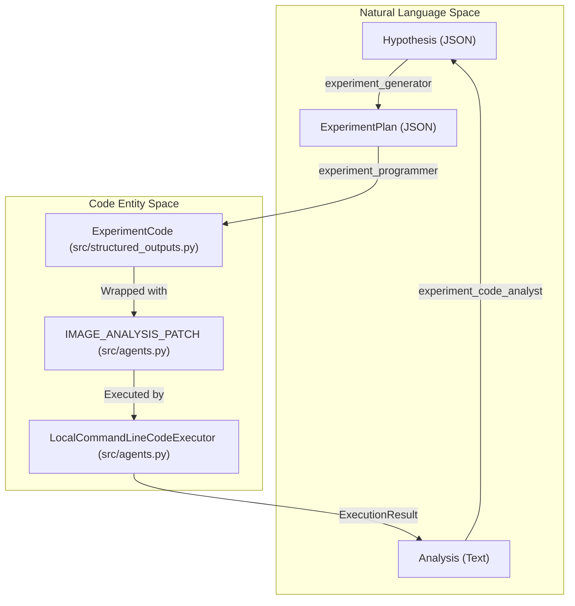
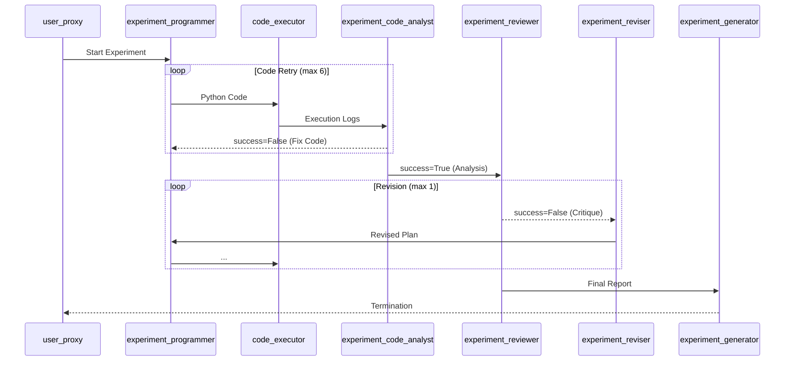

<!-- source: DeepWiki mcp.deepwiki.com · repo allenai/autodiscovery-neurips · extra page Conversation Flow and Transitions · fetched 2026-10-26 -->

# Conversation Flow and Transitions

Relevant source files

The following files were used as context for generating this wiki page:

- [src/agents.py](src/agents.py)
- [src/transitions.py](src/transitions.py)

The conversation flow in AutoDiscovery is managed by a deterministic state machine that orchestrates the interaction between specialized agents. This logic ensures that hypotheses are systematically translated into code, executed, analyzed, and reviewed before being used to seed further discoveries.

## SpeakerSelector State Machine

The `SpeakerSelector` class in `src/transitions.py` implements the routing logic for the `GroupChat`. Unlike standard AutoGen group chats that may rely on LLM-based selection, AutoDiscovery uses a rule-based approach to ensure a reliable research pipeline.

### Deterministic Routing Rules

The transitions follow a linear path with specific loops for error correction and refinement.

| Current Speaker | Next Speaker | Condition / Logic |
| :--- | :--- | :--- |
| `user_proxy` | `experiment_programmer` | Initial handoff of the experiment plan. |
| `experiment_programmer` | `code_executor` | Handoff of generated Python code for execution. |
| `code_executor` | `experiment_code_analyst` | Handoff of execution logs and plots for interpretation. |
| `experiment_code_analyst` | `experiment_programmer` | **Retry Loop:** Triggered if `success` is `False` and `code_failure_count < 6`. |
| `experiment_code_analyst` | `experiment_reviewer` | Triggered if analysis is successful or retry budget is exhausted. |
| `experiment_reviewer` | `experiment_reviser` | **Revision Loop:** Triggered if `success` is `False` and `experiment_revision_count < 1`. |
| `experiment_reviewer` | `experiment_generator` | Triggered if review passes or revision budget is exhausted. |
| `experiment_reviser` | `experiment_programmer` | Revision feedback is sent back to the programmer to fix the experiment. |
| `experiment_generator` | `None` | Termination of the current MCTS node iteration. |

Sources: [src/transitions.py:6-66]()

### Failure Budgets and Counters

To prevent infinite loops in the multi-agent conversation, `SpeakerSelector` maintains internal state counters:

*   **`code_failure_count`**: Tracks how many times the `experiment_code_analyst` has reported a failure (e.g., runtime errors or empty results). The system allows up to **6 attempts** to fix the code via the `experiment_programmer` before moving to the review stage regardless of outcome [src/transitions.py:40-45]().
*   **`experiment_revision_count`**: Tracks how many times the `experiment_reviewer` has requested a revision of the experiment's logic. The system allows **1 revision** attempt via the `experiment_reviser` [src/transitions.py:53-58]().

## Data Flow: Natural Language to Code Entity Space

The following diagram illustrates how high-level research intents are transformed into concrete code entities and back into structured analysis.

**Entity Transition Diagram**

Sources: [src/agents.py:14-87](), [src/agents.py:146-160](), [src/transitions.py:23-32]()

## Success Signaling and JSON Parsing

Transitions are heavily dependent on the structured outputs of the agents. The `SpeakerSelector` parses the `content` of the last message as JSON to determine the next state.

*   **Code Analysis Success**: The `experiment_code_analyst` outputs a JSON object. If `json.loads(content).get("success")` is `False`, the selector increments `code_failure_count` and routes back to the programmer [src/transitions.py:35-42]().
*   **Review Success**: The `experiment_reviewer` outputs a JSON object. If `success` is `False`, the selector routes to the `experiment_reviser` [src/transitions.py:49-55]().
*   **Parsing Failures**: If a message cannot be parsed as JSON, the system treats it as a failure, defaulting `success` to `False` to trigger a retry or revision loop [src/transitions.py:37-39](), [src/transitions.py:51-52]().

## Termination Conditions

The conversation terminates (returns `None`) in two scenarios:
1.  The `experiment_generator` has finished its final task in the sequence [src/transitions.py:63-64]().
2.  An unrecognized speaker is encountered (fallback safety) [src/transitions.py:66]().

**Conversation Lifecycle**

Sources: [src/transitions.py:11-66]()

---

