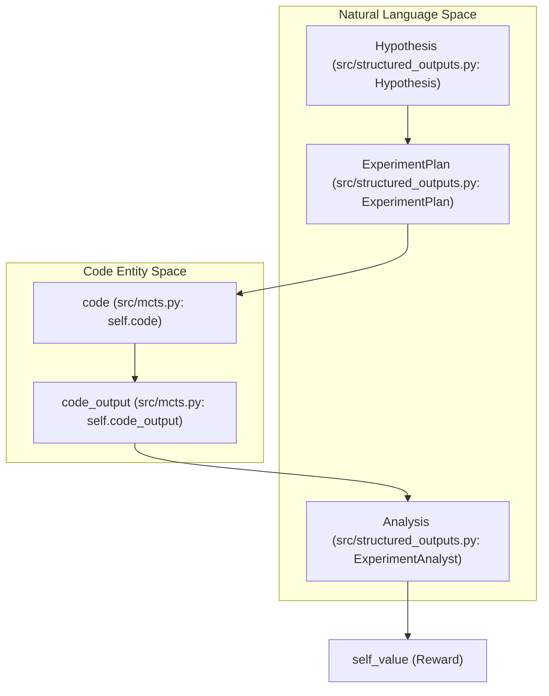
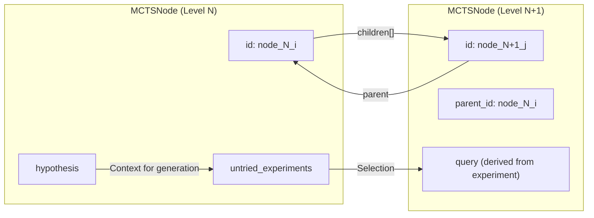

<!-- source: DeepWiki mcp.deepwiki.com · repo allenai/autodiscovery-neurips · extra page MCTSNode Data Model · fetched 2026-10-26 -->

# MCTSNode Data Model

Relevant source files

The following files were used as context for generating this wiki page:

- [src/mcts.py](src/mcts.py)
- [src/mcts_utils.py](src/mcts_utils.py)

The `MCTSNode` class is the fundamental data structure of the AutoDiscovery system, representing a single state within the Monte Carlo Tree Search (MCTS) discovery loop. Each node encapsulates a scientific hypothesis, the experimental plan designed to test it, the resulting code, and the Bayesian belief distributions (prior and posterior) used to calculate scientific surprise.

## 1. Class Structure and Fields

The `MCTSNode` class [src/mcts.py:14-63]() serves as a container for both tree-specific metadata and agent-generated scientific content.

### 1.1 Tree and Identification Attributes
These fields manage the node's position and relationship within the search tree.

| Field | Type | Description |
| :--- | :--- | :--- |
| `id` | `str` | Unique identifier formatted as `node_{level}_{node_idx}` [src/mcts.py:26](). |
| `level` | `int` | The depth of the node in the tree (0 for root) [src/mcts.py:24](). |
| `node_idx` | `int` | Sequential index of the node within its specific level [src/mcts.py:25](). |
| `creation_idx` | `int` | Global counter used to replay MCTS steps in the exact order they occurred [src/mcts.py:21-22](). |
| `parent` | `MCTSNode` | Reference to the parent node object [src/mcts.py:28](). |
| `children` | `list` | List of child `MCTSNode` objects [src/mcts.py:27](). |

### 1.2 Scientific and Agent Attributes
These fields store the outputs from the multi-agent orchestration pipeline.

| Field | Type | Description |
| :--- | :--- | :--- |
| `hypothesis` | `dict`/`Hypothesis` | The scientific hypothesis being tested [src/mcts.py:46](). |
| `experiment_plan` | `dict`/`ExperimentPlan`| The natural language plan for the experiment [src/mcts.py:47](). |
| `code` | `str` | The Python code generated to execute the experiment [src/mcts.py:48](). |
| `code_output` | `str` | The stdout/stderr and results from code execution [src/mcts.py:49](). |
| `analysis` | `dict` | The `experiment_code_analyst`'s interpretation of results [src/mcts.py:50](). |
| `review` | `dict` | Feedback from the `experiment_reviewer` [src/mcts.py:51](). |

### 1.3 MCTS and Belief Attributes
Fields used for selection logic and reward calculation.

| Field | Type | Description |
| :--- | :--- | :--- |
| `visits` | `int` | Number of times this node (or its descendants) has been visited [src/mcts.py:54](). |
| `value` | `float` | Aggregated value (backpropagated) used for UCB1 selection [src/mcts.py:55](). |
| `self_value` | `float` | The immediate reward of this node based on belief change [src/mcts.py:56](). |
| `prior` | `DistributionFormat` | LLM-elicited belief distribution before seeing data [src/mcts.py:60](). |
| `posterior` | `DistributionFormat` | LLM-elicited belief distribution after seeing data [src/mcts.py:61](). |
| `kl_divergence` | `float` | Quantified surprise (KL divergence between prior and posterior) [src/mcts.py:63](). |

**Sources:** [src/mcts.py:14-64](), [src/mcts.py:65-117]()

## 2. Serialization and Persistence

The `MCTSNode` supports robust serialization to allow for experiment resumption and post-hoc visualization.

### 2.1 Dictionary Conversion
The `to_dict` method (referenced in `save_nodes`) converts the node and its belief objects into a JSON-serializable format [src/mcts_utils.py:113-118]().

### 2.2 Tree Reconstruction
The `init_from_dict` function [src/mcts.py:65-117]() populates a node's attributes from a dictionary. To reconstruct a full tree from disk, the `load_mcts_from_json` utility [src/mcts_utils.py:15-90]() performs a two-pass process:
1. **Instantiation**: Nodes are created and sorted by `level` and `node_idx` [src/mcts_utils.py:34-41]().
2. **Linking**: Parent-child pointers are restored using the `parent_id` and `node_map` [src/mcts_utils.py:43-51]().
3. **Replay**: If `replay_mcts=True`, the system iterates through nodes by `creation_idx` and calls `update_counts` to reconstruct the `visits` and `value` fields [src/mcts_utils.py:80-89]().

### 2.3 Storage Schema
Nodes are typically saved in two formats within the log directory:
- `mcts_nodes.json`: A list of the current tree nodes (optionally deduplicated) [src/mcts_utils.py:151-154]().
- `mcts_nodes_all.json`: A complete archive of every node generated [src/mcts_utils.py:156-158]().

**Sources:** [src/mcts.py:65-117](), [src/mcts_utils.py:15-90](), [src/mcts_utils.py:130-162]()

## 3. Data Flow and Lifecycle

The following diagrams illustrate how the `MCTSNode` bridges the gap between natural language scientific reasoning and executable code entities.

### Node Data Lifecycle
This diagram shows how a node's fields are populated as it moves through the discovery pipeline.

**Sources:** [src/mcts.py:46-56](), [src/structured_outputs.py:1-100]()

### Tree Linking and Parent Context
This diagram shows how `MCTSNode` instances are linked and how parent hypotheses form the context for child exploration.

**Sources:** [src/mcts.py:24-35](), [src/mcts.py:126-152](), [src/mcts_utils.py:43-51]()

## 4. Key Methods

### 4.1 `get_next_experiment`
This method manages the transition from a parent node to a new child [src/mcts.py:118-154]().
- It pops an experiment from `untried_experiments` [src/mcts.py:127-129]().
- If empty and `allow_generate_experiments` is True, it invokes the `experiment_generator` to produce new experiment candidates based on `tried_experiments` [src/mcts.py:130-141]().

### 4.2 `update_counts`
Handles the backpropagation of rewards [src/mcts.py:166-173]().
- Increments `visits` by 1.
- Adds the `reward` to the `value` field.
- Recursively calls `parent.update_counts` until the root is reached.

**Sources:** [src/mcts.py:118-173]()

---

