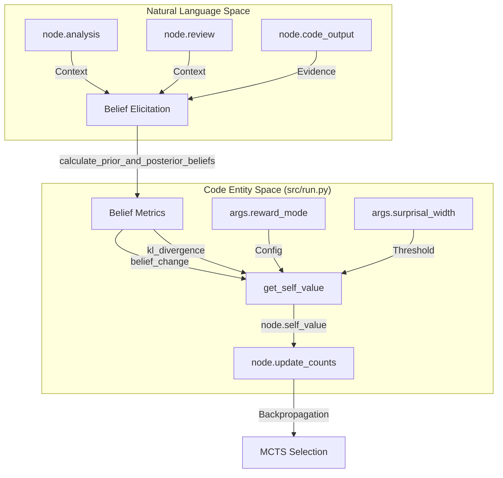
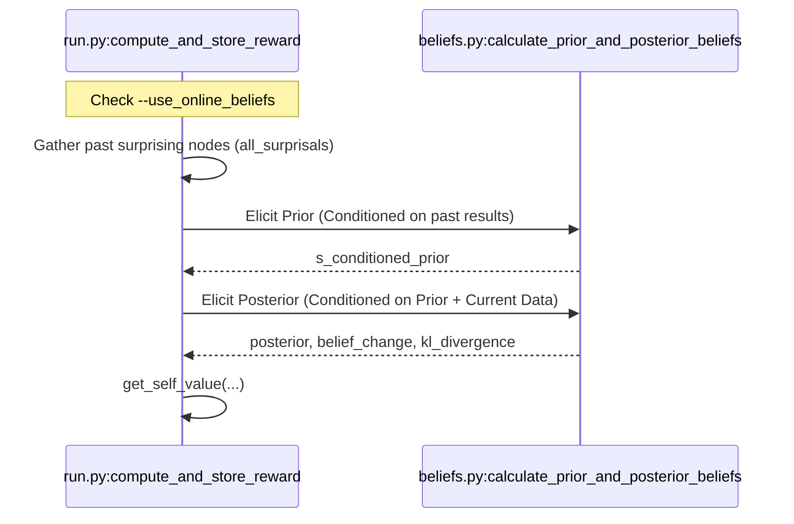

<!-- source: DeepWiki mcp.deepwiki.com · repo allenai/autodiscovery-neurips · extra page Reward Calculation and Surprisal · fetched 2026-10-26 -->

# Reward Calculation and Surprisal

Relevant source files

The following files were used as context for generating this wiki page:

- [src/args.py](src/args.py)
- [src/mcts_utils.py](src/mcts_utils.py)
- [src/run.py](src/run.py)

In the AutoDiscovery framework, the value of a discovery is quantified through the lens of Bayesian surprise. This page details how the system converts belief shifts (the difference between what an LLM expects and what the data shows) into a numerical reward used by the Monte Carlo Tree Search (MCTS) engine to guide exploration.

## Overview of the Reward Pipeline

The reward calculation occurs within `compute_and_store_reward` in [src/run.py:43-162](). This function orchestrates the elicitation of prior and posterior beliefs and maps the resulting metrics to a `self_value` for the `MCTSNode`.

### Reward Data Flow

The following diagram illustrates the flow from experimental results to the final MCTS reward:

**Belief to Reward Transformation**

Sources: [src/run.py:106-162](), [src/mcts_utils.py:175-188]()

## Reward Modes and Logic

The system supports three primary modes for calculating rewards, configured via the `--reward_mode` flag [src/args.py:78-79](). These modes determine how `belief_change` (absolute difference in means) and `kl_divergence` (information gain) are weighted.

### Reward Calculation Logic (`get_self_value`)
The function `get_self_value` in [src/mcts_utils.py:175-188]() implements the mapping:

| Mode | Logic | Purpose |
| :--- | :--- | :--- |
| `belief` | `reward = belief_change` | Favors nodes where the mean probability shifted significantly. |
| `kl` | `reward = kl_divergence / kl_scale` | Favors nodes with high information gain (reduction in uncertainty). |
| `belief_and_kl` | `reward = (belief_change + kl_divergence / kl_scale) / 2` | A balanced approach considering both mean shift and distribution shape. |

### Binary vs. Continuous Reward
By default, the system uses continuous rewards. If `--use_binary_reward` is enabled [src/args.py:58-59](), the reward becomes `1.0` if the node is "surprising" and `0.0` otherwise [src/mcts_utils.py:186]().

Sources: [src/mcts_utils.py:175-188](), [src/args.py:78-79]()

## Surprisal and Thresholding

A node is flagged as `surprising` based on the `surprisal_width` threshold [src/args.py:53-54]().

*   **Calculation**: `surprising = belief_change > surprisal_width` [src/mcts_utils.py:183]().
*   **Significance**: Surprising nodes are tracked in `all_surprisals` [src/run.py:165]() and can be used to condition future priors in online belief updates.
*   **Visualization**: In the D3 visualization, surprising nodes are typically highlighted to indicate discovery breakthroughs.

Sources: [src/run.py:159-165](), [src/mcts_utils.py:183](), [src/args.py:53-54]()

## Online Belief Updates

The system can optionally perform "online" updates where the prior for a new experiment is conditioned on the results of previous surprising discoveries.

### Implementation Detail
If `--use_online_beliefs` is enabled [src/args.py:72-73](), the system:
1.  Collects all previous surprising nodes [src/run.py:51-62]().
2.  Constructs an `evidence_msg` containing the hypothesis, analysis, and posterior mean of those past discoveries [src/run.py:53-62]().
3.  Calls `calculate_prior_and_posterior_beliefs` twice:
    *   First, to generate a **conditioned prior** based on past evidence [src/run.py:64-74]().
    *   Second, to generate the **posterior** by adding the current experiment's results to that conditioned prior [src/run.py:106-118]().

**Online Update Logic**

Sources: [src/run.py:51-118](), [src/args.py:72-73]()

## Key Functions and Parameters

### `get_self_value` Parameters
*   `belief_change`: The absolute difference between prior mean and posterior mean [src/mcts_utils.py:175]().
*   `kl_divergence`: The KL divergence between the prior and posterior distributions [src/mcts_utils.py:175]().
*   `kl_scale`: A normalization factor (default 5.0) to bring KL values into a range comparable to probability shifts [src/args.py:76-77]().
*   `width`: The `surprisal_width` threshold [src/mcts_utils.py:175]().

### Integration with MCTS
Once the `self_value` is calculated, it is passed to `node.update_counts(visits=1, reward=node.self_value)` [src/mcts_utils.py:88](). This triggers the standard MCTS backpropagation, updating the value estimates of all ancestor nodes in the tree, thereby influencing future `select_node` decisions.

Sources: [src/run.py:159-162](), [src/mcts_utils.py:88, 175-188]()

---

