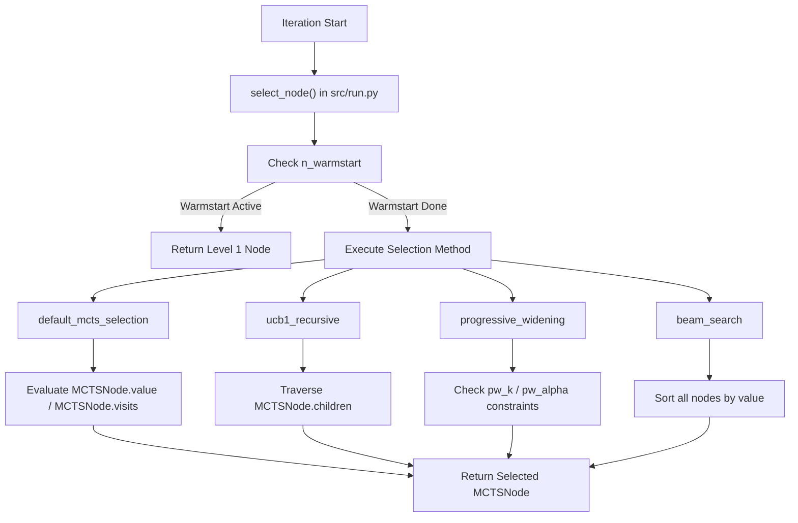
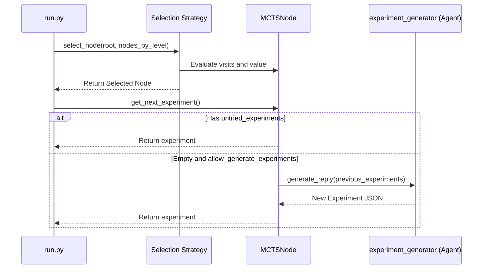

<!-- source: DeepWiki mcp.deepwiki.com · repo allenai/autodiscovery-neurips · extra page Selection Strategies · fetched 2026-10-26 -->

# Selection Strategies

Relevant source files

The following files were used as context for generating this wiki page:

- [src/args.py](src/args.py)
- [src/mcts.py](src/mcts.py)
- [src/run.py](src/run.py)

Selection strategies in AutoDiscovery define how the Monte Carlo Tree Search (MCTS) engine navigates the tree of scientific experiments to decide which hypothesis to expand next. These strategies manage the fundamental **exploration-exploitation trade-off**: exploring new, potentially high-surprise areas of the dataset versus exploiting known paths that have already yielded significant belief changes.

## Overview of Selection Flow

The selection process is triggered at the start of each MCTS iteration within the main loop [src/run.py:21-40](). The system uses a `select_node` wrapper that handles an initial "warmstart" phase before transitioning to the configured search algorithm.

### Warmstart Logic
Before the selection strategy takes over, the system can be configured to run a fixed number of initial experiments. If the number of experiments performed is less than `--n_warmstart`, the system bypasses the selection algorithm and repeatedly selects the data loader node (Level 1) to generate diverse initial seeds [src/run.py:34-38]().

### Natural Language to Code Entity Mapping: Selection

| Concept | Code Entity | File |
| :--- | :--- | :--- |
| **Selection Wrapper** | `select_node` | [src/run.py:21]() |
| **UCB1 Algorithm** | `default_mcts_selection` | [src/mcts.py:192]() |
| **Recursive UCB1** | `ucb1_recursive` | [src/mcts.py:341]() |
| **Beam Search** | `beam_search` | [src/mcts.py:223]() |
| **Progressive Widening** | `progressive_widening` | [src/mcts.py:261]() |

## Supported Strategies

### 1. UCB1 (Upper Confidence Bound)
The standard MCTS selection algorithm. It selects children based on their average value plus an exploration term that grows with the parent's total visits.

*   **Implementation**: `default_mcts_selection` [src/mcts.py:192-221]().
*   **Formula**: $Score = \frac{v_i}{n_i} + C \times \sqrt{\frac{\ln(N)}{n_i}}$, where $v_i$ is node value, $n_i$ is node visits, $N$ is parent visits, and $C$ is `--exploration_weight`.
*   **CLI Flag**: `--mcts_selection ucb1`.

### 2. Recursive UCB1
This is the default strategy for AutoDiscovery. Unlike standard UCB1 which often selects from the entire pool of nodes, this method traverses the tree level-by-level from the root, applying UCB1 at each step until a leaf or a node with untried experiments is reached.

*   **Implementation**: `ucb1_recursive` [src/mcts.py:341-367]().
*   **Behavior**: It recursively calls itself on the best child until it finds a node that can be expanded [src/mcts.py:361-364]().
*   **CLI Flag**: `--mcts_selection ucb1_recursive`.

### 3. Progressive Widening (PW)
Progressive Widening limits the number of children a node can have as a function of its visits. This prevents the search from becoming too shallow when the branching factor (number of possible hypotheses) is high.

*   **Implementation**: `progressive_widening` [src/mcts.py:261-299]().
*   **Mechanism**: A child is only eligible for selection if the number of children $k$ satisfies $k \le pw\_k \cdot n^{pw\_alpha}$ [src/mcts.py:284-285]().
*   **CLI Flags**: `--mcts_selection pw`, `--pw_k`, `--pw_alpha`.

### 4. Beam Search
A deterministic search strategy that maintains a "beam" of the top-$N$ scoring nodes across the entire tree.

*   **Implementation**: `beam_search` [src/mcts.py:223-259]().
*   **Behavior**: It flattens all nodes in the tree, filters for those with `untried_experiments`, sorts them by their `value / visits` ratio, and selects from the top nodes defined by `--beam_width` [src/mcts.py:246-255]().
*   **CLI Flag**: `--mcts_selection beam_search`, `--beam_width`.

## Data Flow and Implementation

The following diagram illustrates how the `select_node` function interacts with the `MCTSNode` tree structure and the specific selection algorithms.

**MCTS Selection Data Flow**

**Sources:** [src/run.py:21-40](), [src/mcts.py:192-367]()

## Configuration Reference

Selection behavior is primarily controlled via `src/args.py`.

| Flag | Type | Default | Description |
| :--- | :--- | :--- | :--- |
| `--mcts_selection` | string | `ucb1_recursive` | The algorithm to use: `ucb1`, `beam_search`, `pw`, `pw_all`, `ucb1_recursive`. [src/args.py:44-46]() |
| `--exploration_weight` | float | `2.0` | The $C$ constant in UCB1. [src/args.py:34-35]() |
| `--n_warmstart` | int | `8` | Initial experiments before search starts. [src/args.py:70-71]() |
| `--beam_width` | int | `8` | Number of nodes to consider in Beam Search. [src/args.py:41]() |
| `--pw_k` | float | `1.0` | Constant for Progressive Widening. [src/args.py:47]() |
| `--pw_alpha` | float | `0.5` | Exponent for Progressive Widening. [src/args.py:48]() |

## Code Logic: Node Selection and Expansion

When a node is selected, the system checks if it has `untried_experiments`. If it does, it pops one to create a new child node. If it does not, and `--allow_generate_experiments` is enabled, it invokes the `experiment_generator` agent to create new branches for that node [src/mcts.py:118-154]().

**Selection to Expansion Logic**

**Sources:** [src/run.py:21-40](), [src/mcts.py:118-154](), [src/args.py:28-29]()

---

