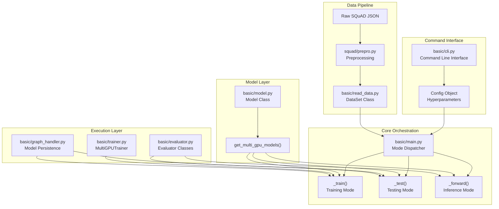
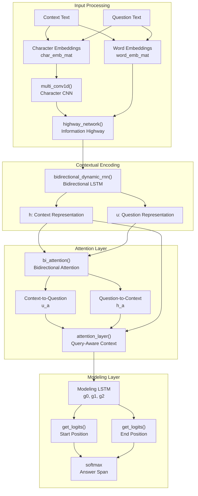
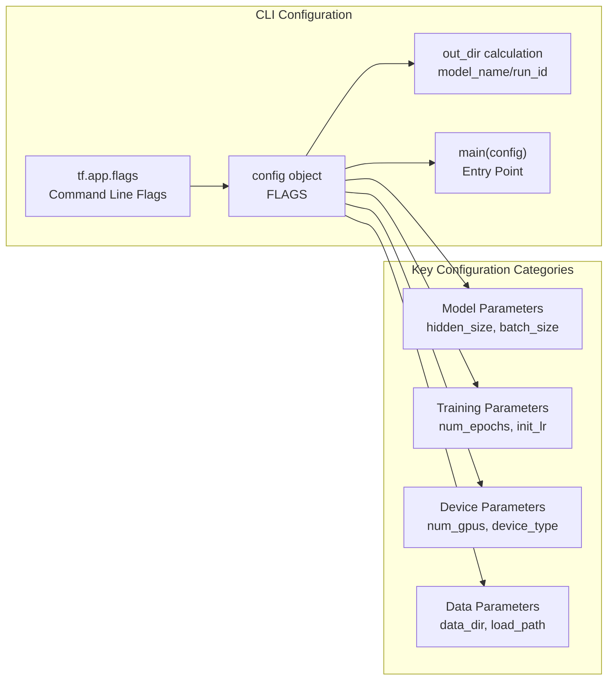
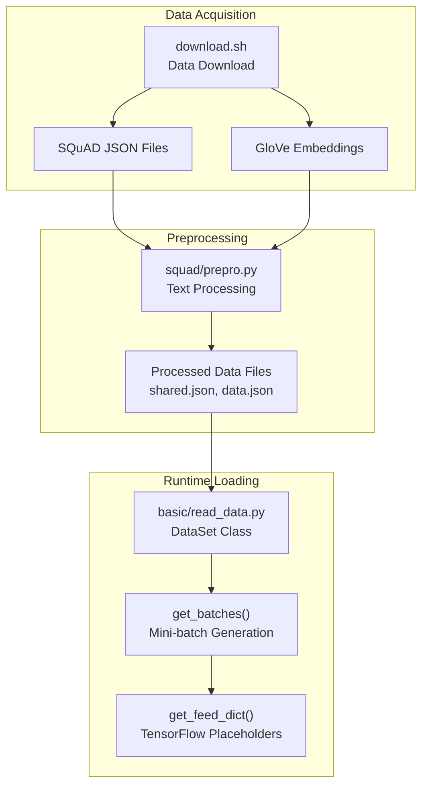
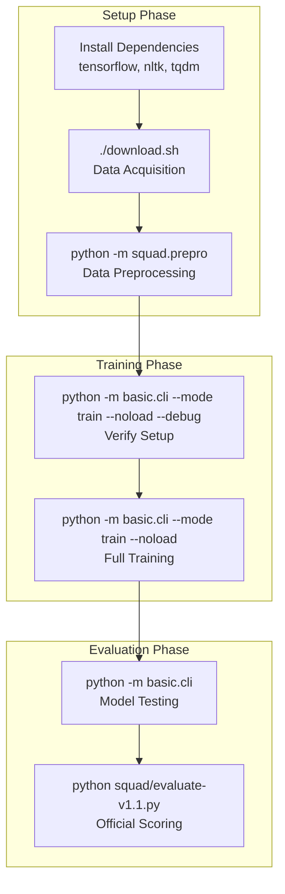

<!-- source: DeepWiki mcp.deepwiki.com · repo allenai/bi-att-flow · page 1 Overview · fetched 2026-10-26 -->

# Overview

Relevant source files

The following files were used as context for generating this wiki page:

- [README.md](README.md)
- [basic/cli.py](basic/cli.py)
- [basic/graph_handler.py](basic/graph_handler.py)
- [basic/model.py](basic/model.py)

This document provides a comprehensive overview of the BiDAF (Bi-directional Attention Flow) repository, a neural question answering system designed for machine reading comprehension tasks. The system implements the BiDAF architecture for extractive question answering, primarily targeting the Stanford Question Answering Dataset (SQuAD).

For detailed information about specific model architectures beyond the core BiDAF model, see [Alternative Models](#6). For training and evaluation procedures, see [Training and Evaluation](#4). For deployment and production usage, see [Ensemble and Deployment](#7).

## Purpose and Core Functionality

The BiDAF system is a deep learning framework that answers questions by reading and comprehending text passages. Given a context paragraph and a question, the system identifies the span of text in the context that best answers the question. The implementation supports:

- **Bidirectional attention mechanisms** for context-question interaction
- **Multi-GPU distributed training** and inference
- **Ensemble methods** for improved accuracy
- **Flexible model configurations** through command-line interfaces
- **Integration with standard datasets** like SQuAD

Sources: [README.md:1-8](), [basic/model.py:25-66]()

## System Architecture Overview

The BiDAF system follows a modular architecture with clear separation between data processing, model definition, training, and evaluation components.

### High-Level System Architecture

Sources: [basic/cli.py:101-109](), [basic/model.py:15-22](), [basic/graph_handler.py:14-21]()

### Core BiDAF Model Architecture

Sources: [basic/model.py:69-195](), [basic/model.py:380-425]()

## Core Components

### Model Class and Multi-GPU Support

The central `Model` class in [basic/model.py:25-378]() implements the BiDAF architecture. The system supports distributed training through the `get_multi_gpu_models()` function, which creates model replicas across multiple GPUs:

| Component | File | Key Functions | Purpose |
|-----------|------|---------------|---------|
| Model | `basic/model.py` | `__init__`, `_build_forward`, `_build_loss` | Core BiDAF implementation |
| Multi-GPU | `basic/model.py` | `get_multi_gpu_models` | Distributed model creation |
| Graph Handler | `basic/graph_handler.py` | `save`, `_load`, `dump_eval` | Model persistence and evaluation storage |

Sources: [basic/model.py:15-22](), [basic/graph_handler.py:14-80]()

### Configuration and Command Line Interface

The system uses TensorFlow's `flags` system for configuration management:

Key configuration parameters include:
- **Model architecture**: `hidden_size`, `char_emb_size`, `highway_num_layers`
- **Training**: `batch_size`, `num_epochs`, `init_lr`, `keep_prob`
- **Multi-GPU**: `num_gpus`, `device_type`
- **Data**: `data_dir`, `load_path`, `eval_path`

Sources: [basic/cli.py:7-99](), [basic/cli.py:101-109]()

### Data Processing Pipeline

The data pipeline transforms raw SQuAD JSON files into model-ready tensors:

The `DataSet` class manages data loading and batching, while the `Model.get_feed_dict()` method converts data into TensorFlow placeholders.

Sources: [basic/model.py:245-377](), [basic/read_data.py]() (referenced in model.py)

## Execution Modes

The system supports three primary execution modes orchestrated by [basic/main.py]():

| Mode | Function | Purpose | Key Components |
|------|----------|---------|----------------|  
| `train` | `_train()` | Model training | `MultiGPUTrainer`, loss computation, checkpointing |
| `test` | `_test()` | Model evaluation | `MultiGPUF1Evaluator`, metrics calculation |
| `forward` | `_forward()` | Inference/prediction | `ForwardEvaluator`, answer generation |

Each mode utilizes the same underlying `Model` class but with different evaluator and trainer components.

Sources: [basic/cli.py:26](), [basic/main.py]() (referenced in cli.py)

## Getting Started

### Quick Start Sequence

### System Requirements

- **GPU Memory**: Minimum 12GB for default batch size (60)
- **Training Time**: ~20 hours on NVIDIA Titan X
- **Model Size**: ~2.5M parameters
- **Multi-GPU**: Supported for distributed training

Sources: [README.md:8-57](), [README.md:138-151]()

### Performance Benchmarks

The system achieves the following performance on SQuAD:

| Model Type | Dev EM | Dev F1 | Test EM | Test F1 |
|------------|--------|--------|---------|---------|
| Single | 67.7% | 77.3% | 68.0% | 77.3% |
| Ensemble | 72.6% | 80.7% | 73.3% | 81.1% |

Sources: [README.md:104-122]()

## Integration Points

The BiDAF system integrates with several external tools and frameworks:

- **TensorFlow**: Core deep learning framework (r0.11 compatibility)
- **SQuAD Evaluation**: Official evaluation script at [squad/evaluate-v1.1.py]()
- **GloVe**: Pre-trained word embeddings for initialization
- **NLTK**: Natural language processing utilities

For advanced usage including ensemble methods and custom model variants, refer to the specialized documentation sections covering those topics.

Sources: [README.md:8-17](), [basic/model.py:1-13]()

---

