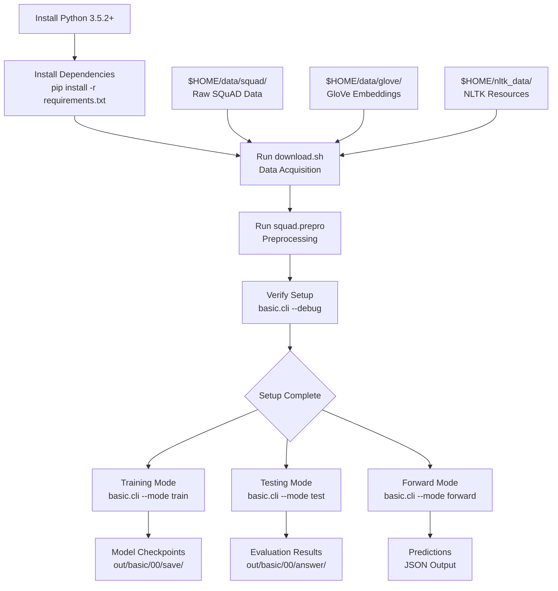
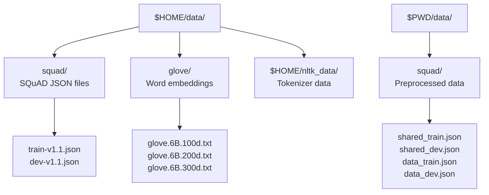
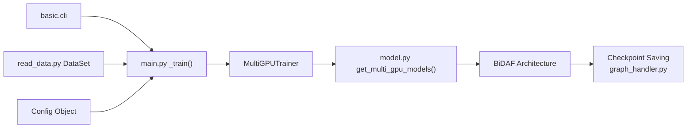

<!-- source: DeepWiki mcp.deepwiki.com · repo allenai/bi-att-flow · page 1.1 Getting Started · fetched 2026-10-26 -->

# Getting Started

<details>
<summary>Relevant source files</summary>

The following files were used as context for generating this wiki page:

- [README.md](README.md)
- [basic/graph_handler.py](basic/graph_handler.py)
- [download.sh](download.sh)
- [my/zip_save.py](my/zip_save.py)
- [requirements.txt](requirements.txt)
- [tree/test.ipynb](tree/test.ipynb)

</details>


This guide provides a step-by-step walkthrough for setting up the BiDAF (Bi-directional Attention Flow) question answering system and running your first model. It covers environment setup, data preparation, and basic training and testing workflows.

For detailed information about the repository structure, see [Repository Structure](#1.2). For comprehensive configuration options, see [Configuration and CLI](#2.2). For in-depth preprocessing details, see [SQuAD Preprocessing](#3.2).

## Prerequisites and Requirements

The BiDAF system requires specific software dependencies and hardware specifications for optimal performance.

### System Requirements

| Component | Requirement | Notes |
|-----------|-------------|-------|
| Python | 3.5.2+ | Issues reported with Python 2 |
| GPU Memory | 12GB+ recommended | Required for default batch size |
| System Tools | `unzip`, `wget` | For automated data download |

### Python Dependencies

The core dependencies are defined in [requirements.txt:1-4]():

```
tensorflow>=0.11
nltk
tqdm
jinja2
```

**Essential packages:**
- `tensorflow` (r0.11) - Deep learning framework
- `nltk` (3.2.1+) - Natural language processing tools  
- `tqdm` (4.7.4+) - Progress bar functionality
- `jinja2` - Visualization support (optional for training/testing only)

Sources: [README.md:8-18](), [requirements.txt:1-4]()

## Environment Setup Workflow

The following diagram shows the complete setup and execution workflow:

### BiDAF Setup and Execution Flow


Sources: [README.md:19-57](), [download.sh:1-26]()

## Data Acquisition and Preprocessing

### Step 1: Download Required Data

Execute the automated download script to acquire SQuAD dataset, GloVe embeddings, and NLTK resources:

```bash
chmod +x download.sh
./download.sh
```

This script downloads approximately 850MB of data to `$HOME/data`, including:
- **SQuAD Dataset**: Training and development JSON files
- **GloVe Embeddings**: Pre-trained word vectors (6B tokens, 100d)
- **NLTK Data**: Punkt tokenizer resources

### Step 2: Preprocess SQuAD Data

Run the preprocessing pipeline to prepare data for model training:

```bash
python -m squad.prepro
```

This process (~5 minutes) tokenizes text, aligns embeddings, and saves processed data to `$PWD/data/squad`.

### Data Directory Structure After Setup


Sources: [download.sh:3-26](), [README.md:20-29]()

## Initial Verification

Before full training, verify the setup with a debug run to check memory requirements and configuration:

```bash
python -m basic.cli --mode train --noload --debug
```

This command performs a quick validation without loading pre-trained weights, ensuring:
- All dependencies are correctly installed
- GPU memory is sufficient (12GB+ recommended)
- Data preprocessing completed successfully
- Model architecture initializes properly

Sources: [README.md:39-42]()

## Training Your First Model

### Basic Training Command

Start full model training with the following command:

```bash
python -m basic.cli --mode train --noload
```

### Training with Optimization Flags

For faster training performance, use optimization flags:

```bash
python -m basic.cli --mode train --noload --len_opt --cluster
```

### Training Specifications

| Parameter | Value | Description |
|-----------|--------|-------------|
| Model Parameters | ~2.5M | Total trainable parameters |
| Training Steps | ~18k | Convergence point |
| Time per Step | ~4s | On Titan X Pascal |
| Total Training Time | ~20 hours | Full convergence |
| Memory Requirement | 12GB+ GPU | For default batch size |

### Command Flow for Training


Sources: [README.md:31-54](), [basic/graph_handler.py:30-33]()

## Testing and Evaluation

### Basic Testing

Test a trained model using:

```bash
python -m basic.cli
```

### Testing with Optimization

For faster evaluation (5 minutes on dev data):

```bash
python -m basic.cli --len_opt --cluster
```

### Evaluation Output

The testing process generates:
- **Internal Scores**: F1 and EM metrics (printed to console)
- **Answer File**: JSON predictions in `$PWD/out/basic/00/answer/test-####.json`
- **Official Evaluation**: Use `squad/evaluate-v1.1.py` for standard metrics

### Official Evaluation Command

```bash
python squad/evaluate-v1.1.py $HOME/data/squad/dev-v1.1.json out/basic/00/answer/test-####.json
```

Sources: [README.md:60-79]()

## Multi-GPU Configuration

For systems with multiple GPUs or limited GPU memory, use distributed training:

### Multi-GPU Training Example

```bash
python -m basic.cli --mode train --noload --num_gpus 3 --batch_size 20
```

### Multi-GPU Testing Example

```bash
python -m basic.cli --num_gpus 3 --batch_size 20
```

This configuration distributes the default batch size of 60 across 3 GPUs (20 per GPU), combining gradients on CPU.

Sources: [README.md:138-151]()

## Expected Results

### Performance Benchmarks

| Model Type | Dev EM (%) | Dev F1 (%) | Test EM (%) | Test F1 (%) |
|------------|------------|------------|-------------|-------------|
| Single Model | 67.7 | 77.3 | 68.0 | 77.3 |
| Ensemble | 72.6 | 80.7 | 73.3 | 81.1 |

Sources: [README.md:102-122]()

## Next Steps

After successfully running your first model:

1. **Explore Configuration Options**: See [Configuration and CLI](#2.2) for detailed parameter tuning
2. **Understand Model Architecture**: Review [Model Architecture](#2.1) for technical details
3. **Advanced Training**: Consult [Training Pipeline](#4.1) for optimization strategies
4. **Model Ensembling**: See [Model Ensembling](#7.1) for combining multiple models
5. **Custom Data**: Review [Alternative Dataset Support](#3.3) for non-SQuAD datasets

Sources: [README.md:1-164]()

---

