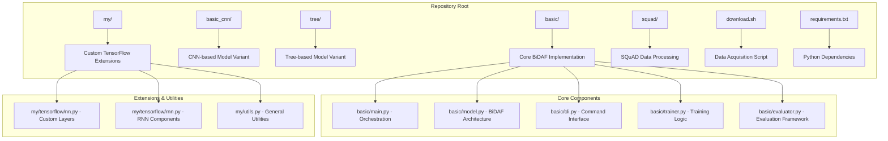
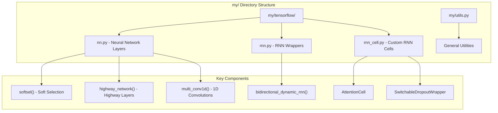
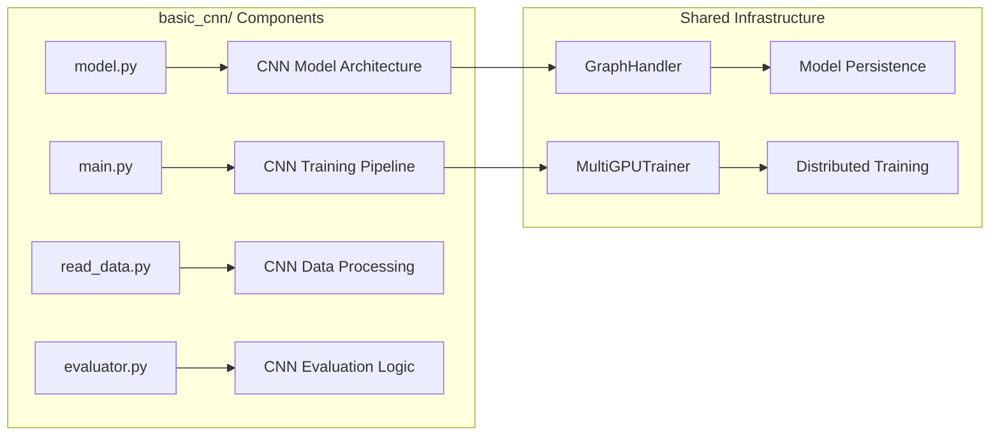
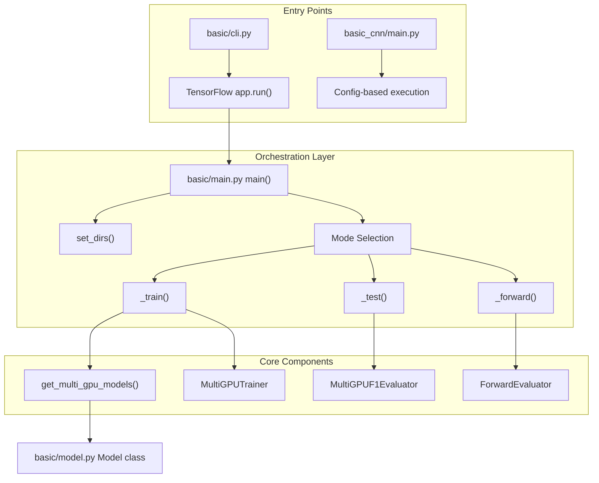
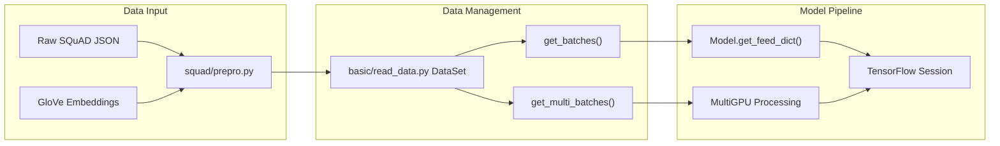

<!-- source: DeepWiki mcp.deepwiki.com · repo allenai/bi-att-flow · page 1.2 Repository Structure · fetched 2026-10-26 -->

# Repository Structure

Relevant source files

The following files were used as context for generating this wiki page:

- [basic/__init__.py](basic/__init__.py)
- [basic/cli.py](basic/cli.py)
- [basic/model.py](basic/model.py)
- [basic_cnn/main.py](basic_cnn/main.py)
- [basic_cnn/model.py](basic_cnn/model.py)

This document provides a comprehensive overview of the BiDAF repository's directory structure and organization. It explains the purpose of each major directory, the relationships between different components, and how they work together to implement the bidirectional attention flow model for question answering.

For information about the specific BiDAF model architecture and its neural network components, see [Model Architecture](#2.1). For details about training and evaluation processes, see [Training Pipeline](#4.1) and [Evaluation Framework](#4.2).

## Overview

The repository is organized into several main directories, each serving a distinct purpose in the BiDAF ecosystem. The structure supports multiple model variants, custom TensorFlow extensions, data processing pipelines, and comprehensive evaluation tools.

## Directory Structure

**Sources:** [basic/model.py:1-426](), [basic/cli.py:1-110](), [basic_cnn/model.py:1-376](), [my/tensorflow/nn.py](), [my/tensorflow/rnn.py](), [my/utils.py]()

## Core Directories

### basic/ - Primary BiDAF Implementation

The `basic/` directory contains the main BiDAF model implementation and serves as the primary entry point for the system.

| File | Purpose | Key Classes/Functions |
|------|---------|----------------------|
| `cli.py` | Command-line interface and configuration | `main()`, TensorFlow flags |
| `main.py` | Orchestration and execution modes | `_train()`, `_test()`, `_forward()` |
| `model.py` | BiDAF neural network architecture | `Model`, `get_multi_gpu_models()` |
| `trainer.py` | Training logic and optimization | `MultiGPUTrainer` |
| `evaluator.py` | Evaluation framework | `MultiGPUF1Evaluator` |
| `read_data.py` | Data loading and management | `DataSet` |
| `graph_handler.py` | Model persistence | `GraphHandler` |

**Sources:** [basic/cli.py:1-110](), [basic/model.py:1-426]()

### my/ - Custom TensorFlow Extensions

The `my/` directory provides custom TensorFlow components that extend the framework's capabilities for the BiDAF model.

**Sources:** [basic/model.py:10-12](), [my/tensorflow/nn.py](), [my/tensorflow/rnn.py](), [my/tensorflow/rnn_cell.py]()

### squad/ - SQuAD Data Processing

The `squad/` directory handles SQuAD dataset-specific preprocessing and evaluation.

| Component | Purpose |
|-----------|---------|
| `prepro.py` | Tokenization and data preprocessing |
| `evaluate-v1.1.py` | Official SQuAD evaluation metrics |
| `utils.py` | Text processing utilities |

**Sources:** [squad/prepro.py](), [squad/evaluate-v1.1.py](), [squad/utils.py]()

## Alternative Model Implementations

### basic_cnn/ - CNN-based Variant

The `basic_cnn/` directory contains a CNN-based variant of the question answering model that shares the same overall structure as the main BiDAF implementation.

The CNN variant uses the same execution pattern with `get_multi_gpu_models()` function but implements a different neural architecture focused on convolutional layers rather than the bidirectional attention mechanism.

**Sources:** [basic_cnn/model.py:1-376](), [basic_cnn/main.py:1-239]()

### tree/ - Tree-based Model

The `tree/` directory implements a tree-structured neural network that processes syntactic parse trees for question answering.

**Sources:** [tree/model.py](), [tree/read_data.py]()

## Execution Flow and Entry Points

The main execution flow begins with command-line argument parsing in `basic/cli.py`, which configures the system through TensorFlow flags and calls the main orchestration function. The system supports three primary execution modes controlled by the `mode` parameter.

**Sources:** [basic/cli.py:101-110](), [basic/main.py]()

## Data Flow Architecture

The data flows from raw JSON files through preprocessing, into DataSet objects that manage batching and feeding data to the TensorFlow models. The `DataSet` class in `basic/read_data.py` serves as the central data management component.

**Sources:** [basic/read_data.py](), [basic/model.py:245-377]()

## Configuration and Extensibility

The repository uses a comprehensive configuration system through TensorFlow flags defined in `basic/cli.py`. Key configuration categories include:

- **Model Architecture**: `hidden_size`, `char_emb_size`, `highway_num_layers`
- **Training Parameters**: `batch_size`, `num_epochs`, `init_lr`
- **Multi-GPU Settings**: `num_gpus`, `device_type`
- **Optimization Flags**: `len_opt`, `cpu_opt`, `cluster`

The modular design allows for easy extension through the plugin-style architecture where new model variants can be added by following the patterns established in `basic_cnn/` and `tree/` directories.

**Sources:** [basic/cli.py:9-99]()

---

