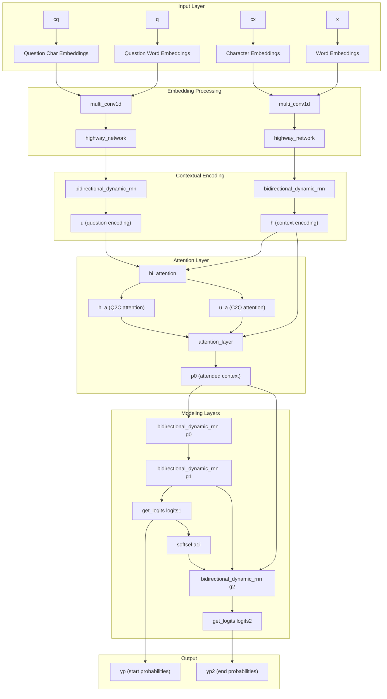
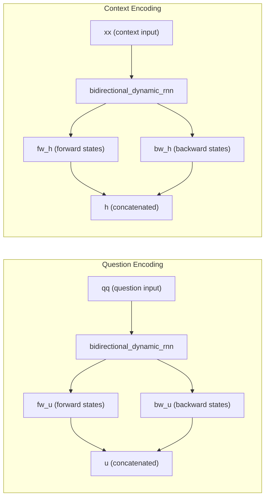
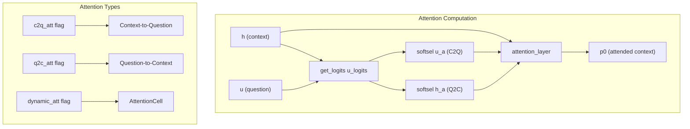
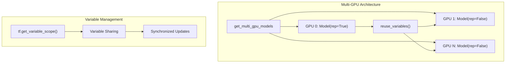

<!-- source: DeepWiki mcp.deepwiki.com · repo allenai/bi-att-flow · page 2 Core BiDAF Model · fetched 2026-10-26 -->

# Core BiDAF Model

Relevant source files

The following files were used as context for generating this wiki page:

- [basic/cli.py](basic/cli.py)
- [basic/main.py](basic/main.py)
- [basic/model.py](basic/model.py)

This document covers the core BiDAF (Bidirectional Attention Flow) model architecture implemented in the `basic/model.py` file. It explains how the model processes question-context pairs to predict answer spans, including the embedding layers, attention mechanisms, and output generation. For information about alternative model architectures, see [Alternative Models](#6). For details about training and evaluation processes, see [Training and Evaluation](#4).

## Model Architecture Overview

The BiDAF model follows a hierarchical architecture that transforms raw text inputs through multiple processing stages to produce answer span predictions. The `Model` class in [basic/model.py:25-378]() implements this complete pipeline.

**Model Architecture Flow Diagram**

Sources: [basic/model.py:69-195]()

## Core Components

### Embedding Layer

The embedding layer processes both word-level and character-level representations. The implementation supports configurable embedding strategies through the `use_char_emb` and `use_word_emb` flags.

| Component | Input Shape | Output Shape | Purpose |
|-----------|-------------|--------------|---------|
| Character Embeddings | `[N, M, JX, W]` | `[N, M, JX, dco]` | Character-level word representations |
| Word Embeddings | `[N, M, JX]` | `[N, M, JX, dw]` | Pre-trained word vectors |
| Highway Network | `[N, M, JX, di]` | `[N, M, JX, di]` | Information flow control |

The character embedding processing uses `multi_conv1d` convolutions followed by max pooling to create character-aware word representations [basic/model.py:85-103](). Word embeddings utilize pre-trained GloVe vectors loaded through the `word_emb_mat` variable [basic/model.py:107-112]().

Sources: [basic/model.py:80-133]()

### Encoding Layer  

The encoding layer applies bidirectional LSTMs to create contextual representations for both the passage and question. The `BasicLSTMCell` with `SwitchableDropoutWrapper` provides regularization during training.

**Bidirectional Encoding Process**

The encoding phase creates representations `u` for questions and `h` for context paragraphs [basic/model.py:140-151](). The `share_lstm_weights` configuration option allows weight sharing between question and context encoders.

Sources: [basic/model.py:135-151]()

### Attention Layer

BiDAF's core innovation is the bidirectional attention mechanism implemented in the `bi_attention` and `attention_layer` functions. This creates query-aware context representations and context-aware query representations.

The attention computation follows these steps:

1. **Similarity Matrix**: Computes attention weights between every context word and question word
2. **Context-to-Question (C2Q)**: For each context word, identifies most relevant question words  
3. **Question-to-Context (Q2C)**: Identifies context words most relevant to the entire question

**Bidirectional Attention Mechanism**

The `bi_attention` function [basic/model.py:380-409]() computes the core attention matrices, while `attention_layer` [basic/model.py:412-425]() integrates them based on configuration flags `q2c_att` and `c2q_att`.

Sources: [basic/model.py:154-162](), [basic/model.py:380-425]()

### Modeling Layer  

The modeling layer consists of multiple bidirectional LSTM layers (`g0`, `g1`, `g2`) that progressively refine the attended context representation. Each layer builds on the previous one to model complex reasoning patterns.

The modeling process includes:
- **g0 layer**: Initial modeling over attended context `p0`
- **g1 layer**: Secondary modeling with start position awareness  
- **g2 layer**: Final modeling incorporating start position information via `a1i`

Answer span prediction uses the `get_logits` function with configurable answer functions specified by the `answer_func` parameter [basic/model.py:169-179]().

Sources: [basic/model.py:164-180]()

### Output Layer

The output layer generates probability distributions over start and end positions for the answer span. The model produces two separate predictions:

- `yp`: Start position probabilities from `logits`
- `yp2`: End position probabilities from `logits2`  

Both use softmax normalization over the flattened context representation [basic/model.py:181-194]().

Sources: [basic/model.py:181-194]()

## Multi-GPU Support

The `get_multi_gpu_models` function enables distributed training across multiple GPUs. Each GPU gets its own `Model` instance with shared variables after the first model.

**Multi-GPU Model Distribution**

The `rep` parameter controls which model builds the exponential moving average variables [basic/model.py:15-22]().

Sources: [basic/model.py:15-22]()

## Configuration and Placeholders

The model accepts various input placeholders defined in the constructor:

| Placeholder | Shape | Purpose |
|-------------|-------|---------|
| `x` | `[N, M, JX]` | Context word indices |
| `cx` | `[N, M, JX, W]` | Context character indices |
| `q` | `[N, JQ]` | Question word indices |
| `cq` | `[N, JQ, W]` | Question character indices |
| `y` | `[N, M, JX]` | Answer start positions |
| `y2` | `[N, M, JX]` | Answer end positions |

Key configuration dimensions are extracted from the config object [basic/model.py:33-35]():
- `N`: Batch size
- `M`: Maximum number of sentences  
- `JX`: Maximum sentence length
- `JQ`: Maximum question length
- `W`: Maximum word length

Sources: [basic/model.py:26-46](), [basic/model.py:71-78]()

## Loss Computation

The model uses cross-entropy loss for both start and end position predictions. The `_build_loss` method computes separate losses for `logits` and `logits2`, then combines them [basic/model.py:196-213]().

Loss masking ensures that only valid question positions contribute to the loss computation through the `loss_mask` derived from `q_mask` [basic/model.py:201-204]().

Sources: [basic/model.py:196-213]()

---

