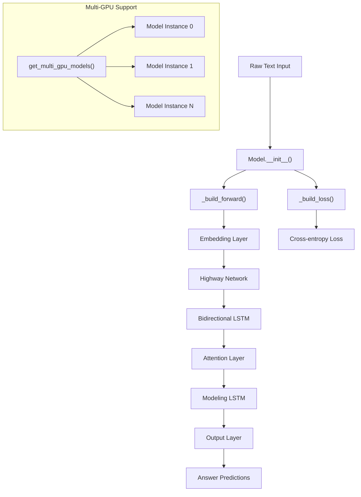
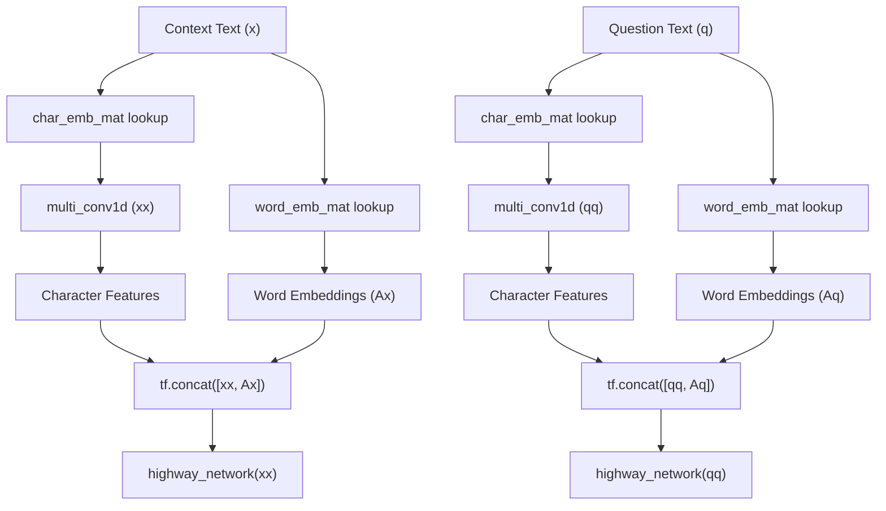
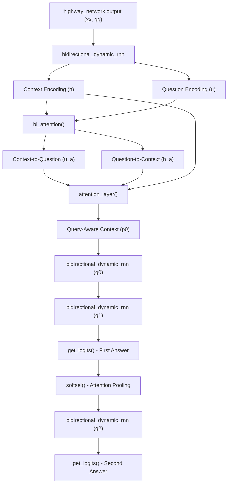
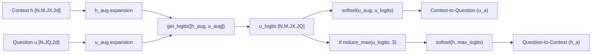

<!-- source: DeepWiki mcp.deepwiki.com · repo allenai/bi-att-flow · page 2.1 Model Architecture · fetched 2026-10-26 -->

# Model Architecture

Relevant source files

The following files were used as context for generating this wiki page:

- [basic/cli.py](basic/cli.py)
- [basic/model.py](basic/model.py)

This document explains the neural network architecture of the BiDAF (Bidirectional Attention Flow) model implemented in the core system. It covers the structure and flow of the main model components, from input embeddings through attention mechanisms to answer prediction. For information about training and evaluation processes, see [Training Pipeline](#4.1). For details about data preprocessing and input formats, see [SQuAD Preprocessing](#3.2).

## Model Class Structure

The BiDAF model is implemented in the `Model` class within [basic/model.py:25-378](). The architecture supports multi-GPU training through the `get_multi_gpu_models` function which creates multiple model instances across available GPUs.

### Model Architecture Flow

**Sources:** [basic/model.py:15-22](), [basic/model.py:25-67](), [basic/model.py:69-195]()

## Input Processing and Embeddings

The model processes both character-level and word-level embeddings, which are then combined and passed through highway networks for improved information flow.

### Embedding Architecture

**Sources:** [basic/model.py:80-133]()

The embedding process involves several key components:

| Component | Configuration | Purpose |
|-----------|---------------|---------|
| `char_emb_mat` | Size: `[VC, dc]` | Character-level embeddings |
| `word_emb_mat` | Size: `[VW, dw]` | Word-level embeddings (GloVe) |
| `multi_conv1d` | Configurable filters | Character CNN processing |
| `highway_network` | 2 layers default | Information gating mechanism |

**Sources:** [basic/model.py:82-83](), [basic/model.py:107-108](), [basic/model.py:95-100](), [basic/model.py:127-130]()

## Core BiDAF Architecture

The heart of the model consists of bidirectional LSTM layers followed by the signature bidirectional attention mechanism.

### Contextual Encoding and Attention Flow

**Sources:** [basic/model.py:140-151](), [basic/model.py:380-409](), [basic/model.py:412-425](), [basic/model.py:164-179]()

### Bidirectional Attention Details

The `bi_attention` function implements the core innovation of BiDAF - computing attention in both directions between context and question:

**Sources:** [basic/model.py:380-409]()

## Output Processing and Answer Prediction

The model produces two sets of logits for answer span prediction - one for the start position and one for the end position.

### Answer Prediction Architecture

The final layers process the attended representations through multiple LSTM layers and produce probability distributions over possible answer positions:

| Component | Input | Output | Purpose |
|-----------|-------|--------|---------|
| `g0` LSTM | `p0` (attended context) | `[N,M,JX,2d]` | First modeling layer |
| `g1` LSTM | `g0` output | `[N,M,JX,2d]` | Second modeling layer |
| `get_logits` | `[g1, p0]` | `[N,M*JX]` | Start position logits |
| `softsel` | `g1` + `logits` | `[N,2d]` | Attention-weighted sum |
| `g2` LSTM | Concatenated features | `[N,M,JX,2d]` | Final modeling layer |
| `get_logits` | `[g2, p0]` | `[N,M*JX]` | End position logits |

**Sources:** [basic/model.py:164-179](), [basic/model.py:181-194]()

## Configuration Options

The model architecture is highly configurable through command-line flags defined in [basic/cli.py](). Key architectural parameters include:

### Essential Architecture Parameters

| Parameter | Default | Description |
|-----------|---------|-------------|
| `hidden_size` | 100 | LSTM hidden dimension |
| `char_emb_size` | 8 | Character embedding size |
| `char_out_size` | 100 | Character CNN output size |
| `highway_num_layers` | 2 | Number of highway layers |
| `share_lstm_weights` | True | Share LSTM weights between context/question |
| `share_cnn_weights` | True | Share CNN weights for character processing |

**Sources:** [basic/cli.py:44-53]()

### Attention Configuration

| Parameter | Default | Description |
|-----------|---------|-------------|
| `c2q_att` | True | Enable context-to-question attention |
| `q2c_att` | True | Enable question-to-context attention |
| `dynamic_att` | False | Use dynamic attention with AttentionCell |
| `logit_func` | "tri_linear" | Attention scoring function |

**Sources:** [basic/cli.py:96-98](), [basic/cli.py:89]()

The model supports alternative attention mechanisms through the `dynamic_att` flag, which uses `AttentionCell` instead of the standard bidirectional attention mechanism.

**Sources:** [basic/model.py:154-162]()

---

