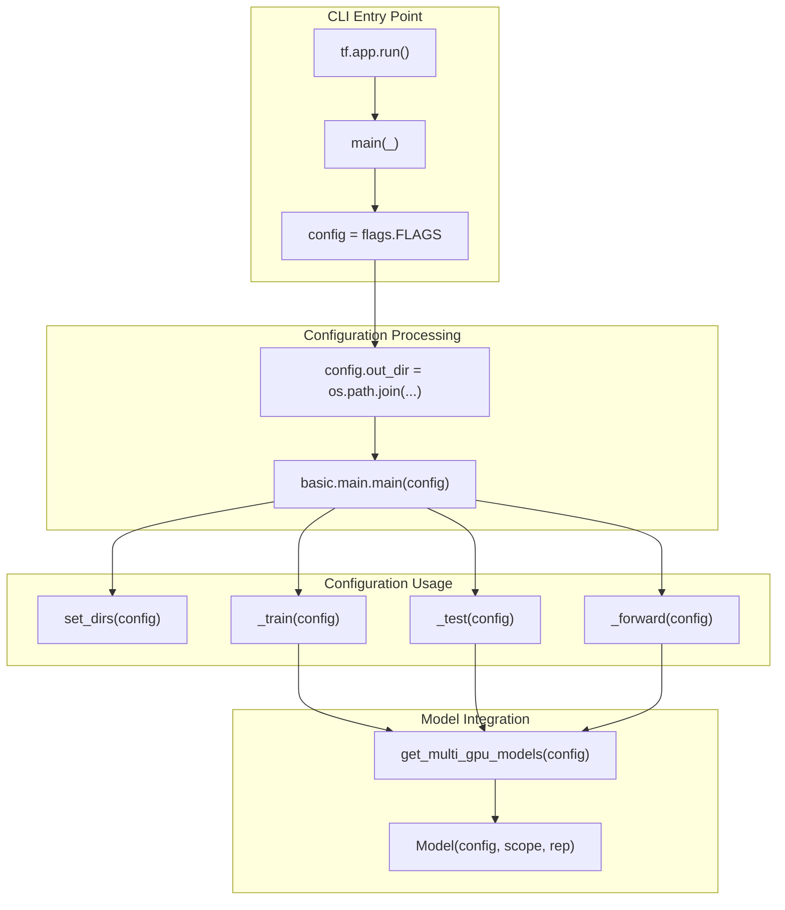
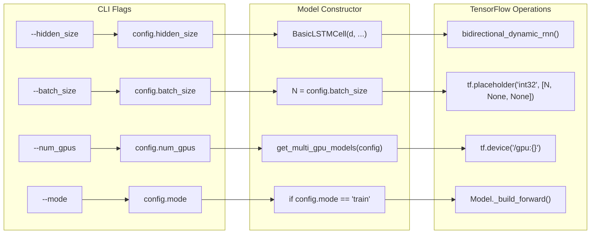
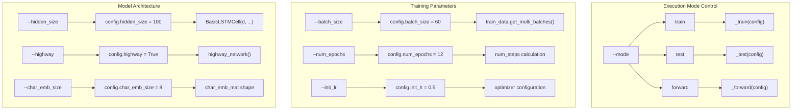
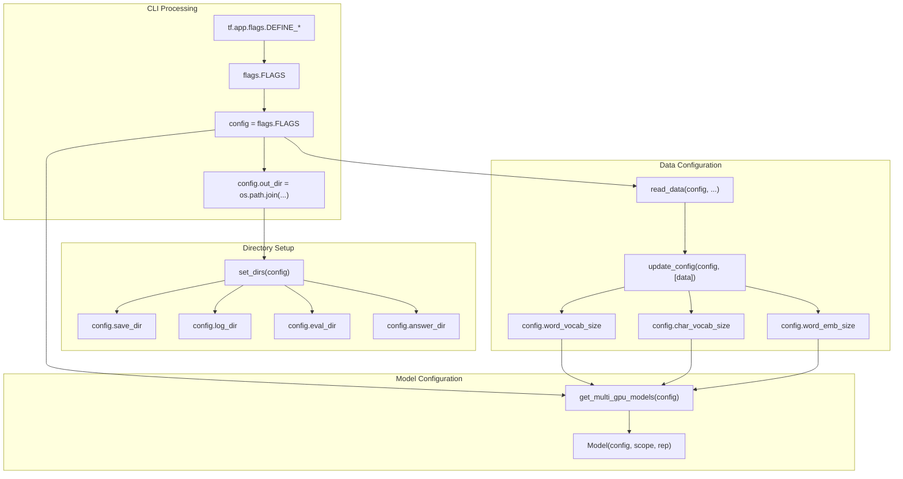
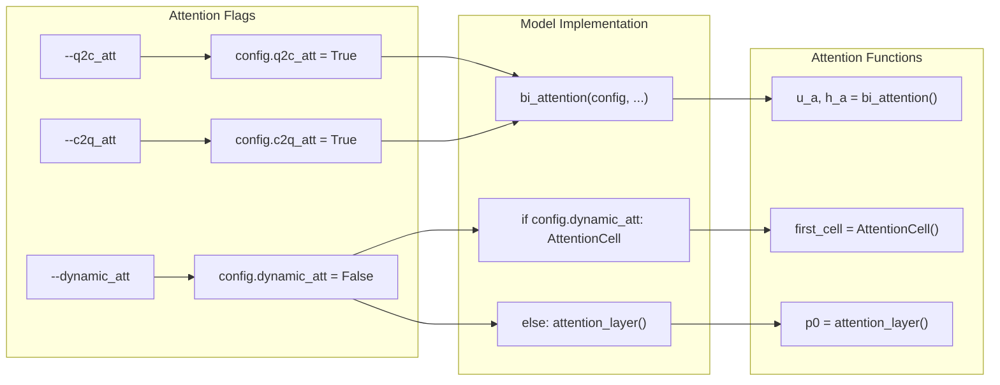

<!-- source: DeepWiki mcp.deepwiki.com · repo allenai/bi-att-flow · page 2.2 Configuration and CLI · fetched 2026-10-26 -->

# Configuration and CLI

<details>
<summary>Relevant source files</summary>

The following files were used as context for generating this wiki page:

- [basic/cli.py](basic/cli.py)
- [basic/main.py](basic/main.py)
- [basic/model.py](basic/model.py)

</details>


This document covers the command-line interface and configuration system for the BiDAF model. The configuration system uses TensorFlow's flags mechanism to manage hyperparameters, paths, and execution settings across all components of the system.

For information about how these configurations are used during training and evaluation, see [Training Pipeline](#4.1) and [Evaluation Framework](#4.2). For details on execution modes, see [Execution Modes](#2.3).

## CLI Interface Overview

The BiDAF system uses a comprehensive command-line interface defined in `basic/cli.py` that provides over 70 configuration options. The CLI uses TensorFlow's `tf.app.flags` system to define and parse command-line arguments.

### CLI Architecture Flow



Sources: [basic/cli.py:101-109](), [basic/main.py:19-30]()

## Configuration Categories

The configuration system is organized into logical categories, each serving specific aspects of the model and training pipeline.

### Core Configuration Groups

| Category | Purpose | Key Flags | Used By |
|----------|---------|-----------|---------|
| **Names & Directories** | File paths and identifiers | `model_name`, `data_dir`, `out_base_dir` | [basic/main.py:32-51]() |
| **Device Placement** | GPU/CPU configuration | `device_type`, `num_gpus`, `device` | [basic/model.py:15-22]() |
| **Training Parameters** | Learning and optimization | `batch_size`, `init_lr`, `num_epochs` | [basic/trainer.py]() |
| **Model Architecture** | Neural network structure | `hidden_size`, `highway`, `char_emb_size` | [basic/model.py:26-378]() |
| **Attention Mechanisms** | BiDAF-specific settings | `q2c_att`, `c2q_att`, `dynamic_att` | [basic/model.py:380-425]() |
| **Optimization** | Performance tuning | `len_opt`, `cpu_opt`, `cluster` | [basic/model.py:253-276]() |

Sources: [basic/cli.py:9-99]()

### Configuration to Code Entity Mapping



Sources: [basic/cli.py:44](), [basic/model.py:33-35](), [basic/model.py:135-149]()

## Essential Configuration Options

### Training and Execution Control



Sources: [basic/cli.py:26](), [basic/cli.py:34](), [basic/cli.py:44](), [basic/main.py:22-29]()

### Device and Performance Configuration

The system supports multi-GPU training and various performance optimizations:

```python
# Device placement configuration
flags.DEFINE_string("device_type", "gpu", "device for computing gradients")
flags.DEFINE_integer("num_gpus", 1, "num of gpus or cpus for computing gradients")
flags.DEFINE_string("device", "/cpu:0", "default device for summing gradients")

# Performance optimizations
flags.DEFINE_bool("len_opt", False, "Length optimization?")
flags.DEFINE_bool("cpu_opt", False, "CPU optimization?")
flags.DEFINE_bool("cluster", False, "Cluster data for faster training")
```

Sources: [basic/cli.py:21-59]()

## Configuration Processing Pipeline

### Configuration Flow Through System



Sources: [basic/cli.py:101-109](), [basic/main.py:32-51](), [basic/read_data.py]()

### Configuration Validation and Updates

The system performs configuration validation and updates based on loaded data:

```python
def update_config(config, data_list):
    # Updates configuration based on actual data dimensions
    config.max_sent_size = max(config.max_sent_size, 
                              max(len(sent) for data in data_list 
                                  for para in data.data['x'] 
                                  for sent in para))
```

Sources: [basic/read_data.py]()

## Advanced Configuration Features

### Attention Mechanism Configuration



Sources: [basic/cli.py:96-98](), [basic/model.py:154-162](), [basic/model.py:412-425]()

### Embedding Configuration

The system supports both character-level and word-level embeddings with extensive configuration options:

| Flag | Default | Purpose | Implementation |
|------|---------|---------|---------------|
| `use_char_emb` | True | Enable character embeddings | [basic/model.py:81-103]() |
| `use_word_emb` | True | Enable word embeddings | [basic/model.py:104-124]() |
| `char_emb_size` | 8 | Character embedding dimension | [basic/model.py:83]() |
| `char_out_size` | 100 | Character CNN output size | [basic/model.py:78]() |
| `filter_heights` | "5" | CNN filter heights | [basic/model.py:92]() |
| `use_glove_for_unk` | True | Use GloVe for unknown words | [basic/model.py:110-111]() |

Sources: [basic/cli.py:94-95](), [basic/cli.py:46-48](), [basic/cli.py:87]()

## Configuration Usage Patterns

### Debug Mode Configuration

The system provides a debug mode that overrides multiple settings for rapid testing:

```python
def _config_debug(config):
    if config.debug:
        config.num_steps = 2
        config.eval_period = 1
        config.log_period = 1
        config.save_period = 1
        config.val_num_batches = 2
        config.test_num_batches = 2
```

Sources: [basic/main.py:54-62]()

### Multi-GPU Configuration Usage

```mermaid
graph TD
    subgraph "Multi-GPU Setup"
        A["config.num_gpus"] --> B["get_multi_gpu_models(config)"]
        B --> C["for gpu_idx in range(config.num_gpus)"]
        C --> D["tf.device('/gpu:{}')".format(gpu_idx)]
        D --> E["Model(config, scope, rep)"]
    end
    
    subgraph "Device Placement"
        F["config.device_type"] --> G["'/{}:{}'.format(config.device_type, gpu_idx)"]
        G --> D
        H["config.device"] --> I["tf.device(config.device)"]
        I --> J["gradient aggregation"]
    end
```

Sources: [basic/model.py:15-22](), [basic/main.py:21]()

The configuration system provides comprehensive control over all aspects of the BiDAF model, from basic training parameters to advanced multi-GPU deployment settings. The `tf.app.flags` system ensures type safety and provides built-in help documentation for all options.

---

