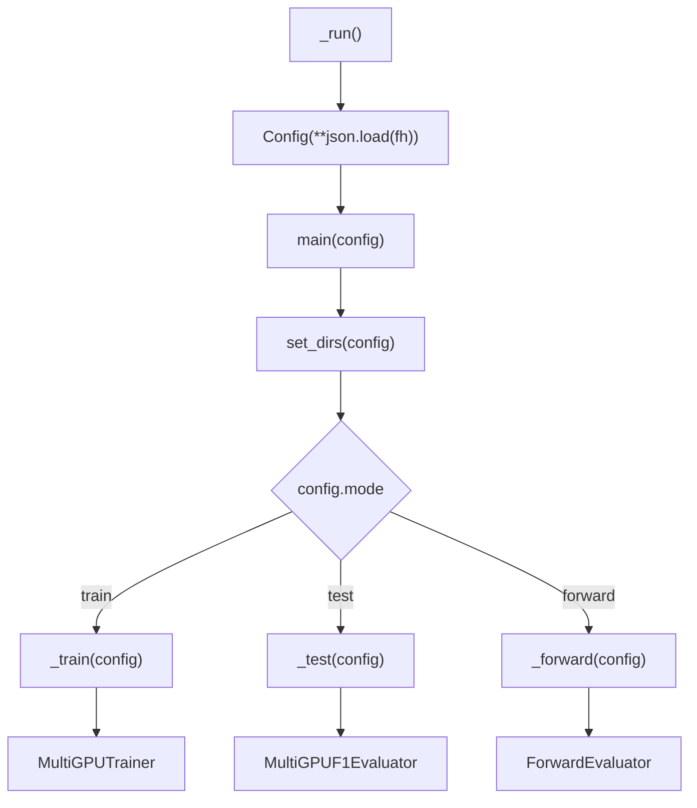
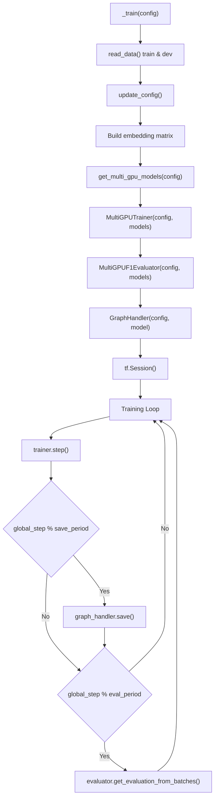
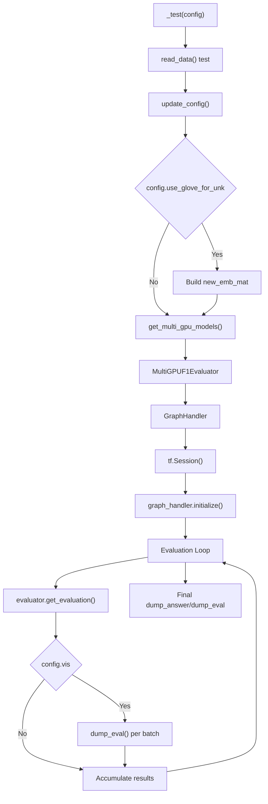
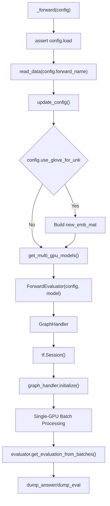
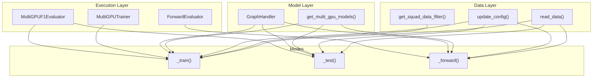

<!-- source: DeepWiki mcp.deepwiki.com · repo allenai/bi-att-flow · page 2.3 Execution Modes · fetched 2026-10-26 -->

# Execution Modes

Relevant source files

The following files were used as context for generating this wiki page:

- [basic/main.py](basic/main.py)

## Purpose and Scope

This document covers the three primary execution modes of the BiDAF system and how they are orchestrated through the main entry point. The execution modes determine how the system processes data and models: training new models, testing existing models, or performing forward inference. 

For information about model architecture details, see [Model Architecture](#2.1). For configuration options, see [Configuration and CLI](#2.2). For details about the training pipeline components, see [Training Pipeline](#4.1).

## Main Execution Flow

The BiDAF system operates through a centralized orchestration mechanism in `basic/main.py` that dispatches to one of three execution modes based on configuration.

### Execution Dispatcher

Sources: [basic/main.py:19-30](), [basic/main.py:222-230]()

The `main()` function serves as the central dispatcher, using `tf.device(config.device)` to set the TensorFlow device context and routing execution based on the `config.mode` parameter.

### Directory Structure Setup

Before executing any mode, the system establishes a standardized directory structure through `set_dirs()`:

| Directory | Purpose | Config Attribute |
|-----------|---------|------------------|
| `out_dir` | Root output directory | `config.out_dir` |
| `save_dir` | Model checkpoints | `config.save_dir` |
| `log_dir` | TensorBoard logs | `config.log_dir` |
| `eval_dir` | Evaluation outputs | `config.eval_dir` |
| `answer_dir` | Answer predictions | `config.answer_dir` |

Sources: [basic/main.py:32-52]()

## Training Mode

The training mode (`_train()`) implements the complete training pipeline with multi-GPU support, periodic evaluation, and checkpoint management.

### Training Flow

Sources: [basic/main.py:64-128]()

### Training Components

The training mode initializes several key components:

- **Data Loading**: Uses `get_squad_data_filter()` and `read_data()` for train/dev data
- **Embedding Matrix**: Constructs `emb_mat` from GloVe vectors with random initialization for OOV words
- **Multi-GPU Models**: Creates model replicas via `get_multi_gpu_models()`
- **Trainer**: `MultiGPUTrainer` handles distributed training across GPUs
- **Evaluator**: `MultiGPUF1Evaluator` computes F1 and exact match scores
- **Graph Handler**: `GraphHandler` manages model persistence and TensorBoard logging

### Training Loop Control

The training loop processes batches using configurable periods:

- `config.log_period`: Frequency of summary logging
- `config.save_period`: Frequency of model checkpointing  
- `config.eval_period`: Frequency of evaluation on dev set

Sources: [basic/main.py:93-127]()

## Testing Mode

The testing mode (`_test()`) evaluates trained models on test data with support for visualization and answer dumping.

### Testing Flow

Sources: [basic/main.py:130-173]()

### Testing Features

- **OOV Handling**: When `config.use_glove_for_unk` is enabled, builds `new_emb_mat` for unknown words
- **Visualization**: With `config.vis`, saves detailed evaluation outputs per batch
- **Answer Dumping**: Generates prediction files in SQuAD format when `config.dump_answer` is set
- **Evaluation Dumping**: Saves detailed evaluation metrics when `config.dump_eval` is set

Sources: [basic/main.py:136-141](), [basic/main.py:159-172]()

## Forward Mode

The forward mode (`_forward()`) performs inference on new data without computing evaluation metrics.

### Forward Flow

Sources: [basic/main.py:175-209]()

### Forward Mode Characteristics

- **Load Required**: Requires `config.load` to be True (no training from scratch)
- **Custom Dataset**: Uses `config.forward_name` to specify the dataset name
- **Single GPU**: Uses `ForwardEvaluator` instead of multi-GPU evaluator
- **Inference Only**: Generates predictions without ground truth comparison

The forward mode uses `test_data.get_batches()` (single GPU) rather than `get_multi_batches()` used in training and testing modes.

Sources: [basic/main.py:176](), [basic/main.py:192](), [basic/main.py:201]()

## Debug Configuration

All execution modes support debug configuration through `_config_debug()`, which overrides several parameters when `config.debug` is True:

- `num_steps = 2`
- `eval_period = 1` 
- `log_period = 1`
- `save_period = 1`
- `val_num_batches = 2`
- `test_num_batches = 2`

This enables rapid testing with minimal data processing.

Sources: [basic/main.py:54-62]()

## Component Integration

### Cross-Mode Dependencies

Sources: [basic/main.py:12-16](), [basic/main.py:64-128](), [basic/main.py:130-173](), [basic/main.py:175-209]()

Each execution mode follows a consistent pattern: data loading, configuration updates, model initialization, component setup, and execution loop. The modes differ primarily in their execution components (`MultiGPUTrainer` vs evaluators) and output handling (checkpointing vs prediction dumping).

---

