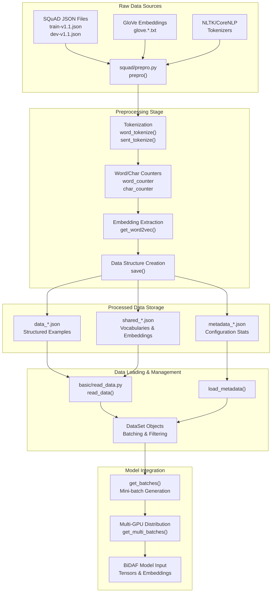
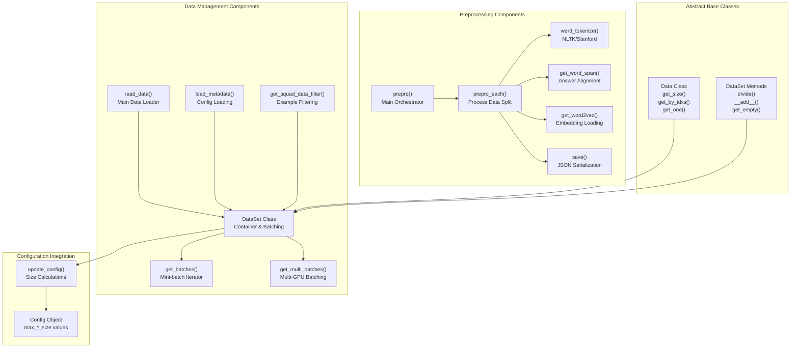
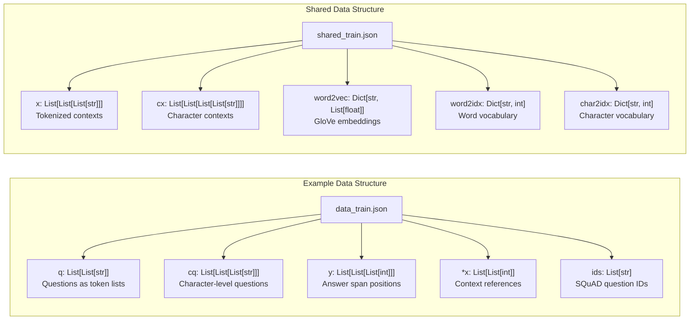
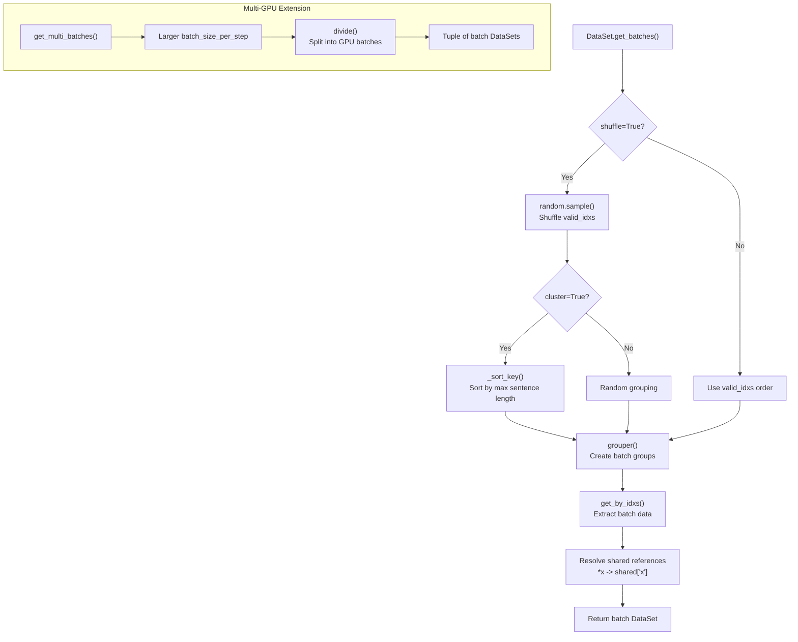
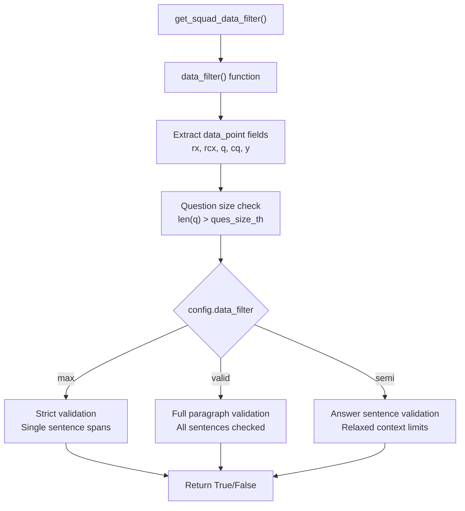

<!-- source: DeepWiki mcp.deepwiki.com · repo allenai/bi-att-flow · page 3 Data Pipeline · fetched 2026-10-26 -->

# Data Pipeline

Relevant source files

The following files were used as context for generating this wiki page:

- [basic/read_data.py](basic/read_data.py)
- [squad/prepro.py](squad/prepro.py)

The data pipeline system manages the complete flow of data from raw SQuAD JSON files through preprocessing, storage, and loading into the BiDAF model. This system handles tokenization, embedding integration, data filtering, batching, and multi-GPU data distribution. For model-specific data transformations, see [Model Architecture](#2.1). For training-specific data handling, see [Training Pipeline](#4.1).

## Data Flow Overview

The data pipeline transforms raw question-answer datasets through several stages before feeding them to the BiDAF model:

**Data Flow Architecture**

Sources: [basic/read_data.py:158-224](), [squad/prepro.py:55-82](), [squad/prepro.py:107-227]()

## Core Components

The data pipeline consists of two main subsystems with distinct responsibilities:

**Component Architecture**

Sources: [basic/read_data.py:14-39](), [basic/read_data.py:41-147](), [squad/prepro.py:107-227](), [basic/read_data.py:280-317]()

## Data Structures and Formats

The pipeline uses specific JSON structures to store processed data efficiently:

| File Type | Content | Key Fields |
|-----------|---------|------------|
| `data_*.json` | Example-specific data | `q` (questions), `cq` (char questions), `y` (answers), `*x` (context refs), `ids` |
| `shared_*.json` | Shared vocabularies & embeddings | `x` (contexts), `cx` (char contexts), `word2vec`, `word2idx`, `char2idx` |
| `metadata_*.json` | Dataset statistics | `max_*_size` values, vocabulary sizes |

**Data Structure Organization**

Sources: [squad/prepro.py:220-227](), [basic/read_data.py:161-164](), [basic/read_data.py:182-221]()

## Batching and Multi-GPU Support

The `DataSet` class provides sophisticated batching capabilities for efficient training:

**Batching Strategy Flow**

Sources: [basic/read_data.py:72-112](), [basic/read_data.py:114-119](), [basic/read_data.py:141-146]()

## Data Filtering and Validation

The system includes comprehensive filtering to ensure data quality and compatibility with model constraints:

| Filter Type | Purpose | Configuration |
|-------------|---------|---------------|
| `max` | Strict size limits | `num_sents_th`, `sent_size_th` |
| `valid` | Overall paragraph validation | Check all sentences |
| `semi` | Answer sentence validation | Only validate answer spans |
| `squash` | Paragraph-level processing | Flatten sentence structure |
| `single` | Single sentence answers | Answer spans within one sentence |

**Filtering Process**

Sources: [basic/read_data.py:227-277](), [basic/read_data.py:167-176]()

## Integration Points

The data pipeline integrates with several other system components:

- **Configuration System**: Updates `config` object with data-derived parameters via `update_config()` [basic/read_data.py:280-317]()
- **Model Architecture**: Provides vocabulary sizes and embedding dimensions [basic/read_data.py:308-310]()
- **Training Loop**: Supplies batched data through `get_batches()` and `get_multi_batches()` methods
- **Evaluation Framework**: Supports filtered datasets and custom data splits for testing

The pipeline ensures efficient memory usage through lazy loading, reference-based shared data storage, and configurable batch sizes to accommodate different GPU memory constraints.

Sources: [basic/read_data.py:104-109](), [basic/read_data.py:280-317](), [squad/prepro.py:14-17]()

---

