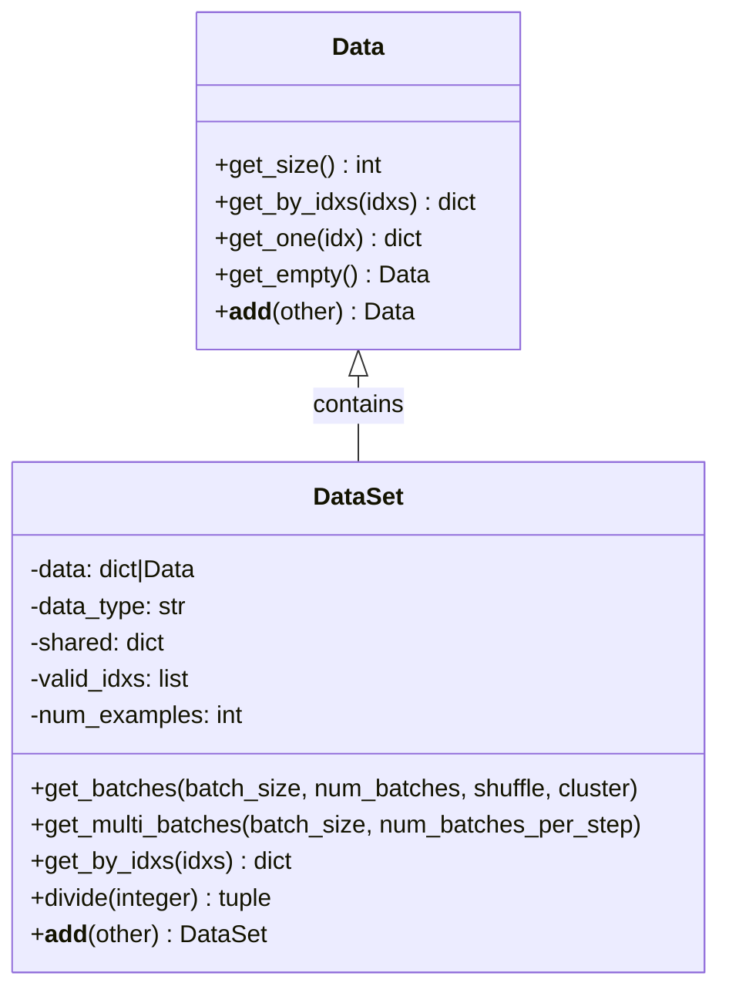
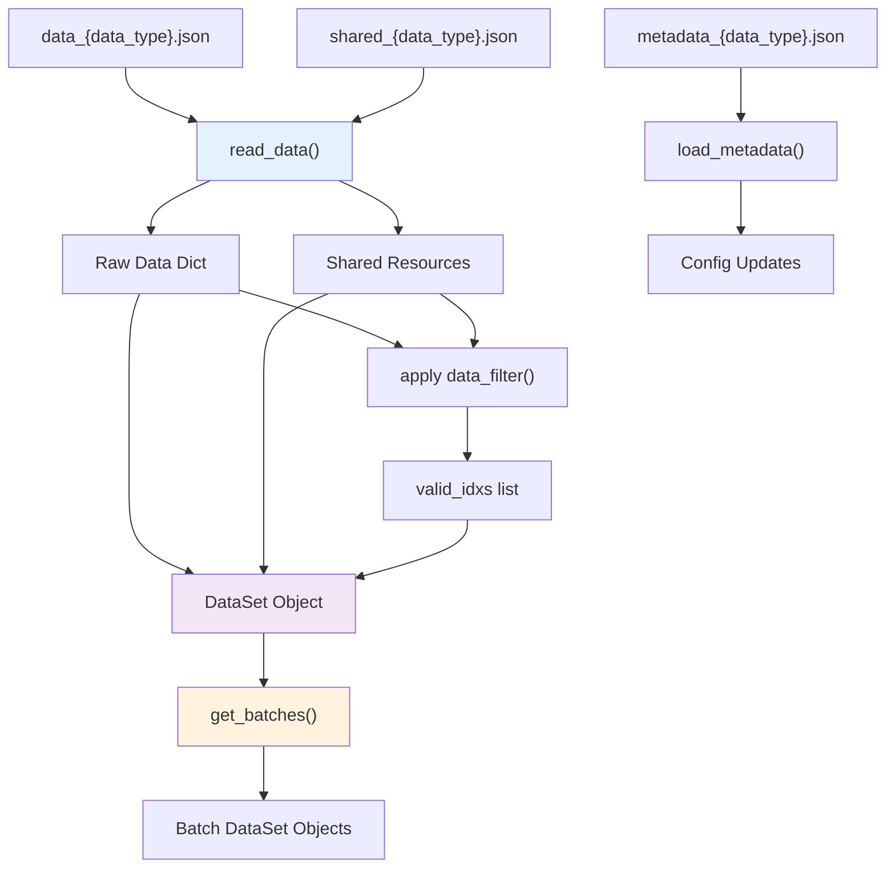
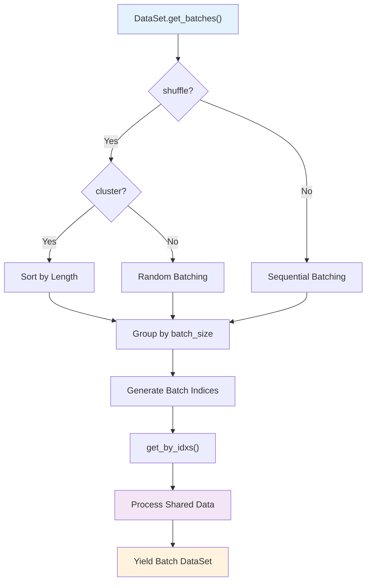
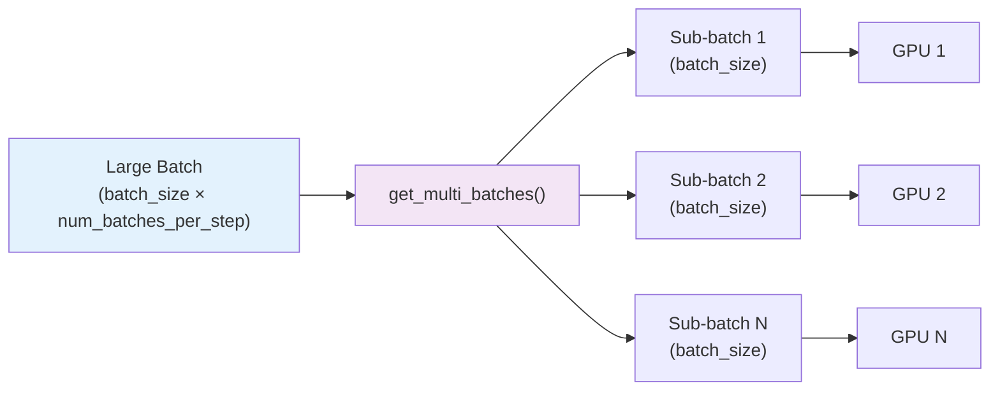
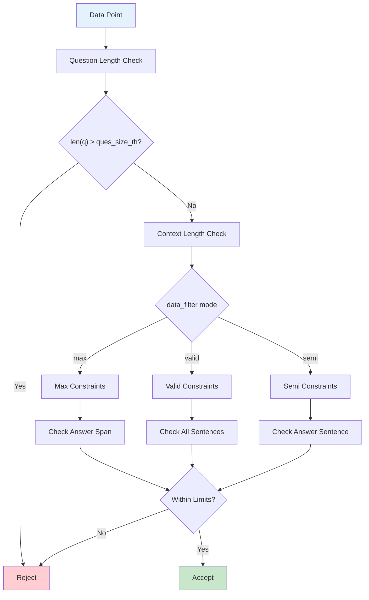
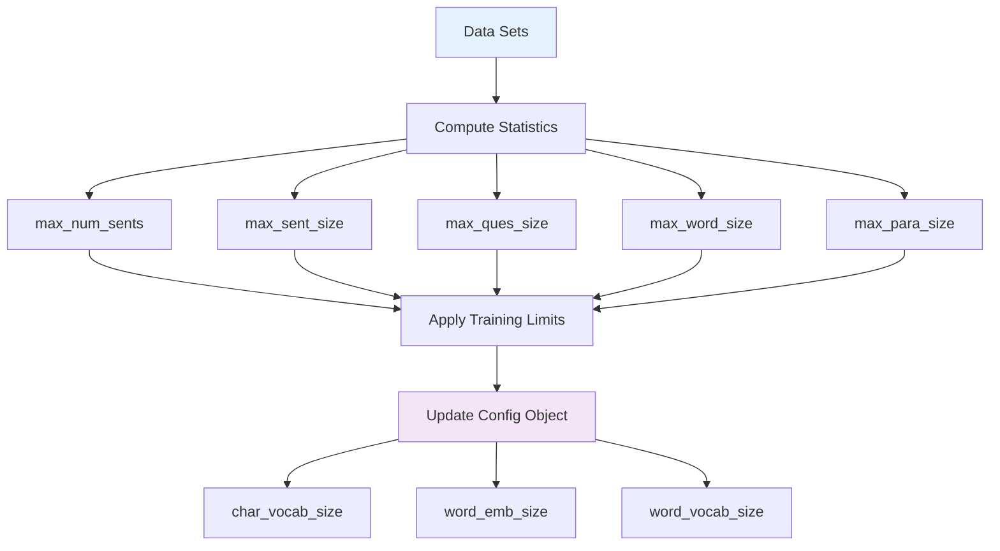

<!-- source: DeepWiki mcp.deepwiki.com · repo allenai/bi-att-flow · page 3.1 Data Loading and Management · fetched 2026-10-26 -->

# Data Loading and Management

<details>
<summary>Relevant source files</summary>

The following files were used as context for generating this wiki page:

- [basic/read_data.py](basic/read_data.py)

</details>


This document covers the core data loading and management system in the BiDAF repository. The system handles loading preprocessed data from JSON files, organizing it into batches for training and evaluation, and managing shared resources like word embeddings. For information about the preprocessing pipeline that creates this data, see [SQuAD Preprocessing](#3.2).

## Core Data Abstractions

The data management system is built around two main abstractions: the `Data` base class and the `DataSet` container class.

### Data Interface

The `Data` class [basic/read_data.py:14-38]() provides an abstract interface for data sources:



**Core Data Interface Methods**

| Method | Purpose | Return Type |
|--------|---------|------------|
| `get_size()` | Returns total number of examples | `int` |
| `get_by_idxs(idxs)` | Retrieves batch of examples by indices | `dict` |
| `get_one(idx)` | Retrieves single example by index | `dict` |
| `get_empty()` | Creates empty data container | `Data` |

Sources: [basic/read_data.py:14-38]()

### DataSet Container

The `DataSet` class [basic/read_data.py:41-147]() is the primary data container that wraps either dictionary data or `Data` objects:

**Key Attributes:**
- `data`: Raw data as dictionary or `Data` object
- `data_type`: String identifier for the dataset type
- `shared`: Shared resources like embeddings and vocabularies
- `valid_idxs`: List of valid example indices for filtering
- `num_examples`: Number of valid examples

Sources: [basic/read_data.py:41-48]()

## Data Loading Process

The data loading process transforms preprocessed JSON files into `DataSet` objects ready for model consumption.



**Data Loading Functions**

| Function | Purpose |
|----------|---------|
| `read_data(config, data_type, ref, data_filter)` | Main data loading function |
| `load_metadata(config, data_type)` | Loads dataset metadata into config |
| `get_squad_data_filter(config)` | Creates SQuAD-specific data filter |

Sources: [basic/read_data.py:149-224]()

### Shared Data Management

The system manages shared resources including word embeddings and vocabularies. During loading, it creates vocabulary mappings and handles GloVe embeddings:

**Vocabulary Creation Process:**
1. Word vocabulary (`word2idx`) based on frequency thresholds [basic/read_data.py:186-194]()
2. Character vocabulary (`char2idx`) based on frequency thresholds [basic/read_data.py:195-197]()
3. Special tokens: `NULL` (index 0) and `UNK` (index 1) [basic/read_data.py:198-203]()
4. GloVe integration for unknown words when `use_glove_for_unk` is enabled [basic/read_data.py:210-221]()

Sources: [basic/read_data.py:180-222]()

## Batching Strategies

The batching system provides flexible strategies for organizing data during training and evaluation.

### Basic Batching

The `get_batches()` method [basic/read_data.py:72-112]() supports multiple batching strategies:



**Batching Parameters:**

| Parameter | Purpose | Default |
|-----------|---------|---------|
| `batch_size` | Number of examples per batch | Required |
| `num_batches` | Total batches to generate | All available |
| `shuffle` | Randomize example order | `False` |
| `cluster` | Group by sequence length | `False` |

**Clustering Strategy:**
When `cluster=True`, examples are sorted by maximum sequence length using `_sort_key()` [basic/read_data.py:50-53]() to minimize padding and improve training efficiency.

Sources: [basic/read_data.py:72-112]()

### Multi-GPU Batching

The `get_multi_batches()` method [basic/read_data.py:114-119]() supports multi-GPU training by dividing large batches into smaller sub-batches:



Sources: [basic/read_data.py:114-119]()

### Shared Data Resolution

During batching, keys prefixed with `*` are resolved using the shared data dictionary [basic/read_data.py:104-109]():

```python
# Example: '*x' key references shared['x']
if key.startswith('*'):
    shared_key = key[1:]  # Remove '*' prefix
    shared_batch_data[shared_key] = [index(self.shared[shared_key], each) for each in val]
```

Sources: [basic/read_data.py:104-109]()

## Data Filtering and Validation

The system provides sophisticated filtering capabilities to ensure data quality and handle memory constraints.

### SQuAD Data Filter

The `get_squad_data_filter()` function [basic/read_data.py:227-277]() creates filters specific to SQuAD dataset requirements:



**Filter Modes:**

| Mode | Description | Constraints |
|------|-------------|-------------|
| `max` | Maximum constraints | Answer must be within single sentence and size limits |
| `valid` | Validation constraints | All sentences must be within size limits |
| `semi` | Semi-strict constraints | Only answer sentence must be within limits |

Sources: [basic/read_data.py:227-277]()

### Filter Criteria

The filtering system checks multiple criteria:

1. **Question Length:** `len(q) > config.ques_size_th` [basic/read_data.py:232-233]()
2. **Sentence Count:** `len(xi) > config.num_sents_th` [basic/read_data.py:258-259]()
3. **Sentence Length:** `len(xij) > config.sent_size_th` [basic/read_data.py:260-261]()
4. **Answer Span Constraints:** Single sentence answers when `config.single=True` [basic/read_data.py:244-247]()
5. **Paragraph Size:** Total paragraph length when `config.squash=True` [basic/read_data.py:237-242]()

Sources: [basic/read_data.py:227-277]()

## Configuration Management

The data loading system automatically updates model configuration based on loaded data characteristics.

### Dynamic Configuration Updates

The `update_config()` function [basic/read_data.py:280-317]() computes dataset statistics and updates configuration:



**Configuration Parameters Updated:**

| Parameter | Description | Source |
|-----------|-------------|---------|
| `max_num_sents` | Maximum sentences per paragraph | Computed from data |
| `max_sent_size` | Maximum words per sentence | Computed from data |
| `max_ques_size` | Maximum words per question | Computed from data |
| `max_word_size` | Maximum characters per word | Computed from data |
| `char_vocab_size` | Character vocabulary size | `len(shared['char2idx'])` |
| `word_vocab_size` | Word vocabulary size | `len(shared['word2idx'])` |
| `word_emb_size` | Word embedding dimension | GloVe vector size |

**Training Mode Limits:**
During training, maximum sizes are capped by threshold values [basic/read_data.py:301-306]():
- `max_num_sents = min(max_num_sents, num_sents_th)`
- `max_sent_size = min(max_sent_size, sent_size_th)`
- `max_para_size = min(max_para_size, para_size_th)`

Sources: [basic/read_data.py:280-317]()

---

